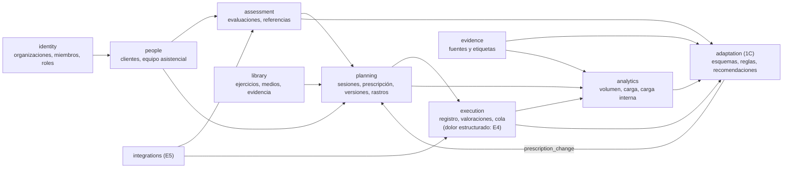

# Arquitectura

TrainPro es un **monolito modular** en una única aplicación Next.js (App Router) con TypeScript estricto. Un solo proyecto sirve las dos experiencias, entrenador y cliente, con permisos aplicados siempre en el servidor.

## Capas y reglas de dependencia

```
            ┌──────────────┐
            │   src/app    │  Rutas: orquestan, no contienen lógica de negocio
            └──┬────────┬──┘
               │        │
     ┌─────────▼──┐  ┌──▼──────────┐
     │ src/server │  │ src/features│  Pantallas por área (React)
     │ (solo      │  └──┬──────────┘
     │ servidor)  │     │      ┌─────────┐
     └──┬─────────┘     ├─────►│ src/ui  │  Componentes genéricos
        │               │      └─────────┘
        │   ┌───────────▼──┐
        ├──►│src/contracts │  Tipos de los datos que llegan a la interfaz
        │   └───────────┬──┘
        │   ┌───────────▼──┐
        └──►│  src/domain  │  TypeScript puro: modelo, reglas, permisos, fórmulas
            └──────────────┘
```

| Capa        | Puede importar                         | No puede importar                     |
| ----------- | -------------------------------------- | ------------------------------------- |
| `domain`    | nada del proyecto, ni React ni Next    | todo lo demás                         |
| `contracts` | `domain` (solo tipos)                  | código ejecutable                     |
| `server`    | `domain`, `contracts`, Next (servidor) | `app`, `features`, `ui`               |
| `ui`        | React, Next                            | `domain`, `server`, `features`, `app` |
| `features`  | `domain`, `contracts`, `ui`            | `server`, `app`                       |
| `app`       | todo                                   | —                                     |

Actores: `trainer`, `client` y `admin` (administración del catálogo de ejercicios; no accede a datos de clientes). Estas reglas **se comprueban automáticamente** con ESLint (`no-restricted-imports` en `eslint.config.mjs`); `pnpm lint` falla si alguien se las salta. Además, cada módulo de `src/server` importa `server-only`: si un componente de cliente lo importara por error, la compilación fallaría y ese código nunca llegaría al navegador.

Dos reglas más desde V1 (`V1_SPEC.md` §8.3.4):

- el controlador `better-sqlite3` solo se importa en `src/server/db/sqlite.ts`;
- el adaptador `src/server/repositories/sqlite/*` solo se importa desde la composición, `src/server/db/store.ts`, y desde las pruebas.

Los módulos de `src/server/db` que usa también la herramienta de copias (`sqlite.ts`, `migrate.ts`, `backup.ts`, `location.ts`, `lock.ts` y la migración) no importan `server-only` ni alias `@/`: Node 26 los ejecuta directamente desde `scripts/db.ts`.

## Flujo de una petición

1. La ruta (por ejemplo `src/app/entrenador/clientes/[clientId]/page.tsx`) obtiene el **contexto**: `getTrainerContext()` o `getClientContext()` en `src/server/context.ts`. El contexto contiene el **actor** (quién pide), el día de hoy en la zona horaria configurada y los repositorios.
2. Llama a un **caso de uso** (`src/server/services/*`), que lee los repositorios y aplica las **políticas de acceso** del dominio (`src/domain/access.ts`).
3. El caso de uso devuelve un **modelo de vista** plano (`src/contracts/*`) que ya contiene solo lo permitido. Si el recurso no existe o el actor no tiene acceso, devuelve `null` y la ruta responde 404, sin revelar cuál de las dos cosas ocurre.
4. La ruta pasa ese modelo a los componentes de `src/features`. Los componentes interactivos (`'use client'`) solo reciben datos ya filtrados.

Todas las páginas con datos se renderizan en cada petición (`await connection()` en el contexto). Así «hoy» nunca queda congelado en el momento de compilar y la autenticación real encajará sin cambios estructurales.

## Lógica compartida entre servidor y cliente

Algunas reglas del dominio se ejecutan también en el navegador, siempre con **la misma función**. Por ejemplo, el reproductor de sesión usa `summarizeExecution` y `deriveSessionStatus` (`src/domain/training/session.ts`), igual que el servidor, para que el estado y los cálculos coincidan. El dominio no depende de React ni de Next, así que puede importarse en componentes de cliente.

## Datos: puertos y adaptadores

```
dominio (puro) → casos de uso (políticas) → puertos → adaptador SQLite → src/server/db/sqlite.ts → better-sqlite3
```

- **Puertos** (`src/server/repositories/ports.ts`): interfaces asíncronas por agregado. Desde V1, `TrainingRepository` cubre la prescripción v2: borradores con revisión, publicación idempotente, versiones inmutables y lectura de la ejecución. Cada escritura es **una transacción `BEGIN IMMEDIATE`** y devuelve un resultado explícito (`created`/`exists`, `saved`/`unchanged`/`conflict`, `published`/`already_published`/`conflict`…).
- **Adaptador SQLite** (`src/server/repositories/sqlite/`): todo el SQL vive aquí, en un subconjunto portable a PostgreSQL (sin `rowid`, sin `INSERT OR REPLACE`, sin funciones de fecha en la lógica). Las pantallas de la Fase 1 leen a través de la **capa de compatibilidad** (`src/domain/training/compat.ts`): solo ven sesiones publicadas, en su versión vigente.
- **Composición** (`src/server/db/store.ts`): una conexión por archivo, guardada en `globalThis`. Al abrir aplica las migraciones pendientes, con una copia previa si la base ya tenía datos, y siembra la base si está vacía. Los datos de referencia de solo lectura (biblioteca, objetivos, evaluaciones, readaptación, compartición) siguen en el código y se generan con la **fecha de la semilla** (`meta.seed_date`).
- **Base** (`src/server/db/`): `sqlite.ts` abre con WAL, `synchronous=FULL`, `foreign_keys=ON` y `busy_timeout=5000`. `migrate.ts` aplica las migraciones en orden y con suma de comprobación; si una ya aplicada cambia, el arranque falla. `backup.ts` hace copias en línea verificadas y restaura (`integrity_check`, claves ajenas y migraciones). `seed.ts` convierte la demostración al modelo v2. La migración `001` tiene `CHECK`, claves ajenas compuestas, un índice único parcial y disparadores de inmutabilidad.
- **Adaptador en memoria** (`src/server/repositories/demo/`): ya no lo usa la aplicación. Queda como **referencia de la prueba de equivalencia**: las pantallas existentes deben ver lo mismo con los dos adaptadores (`compat.equivalence.test.ts`).
- Los repositorios **no deciden permisos**: lo hacen los casos de uso con las políticas del dominio. Con PostgreSQL se añadirá una segunda barrera en la base de datos (Row Level Security).
- `TRAINPRO_DATA_SOURCE` solo acepta `sqlite`. La migración a PostgreSQL (Fase 2) sigue el plan de `V1_SPEC.md` §8.3.4: un adaptador nuevo de los mismos puertos que pase las mismas pruebas de contrato.

## Registro sin conexión y envío idempotente (propuesta, ADR-22)

Diseño pendiente de aprobación para el portal del cliente (`TRAINING_EXPERIENCE.md` §4). No añade dependencias: usa APIs del navegador. V1 aplica un subconjunto (`V1_SPEC.md` §5.5): una lista local de pendientes en `localStorage`, con estados y reintentos; IndexedDB y el registro completo sin conexión llegan en V2. **Nota (13 nov 2026):** el bloque 2 de V1 ya usa IndexedDB (ADR-24, `EXECUTION.md` §6); abrir la app sin conexión sigue en V2. Ver `AUDIT_BLOCK1.md` §5.

1. Al abrir «Hoy» con conexión, el portal guarda en el dispositivo la sesión del día (y la siguiente), con su prescripción, las indicaciones y las siluetas. Los vídeos no se guardan (P-30).
2. Cada serie registrada se guarda **primero en IndexedDB** con un `clientSetId` (UUID generado en el dispositivo) y pasa a una **cola de envío**.
3. La cola se envía al abrir la app, al volver a ella (`visibilitychange`) y al recuperar la conexión (`online`). iOS no admite la sincronización en segundo plano, así que no se depende de ella.
4. El servidor recibe los envíos en un **caso de uso idempotente** (`recordSetLogs`): comprueba con `canLogExecution` que el actor es el cliente de esa sesión publicada, ignora los `clientSetId` ya recibidos y guarda las correcciones como versiones (`supersedes`). La restricción única de la base de datos es la segunda barrera.
5. La interfaz distingue «Guardado en el móvil» de «Enviado». Si al cerrar sesión quedan series sin enviar, se avisa antes de borrar los datos locales.
6. Las series efectivas se calculan con la misma función del dominio en el servidor y en el portal, como ya ocurre con `effectiveSetRecords`.

El temporizador de descanso se calcula a partir de la hora de fin y del reloj monótono (`performance.now()`), así que es correcto aunque se bloquee la pantalla. Mantener la pantalla encendida (API Wake Lock) se usará donde el navegador lo permita.

## Recursos visuales (propuesta, ADR-21)

Un puerto `MediaStorage` en `src/server` (subir con URL firmada, obtener URL de lectura, firmada o pública según la visibilidad, y borrar) aísla el proveedor de almacenamiento. El caso de uso comprueba `canViewMedia` antes de firmar una URL. Detalle en `MEDIA.md`.

## Evolución hacia un producto comercial (propuesta)

Pendiente de aprobación (`PRODUCT_STRATEGY.md`, P-51 y siguientes). Principio: **monolito modular**, sin microservicios. Se separan módulos dentro del mismo proyecto y solo se extrae un servicio si una carga concreta lo exige y se mide.

### Módulos

Cada módulo tiene su carpeta en `domain`, `server/services` y `contracts`, y solo se comunica con los demás por su interfaz pública (reglas de ESLint por módulo, como las de las capas actuales). Es el destino, no el punto de partida: en la 1B se crea la carpeta de un área solo cuando aparece su código, y las reglas por módulo, cuando el código lo justifique; no se crean módulos vacíos (`IMPLEMENTATION_READINESS.md` §7):

- `identity` (organizaciones, centros, miembros y roles);
- `people` (clientes y equipos asistenciales);
- `library`;
- `assessment`;
- `planning` (planes, sesiones y prescripción);
- `execution` (registro, valoración previa y RPE de la sesión);
- `analytics` (volumen y carga);
- `adaptation` (progresiones, reglas, recomendaciones y registro de decisiones);
- `rehab`;
- `evidence`;
- `media`;
- `integrations`;
- `reporting`;
- `messaging`.

### Inquilinos y permisos

- **Organización como inquilino** desde el primer esquema (Fase 2). Un entrenador independiente es una organización de una persona, de modo que añadir centros y equipos (E7) no exige migrar los datos.
- Cada fila lleva `organization_id`. RLS filtra por organización y por la relación con el cliente.
- Los permisos pasan de «entrenador responsable» a **equipo asistencial** (`client_care_team`): cada profesional tiene un rol (entrenador, readaptador, fisioterapeuta, observador) y un alcance (entrenamiento, evaluaciones, salud). Las políticas de `src/domain/access.ts` se amplían con esos roles, con tests de acceso no autorizado.

### Motor de reglas

- Funciones **puras** del dominio: reciben una instantánea de los datos y devuelven recomendaciones con su explicación. Sin acceso a red ni a base de datos, deterministas y versionadas.
- Se ejecutan en el servidor y, para las reglas preautorizadas previas a la sesión, también en el móvil sin conexión, con la misma función (como `summarizeExecution`).
- El **registro de decisiones** es una tabla de primera clase, de solo adición (`PROGRESSION_AND_AUTOREGULATION.md` §5.5).

### Versionado y auditoría

- Tienen versión: prescripciones (versión de la sesión), reglas, fórmulas, correspondencias de integraciones y fuentes de evidencia (fecha de revisión).
- Auditoría de los accesos a datos de salud, de los cambios en lo compartido y de las decisiones del motor. No se usa _event sourcing_ completo: solo registros de adición donde la trazabilidad lo exige.

### IA y servicios externos

Un puerto `AssistantPort` aísla cualquier proveedor de IA. **No se conecta ninguno hasta aprobar** el proveedor, la región (UE), el contrato de tratamiento, el coste y la base jurídica (P-55). Las salidas se etiquetan como generadas y requieren la revisión del profesional.

### Escalabilidad

- PostgreSQL con índices por organización y fecha.
- Partición por tiempo de `set_log` cuando el volumen lo justifique.
- Trabajos en segundo plano para los agregados y la importación, solo cuando haga falta.
- Costes en `INFRASTRUCTURE.md`.

## Decisiones estructurales propuestas para la Fase 1B (P-51, P-52 y P-62 a P-67)

El objetivo es que la 1B, aunque use datos ficticios, **no obligue a reconstruir** nada en la 1C ni en la Fase 2. Se separa lo que hay que preparar de lo que se implementa y de lo que puede esperar.

> **Revisado en la auditoría de preparación (7 de noviembre de 2026).** Esta tabla preparaba en la 1B más de lo necesario. La columna «Clase» recoge la clasificación vigente del §7 de `IMPLEMENTATION_READINESS.md`: **A**, implementar ahora; **B**, preparar ahora con una decisión de diseño sencilla; **C**, construir cuando haga falta. En resumen: organización y equipo asistencial, en el esquema de la Fase 2 (P-51, P-52); historial por (cliente, variante) y `trackId` solo en la 1C, si hace falta (P-62); versiones en la 1B y modelo de cambios en la 1C (P-63); la escala, como un campo (P-64); una sola cola local para la sesión (P-65); y la zona horaria de la aplicación (P-66). Las demás columnas conservan la propuesta anterior.

| Área                                       | Preparación arquitectónica necesaria en la 1B                                                                                                        | Funcionalidad que se implementa en la 1B                         | Puede esperar                                                                                      | Coste de no fijarlo ahora                                                 | Clase                                                                                 |
| ------------------------------------------ | ---------------------------------------------------------------------------------------------------------------------------------------------------- | ---------------------------------------------------------------- | -------------------------------------------------------------------------------------------------- | ------------------------------------------------------------------------- | ------------------------------------------------------------------------------------- |
| **Clientes y organizaciones** (P-51, P-52) | `organizationId` en todos los agregados; `membership` (usuario, organización, rol); `careTeam` del cliente con un responsable principal y alcances   | Una organización demo con un entrenador; crear y editar clientes | Centros, grupos, varios profesionales, interfaz de equipo (E7); acceso entre organizaciones (P-73) | Migrar todas las tablas y reescribir las políticas RLS en la Fase 2       | C (Fase 2). En la 1B, crear y editar clientes, sin organización                       |
| **Prescripción por serie** (ADR-20, P-41)  | Valores comunes + excepciones por serie; modalidades de carga y escalas tipadas                                                                      | Editor y reproductor por serie                                   | —                                                                                                  | Rehacer el editor, el reproductor y los cálculos                          | A                                                                                     |
| **Versiones de sesión**                    | Versiones inmutables; cada serie registrada apunta a la versión en vigor cuando se hizo                                                              | Publicar, editar y avisar al cliente                             | Comparar versiones visualmente a gran escala                                                       | Perder la trazabilidad de lo prescrito                                    | A; la comparación visual, B                                                           |
| **Rastro de progresión** (P-62)            | `trackId` opcional en cada ejercicio prescrito (cliente + variante + contexto), estable entre sesiones y versiones                                   | Se asigna al duplicar o planificar; visible en el historial      | Esquemas de progresión que lo usan (1C)                                                            | La 1C no podría saber qué ejercicios de sesiones distintas son «el mismo» | C (1C, si hace falta); en la 1B, (cliente, variante)                                  |
| **Cambios de prescripción** (P-63)         | Un único modelo `prescription_change` con origen (`manual`, `supervised`, `preauthorized`), autor, fecha, motivo y diferencias                       | Historial y trazabilidad de los cambios manuales                 | Orígenes del motor (1C)                                                                            | Dos historiales incompatibles entre la 1B y la 1C                         | C (1C); en la 1B, versiones con autor y fecha                                         |
| **Registro de ejecución** (ADR-22)         | Registro de solo adición, `clientSetId`, `supersedes`, procedencia por dato                                                                          | Registro, correcciones y series sin duplicados                   | —                                                                                                  | Contar series dos veces o perder correcciones                             | A                                                                                     |
| **Cola de envío** (P-65)                   | Comandos idempotentes genéricos (serie, valoración previa, dolor, RPE de la sesión, nota)                                                            | Envío sin conexión y reintentos                                  | Sincronización en segundo plano (no existe en iOS)                                                 | Una cola distinta por tipo de dato                                        | A, solo para lo que escribe el cliente en la sesión; sin dolor y no genérica          |
| **Valoraciones subjetivas** (P-64)         | `instrument` + `item` + versión de la escala en cada respuesta (valoración previa, RPE de la sesión, escalas de RPE, dolor, calidad)                 | Recogida y visualización                                         | Instrumentos validados opcionales (E3)                                                             | Mezclar respuestas de escalas distintas al cambiar la escala              | A, como un campo de escala con versión; sin `instrument` ni dolor                     |
| **Cálculos de carga**                      | Funciones puras y versionadas en el registro de fórmulas; resultados recalculables, no guardados                                                     | Volumen y tonelaje por tipo (P-36)                               | Carga interna (1C) y volumen por músculo (E3)                                                      | Cifras que no se pueden reproducir                                        | A                                                                                     |
| **Unidades y tiempo** (P-66)               | Unidades canónicas (kg, s, m) con la unidad en cada valor; fechas con la zona horaria del cliente                                                    | Visualización en kg                                              | Libras y otras unidades de visualización                                                           | Errores de conversión y sesiones que cambian de día                       | B (unidad en el nombre del campo, zona horaria de la aplicación); zona por cliente, C |
| **Integraciones**                          | Modelo de medición con procedencia `imported`, dispositivo y lote, igual para series y evaluaciones                                                  | Transcripción manual con procedencia (P-25)                      | Importación de CSV (E2) y API (E5)                                                                 | Datos importados sin trazabilidad                                         | B (la procedencia `imported` ya existe); transcripción manual, iteración B            |
| **Permisos**                               | Políticas con la forma `puede(actor, acción, recurso)`, con la organización, el equipo asistencial y el alcance (entrenamiento, evaluaciones, salud) | Políticas nuevas con tests de acceso no autorizado               | Roles adicionales (E7)                                                                             | Reescribir todas las políticas al añadir roles                            | A, con el actor y el recurso; organización, equipo y alcance de salud, C              |
| **Historial de decisiones**                | Registro de solo adición compartido con `prescription_change`                                                                                        | Cambios manuales                                                 | Recomendaciones y decisiones del motor (1C)                                                        | Auditoría incompleta                                                      | C (1C)                                                                                |
| **Datos de referencia** (P-67)             | `normative_reference` con fuente, población y verificación; referencias del cliente (1RM, peso corporal, línea base) como mediciones                 | Referencias del cliente                                          | Valores normativos poblacionales verificados (E2)                                                  | Comparaciones con referencias sin fuente                                  | A, las del cliente; poblacionales, B (estructura sin valores)                         |

### Terminología (P-52)

- **Miembro de la organización** (`membership`): profesional que trabaja en una organización, con un rol.
- **Equipo asistencial** (`care_team`): profesionales que atienden a **un cliente**, cada uno con su alcance.
- **Equipo deportivo o grupo** (`team`, `group`): conjunto de clientes o deportistas que se planifican juntos (E7).

Así no se confunden «el equipo de un club» y «los profesionales que atienden a una persona».

### Mapa de dependencias entre módulos



**Regla:** `adaptation` solo modifica la planificación a través de `prescription_change`, nunca directamente. Las dependencias van siempre en el sentido de las flechas y se comprueban con ESLint, como las capas actuales.

### Acceso entre organizaciones (P-73, diseñado, no construido)

Si en el futuro un cliente trabaja con un centro y una clínica distintos, cada organización conserva sus datos. Compartirlos exigirá una **concesión explícita** (`access_grant`: quién, qué alcance, hasta cuándo) con el consentimiento del cliente. No se implementa hasta E7, pero las políticas de permisos ya reciben la organización del recurso, así que añadirlo no exigirá rehacerlas.

## Sesión de demostración y protección local

No hay autenticación. Identidad, rol y permiso están separados (`V1_SPEC.md` §7):

1. **Identidad** (`resolveIdentity` en `src/server/context.ts`): solo con `TRAINPRO_MODE=local-demo`. El área del entrenador es la de Alex; en la del cliente, la persona elegida en «Entrar como…» (cookie `trainpro-cliente`, validada contra las identidades ficticias de la semilla; Marta por defecto). **No es autenticación.** Sin el modo local no hay ninguna identidad y las áreas privadas vuelven a la portada.
2. **Rol**: el actor sale de la base (entrenador o cliente vinculado a su entrenador).
3. **Permiso**: las políticas de `access.ts` en cada caso de uso (`canPlanForClient`, `canEditSession`, `canViewSession`, `canManageDemoData`…).

En la Fase 2 solo cambia el paso 1: la identidad saldrá de una sesión verificada.

**Protección del prototipo local (P-87):**

- `next dev` y `next start` escuchan solo en `127.0.0.1` (`-H 127.0.0.1` en los scripts).
- `src/proxy.ts` rechaza con `403` cualquier `Host` o `X-Forwarded-Host` que no esté en `TRAINPRO_ALLOWED_HOSTS` (por defecto `localhost` y `127.0.0.1`), también los archivos estáticos: protege frente al DNS rebinding.
- Las acciones de servidor comprueban el origen (Next.js compara `Origin` con `Host`).
- El archivo de datos tiene permisos `600` y la carpeta `700` (Linux y macOS).

**Espacios de prueba:** con `TRAINPRO_DEMO_SPACES=on` (solo E2E), la cookie `trainpro-espacio` elige un archivo SQLite aparte, sembrado al primer uso, para que las pruebas que escriben no se pisen.

## Estructura de carpetas

```
src/app/
  layout.tsx, globals.css        Raíz: fuentes, metadatos, tokens de diseño, service worker
  page.tsx, actions.ts           Portada y «Entrar como…» (acción de servidor)
  manifest.ts, icon.svg, apple-icon.png   PWA
  not-found.tsx, error.tsx       Páginas de error propias
  entrenador/                    Área del entrenador (layout con barra lateral)
    page.tsx                     Panel
    clientes/                    Lista de clientes
    clientes/[clientId]/         Ficha con pestañas horizontales (layout + una ruta por pestaña):
      page.tsx                   Información
      objetivos/ evaluaciones/ resultados/ planificacion/
      sesiones/                  A3 por días · nueva/ (A4) · [sessionId]/ (A7) · [sessionId]/editar/ (A5) · actions.ts
      registro/ informes/ salud/ compartido/
    evaluaciones/, analisis/     Catálogo y últimos resultados · evolución y comparaciones
    planificacion/, carga/, readaptacion/, informes/
    configuracion/               Ajustes; datos de la demostración (copias y restablecer) con actions.ts
    ejercicios/, ejercicios/[exerciseId]/   Biblioteca (buscador avanzado) y ficha de variante
  cliente/                       Portal del cliente (columna móvil)
    (pestanas)/                  Grupo con navegación inferior: Hoy, Semana, Progreso
    sesion/[sessionId]/          Detalle de la sesión publicada (B2)
    sesion/[sessionId]/entrenar/ Reproductor por pasos del bloque 2 (guarda en el servidor; antes, el de la Fase 1)
src/proxy.ts                     Protección local: Host permitido o 403
src/domain/                      access, issues, measurement, formulas, assessment, goals, people, rehab,
                                 time, text, format, library/{taxonomy, exercise, search},
                                 training/{prescription, session, volume, load, effort, session-v2,
                                 execution, compat}
src/server/                      env, context, host-guard,
                                 db/{sqlite, migrate, migrations/001-v1, seed, store, backup, location, lock},
                                 repositories/{ports, sqlite/{index, training, rows}, demo/{dataset, library, index}},
                                 services/{trainer, trainer-access, trainer-sessions, client-file, client,
                                 client-sessions, session-views, demo-data, library, mappers}
src/contracts/                   shared, trainer, client, sessions
src/features/                    brand/, shared/, trainer/, client/
src/ui/                          button, card, badge, avatar, stat, meter, notice, page-header, empty-state, cn
```

El modelo de datos completo (también lo que aún es conceptual) está en `DATA_MODEL.md`. El diseño de la experiencia guiada, la prescripción v2 y los recursos visuales, pendiente de aprobación, está en `TRAINING_EXPERIENCE.md`, `EFFORT_AND_LOAD.md` y `MEDIA.md`. La estrategia, la progresión y autorregulación y las integraciones están en `PRODUCT_STRATEGY.md`, `PROGRESSION_AND_AUTOREGULATION.md` e `INTEGRATIONS.md`.

## Cómo ampliar

- **Nueva pantalla**: crea la ruta en `src/app`, obtén el contexto, llama a un caso de uso y pasa el resultado a un componente de `src/features`. No consultes repositorios directamente desde la ruta.
- **Nuevo dato**: añade el tipo en `src/domain`, el método en el puerto y en el adaptador SQLite (con su prueba de contrato), la migración nueva si cambia el esquema (nunca se edita una ya aplicada), el caso de uso con su comprobación de permisos y el modelo de vista en `src/contracts`. Escribe tests del caso de uso que incluyan el intento de acceso no autorizado.
- **Nuevo cálculo**: regístralo en `src/domain/formulas.ts` con id, versión y limitaciones; si es científico, con su referencia verificada (ver `SCIENTIFIC_RIGOR.md`).
