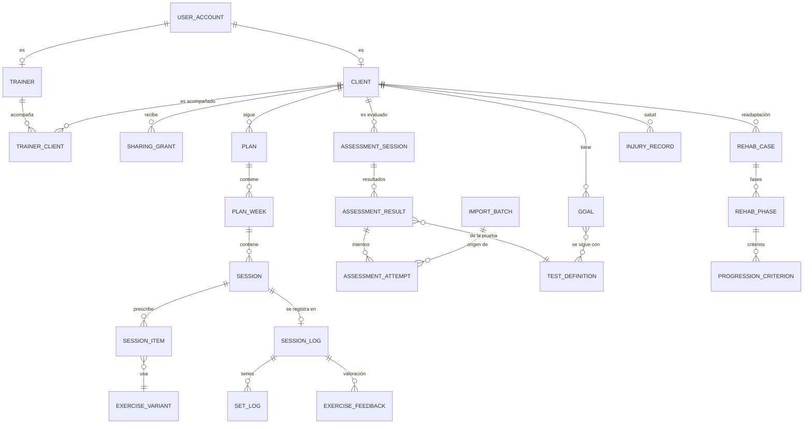
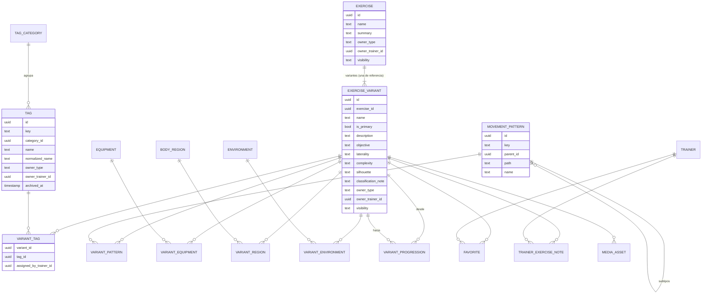

# Modelo conceptual de datos

Diseño relacional y normalizado para PostgreSQL, que se implementará en fases posteriores. En la Fase 1 **no hay base de datos**: parte del modelo ya existe como tipos de TypeScript en `src/domain` (los usa el adaptador demo en memoria) y el resto es conceptual. Cada sección indica qué está implementado.

## Principios

1. **Normalización.** Nada de listas en campos de texto: las etiquetas, patrones, materiales, regiones y entornos se relacionan con tablas intermedias (muchos a muchos).
2. **Identificadores estables.** Las filas de usuario usan UUID. La taxonomía del sistema usa además una **clave textual estable** (`key`, por ejemplo `push.horizontal`) que nunca se reutiliza ni se renombra; el nombre visible sí puede cambiar.
3. **Propietario y visibilidad** en todo lo que se puede compartir: `owner_type` (`system` | `trainer`), `owner_trainer_id` y `visibility` (`global` | `trainer` | `private`).
4. **Procedencia en cada medición**: origen (`direct`, `calculated`, `estimated`, `imported`, `self_reported`), método, instrumento, fórmula con su versión, importación de origen, fecha de medición, fecha de registro y autor.
5. **Fórmulas versionadas**: los resultados guardan `formula_key` y `formula_version`. Si cambia una fórmula, se crea una versión nueva y los resultados antiguos conservan la suya.
6. **Datos de salud separados** del resto, con permisos y cifrado reforzados.
7. **Seguridad en dos capas**: los casos de uso aplican las políticas (`src/domain/access.ts`) y la base de datos repite el aislamiento con Row Level Security (RLS) por entrenador y cliente.
8. **Archivar antes que borrar** lo que está referenciado (por ejemplo, etiquetas), con políticas de conservación explícitas.

## Vista general

## 1. Identidad, roles y relación entrenador–cliente

**Estado:** conceptual. En la Fase 1 el actor es fijo (`Actor` en `src/domain/access.ts`).

| Entidad          | Campos principales                                                                                      | Notas                                                                    |
| ---------------- | ------------------------------------------------------------------------------------------------------- | ------------------------------------------------------------------------ |
| `user_account`   | id, email (único), estado, created_at                                                                   | Lo gestiona el proveedor de autenticación (pendiente de elegir).         |
| `trainer`        | id, user_id, display_name                                                                               | Rol de entrenador.                                                       |
| `client`         | id, user_id (opcional mientras no haya invitación), display_name, population, sport, started_on, status | Datos mínimos; la salud va aparte.                                       |
| `trainer_client` | trainer_id, client_id, status, started_at, ended_at                                                     | Hoy, un cliente tiene un único entrenador responsable.                   |
| `consent`        | id, client_id, type, text_version, granted_at, revoked_at                                               | Necesario antes de tratar datos de salud.                                |
| `team` (futuro)  | id, name; `team_member` (team_id, trainer_id, role)                                                     | Para compartir ejercicios con visibilidad `trainer` dentro de un equipo. |

## 2. Cliente: objetivos, métricas visibles y compartición

**Estado:** `Client`, `Goal` y `SharingSettings` implementados en el dominio con datos demo; `metric_profile` es conceptual.

| Entidad          | Campos principales                                                                                                                                                |
| ---------------- | ----------------------------------------------------------------------------------------------------------------------------------------------------------------- |
| `goal`           | id, client_id, title, area, status, started_on, target_date, notes                                                                                                |
| `goal_test`      | goal_id, test_definition_id (pruebas con las que se sigue el objetivo)                                                                                            |
| `metric_profile` | id, owner, population, goal_area, name; `metric_profile_item` (profile_id, test_definition_id, order): métricas visibles configurables según población y objetivo |
| `sharing_grant`  | id, client_id, resource (`assessments`, `volume`, `rehab`, `reports`…), scope (por ejemplo, una prueba concreta), granted_by, granted_at, revoked_at              |

`sharing_grant` sustituye a los booleanos actuales de `SharingSettings`. Cada cambio queda registrado (alta o revocación con fecha y autor), y sin concesión no se comparte nada.

## 3. Biblioteca de ejercicios (multidimensional)

**Estado:** implementada en el dominio (`src/domain/library/`) y en los datos demo. Incluye la taxonomía del sistema, las variantes con clasificación propia, las progresiones, las etiquetas personales, los favoritos, las notas y la búsqueda Y/O con jerarquías. La persistencia queda para la Fase 4.

### Entidades

| Entidad                                                                    | Contenido                                                                                                                                                                                           | Reglas                                                                                                                                                                                                          |
| -------------------------------------------------------------------------- | --------------------------------------------------------------------------------------------------------------------------------------------------------------------------------------------------- | --------------------------------------------------------------------------------------------------------------------------------------------------------------------------------------------------------------- |
| `exercise`                                                                 | Ejercicio principal (p. ej., «Sentadilla»)                                                                                                                                                          | Agrupa variantes; tiene su propio propietario y visibilidad.                                                                                                                                                    |
| `exercise_variant`                                                         | Variante concreta y prescribible (p. ej., «Sentadilla frontal»): descripción, objetivo y aplicaciones, ejecución (bilateral, unilateral o alternante), complejidad, silueta y nota de clasificación | Cada principal tiene **exactamente una** variante de referencia (`is_primary`). La variante **no hereda** etiquetas, patrones ni material. Si no tiene instrucciones propias, se muestran las de la referencia. |
| `variant_step`, `variant_cue`, `variant_mistake`, `variant_technical_note` | Instrucciones, puntos clave, errores frecuentes y consideraciones técnicas, ordenados                                                                                                               | Tablas hijas con `ordinal` (en el dominio son listas).                                                                                                                                                          |
| `tag_category` / `tag`                                                     | Categorías (Capacidades y objetivos, Métodos y contracciones, Control y estabilidad) y etiquetas                                                                                                    | Globales (`owner_type = system`) o personales del entrenador. Índice único en (`owner`, `normalized_name`) y comprobación frente a las globales: **no hay duplicados**. Se archivan, no se borran.              |
| `variant_tag`                                                              | Relación variante–etiqueta                                                                                                                                                                          | `assigned_by_trainer_id` nulo = asignación del catálogo, visible para todos. Si tiene valor, es una **etiqueta personal** sobre cualquier variante (también global) y solo la ve ese entrenador.                |
| `movement_pattern`                                                         | Árbol de patrones: Empuje, Tracción, Tren inferior, Core y tronco (anti-movimiento y movimiento dinámico) y sus subtipos                                                                            | `parent_id` + `path` (ruta materializada) para filtrar un grupo con todos sus subtipos. Se amplía añadiendo nodos.                                                                                              |
| `variant_pattern`                                                          | Relación variante–patrón (cero, uno o varios)                                                                                                                                                       | Varios patrones solo si está biomecánicamente justificado.                                                                                                                                                      |
| `equipment`, `body_region`, `environment`                                  | Material, región corporal (con subregiones: hombro, cadera, rodilla, tobillo…) y entorno                                                                                                            | Jerárquicos cuando procede; cada uno con su tabla intermedia (`variant_equipment`, `variant_region`, `variant_environment`).                                                                                    |
| `variant_progression`                                                      | Arista dirigida: `to` es una progresión de `from` (y `from`, una regresión de `to`)                                                                                                                 | Sin autoenlaces, duplicados ni ciclos de dos nodos. Tiene propietario: las relaciones de un entrenador no las ven otros.                                                                                        |
| `favorite`                                                                 | (trainer_id, variant_id)                                                                                                                                                                            | Único por par.                                                                                                                                                                                                  |
| `trainer_exercise_note`                                                    | Observaciones personales del entrenador sobre una variante                                                                                                                                          | Información personalizada, separada del catálogo global.                                                                                                                                                        |
| `media_asset`                                                              | Imagen o vídeo: tipo, URL `https` o clave de almacenamiento, propietario                                                                                                                            | Sin medios, se muestra la silueta.                                                                                                                                                                              |

### Visibilidad

| `visibility` | Quién la ve                                 | Quién la edita                                                                                  |
| ------------ | ------------------------------------------- | ----------------------------------------------------------------------------------------------- |
| `global`     | Todos los entrenadores                      | Solo administración del catálogo (futuro); los entrenadores añaden notas y etiquetas personales |
| `trainer`    | El propietario (y, en el futuro, su equipo) | El propietario                                                                                  |
| `private`    | Solo el propietario                         | El propietario                                                                                  |

Los clientes no navegan por la biblioteca: ven los ejercicios a través de las sesiones que tienen prescritas.

### Búsqueda Y/O

- **Y (todos):** la variante cumple todos los filtros. En SQL, se agrupa por variante y se exige `COUNT(DISTINCT filtro_cumplido) = número_de_filtros`.
- **O (alguno):** basta con que cumpla uno (`EXISTS` sobre cualquiera de las relaciones).
- Los filtros jerárquicos (patrón, material, región) incluyen los subtipos con `path LIKE 'pull.%'` o mediante una CTE recursiva.
- El texto siempre es obligatorio y se busca sin tildes (`unaccent` + índice trigram). En la Fase 1 esta lógica está en `searchLibrary()` y tiene tests.

## 4. Planificación

**Estado:** sesiones y prescripción por ejercicio implementadas en el dominio; planes y semanas, conceptuales.

| Entidad             | Campos principales                                                                                                                                                                                                                            |
| ------------------- | --------------------------------------------------------------------------------------------------------------------------------------------------------------------------------------------------------------------------------------------- |
| `plan`              | id, client_id, trainer_id, title, goal_id, starts_on, ends_on, status (`draft`, `published`, `archived`)                                                                                                                                      |
| `plan_week`         | id, plan_id, ordinal, focus                                                                                                                                                                                                                   |
| `session`           | id, plan_week_id (opcional: hay sesiones sueltas), client_id, date, title, focus, estimated_minutes, coach_note, status                                                                                                                       |
| `session_item`      | id, session_id, variant_id, block (A, B…), ordinal, notes                                                                                                                                                                                     |
| `item_prescription` | item_id, sets, rep_target (`fixed`, `range`, `seconds`, `meters` + valores), load (`kg`, `bodyweight`, `percent_1rm`, `autoregulated`, `text` + valores), rest_seconds, tempo (4 fases), effort (`rir`, `rpe`, `character`, `none` + valores) |
| `item_set_override` | item_id, set_number y los campos anteriores, opcionales                                                                                                                                                                                       | Pirámides, contrastes, _clusters_ u otros métodos sin imponer una estructura rígida. |

## 5. Registro de la ejecución

**Estado:** implementado en el dominio (`SessionLog`, `SetRecord`, `ExerciseFeedback`) con datos demo; el portal del cliente registra en pantalla, sin guardar.

| Entidad             | Campos principales                                                                                                                      |
| ------------------- | --------------------------------------------------------------------------------------------------------------------------------------- |
| `session_log`       | id, session_id, client_id, started_at, completed_at, perceived_effort (0–10, autodeclarado), comment (observaciones para el entrenador) |
| `set_log`           | id, session_log_id, session_item_id, set_number, reps, load_kg, duration_s, distance_m, completed                                       |
| `exercise_feedback` | session_log_id, session_item_id, rir, rpe, note (autodeclarados)                                                                        |
| `message` (futuro)  | id, client_id, author, body, created_at, read_at: comunicación con el entrenador                                                        |

## 6. Volumen y carga

**Estado:** cálculo de series, repeticiones y tonelaje por semana implementado con fórmulas versionadas (`training.completed-sets`, `training.total-reps`, `training.volume-load`).

- Por defecto, los agregados **no se guardan**: se calculan desde `set_log` y se muestran con la fórmula y la versión que los producen.
- Si hace falta rendimiento, se añadirá `volume_snapshot` (scope `exercise` | `session` | `week` | `pattern` | `tag`, valor, `formula_key`, `formula_version`, `computed_at`), siempre recalculable.
- El volumen por patrón o por clasificación usará `variant_pattern` y `variant_tag`. Para que no cuente doble, cada serie suma una vez a cada patrón que tenga su variante, y así se documentará en su fórmula.
- Tipos de cuantificación: repeticiones, tiempo y distancia. El tonelaje solo se calcula con carga externa en kg.
- **Estimación de RM:** se guardará como medición `estimated` con la fórmula (id + versión) y su error, nunca como medición directa. La ecuación no se elegirá hasta verificar su fuente primaria.

## 7. Evaluaciones

**Estado:** catálogo, resultados con procedencia, intentos con regla de agregación (`assessment.best-attempt`, `assessment.mean-attempts`) y comparación implementados en el dominio. Protocolos y referencias, conceptuales.

| Entidad                 | Campos principales                                                                                                               |
| ----------------------- | -------------------------------------------------------------------------------------------------------------------------------- |
| `test_definition`       | id, key, name, category, outcome_name, outcome_unit, better_when, owner, status                                                  |
| `test_protocol_version` | id, test_definition_id, version, procedure, required_instrument, attempts_default, aggregation_default, references               |
| `assessment_session`    | id, client_id, date, evaluator_id, context, notes                                                                                |
| `assessment_result`     | id, assessment_session_id, test_definition_id, protocol_version_id, side, aggregation, value, unit + procedencia                 |
| `assessment_attempt`    | id, result_id, ordinal, value, unit, valid, notes + procedencia                                                                  |
| `normative_reference`   | id, test_definition_id, population, values, citation, doi/pmid, verified_on. **Vacía**: solo se cargarán referencias verificadas |

**Columnas de procedencia** (en resultados, intentos y cualquier medición): `origin`, `method`, `instrument`, `formula_key`, `formula_version`, `import_batch_id`, `measured_at`, `recorded_at` y `recorded_by`. Un resultado agregado es `calculated` y sus intentos conservan su origen (por ejemplo, `imported`). **No se guardan variables que el instrumento no mide**, como la fuerza pico, la RFD o el impulso a partir de una altura de salto.

## 8. Readaptación y retorno al deporte

**Estado:** casos, fases y criterios implementados en el dominio; lesiones y antecedentes, conceptuales.

| Entidad                 | Campos principales                                                                                                                                                  |
| ----------------------- | ------------------------------------------------------------------------------------------------------------------------------------------------------------------- |
| `rehab_case`            | id, client_id, body_region_id (tobillo, rodilla, cadera, hombro…), title, status, started_on, closed_on                                                             |
| `rehab_phase`           | id, case_id, ordinal, name, goal                                                                                                                                    |
| `progression_criterion` | id, phase_id, description, defined_by (`trainer`, `clinician`), status, checked_on, evidence_result_id (evaluación que lo respalda, opcional)                       |
| `injury_record`         | id, client_id, body_region_id, description, occurred_on, reported_by, consent_id. **Categoría especial**: esquema separado, cifrado de campos y registro de accesos |

TrainPro no genera protocolos clínicos: las fases y los criterios los define el profesional.

## 9. Informes

**Estado:** conceptual.

| Entidad        | Campos principales                                                                                                                                                           |
| -------------- | ---------------------------------------------------------------------------------------------------------------------------------------------------------------------------- |
| `report`       | id, client_id, type (`progress`, `training`, `rehab`), period, generated_at, generated_by, formula_versions (las versiones usadas), content (o los datos para reconstruirlo) |
| `report_share` | report_id, shared_at, revoked_at: visible para el cliente solo si se comparte                                                                                                |

## 10. Integraciones e importación

**Estado:** conceptual. No se presupone ninguna API externa.

| Entidad        | Campos principales                                                                                      |
| -------------- | ------------------------------------------------------------------------------------------------------- |
| `data_source`  | id, kind (`manual_file`, `device`, `app`), name, verified_integration (bool), notes                     |
| `import_batch` | id, data_source_id, file_name, checksum, mapping_version, imported_by, imported_at, status, error_count |
| `import_issue` | batch_id, row, field, message                                                                           |

Los valores importados se registran como `imported` con `import_batch_id`, y el archivo de origen queda identificado por su suma de comprobación.

## 11. Auditoría, conservación y borrado

**Estado:** conceptual.

| Entidad            | Campos principales                                                                                      |
| ------------------ | ------------------------------------------------------------------------------------------------------- |
| `audit_event`      | id, actor_id, action, entity_type, entity_id, occurred_at, metadata mínima (**sin contenido de salud**) |
| `retention_policy` | entity_type, period, action (`delete`, `anonymize`), legal_basis_note                                   |
| `erasure_request`  | id, client_id, requested_at, completed_at, scope                                                        |

Se auditan: accesos a datos de salud, cambios de lo compartido, exportaciones, importaciones, borrados y cambios de permisos.

## Correspondencia con el código actual

| Concepto              | Tipo en `src/domain`                                                                                                      | Adaptador demo |
| --------------------- | ------------------------------------------------------------------------------------------------------------------------- | -------------- |
| Actor y permisos      | `Actor`, `SharingSettings`, `canAccessClient`, `canReadResource`, `canViewExercise`, `canEditExercise`                    | Sesión fija    |
| Cliente y objetivos   | `Client`, `Goal`                                                                                                          | `dataset.ts`   |
| Biblioteca            | `Exercise`, `ExerciseVariant`, `ProgressionLink`, `Tag`, `TagCategory`, `TaxonomyNode`, `Favorite`, `TrainerExerciseNote` | `library.ts`   |
| Prescripción y sesión | `ExercisePrescription`, `PlannedSession`                                                                                  | `dataset.ts`   |
| Registro              | `SessionLog`, `SetRecord`, `ExerciseFeedback`                                                                             | `dataset.ts`   |
| Mediciones y fórmulas | `Measurement`, `Provenance`, `FormulaDefinition`                                                                          | —              |
| Evaluaciones          | `AssessmentTest`, `AssessmentResult` (con intentos)                                                                       | `dataset.ts`   |
| Readaptación          | `RehabCase`, `RehabPhase`, `ProgressionCriterion`                                                                         | `dataset.ts`   |
