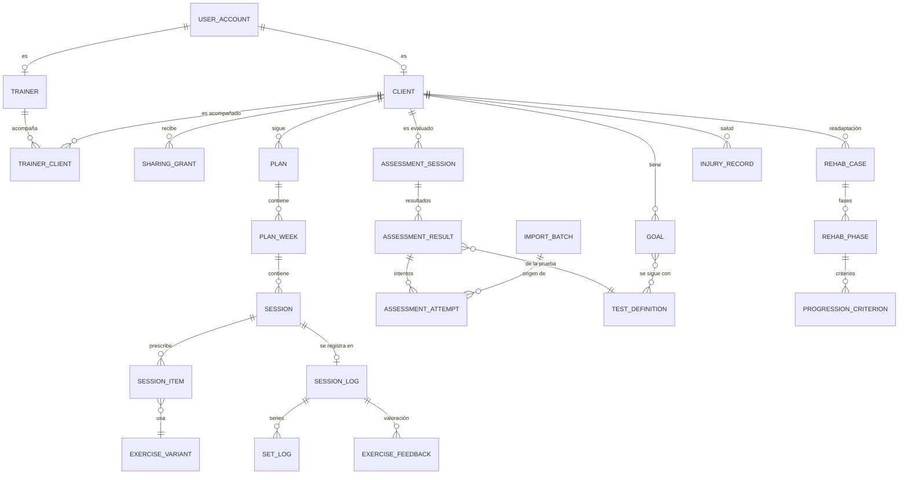
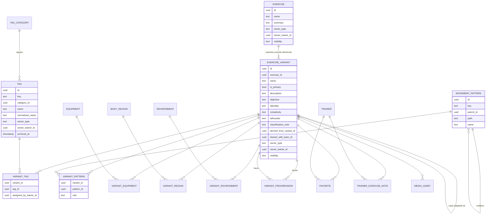

# Modelo conceptual de datos

Diseño relacional y normalizado para PostgreSQL, que se implementará en fases posteriores. En la Fase 1 **no hay base de datos**: parte del modelo ya existe como tipos de TypeScript en `src/domain` (los usa el adaptador demo en memoria) y el resto es conceptual. Cada sección indica qué está implementado.

> **Desde V1 (bloque 1, 9 nov 2026):** hay una base **SQLite local** con las tablas de V1. El esquema implementado está en `V1_SPEC.md` §4 (con las columnas añadidas del §9.2) y en `src/server/db/migrations/001-v1.ts`. El paso a PostgreSQL sigue previsto para la Fase 2 (`V1_SPEC.md` §8.3.4).

## Principios

1. **Normalización.** Nada de listas en campos de texto: las etiquetas, patrones, materiales, regiones y entornos se relacionan con tablas intermedias (muchos a muchos).
2. **Identificadores estables.** Las filas de usuario usan UUID. La taxonomía del sistema usa además una **clave textual estable** (`key`, por ejemplo `push.horizontal`) que nunca se reutiliza ni se renombra; el nombre visible sí puede cambiar.
3. **Propietario y visibilidad** en todo lo que se puede compartir: `owner_type` (`system` | `trainer`), `owner_trainer_id` y `visibility` (`global` | `trainer` | `private`).
4. **Procedencia en cada medición**: origen (`direct`, `calculated`, `estimated`, `imported`, `self_reported`), método, instrumento, fórmula con su versión, importación de origen, fecha de medición, fecha de registro y autor.
5. **Fórmulas versionadas**: los resultados guardan `formula_key` y `formula_version`. Si cambia una fórmula, se crea una versión nueva y los resultados antiguos conservan la suya.
6. **Datos de salud separados** del resto, con permisos y cifrado reforzados.
7. **Seguridad en dos capas**: los casos de uso aplican las políticas (`src/domain/access.ts`) y la base de datos repite el aislamiento con Row Level Security (RLS) por entrenador y cliente.
8. **Archivar antes que borrar** lo que está referenciado (por ejemplo, etiquetas), con políticas de conservación explícitas.

## Vista general



## 1. Identidad, roles y relación entrenador–cliente

**Estado:** conceptual. En la Fase 1 el actor es fijo (`Actor` en `src/domain/access.ts`).

| Entidad          | Campos principales                                                                                      | Notas                                                                                                     |
| ---------------- | ------------------------------------------------------------------------------------------------------- | --------------------------------------------------------------------------------------------------------- |
| `user_account`   | id, email (único), estado, created_at                                                                   | Lo gestiona el proveedor de autenticación (pendiente de elegir).                                          |
| `trainer`        | id, user_id, display_name                                                                               | Rol de entrenador.                                                                                        |
| `catalog_admin`  | id, user_id                                                                                             | Administración del catálogo global de ejercicios. No accede a datos de clientes ni a ejercicios privados. |
| `client`         | id, user_id (opcional mientras no haya invitación), display_name, population, sport, started_on, status | Datos mínimos; la salud va aparte.                                                                        |
| `trainer_client` | trainer_id, client_id, status, started_at, ended_at                                                     | Hoy, un cliente tiene un único entrenador responsable.                                                    |
| `consent`        | id, client_id, type, text_version, granted_at, revoked_at                                               | Necesario antes de tratar datos de salud.                                                                 |
| `team` (futuro)  | id, name; `team_member` (team_id, trainer_id, role)                                                     | Para compartir ejercicios con visibilidad `trainer` dentro de un equipo.                                  |

## 2. Cliente: objetivos, métricas visibles y compartición

**Estado:** `Client`, `Goal` y `SharingSettings` implementados en el dominio con datos demo; `metric_profile` es conceptual.

| Entidad          | Campos principales                                                                                                                                                |
| ---------------- | ----------------------------------------------------------------------------------------------------------------------------------------------------------------- |
| `goal`           | id, client_id, title, area, status, started_on, target_date, notes                                                                                                |
| `goal_test`      | goal_id, test_definition_id (pruebas con las que se sigue el objetivo)                                                                                            |
| `metric_profile` | id, owner, population, goal_area, name; `metric_profile_item` (profile_id, test_definition_id, order): métricas visibles configurables según población y objetivo |
| `sharing_grant`  | id, client_id, resource (`assessments`, `volume`, `rehab`, `reports`…), scope (por ejemplo, una prueba concreta), granted_by, granted_at, revoked_at              |

`sharing_grant` sustituye a los booleanos actuales de `SharingSettings`. Cada cambio queda registrado (alta o revocación con fecha y autor), y sin concesión no se comparte nada.

## 3. Biblioteca de ejercicios (multidimensional)

**Estado:** implementada en el dominio (`src/domain/library/`) y en los datos demo (26 ejercicios principales, 44 variantes). La taxonomía completa está en `TAXONOMY.md`. Incluye la taxonomía del sistema, las variantes con clasificación propia, las progresiones, las etiquetas personales, los favoritos, las notas y la búsqueda Y/O con jerarquías. La persistencia queda para la Fase 4.



### Entidades

| Entidad                                                                    | Contenido                                                                                                                                                                                           | Reglas                                                                                                                                                                                                                         |
| -------------------------------------------------------------------------- | --------------------------------------------------------------------------------------------------------------------------------------------------------------------------------------------------- | ------------------------------------------------------------------------------------------------------------------------------------------------------------------------------------------------------------------------------ |
| `exercise`                                                                 | Ejercicio principal (p. ej., «Sentadilla»)                                                                                                                                                          | Agrupa variantes; tiene su propio propietario y visibilidad.                                                                                                                                                                   |
| `exercise_variant`                                                         | Variante concreta y prescribible (p. ej., «Sentadilla frontal»): descripción, objetivo y aplicaciones, ejecución (bilateral, unilateral o alternante), complejidad, silueta y nota de clasificación | Cada principal tiene **exactamente una** variante de referencia (`is_primary`). La variante **no hereda** etiquetas, patrones ni material. Si no tiene instrucciones propias, se muestran las de la referencia.                |
| `variant_step`, `variant_cue`, `variant_mistake`, `variant_technical_note` | Instrucciones, puntos clave, errores frecuentes y consideraciones técnicas, ordenados                                                                                                               | Tablas hijas con `ordinal` (en el dominio son listas).                                                                                                                                                                         |
| `tag_category` / `tag`                                                     | Cuatro dimensiones: Cualidades y objetivos, Métodos y formas de entrenamiento, Acciones musculares y ejecución, Aplicaciones y evaluación (ver `TAXONOMY.md`)                                       | Globales (`owner_type = system`) o personales del entrenador. Índice único en (`owner`, `normalized_name`) y comprobación frente a las globales: **sin duplicados**. Se archivan (`archived_at`, `replaced_by`), no se borran. |
| `variant_tag`                                                              | Relación variante–etiqueta                                                                                                                                                                          | `assigned_by_trainer_id` nulo = asignación del catálogo, visible para todos. Si tiene valor, es una **etiqueta personal** sobre cualquier variante (también global) y solo la ve ese entrenador.                               |
| `movement_pattern`                                                         | Árbol de patrones: Empuje, Tracción, Tren inferior, Core y tronco (anti-movimiento y movimiento dinámico) y sus subtipos                                                                            | `parent_id` + `path` (ruta materializada) para filtrar un grupo con todos sus subtipos. Se amplía añadiendo nodos.                                                                                                             |
| `variant_pattern`                                                          | Relación variante–patrón con `role` (`primary` o `secondary`)                                                                                                                                       | Exactamente un principal si hay patrones; solo subtipos (hojas), no grupos; varios patrones solo si está biomecánicamente justificado.                                                                                         |
| `equipment`, `body_region`, `environment`                                  | Material, región corporal (con subregiones: hombro, cadera, rodilla, tobillo…) y entorno                                                                                                            | Jerárquicos cuando procede; cada uno con su tabla intermedia (`variant_equipment`, `variant_region`, `variant_environment`).                                                                                                   |
| `variant_progression`                                                      | Arista dirigida: `to` es una progresión de `from` (y `from`, una regresión de `to`)                                                                                                                 | Sin autoenlaces, duplicados ni ciclos de dos nodos. Tiene propietario: las relaciones de un entrenador no las ven otros.                                                                                                       |
| `favorite`                                                                 | (trainer_id, variant_id)                                                                                                                                                                            | Único por par.                                                                                                                                                                                                                 |
| `trainer_exercise_note`                                                    | Observaciones personales del entrenador sobre una variante                                                                                                                                          | Información personalizada, separada del catálogo global.                                                                                                                                                                       |
| `media_asset`                                                              | Archivo de imagen o vídeo **fuera de la base de datos**: proveedor, clave, tipo, códec, dimensiones, duración, tamaño, suma de comprobación, estado y derechos                                      | Diseño en `MEDIA.md` §3 (pendiente de aprobación). Sin medios, se muestra la silueta.                                                                                                                                          |
| `variant_media`                                                            | Hueco publicado de cada variante: `silhouette`, `demo_short` (< 15 s) o `demo_extended` (≤ 45 s)                                                                                                    | Único (variant_id, slot). Cada hueco se gestiona por separado; el ampliado nunca ocupa el hueco del breve.                                                                                                                     |
| `media_rights`                                                             | Titular, licencia y cesión de imagen de las personas que aparecen                                                                                                                                   | Obligatoria antes de publicar un vídeo con personas identificables.                                                                                                                                                            |
| `client_exercise_guidance`                                                 | Indicaciones y restricciones del entrenador **para un cliente** con una variante (o con todas)                                                                                                      | Visibles para ese cliente en todas sus sesiones con la variante. Si proceden de la salud, se muestran sin el diagnóstico.                                                                                                      |

### Visibilidad

| `visibility`              | Quién la ve                                                                                              | Quién la edita                                                                                                                                      |
| ------------------------- | -------------------------------------------------------------------------------------------------------- | --------------------------------------------------------------------------------------------------------------------------------------------------- |
| `global`                  | Todos los entrenadores                                                                                   | Solo la administración del catálogo. Un entrenador lo **adapta**: se crea una copia `trainer` con `derived_from_variant_id` y el original no cambia |
| `trainer` (personalizado) | El propietario y sus clientes, a través de las sesiones; en el futuro, su equipo (`shared_with_team_id`) | El propietario                                                                                                                                      |
| `private`                 | Solo el propietario                                                                                      | El propietario                                                                                                                                      |

Los clientes no navegan por la biblioteca: ven los ejercicios a través de las sesiones que tienen prescritas.

### Búsqueda Y/O

- **Y (todos):** la variante cumple todos los filtros. En SQL, se agrupa por variante y se exige `COUNT(DISTINCT filtro_cumplido) = número_de_filtros`.
- **O (alguno):** basta con que cumpla uno (`EXISTS` sobre cualquiera de las relaciones).
- Los filtros jerárquicos (patrón, material, región) incluyen los subtipos con `path LIKE 'pull.%'` o mediante una CTE recursiva.
- El texto siempre es obligatorio y se busca sin tildes (`unaccent` + índice trigram). En la Fase 1 esta lógica está en `searchLibrary()` y tiene tests.

## 4. Planificación

**Estado:** sesiones y prescripción por ejercicio implementadas en el dominio; planes y semanas, conceptuales. **La prescripción v2, las versiones, las plantillas y el calentamiento son una propuesta pendiente de aprobación** (§12 y `EFFORT_AND_LOAD.md`).

| Entidad             | Campos principales                                                                                                                                                                                                                            |
| ------------------- | --------------------------------------------------------------------------------------------------------------------------------------------------------------------------------------------------------------------------------------------- |
| `plan`              | id, client_id, trainer_id, title, goal_id, starts_on, ends_on, status (`draft`, `published`, `archived`)                                                                                                                                      |
| `plan_week`         | id, plan_id, ordinal, focus                                                                                                                                                                                                                   |
| `session`           | id, plan_week_id (opcional: hay sesiones sueltas), client_id, date, title, focus, estimated_minutes, coach_note, status                                                                                                                       |
| `session_item`      | id, session_id, variant_id, block (A, B…), ordinal, notes                                                                                                                                                                                     |
| `item_prescription` | item_id, sets, rep_target (`fixed`, `range`, `seconds`, `meters` + valores), load (`kg`, `bodyweight`, `percent_1rm`, `autoregulated`, `text` + valores), rest_seconds, tempo (4 fases), effort (`rir`, `rpe`, `character`, `none` + valores) |
| `item_set_override` | item_id, set_number y los campos anteriores, opcionales                                                                                                                                                                                       | Pirámides, contrastes, _clusters_ u otros métodos sin imponer una estructura rígida. |

**Propuesta v2 (pendiente de aprobación):**

| Entidad                  | Cambio                                                                                                                                                                                                                                                                                                                                                 |
| ------------------------ | ------------------------------------------------------------------------------------------------------------------------------------------------------------------------------------------------------------------------------------------------------------------------------------------------------------------------------------------------------ |
| `session`                | + `status` (`draft`, `published`, `cancelled`), `version`, `day_order` y `day_label` (dos sesiones el mismo día), `derived_from_template_id`, `effort_rating_disabled_reason` (el RPE de la sesión se pide en todas las sesiones salvo que el entrenador lo desactive con un motivo, P-48; antes figuraba `effort_rating_requested`, contrario a P-48) |
| `session_version`        | session_id, version, published_at, published_by, snapshot de la prescripción. Las series registradas apuntan a la versión con la que se hicieron                                                                                                                                                                                                       |
| `session_warmup_item`    | session_id, ordinal, variant_id (opcional), text, duration_s o reps                                                                                                                                                                                                                                                                                    |
| `session_item`           | + `block_mode` (`sequential`, `superset`, `circuit`), `client_note` (visible) y `private_note` (solo el entrenador), `show_short_video`, `show_extended_video`                                                                                                                                                                                         |
| `item_prescription` → v2 | load: `LoadSpec` (10 modalidades, base de la carga), reps con `per_side`, effort: `EffortTarget` v2 (RIR, RPE con escala, ambos con justificación, carácter, calidad, ninguno), `stop_criteria`, rest, tempo de 3 o 4 fases, `warmup_sets` (series de aproximación)                                                                                    |
| `set_prescription`       | Sustituye a `item_set_override`: item_id, set_number y cualquier campo anterior que cambie en esa serie                                                                                                                                                                                                                                                |
| `percent_1rm_resolution` | item_id, set_number, reference_result_id (1RM directo o estimado), percent, rounding_step_kg, resolved_kg, formula_key, formula_version, resolved_at. Se congela al publicar                                                                                                                                                                           |
| `session_template`       | id, trainer_id, title, contenido como una sesión sin cliente ni datos individuales                                                                                                                                                                                                                                                                     |

## 5. Registro de la ejecución

**Estado:** implementado en el dominio (`SessionLog`, `SetRecord`, `ExerciseFeedback`) con datos demo; el portal del cliente registra en pantalla, sin guardar.

| Entidad             | Campos principales                                                                                                                                                                                   |
| ------------------- | ---------------------------------------------------------------------------------------------------------------------------------------------------------------------------------------------------- |
| `session_log`       | id, session_id, client_id, started_at, finished_at (el cliente pulsó «Terminar»), perceived_effort (0–10, autodeclarado), comment (observaciones para el entrenador)                                 |
| `set_log`           | id, session_log_id, session_item_id, set_number, reps, load_kg, duration_s, distance_m, completed. **Único (session_log_id, session_item_id, set_number)**: una serie no puede registrarse dos veces |
| `exercise_feedback` | session_log_id, session_item_id, rir, rpe, note (autodeclarados)                                                                                                                                     |
| `message` (futuro)  | id, client_id, author, body, created_at, read_at: comunicación con el entrenador                                                                                                                     |

**Propuesta v2 (pendiente de aprobación):**

| Entidad             | Cambio                                                                                                                                                                                                                                                                                                                                                                    |
| ------------------- | ------------------------------------------------------------------------------------------------------------------------------------------------------------------------------------------------------------------------------------------------------------------------------------------------------------------------------------------------------------------------- |
| `session_log`       | + `session_version`, `last_activity_at` (para retomar), `not_done_reason` (autodeclarado), `warmup_status` (`done`, `skipped`, `none`)                                                                                                                                                                                                                                    |
| `set_log`           | + `client_set_id` (UUID generado en el dispositivo, **único**: idempotencia), `set_role` (`warmup`, `working`), `performed_load` (misma modalidad que la prescrita: kg y base, kg añadidos, asistencia, banda, ajuste), `reps_per_side`, `rir`, `rpe`, `rpe_scale`, `stop_reason`, `note`, `recorded_at` (dispositivo), `received_at` (servidor), `supersedes_set_log_id` |
| `exercise_feedback` | Se conserva solo para el RPE del ejercicio completo (opcional, con su escala) y la observación. **El RIR es siempre por serie** (`set_log`) y no se guarda por ejercicio, para no mezclar magnitudes                                                                                                                                                                      |
| `exercise_skip`     | session_log_id, session_item_id, reason (`no_equipment`, `discomfort`, `other`), note                                                                                                                                                                                                                                                                                     |

> **Nota (13 nov 2026):** V1 implementa un subconjunto de este diseño (`EXECUTION.md` §2): sin `set_role`, `reps_per_side`, `stop_reason`, `exercise_feedback`, `exercise_skip` ni `set_annotation`, y sin guardar la procedencia en cada registro. Ver `AUDIT_BLOCK1.md` §5 y §11.6.

Reglas: las series efectivas son la última versión válida por (session_log_id, session_item_id, set_number), siguiendo `supersedes`; un `client_set_id` repetido no crea otra fila; el entrenador **no edita** `set_log` (anota con `set_annotation`). Todo lo realizado es `self_reported` salvo lo que mide un instrumento o se importa.

**El estado de la sesión no se guarda: se deduce** (`sessionStatus` en `src/domain/training/session.ts`) de las series efectivas (sin duplicados ni registros ajenos a lo prescrito) y de si la sesión ha terminado:

- `completed`: todas las series prescritas están hechas.
- `partial`: se terminó o se interrumpió con parte de las series hechas.
- `in_progress`: empezada hoy y sin terminar.
- `pending`: sin empezar.
- `missed`: pasó el día, o se terminó, sin ninguna serie.

Pulsar «Terminar» **no** convierte una sesión en completada.

## 6. Volumen y carga

**Estado:** cálculo de series, repeticiones y tonelaje por semana implementado con fórmulas versionadas (`training.completed-sets`, `training.total-reps`, `training.volume-load`).

- Por defecto, los agregados **no se guardan**: se calculan desde `set_log` y se muestran con la fórmula y la versión que los producen.
- Si hace falta rendimiento, se añadirá `volume_snapshot` (scope `exercise` | `session` | `week` | `pattern` | `tag`, valor, `formula_key`, `formula_version`, `computed_at`), siempre recalculable.
- El volumen por patrón o por clasificación usará `variant_pattern` y `variant_tag`. Para que no cuente doble, cada serie suma una vez a cada patrón que tenga su variante, y así se documentará en su fórmula.
- Tipos de cuantificación: repeticiones, tiempo y distancia. El tonelaje solo se calcula con carga externa en kg.
- **Estimación de RM:** se guardará como medición `estimated` con la fórmula (id + versión) y su error, nunca como medición directa. La ecuación no se elegirá hasta verificar su fuente primaria.
- **Propuesta v2 (pendiente de aprobación):** volumen y tonelaje **prescritos** frente a **ejecutados**, carga externa añadida (lastre), resumen de asistencia, intensidad relativa (% 1RM) y carga respecto al peso corporal, como métricas separadas; `training.volume-load` 2.0.0 con base de la carga, repeticiones por lado y exclusión de las series de aproximación. El peso corporal × repeticiones **no** es tonelaje. Detalle y fórmulas en `EFFORT_AND_LOAD.md` §10.

## 7. Evaluaciones

**Estado:** catálogo, resultados con procedencia, intentos con regla de agregación (`assessment.best-attempt`, `assessment.mean-attempts`) y comparación implementados en el dominio. Protocolos y referencias, conceptuales.

| Entidad                 | Campos principales                                                                                                               |
| ----------------------- | -------------------------------------------------------------------------------------------------------------------------------- |
| `test_definition`       | id, key, name, category, outcome_name, outcome_unit, better_when, owner, status                                                  |
| `test_protocol_version` | id, test_definition_id, version, procedure, required_instrument, attempts_default, aggregation_default, references               |
| `assessment_session`    | id, client_id, date, evaluator_id, context, notes                                                                                |
| `assessment_result`     | id, assessment_session_id, test_definition_id, protocol_version_id, side, aggregation, value, unit + procedencia                 |
| `assessment_attempt`    | id, result_id, ordinal, value, unit, valid, notes + procedencia                                                                  |
| `normative_reference`   | id, test_definition_id, population, values, citation, doi/pmid, verified_on. **Vacía**: solo se cargarán referencias verificadas |

**Columnas de procedencia** (en resultados, intentos y cualquier medición): `origin`, `method`, `instrument`, `formula_key`, `formula_version`, `import_batch_id`, `measured_at`, `recorded_at` y `recorded_by`. Un resultado agregado es `calculated` y sus intentos conservan su origen (por ejemplo, `imported`). **No se guardan variables que el instrumento no mide**, como la fuerza pico, la RFD o el impulso a partir de una altura de salto.

## 8. Readaptación y retorno al deporte

**Estado:** casos, fases y criterios implementados en el dominio; lesiones y antecedentes, conceptuales.

| Entidad                 | Campos principales                                                                                                                                                  |
| ----------------------- | ------------------------------------------------------------------------------------------------------------------------------------------------------------------- |
| `rehab_case`            | id, client_id, body_region_id (tobillo, rodilla, cadera, hombro…), title, status, started_on, closed_on                                                             |
| `rehab_phase`           | id, case_id, ordinal, name, goal                                                                                                                                    |
| `progression_criterion` | id, phase_id, description, defined_by (`trainer`, `clinician`), status, checked_on, evidence_result_id (evaluación que lo respalda, opcional)                       |
| `injury_record`         | id, client_id, body_region_id, description, occurred_on, reported_by, consent_id. **Categoría especial**: esquema separado, cifrado de campos y registro de accesos |

TrainPro no genera protocolos clínicos: las fases y los criterios los define el profesional.

## 9. Informes

**Estado:** conceptual.

| Entidad        | Campos principales                                                                                                                                                           |
| -------------- | ---------------------------------------------------------------------------------------------------------------------------------------------------------------------------- |
| `report`       | id, client_id, type (`progress`, `training`, `rehab`), period, generated_at, generated_by, formula_versions (las versiones usadas), content (o los datos para reconstruirlo) |
| `report_share` | report_id, shared_at, revoked_at: visible para el cliente solo si se comparte                                                                                                |

## 10. Integraciones e importación

**Estado:** conceptual. No se presupone ninguna API externa.

| Entidad        | Campos principales                                                                                      |
| -------------- | ------------------------------------------------------------------------------------------------------- |
| `data_source`  | id, kind (`manual_file`, `device`, `app`), name, verified_integration (bool), notes                     |
| `import_batch` | id, data_source_id, file_name, checksum, mapping_version, imported_by, imported_at, status, error_count |
| `import_issue` | batch_id, row, field, message                                                                           |

Los valores importados se registran como `imported` con `import_batch_id`, y el archivo de origen queda identificado por su suma de comprobación.

## 11. Auditoría, conservación y borrado

**Estado:** conceptual.

| Entidad            | Campos principales                                                                                                                                                             |
| ------------------ | ------------------------------------------------------------------------------------------------------------------------------------------------------------------------------ |
| `audit_event`      | id, actor_id, action, entity_type, entity_id, occurred_at, metadata mínima (**sin contenido de salud**)                                                                        |
| `retention_policy` | entity_type, period, action (`delete`, `anonymize`), legal_basis_note                                                                                                          |
| `data_request`     | id, client_id, type (`access`, `export`, `rectification`, `erasure`, `restriction`, `objection`), requested_at, due_at, status, resolved_at, handled_by (ver `DATA_RIGHTS.md`) |
| `erasure_job`      | id, data_request_id, scope, executed_at, pending_backup_expiry_at                                                                                                              |

Se auditan: accesos a datos de salud, cambios de lo compartido, exportaciones, importaciones, borrados y cambios de permisos.

## 12. Prescripción y registro v2 en el dominio (propuesta)

**Estado:** diseño pendiente de aprobación. Boceto de los tipos de `src/domain/training` (TypeScript puro, sin dependencias); no es código del proyecto todavía. **Concreción para V1:** `V1_SPEC.md` §4, con el esquema SQLite de la migración inicial y estas diferencias: `referenceResultId` y la resolución congelada del %1RM por versión, `note` por serie, borrador de cambios con revisión, varias sesiones por día con orden y contexto, un registro de sesión por sesión e instantes con zona horaria.

```ts
type LoadBasis = 'total' | 'per_side' | 'per_implement';

type LoadSpec =
  | { kind: 'external'; kg: number; basis: LoadBasis; implements?: number }
  | { kind: 'external_range'; minKg: number; maxKg: number; basis: LoadBasis; implements?: number }
  | { kind: 'percent_1rm'; percent: number | { min: number; max: number }; roundingStepKg: number }
  | { kind: 'bodyweight' }
  | { kind: 'bodyweight_plus'; addedKg: number }
  | {
      kind: 'assisted';
      assistanceKg?: number;
      via: 'machine' | 'band' | 'partner' | 'other';
      descriptor?: string;
    }
  | { kind: 'elastic'; descriptor: string }
  | { kind: 'device'; setting: string; unit?: string; calibratedKg?: number }
  | { kind: 'self_selected'; guidance?: string }
  | { kind: 'none' }
  | { kind: 'other'; text: string };

type RpeScale = 'rir_based' | 'omni_res' | 'borg_cr10';
type Amount = number | { min: number; max: number };

type EffortTarget =
  | { kind: 'rir'; rir: Amount }
  | { kind: 'rpe'; rpe: Amount; scale: RpeScale }
  | {
      kind: 'rir_and_rpe';
      rir: Amount;
      rpe: Amount;
      scale: Exclude<RpeScale, 'rir_based'>;
      justification: string;
    }
  | { kind: 'character'; performed: number; possible: number }
  | { kind: 'quality'; focus: string }
  | { kind: 'none' };

type StopCriterion =
  | { kind: 'velocity_loss'; percent: number; instrument: string }
  | { kind: 'performance_drop'; metric: string; percent: number; instrument: string }
  | { kind: 'technique' | 'quality'; description: string }
  | { kind: 'pain'; threshold: string; definedBy: 'trainer' | 'clinician' }
  | { kind: 'time_cap'; seconds: number }
  | { kind: 'rep_cap'; reps: number };

interface SetTarget {
  reps: RepTarget & { perSide?: boolean };
  load: LoadSpec;
  effort: EffortTarget;
  restSeconds: number;
  tempo?: Tempo; // 3 o 4 fases (P-22)
  stop?: StopCriterion[];
}

interface ExercisePrescriptionV2 {
  id: string;
  variantId: string;
  block: string;
  blockMode: 'sequential' | 'superset' | 'circuit';
  order: number;
  sets: number;
  warmupSets?: number;
  defaults: SetTarget;
  perSet?: (Partial<SetTarget> & { setNumber: number })[];
  clientNote?: string;
  privateNote?: string; // nunca llega al cliente
  showShortVideo: boolean;
  showExtendedVideo: boolean;
}

type PerformedLoad =
  | { kind: 'external'; kg: number; basis: LoadBasis; implements?: number }
  | { kind: 'bodyweight' }
  | { kind: 'bodyweight_plus'; addedKg: number }
  | { kind: 'assisted'; assistanceKg?: number; descriptor?: string }
  | { kind: 'elastic' | 'device' | 'other'; descriptor: string }
  | { kind: 'none' };

interface SetLogV2 {
  clientSetId: string; // UUID del dispositivo: idempotencia
  prescriptionId: string;
  sessionVersion: number;
  setNumber: number;
  role: 'warmup' | 'working';
  reps?: number;
  repsPerSide?: boolean;
  durationS?: number;
  distanceM?: number;
  load: PerformedLoad;
  rir?: number;
  rpe?: number;
  rpeScale?: RpeScale;
  stopReason?: 'completed' | 'criterion' | 'pain' | 'other'; // V1 no lo usa; 'pain' depende de Q3 (P-58 revisada)
  completed: boolean;
  note?: string;
  recordedAt: string;
  supersedes?: string; // clientSetId corregido
}
```

**Correspondencia con el modelo actual** (para migrar sin perder nada):

| Hoy                                                            | v2                                                                                                    |
| -------------------------------------------------------------- | ----------------------------------------------------------------------------------------------------- |
| `LoadPrescription { kind: 'kg' }`                              | `LoadSpec { kind: 'external', basis: 'total' }`                                                       |
| `bodyweight`, `percent_1rm`, `text`                            | `bodyweight`, `percent_1rm` (+ redondeo), `other`                                                     |
| `autoregulated`                                                | `self_selected`                                                                                       |
| `EffortTarget` `rir`, `rpe`, `character`, `none`               | Igual; `rpe` añade la escala obligatoria (los datos demo usarán `rir_based`, que es la que describen) |
| Un esfuerzo para todas las series                              | `defaults.effort` + `perSet`                                                                          |
| `SetRecord { reps, loadKg, completed }`                        | `SetLogV2` con `load: { kind: 'external', kg }` o `{ kind: 'bodyweight' }` si `loadKg` es nulo        |
| `ExerciseFeedback.rir/rpe`                                     | Solo el RPE del ejercicio completo, opcional; el RIR, solo por serie (H-4)                            |
| `effectiveSetRecords` (última por ejercicio y número de serie) | Igual, con `clientSetId` y `supersedes` (y la versión de la sesión)                                   |

## 13. Visión ampliada: entidades nuevas (propuesta)

**Estado:** diseño pendiente de aprobación (`PRODUCT_STRATEGY.md`, `PROGRESSION_AND_AUTOREGULATION.md`, `INTEGRATIONS.md`). Todas las filas llevan `organization_id` **desde el esquema de la Fase 2** (P-51); en la 1B no hay organización en el dominio. Revisión de la auditoría de preparación (7 de noviembre de 2026): se ajustan las entregas de `readiness_check`, `pain_report`, `session_effort_rating`, `progression_track` y `prescription_change`, y no se crean `instrument`, `instrument_item` ni `decision_record`.

| Área                    | Entidad                                                            | Campos principales                                                                                                                                                                                                                                                                                                                                                                                                                                                                          | Entrega propuesta                                                                   |
| ----------------------- | ------------------------------------------------------------------ | ------------------------------------------------------------------------------------------------------------------------------------------------------------------------------------------------------------------------------------------------------------------------------------------------------------------------------------------------------------------------------------------------------------------------------------------------------------------------------------------- | ----------------------------------------------------------------------------------- |
| Inquilinos              | `organization`                                                     | id, name, kind (`individual`, `center`, `club`), region, created_at                                                                                                                                                                                                                                                                                                                                                                                                                         | Fase 2                                                                              |
|                         | `center`                                                           | id, organization_id, name                                                                                                                                                                                                                                                                                                                                                                                                                                                                   | E7                                                                                  |
|                         | `membership`                                                       | user_id, organization_id, center_id (opcional), role (`owner`, `admin`, `trainer`, `clinician`, `assistant`)                                                                                                                                                                                                                                                                                                                                                                                | Fase 2                                                                              |
|                         | `client_care_team`                                                 | client_id, user_id, role (`lead_trainer`, `trainer`, `rehab`, `physio`, `observer`), scopes (`training`, `assessment`, `health`), started_at, ended_at. Sustituye a la relación única de `trainer_client`                                                                                                                                                                                                                                                                                   | Fase 2                                                                              |
|                         | `group` y `group_member`                                           | Grupos y equipos de clientes, para planificar y ver en conjunto                                                                                                                                                                                                                                                                                                                                                                                                                             | E7                                                                                  |
| Ejecución               | `readiness_check`                                                  | session_log_id, energy (1–10), recovery (1–10), scale (identificador y versión), extra_items (si el entrenador activa otros), answered_at, skipped. Procedencia `self_reported`. Sin pregunta de dolor (P-58 revisada; antes, `pain_reported`)                                                                                                                                                                                                                                              | 1B (V5), si se aprueba Q2                                                           |
|                         | `pain_report`                                                      | session_log_id o fecha, body_region_id, side, intensity (0–10), context (`before`, `during`, `after`), exercise_item_id (opcional), note. **Dato de salud**                                                                                                                                                                                                                                                                                                                                 | E4, si se aprueba (P-58 revisada)                                                   |
|                         | `session_effort_rating`                                            | session_log_id, rpe (0–10, CR-10 modificada), scale (identificador y versión, P-64), rated_at, minutes_after_end. El motivo de desactivación está en `session`                                                                                                                                                                                                                                                                                                                              | 1B (V5), si se aprueba Q2                                                           |
| Planificación           | `progression_track`                                                | id, organization_id, client_id, variant_id, context (bloque u objetivo), created_from. Cada ejercicio prescrito puede llevar `track_id` para enlazar sus exposiciones entre sesiones (P-62)                                                                                                                                                                                                                                                                                                 | 1C, solo si hace falta (P-62 revisada); en la 1B, historial por (cliente, variante) |
|                         | `prescription_change`                                              | id, session_id, from_version, to_version, origin (`manual`, `supervised`, `preauthorized`), author_id, reason, diff, recommendation_id (opcional), created_at. **Solo adición**; modelo común para los cambios manuales y los del motor de la 1C (P-63 revisada); en la 1B bastan `session_version`, con autor y fecha                                                                                                                                                                      | 1C                                                                                  |
| Valoraciones subjetivas | `instrument`, `instrument_item`                                    | **No se crean** (P-64 revisada): cada valor subjetivo guarda un campo `scale` con identificador y versión, y las anclas de cada escala, con su fuente o la marca «provisional», se documentan en el dominio, como las fórmulas. Propuesta anterior: instrumento (valoración previa, RPE de la sesión, escalas de RPE, dolor, calidad), ítems, versión de la escala, rango, anclas y su fuente o la marca «provisional». Cada respuesta guarda instrument_id, item_id y scale_version (P-64) | —                                                                                   |
| Adaptación              | `progression_scheme`                                               | id, kind (`linear_kg`, `linear_percent`, `double_progression`, `rep_effort_compliance`, `e1rm`, `hold_reduce_repeat`), params, version, owner                                                                                                                                                                                                                                                                                                                                               | 1C                                                                                  |
|                         | `progression_assignment`                                           | scheme_id, client_id, exercise_item_id o block, started_on, ended_on                                                                                                                                                                                                                                                                                                                                                                                                                        | 1C                                                                                  |
|                         | `adaptation_rule`                                                  | id, owner_trainer_id, client_id, scope, condition (estructura tipada, sin código), action, limits, mode (`supervised`, `preauthorized`), version, active                                                                                                                                                                                                                                                                                                                                    | 1C                                                                                  |
|                         | `exercise_alternative`                                             | client_id (opcional), variant_id, alternative_variant_id, authorized_by. Sustituciones permitidas                                                                                                                                                                                                                                                                                                                                                                                           | 1C                                                                                  |
|                         | `recommendation`                                                   | id, rule_id y versión, scheme_id y versión, inputs (instantánea con procedencia), proposed_change, explanation, evidence_labels, created_at, status                                                                                                                                                                                                                                                                                                                                         | 1C                                                                                  |
|                         | `decision_record`                                                  | **No se crea**: la decisión va en `recommendation` y el cambio aplicado, en `prescription_change` (P-63 revisada). Propuesta anterior: recommendation_id, original_prescription (versión), decision (`accepted`, `modified`, `rejected`, `preauthorized`), final_prescription (versión), decided_by, decided_at, note. **Solo adición**                                                                                                                                                     | —                                                                                   |
| Estimaciones            | `assessment_result` (`estimated`)                                  | 1RM estimado con formula_key, formula_version, load_kg, reps, rir, set_log_id, margin, conditions_checked                                                                                                                                                                                                                                                                                                                                                                                   | 1C                                                                                  |
| Evidencia               | `evidence_source`                                                  | citation, doi, pmid, type, population, finding, limitations, conflicts_of_interest, applicability, verified_on, last_reviewed_on, reviewed_by                                                                                                                                                                                                                                                                                                                                               | 1C                                                                                  |
|                         | `evidence_link`                                                    | source_id, target_type (`formula`, `rule`, `scheme`, `test`, `variant`, `method`), target_id, claim, label, status (`draft`, `reviewed`, `approved`)                                                                                                                                                                                                                                                                                                                                        | 1C (fórmulas y reglas), E3 (ejercicios)                                             |
| Biblioteca              | `muscle` y `variant_muscle`                                        | Taxonomía de músculos; variant_id, muscle_id, role (`direct`, `indirect`), con etiqueta de heurística                                                                                                                                                                                                                                                                                                                                                                                       | E3                                                                                  |
| Integraciones           | `device`, `integration_connection`, `raw_import`, `metric_mapping` | Ver `INTEGRATIONS.md` §4                                                                                                                                                                                                                                                                                                                                                                                                                                                                    | E2 y E5                                                                             |

## Correspondencia con el código actual

| Concepto              | Tipo en `src/domain`                                                                                                      | Adaptador demo |
| --------------------- | ------------------------------------------------------------------------------------------------------------------------- | -------------- |
| Actor y permisos      | `Actor`, `SharingSettings`, `canAccessClient`, `canReadResource`, `canViewExercise`, `canEditExercise`                    | Sesión fija    |
| Cliente y objetivos   | `Client`, `Goal`                                                                                                          | `dataset.ts`   |
| Biblioteca            | `Exercise`, `ExerciseVariant`, `ProgressionLink`, `Tag`, `TagCategory`, `TaxonomyNode`, `Favorite`, `TrainerExerciseNote` | `library.ts`   |
| Prescripción y sesión | `ExercisePrescription`, `PlannedSession`                                                                                  | `dataset.ts`   |
| Registro              | `SessionLog`, `SetRecord`, `ExerciseFeedback`                                                                             | `dataset.ts`   |
| Mediciones y fórmulas | `Measurement`, `Provenance`, `FormulaDefinition`                                                                          | —              |
| Evaluaciones          | `AssessmentTest`, `AssessmentResult` (con intentos)                                                                       | `dataset.ts`   |
| Readaptación          | `RehabCase`, `RehabPhase`, `ProgressionCriterion`                                                                         | `dataset.ts`   |
