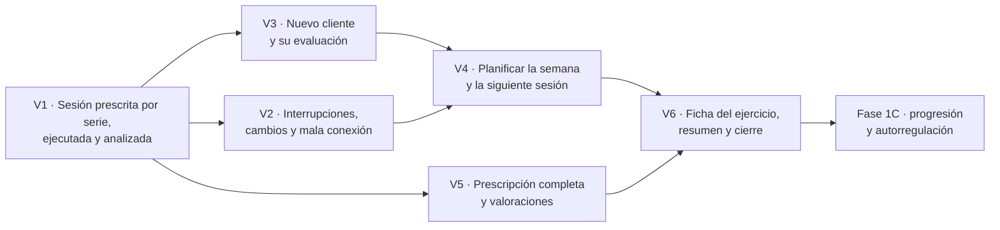

# Preparación para implementar: auditoría y plan de la primera versión

> **Estado de la implementación (12 de noviembre de 2026):** V1 se está construyendo por los bloques de `V1_SPEC.md` §9.
>
> - **Bloque 1** (base persistente): terminado y aceptado.
> - **Bloque 2** (ejecutar y registrar): implementado y pendiente de tu revisión (`V1_SPEC.md` §9.3, `EXECUTION.md`). Adelanta de la entrega V2 la cola local en IndexedDB, la cola idempotente, las correcciones, la reanudación y el aviso al salir.
> - **Auditoría (13 de noviembre):** `AUDIT_BLOCK1.md`, con el estado real verificado, los problemas por gravedad y las correcciones propuestas, pendientes de aprobación.
> - **Bloque 3 y siguientes:** sin empezar.
>
> El texto que sigue es la propuesta original y se conserva como referencia.

> **Estado: propuesta pendiente de aprobación (7 de noviembre de 2026).** Este documento no autoriza a programar. Cierra el alcance de la primera versión funcional (Fase 1B), separa lo imprescindible de lo que puede esperar y propone el orden de desarrollo por **entregas verticales**. Las decisiones están en `DECISIONS.md` y el detalle de las fases, en `ROADMAP.md`.

## 1. Auditoría del repositorio

**Estado de Git:**

- Rama `claude/vigilant-bardeen-qfycp4`, limpia y sincronizada con el remoto.
- Último commit: `1a03a20`, solo de documentación: 9 archivos, +620 y −137 líneas respecto a `1ad8882`. Las líneas eliminadas son tablas realineadas por Prettier y filas sustituidas por su versión ampliada; no se perdió contenido.
- El código no ha cambiado desde `ebb0cff` (revisión de la Fase 1): 110 tests unitarios y 85 E2E superados.

**Comprobación automática de la coherencia:**

| Elemento                               | Definidos                                 | Referencias sin definir | Observaciones                                                                                            |
| -------------------------------------- | ----------------------------------------- | ----------------------- | -------------------------------------------------------------------------------------------------------- |
| Decisiones P-xx                        | 75 (72 abiertas, 3 resueltas)             | 0                       | P-10 aparece dos veces a propósito: resuelta en parte (rol `admin`) y abierta en parte (quién lo ejerce) |
| ADR                                    | 22                                        | 0                       | ADR-18, 20, 21 y 22 siguen como «propuesta»                                                              |
| Funcionalidades de la 1B (F-xx)        | 20                                        | 0                       | —                                                                                                        |
| Funcionalidades de la 1C (C-xx)        | 15                                        | 0                       | Una coincidencia falsa: el asunto «C-21/23» del Tribunal de Justicia                                     |
| Criterios 1B-xx, 1C-xx y CA-xx         | 54, 24 y 52 (59 y 25 tras esta auditoría) | 0                       | —                                                                                                        |
| Escenarios S-xx                        | 24                                        | 0                       | —                                                                                                        |
| Enlaces a documentos y a secciones (§) | —                                         | 0                       | —                                                                                                        |

**Lo que he encontrado al revisar el contenido**, sin dar nada por correcto por haberlo escrito yo:

| #    | Tipo                                     | Hallazgo                                                                                                                                                                                                                                                                                      | Corrección                                                                                     |
| ---- | ---------------------------------------- | --------------------------------------------------------------------------------------------------------------------------------------------------------------------------------------------------------------------------------------------------------------------------------------------- | ---------------------------------------------------------------------------------------------- |
| H-1  | **Complejidad prematura**                | F-20 agrupaba seis decisiones de arquitectura como si fueran una funcionalidad, y proponía implementar ya organización, equipo asistencial, rastro de progresión, instrumentos genéricos y una cola genérica                                                                                  | Desglosado en §2.2; casi todo pasa a «preparación» o se resuelve con un campo                  |
| H-2  | Duplicidad en el modelo                  | `decision_record` (1C) y `prescription_change` (P-63) guardaban lo mismo: prescripción original y final                                                                                                                                                                                       | `prescription_change` registra los cambios aplicados y `recommendation` guarda la decisión     |
| H-3  | Duplicidad en el modelo                  | `readiness_check` y `session_effort_rating` tenían columnas propias **y** a la vez se proponían entidades genéricas `instrument`/`instrument_item`                                                                                                                                            | Tablas concretas con un campo de escala versionada; las entidades genéricas se descartan       |
| H-4  | **Posible mezcla de magnitudes**         | Se mantenía un RIR **por ejercicio** (`exercise_feedback`) además del RIR por serie                                                                                                                                                                                                           | El RIR es siempre por serie. El RPE de ejercicio se conserva como magnitud distinta y opcional |
| H-5  | Contradicción                            | El boceto del resumen final decía «RPE de la sesión, si el entrenador lo pidió» (y `effort_rating_requested`), frente a P-48: «en todas las sesiones»                                                                                                                                         | Alineado con P-48                                                                              |
| H-6  | Contradicción                            | El RPE de la sesión y la carga interna seguían asignados a la «Fase 8» en `EFFORT_AND_LOAD.md`                                                                                                                                                                                                | Recogida en la 1B y carga interna en la 1C                                                     |
| H-7  | Contradicción                            | `SCIENTIFIC_RIGOR.md` mantenía la «vía alternativa» de cotejar ecuaciones en estudios de validación, descartada por tu indicación (P-50)                                                                                                                                                      | Eliminada como vía; queda constancia de que se descartó                                        |
| H-8  | Contradicción                            | `COMPETITIVE_ANALYSIS.md` pedía «tu autorización» para crear cuentas, aunque ya indicaste que no (P-60)                                                                                                                                                                                       | Redactado como aplazado por tu indicación                                                      |
| H-9  | **Propuesta presentada como decidida**   | `PRODUCT_STRATEGY.md` §7 decía «Decidido» sobre lo que no se construirá. `ARCHITECTURE.md` titulaba «Decisiones estructurales que **fija** la Fase 1B»                                                                                                                                        | «Propuesto» y «propuestas»                                                                     |
| H-10 | Contradicción con tu preferencia         | El dolor estructurado (zona, escala 0–10, alertas) aparecía en la 1B (F-16, F-17, S-11, 1B-44) y en el mapa de módulos como «Registro de dolor (1B)»                                                                                                                                          | Recomendación revisada en §6: solo observaciones libres en la 1B                               |
| H-11 | **Riesgo de automatismo indiscriminado** | El ejemplo de conflicto de la 1C (S-18) reducía la carga un 10 % por una regla preautorizada basada solo en la valoración previa                                                                                                                                                              | Nueva salvaguarda (§5.3): una valoración subjetiva aislada, como mucho, impide el incremento   |
| H-12 | Carencia frente a tu flujo               | La 1B excluía «planes» e «informes», pero tu flujo exige «crear una planificación» y la primera versión pide «informes básicos»                                                                                                                                                               | Planificación semanal sin entidad de plan, y resumen imprimible del periodo (§3)               |
| H-13 | Carencia frente a tu flujo               | No había criterios para «preparar la siguiente sesión» ni para la evolución por ejercicio                                                                                                                                                                                                     | Criterios 1B-55 a 1B-58                                                                        |
| H-14 | Orden de desarrollo                      | Las subfases 1B.1–1B.5 eran horizontales (primero todo el dominio, luego las pantallas)                                                                                                                                                                                                       | Sustituidas por entregas verticales (§8)                                                       |
| H-15 | Erratas                                  | F-04 y F-18 tenían frases añadidas sin puntuación                                                                                                                                                                                                                                             | Corregidas                                                                                     |
| H-16 | Referencia errónea                       | P-65 citaba los escenarios «S-07 a S-09 y S-24» para los conflictos de la cola, pero S-09 es de volumen y S-24, de cambio de esquema                                                                                                                                                          | «S-06 a S-08 y S-14»                                                                           |
| H-17 | Coherencia tras reclasificar             | Los ejemplos de cálculo de la 1B incluyen series de aproximación e intensidad relativa (clase B); S-13 usaba «otra organización» (clase C); P-17 y P-66 suponían la zona horaria del cliente; P-26 incluía textos sobre el dolor; `session` tenía `effort_rating_requested`, contrario a P-48 | Nota en los ejemplos; S-13, P-17, P-26, P-66 y `DATA_MODEL.md` alineados                       |

No he encontrado afirmaciones de cumplimiento del RGPD, el MDR o el Reglamento de IA, ni ecuaciones de 1RM implementadas o marcadas como verificadas sin su fuente.

## 2. Revisión de las 20 funcionalidades de la 1B

Clasificación:

- **A.** Imprescindible para la primera versión.
- **B.** Importante, para una iteración posterior.
- **C.** Preparación arquitectónica mínima, sin funcionalidad.
- **D.** Aplazable sin consecuencias relevantes.

### 2.1 Tabla

| Id   | Funcionalidad                | ¿Imprescindible?                                                         | Valor directo             | ¿Dependencia de otras?             | ¿Aplazable sin reconstruir?            | Coste                               | Riesgo que introduce                                                      | Si se aplaza                               | Clasificación                                                                                                                                                                                                        |
| ---- | ---------------------------- | ------------------------------------------------------------------------ | ------------------------- | ---------------------------------- | -------------------------------------- | ----------------------------------- | ------------------------------------------------------------------------- | ------------------------------------------ | -------------------------------------------------------------------------------------------------------------------------------------------------------------------------------------------------------------------- |
| F-01 | Datos demo con escritura     | Sí: sin escritura no hay flujo                                           | Indirecto                 | De todas                           | No                                     | Medio                               | El estado en memoria se pierde al reiniciar; aislamiento en E2E           | No se puede probar nada                    | **A**                                                                                                                                                                                                                |
| F-02 | Identidad demo del cliente   | Sí, para ejecutar como un cliente recién creado                          | Indirecto                 | De la ejecución de clientes nuevos | No                                     | Bajo                                | Que parezca un inicio de sesión                                           | Solo se puede ejecutar como Marta          | **A**                                                                                                                                                                                                                |
| F-03 | Crear cliente                | Sí (paso 1 del flujo)                                                    | Entrenador                | Base del flujo                     | No                                     | Bajo                                | Que se introduzcan datos reales (aviso)                                   | No hay paso 1                              | **A**                                                                                                                                                                                                                |
| F-04 | Evaluar                      | Sí: resultados con intentos, 1RM directo y peso corporal                 | Entrenador                | Referencia del %1RM                | Las referencias poblacionales, sí      | Medio                               | Atribuir validez a pruebas sin protocolo (se marca «protocolo pendiente») | No hay paso 2 ni %1RM                      | **A** (con el 1RM estimado a mano); referencias poblacionales: **D** hasta tener fuentes verificadas                                                                                                                 |
| F-05 | Indicaciones y restricciones | Las indicaciones por sesión y ejercicio, sí (van en F-07)                | Cliente                   | No                                 | Las persistentes por cliente, sí       | Medio                               | Restricciones de origen sanitario                                         | El entrenador repite indicaciones          | Por ejercicio: **A** (dentro de F-07); persistentes por cliente y restricciones: **B**                                                                                                                               |
| F-06 | Planificar sesiones          | Crear, editar, publicar, semana y duplicar al mismo cliente              | Entrenador                | Pasos 3, 5 y 12                    | Duplicar a otros y plantillas, sí      | Medio                               | —                                                                         | No hay pasos 3, 5 ni 12                    | **A**: crear, editar, publicar, calendario semanal, duplicar al mismo cliente, dos sesiones al día. **B**: duplicar a otro cliente (P-19) y plantillas                                                               |
| F-07 | Prescribir                   | Sí: núcleo y requisito prioritario                                       | Ambos                     | De todo                            | No                                     | **Alto**                            | Complejidad del editor                                                    | No hay producto                            | **A**: por serie, 10 modalidades, esfuerzo, descanso, tempo, observaciones, intención, calidad, criterios, %1RM congelado. **B**: series de aproximación (P-20), superseries y circuitos, medición transcrita (P-25) |
| F-08 | Ficha y material visual      | La ficha con silueta, instrucciones y alternativa, sí                    | Ambos                     | No                                 | Los vídeos, sí                         | Medio–alto                          | Peso del repositorio con los clips                                        | Sin vídeo en la demo                       | **A**: ficha, silueta (propia o genérica) y alternativa. **B**: huecos de vídeo, reproductor, clips sintéticos y «Material pendiente» (P-28, P-38)                                                                   |
| F-09 | Pantalla «Hoy»               | Sí                                                                       | Cliente                   | No                                 | No                                     | Bajo                                | —                                                                         | —                                          | **A**, con dos sesiones al día                                                                                                                                                                                       |
| F-10 | Reproductor guiado           | Sí                                                                       | Cliente                   | No                                 | No                                     | **Alto**                            | Usabilidad en el móvil                                                    | No hay ejecución                           | **A**: calentamiento, ejercicio actual, registro con un toque, descanso, siguiente, «Tu sesión», saltar con motivo, confirmación y resumen. El vídeo, con F-08 B                                                     |
| F-11 | Sin conexión y reanudación   | Reanudar y no perder series, sí                                          | Cliente                   | Integridad de los datos            | Empezar la sesión sin conexión, sí     | **Alto**                            | Sincronización                                                            | Series perdidas con mala cobertura         | **A**: guardar primero en el dispositivo, cola idempotente, correcciones, reanudación y aviso al salir. **B**: empezar una sesión sin conexión con los datos precargados                                             |
| F-12 | Textos claros                | Sí                                                                       | Cliente                   | Revisión de P-26                   | No                                     | Bajo                                | Simplificaciones                                                          | El cliente no entiende el RIR ni el RPE    | **A** (borradores al principio; aprobados antes del cierre)                                                                                                                                                          |
| F-13 | Analizar                     | Prescrito frente a realizado, volumen por tipo y evolución por ejercicio | Entrenador                | Pasos 10 y 11                      | Algunas métricas, sí                   | Medio                               | Mezclar magnitudes                                                        | No hay pasos 10 ni 11                      | **A**: serie a serie, volumen y tonelaje por tipo (con lastre y asistencia), evolución por ejercicio. **B**: intensidad relativa, carga respecto al peso corporal y anotaciones del entrenador                       |
| F-14 | Progreso del cliente         | Lo que ya existe, con las métricas nuevas                                | Cliente                   | No                                 | Vistas nuevas, sí                      | Bajo                                | Mostrar lo no compartido                                                  | —                                          | **A** (mínimo); vistas nuevas: **B**                                                                                                                                                                                 |
| F-15 | Permisos                     | Sí                                                                       | Seguridad                 | De todo lo nuevo                   | No                                     | Medio                               | Fugas de datos                                                            | —                                          | **A**                                                                                                                                                                                                                |
| F-16 | Valoración previa            | Solo si la apruebas                                                      | Cliente; base de la 1C    | La 1C la usa                       | Sí, pero la 1C empezaría sin historial | Bajo                                | Que se interprete como una medición                                       | La 1C arranca sin datos                    | **A, si se aprueba**, sin la pregunta de dolor                                                                                                                                                                       |
| F-17 | Dolor e incidencias          | No                                                                       | —                         | No                                 | Sí                                     | Medio                               | Clínico y regulatorio                                                     | Nada en la 1B                              | **D**: estructurado, en E4 si se aprueba (§6). En la 1B, solo observaciones libres y el motivo neutro «molestias»                                                                                                    |
| F-18 | RPE de la sesión             | Solo si lo apruebas                                                      | Entrenador; base de la 1C | La carga interna de la 1C          | Sí                                     | Bajo                                | Anclas sin verificar (versión provisional marcada)                        | La 1C sin datos                            | **A, si se aprueba**                                                                                                                                                                                                 |
| F-19 | Historial de prescripciones  | El versionado mínimo, sí                                                 | Entrenador                | El registro se liga a la versión   | Las diferencias, sí                    | Bajo (mínimo) / medio (diferencias) | —                                                                         | Lo realizado sin referencia a lo prescrito | **A**: versiones inmutables con autor y fecha, y lista de versiones. **B**: vista de diferencias y motivo. **C**: modelo común de cambios con orígenes (1C)                                                          |
| F-20 | Estructura para no rehacer   | No es una funcionalidad                                                  | —                         | —                                  | —                                      | —                                   | Complejidad prematura                                                     | —                                          | **Desaparece como funcionalidad**: ver §2.2                                                                                                                                                                          |

### 2.2 F-20 desglosado

| Elemento                | ¿Requisito funcional o decisión de arquitectura? | ¿Hace falta ahora?                                                                                          | Propuesta                                                                                                                                                                             | Clase                  |
| ----------------------- | ------------------------------------------------ | ----------------------------------------------------------------------------------------------------------- | ------------------------------------------------------------------------------------------------------------------------------------------------------------------------------------- | ---------------------- |
| Organización            | Arquitectura                                     | No. Los permisos ya están centralizados en los casos de uso, y la tenencia importa cuando hay base de datos | Nada en la 1B. En el esquema de la Fase 2, `organization` como inquilino desde el principio (P-51)                                                                                    | **C**                  |
| Equipo asistencial      | Arquitectura                                     | No: hay un solo profesional por cliente                                                                     | Nada en la 1B. En la Fase 2, la relación cliente–profesional como tabla con rol, aunque haya una sola fila (P-52)                                                                     | **C**                  |
| Rastro de progresión    | Arquitectura                                     | No. Para el historial y la evolución basta con (cliente, variante)                                          | 1B: identificar por (cliente, variante). 1C: añadir `trackId` opcional, rellenado a partir de (cliente, variante), solo si hace falta distinguir dos usos de la misma variante (P-62) | **C**                  |
| Escalas versionadas     | Arquitectura **sencilla**                        | Sí, pero solo como un campo: el RPE de la sesión empezará con una versión provisional                       | Campo `scale` con identificador y versión en cada valor subjetivo (RPE de serie y de ejercicio, RPE de la sesión, valoración previa, calidad). Sin entidades genéricas (P-64)         | **A** (campo)          |
| Cola de envío           | Funcional (es F-11)                              | Sí, pero no genérica                                                                                        | Una sola cola local para lo que escribe el cliente en la sesión. No tiene relación con integraciones (P-65)                                                                           | **A** (dentro de F-11) |
| Unidades y zona horaria | Arquitectura                                     | Ya resuelto en lo esencial                                                                                  | kg, s y m como hoy; zona horaria de la aplicación (`TRAINPRO_TIME_ZONE`). Zona por cliente y otras unidades de visualización, cuando hagan falta (P-66)                               | **C**                  |

### 2.3 Trazabilidad: qué es imprescindible

- **Imprescindible (A):**
  - lo realizado es inmutable y se corrige con versiones;
  - cada serie apunta a la versión de la prescripción con la que se hizo;
  - cada versión publicada tiene autor y fecha;
  - los cálculos llevan fórmula y versión;
  - los valores subjetivos llevan su escala y versión.
- **Complejidad prematura en la 1B:** el modelo común de cambios con orígenes del motor, la vista de diferencias, los motivos obligatorios, la auditoría de accesos (sin datos reales no aporta) y el _event sourcing_.

## 3. Primera versión funcional: alcance recomendado

**Incluye (clase A), con datos ficticios y sin infraestructura externa:**

1. **Clientes:** crear y editar; ficha individual con las pestañas actuales.
2. **Evaluaciones:** resultados con intentos y procedencia; 1RM directo; 1RM estimado a mano; peso corporal.
3. **Planificación:** calendario semanal del cliente; crear, editar y publicar sesiones; dos sesiones al día; duplicar al mismo cliente para preparar la siguiente.
4. **Biblioteca:** la actual (búsqueda Y/O, niveles), con la ficha del ejercicio, la silueta y la alternativa cuando falta material.
5. **Prescripción por ejercicio y serie:** todas las modalidades de carga y de esfuerzo, con potencia, pliometría, técnica y series por tiempo o distancia.
6. **Experiencia móvil del cliente:** «Hoy», reproductor guiado, registro con un toque, temporizador de descanso, reanudación y registro resistente a la mala conexión.
7. **Registro fiel:** sesiones parciales e interrumpidas, sin duplicados, correcciones con historial y versiones.
8. **Análisis:** prescrito frente a realizado serie a serie, volumen y tonelaje por tipo, historial de entrenamiento y evolución por ejercicio.
9. **Valoración previa y RPE de la sesión**, si los apruebas (solo recogida y visualización).
10. **Progreso del cliente** (lo compartido) y **resumen imprimible del periodo** para el entrenador (el informe básico, con la impresión del navegador y sin dependencias).
11. **Permisos** con tests de acceso no autorizado.

**Iteración posterior (clase B):**

- duplicar a otro cliente y plantillas;
- series de aproximación, superseries y circuitos;
- indicaciones persistentes y restricciones por cliente;
- vídeos (huecos, reproductor, clips sintéticos, «Material pendiente»);
- empezar una sesión sin conexión;
- intensidad relativa y carga respecto al peso corporal;
- anotaciones del entrenador;
- vista de diferencias entre versiones;
- nuevas vistas de progreso.

**Lo que podrá hacer el entrenador al terminar:** crear un cliente, registrar su evaluación, planificar su semana, prescribir cada serie con la carga y el esfuerzo adecuados al tipo de ejercicio, publicar y, después de que el cliente entrene, ver qué hizo serie a serie frente a lo prescrito. También podrá ver el volumen sin mezclar magnitudes, seguir la evolución de cada ejercicio, preparar la siguiente sesión e imprimir un resumen.

**Lo que podrá hacer el cliente al terminar:** abrir la app en el móvil, ver qué le toca hoy (también dos sesiones), entender la carga y el esfuerzo sin tecnicismos y seguir la sesión paso a paso. Registrará cada serie con un toque, usará el temporizador y podrá interrumpir y retomar sin perder nada, aunque falle la conexión. Al terminar verá el resumen y su progreso.

## 4. Decisiones abiertas

### 4.1 Necesitan tu aprobación expresa antes de programar

| #   | Decisiones  | Pregunta                                                                                                                         | Propuesta recomendada                                                                                                                    | Alternativa razonable                                 | Consecuencias                                                                                                                                                           | Fase                    |
| --- | ----------- | -------------------------------------------------------------------------------------------------------------------------------- | ---------------------------------------------------------------------------------------------------------------------------------------- | ----------------------------------------------------- | ----------------------------------------------------------------------------------------------------------------------------------------------------------------------- | ----------------------- |
| Q1  | P-16, P-44  | ¿Apruebas el alcance de la primera versión del §3 (clase A) y el aplazamiento de la clase B?                                     | Sí                                                                                                                                       | Incluir algo de la clase B (por ejemplo, los vídeos)  | Recomendada: un flujo completo antes. Alternativa: más alcance y más tiempo antes del primer resultado utilizable                                                       | 1B                      |
| Q2  | P-47, P-48  | ¿Incluimos ya la valoración previa (energía y recuperación, 1–10) y el RPE de la sesión (con versión provisional de las anclas)? | Sí, solo recogida y visualización                                                                                                        | Dejarlos para la 1C                                   | Recomendada: la 1C empieza con historial y línea base. Alternativa: la 1B es más pequeña, pero las reglas de la 1C no tendrán datos al principio                        | 1B (entrega V5)         |
| Q3  | P-58        | ¿Cómo tratamos el dolor?                                                                                                         | Sin registro estructurado en la 1B; solo observaciones libres y el motivo neutro «molestias» (§6)                                        | Registro mínimo: sí/no y una nota, sin escala ni zona | Recomendada: sin funciones clínicas ni datos de salud estructurados. Alternativa: algo más de información, con más protección y revisión jurídica antes de datos reales | 1B; lo estructurado, E4 |
| Q4  | F-11 (P-65) | ¿Qué nivel sin conexión exige la primera versión?                                                                                | No perder nada: guardar primero en el dispositivo, cola idempotente y reanudación. Empezar una sesión ya sin conexión, en la iteración B | Todo sin conexión desde el principio                  | Recomendada: cubre la pérdida de cobertura a mitad de sesión. Alternativa: más complejidad (precarga y caché del _service worker_)                                      | 1B (V2)                 |
| Q5  | P-43        | ¿Revisamos juntos al final de cada entrega vertical o solo tras la primera?                                                      | Al final de V1, y después en V3 y V6                                                                                                     | Solo al final de la 1B                                | Recomendada: corriges pronto la dirección. Alternativa: menos interrupciones                                                                                            | 1B                      |
| Q6  | P-26        | ¿Revisarás los textos para el cliente?                                                                                           | Sí, durante V5. Hasta entonces se usan los borradores, marcados como tales                                                               | Que los apruebe yo con la evidencia documentada       | Recomendada: lenguaje validado por ti. Alternativa: más rápido, sin tu criterio                                                                                         | 1B (V5)                 |

### 4.2 Puedo resolverlas técnicamente sin afectar a la visión

Quedan registradas como «resolución técnica propuesta» y se aplicarán al implementar **salvo que te opongas**:

- P-11 (sin dependencias)
- P-17 (ventana de reanudación)
- P-18 (cambios con la sesión en curso)
- P-21 (detalle de dos sesiones al día)
- P-22 (tempo de 3 y 4 cifras)
- P-34 (solo escalas con anclas verificadas)
- P-35 y P-37 (potencia y valoración cualitativa, tal como las pediste)
- P-36 (no mezclar magnitudes, como indicaste)
- P-39 (memoria del servidor; sustituida por P-85, que necesita tu aprobación)
- P-40 (identidad demo)
- P-41 (prescripción por serie)
- P-42 (punto de reanudación)
- P-62 a P-64, P-66 y P-67 (simplificadas en §2.2; P-65 está en Q4)
- P-75 (ADR-20, 21 y 22)
- P-12 (ya implementada)

### 4.3 Resueltas por tus indicaciones (no vuelvo a preguntarlas)

| Indicación                                       | Decisiones      |
| ------------------------------------------------ | --------------- |
| Fase 1B antes de la 2, dividida en 1B y 1C       | P-16 y P-44     |
| La 1B sin motor ni modificaciones automáticas    | P-45 (en la 1B) |
| No implementar ecuaciones sin la fuente original | P-23 y P-50     |
| No inventar velocidades                          | P-25            |
| IA de bajo riesgo en paralelo                    | P-56            |
| Sin cuentas en competidores                      | P-60            |
| Protocolo de evidencia obligatorio               | P-61            |

### 4.4 Aplazables

- **Antes de la 1C:** P-24, P-45, P-46, P-49, P-54 (definición), P-62 (rastro, si hace falta), P-63 (modelo común de cambios), P-68 a P-71 y P-74.
- **Antes de la Fase 2:** P-01, P-02, P-04, P-51 y P-52.
- **Iteración B o fases posteriores:** P-19, P-20, P-28, P-29, P-30, P-31, P-38, P-53, P-59, P-73.
- **Sin fecha:** P-06, P-07, P-27.

### 4.5 Requieren evidencia, asesoría o información externa

| Necesita                  | Decisiones                                                               | ¿Bloquea la 1B?                                                 |
| ------------------------- | ------------------------------------------------------------------------ | --------------------------------------------------------------- |
| Fuentes originales (P-72) | P-48 (anclas), P-49 (fórmula), P-24 y P-50 (ecuaciones), P-34 (OMNI-RES) | **No**: el RPE de la sesión usa una versión provisional marcada |
| Curación científica       | P-53 (taxonomía muscular), P-61 (registro de fuentes)                    | No                                                              |
| Asesoría jurídica         | P-13, P-14, P-15; si la valoración previa es dato de salud (P-47 y P-58) | **No** con datos ficticios; **sí** antes de datos reales        |
| Asesoría regulatoria      | P-54                                                                     | No; sí antes de E4 y E6                                         |
| Proveedores y condiciones | P-01, P-02, P-03, P-32, P-55                                             | No                                                              |
| Personas o presupuesto    | P-10, P-33                                                               | No                                                              |
| Configuración de la red   | P-74                                                                     | No                                                              |

## 5. Autorregulación: preparación de la 1C

### 5.1 ¿La arquitectura de la 1B lo permite?

| Capacidad de la 1C                                    | Qué deja preparado la 1B                                                              | Qué añade la 1C                                              | Estado             |
| ----------------------------------------------------- | ------------------------------------------------------------------------------------- | ------------------------------------------------------------ | ------------------ |
| Progresión en % y en kg                               | Carga por serie, modalidades, kg canónicos                                            | Esquemas con parámetros                                      | Preparado          |
| Doble progresión                                      | Rangos de repeticiones y repeticiones logradas por serie                              | Esquema y criterio                                           | Preparado          |
| Por RIR/RPE                                           | RIR y RPE reales por serie, con escala versionada                                     | Diferencia de RIR como señal                                 | Preparado          |
| Por 1RM estimado                                      | 1RM directo y estimado a mano como mediciones con procedencia                         | Ecuaciones, solo con fuente original (P-50)                  | Bloqueado por P-72 |
| Lineal y ondulante                                    | Sesiones por fecha y semana                                                           | Lineal: esquema. Ondulante: estructura de planificación (E3) | Ondulante, en E3   |
| Por objetivo, ejercicio, bloque y población           | Etiquetas de cualidades, variante, bloque y población del cliente (ya existen)        | Ámbitos de las reglas                                        | Preparado          |
| Valoración previa                                     | Recogida con escala versionada (si se aprueba Q2)                                     | Señal con línea base                                         | Preparado (Q2)     |
| Prevista frente a real                                | Versiones publicadas y series ligadas a su versión; historial por (cliente, variante) | Métricas y panel                                             | Preparado          |
| Recomendaciones explicables y decisión del entrenador | Cambios manuales registrados como versiones                                           | `recommendation` y `prescription_change`                     | Preparado          |
| Simulación retrospectiva                              | Historial completo e inmutable                                                        | Reglas como funciones puras                                  | Preparado          |
| Tendencias individuales                               | Historial por ejercicio y valoraciones                                                | Señales y paneles                                            | Preparado          |

### 5.2 Magnitudes que no se mezclan

| Magnitud                 | Dónde se guarda                          | Unidad o escala                                    | Nunca se suma o convierte con      |
| ------------------------ | ---------------------------------------- | -------------------------------------------------- | ---------------------------------- |
| RIR de una serie         | Serie registrada                         | Repeticiones en reserva                            | RPE de la sesión, carga interna    |
| RPE de ejercicio o serie | Serie o ejercicio, con su escala         | Puntos de esa escala                               | RPE de la sesión; otras escalas    |
| RPE de la sesión         | Registro de la sesión, con su escala     | CR-10 modificada (0–10)                            | RPE de las series (no es su media) |
| Carga externa            | Serie registrada (kg y base de la carga) | kg                                                 | Carga interna                      |
| Carga interna (1C)       | Calculada, no guardada                   | UA                                                 | Tonelaje y volumen                 |
| Volumen                  | Calculado por tipo                       | Series, repeticiones, contactos, distancia, tiempo | Tipos distintos entre sí           |
| Tonelaje                 | Calculado                                | kg (Σ repeticiones × kg externos)                  | Lastre, asistencia, peso corporal  |

### 5.3 Salvaguarda nueva: la valoración aislada

**Una valoración subjetiva aislada, por sí sola, como mucho puede impedir el incremento previsto** («mantener lo planificado sin progresar»). Nunca reduce ni aumenta la carga, las series o las repeticiones. Para reducir hace falta, además, otra señal de rendimiento con calidad suficiente (por ejemplo, una diferencia de RIR en la exposición anterior) o la supervisión del entrenador. Se añade a `PROGRESSION_AND_AUTOREGULATION.md` §5.14 y al criterio 1C-25, y se corrigen el ejemplo de conflicto y S-18.

## 6. Dolor (P-58): recomendación revisada

| Uso                                          | Recomendación                                                                                                          |
| -------------------------------------------- | ---------------------------------------------------------------------------------------------------------------------- |
| Registro informativo                         | **1B:** solo las observaciones libres que ya existen (de la sesión y del ejercicio)                                    |
| Vinculado a un ejercicio                     | **1B:** al saltar un ejercicio o terminar una serie antes de tiempo, el motivo neutro «molestias», sin escala ni zona  |
| Antes y después de la sesión                 | **No en la 1B.** Registro estructurado (zona, lado, 0–10, momento) solo en E4, tras la asesoría jurídica y regulatoria |
| Recomendaciones derivadas del dolor          | **Nunca automáticas.** En E4, como mucho un aviso al profesional, si se aprueba                                        |
| Modificaciones automáticas del entrenamiento | **Nunca**, en ninguna fase ni modo                                                                                     |
| Uso en readaptación                          | E4, con criterios definidos por el profesional y tras revisar la finalidad prevista (P-54)                             |

**Motivos:**

- Es tu preferencia.
- No hay ninguna regla que lo necesite en la 1B ni en la 1C.
- Un registro estructurado de dolor es un dato de salud de categoría especial y acerca el producto a una finalidad clínica.
- Las observaciones libres ya dan al entrenador la información para decidir.
- Esas observaciones también pueden contener datos de salud, así que tendrán la misma protección antes de usar datos reales.

## 7. Arquitectura: lo justo para crecer

| Área                        | A. Implementar ahora                                                                       | B. Preparar ahora con una decisión de diseño sencilla                                  | C. Construir cuando haga falta                                                |
| --------------------------- | ------------------------------------------------------------------------------------------ | -------------------------------------------------------------------------------------- | ----------------------------------------------------------------------------- |
| Cliente y entrenador        | Alta y edición; propiedad por entrenador (ya existe)                                       | Ninguna regla de acceso fuera de las políticas de `src/domain/access.ts`               | Varios profesionales por cliente                                              |
| Identidad y permisos        | Actor demo (entrenador fijo, cliente elegible) y políticas nuevas con tests                | Un único punto de identidad (`getTrainerContext`, `getClientContext`), ya existente    | Autenticación real (Fase 2)                                                   |
| Organizaciones y centros    | Nada                                                                                       | Los casos de uso reciben el actor y el recurso; nada supone un único entrenador global | `organization` como inquilino en el esquema de la Fase 2 (P-51); centros (E7) |
| Equipos asistenciales       | Nada                                                                                       | Ídem                                                                                   | Relación cliente–profesional con rol (Fase 2, P-52); interfaz (E7)            |
| Historial de prescripciones | Versiones inmutables, autor y fecha; series ligadas a su versión                           | —                                                                                      | Diferencias (B); modelo común de cambios (1C)                                 |
| Ejercicios y variantes      | Identificadores estables (ya existen); la prescripción guarda la variante, nunca el nombre | No reutilizar identificadores                                                          | —                                                                             |
| Continuidad de progresiones | Historial por (cliente, variante)                                                          | —                                                                                      | `trackId` y esquemas (1C)                                                     |
| Escalas y unidades          | Campo de escala con versión; kg, s y m                                                     | Nombres de campo con la unidad (`loadKg`, `durationS`)                                 | Unidades de visualización y zona horaria por cliente                          |
| Datos de evaluación         | Registro con intentos y procedencia (el modelo ya existe)                                  | Referencias poblacionales solo con fuente (estructura sin valores)                     | Protocolos y fiabilidad (E2)                                                  |
| Integraciones               | Nada                                                                                       | La procedencia `imported` ya existe en el modelo de medición                           | Importación de CSV (E2) y API (E5)                                            |
| Almacenamiento audiovisual  | Siluetas SVG en el proyecto                                                                | Metadatos del medio separados del archivo (`MEDIA.md`)                                 | Vídeos y almacenamiento (B y Fase 4)                                          |
| Seguridad y privacidad      | Políticas con tests, aviso de datos ficticios, borrado local al salir, ningún dato real    | Separar las observaciones como posible dato de salud                                   | Cifrado, auditoría, RLS, evaluación de impacto (Fase 2 y 10a)                 |
| Organización del código     | Las capas actuales                                                                         | Carpetas por área solo cuando aparezca su código                                       | Reglas de ESLint por módulo, si el código lo justifica                        |

**Lo que no se crea:**

- entidades genéricas de instrumentos;
- bus de eventos;
- cola genérica;
- módulos vacíos;
- abstracciones para integraciones que no existen;
- organización o equipos en la 1B.

### Mapa de dependencias de la primera versión

## 8. Plan de implementación por entregas verticales

Cada entrega deja un flujo **funcional y comprobable** de extremo a extremo, entre el entrenador y el cliente. Al terminar cada una: `pnpm check`, `pnpm test:e2e`, commit y, según Q5, revisión contigo.

### V1 · Una sesión prescrita por serie, ejecutada y analizada

> **Concretada en `V1_SPEC.md` (versión 2, 7 de noviembre de 2026, pendiente de aprobación).** A petición tuya, V1 adelanta desde V2 las correcciones, la reanudación, el guardado local, dos sesiones el mismo día y la edición de sesiones publicadas con versiones; desde V3, «Entrar como…» si se aprueba P-76. Además: persistencia en SQLite (P-85), fechas de ejecución libres y ninguna serie rechazada por medianoche. Las pantallas, el modelo, la API, las tareas y las pruebas de V1 están allí.

- **Objetivo:** el entrenador prescribe por serie una sesión de fuerza a una clienta demo y la publica; la clienta la ejecuta en el móvil; el entrenador ve lo realizado frente a lo prescrito.
- **Funcionalidades:**
  - almacén demo con escritura, «Restablecer» y aislamiento en E2E (F-01);
  - prescripción por serie con carga en kg, rango, %1RM (con la referencia existente, congelada al publicar), peso corporal, lastre, asistencia y sin carga;
  - esfuerzo RIR, RPE (escala basada en RIR) o ninguno, por serie; descanso; tempo de 3 y 4 cifras; observaciones visibles;
  - publicar como versión 1, con autor y fecha;
  - «Hoy» y reproductor por pasos: ejercicio actual, tarjeta de prescripción, registro con un toque, descanso por hora de fin, siguiente, «Tu sesión», terminar con confirmación y resumen;
  - análisis serie a serie y volumen por tipo (P-36);
  - textos de ayuda en borrador;
  - puerta automática del protocolo de evidencia (P-61).
- **Modelo de datos:**
  - tipos v2 de carga, esfuerzo y serie prescrita (subconjunto);
  - serie registrada v2 (identificador, versión, carga en su modalidad, RIR/RPE con escala);
  - versión de la sesión;
  - fórmulas `training.total-reps` 2.0.0 y `training.volume-load` 2.0.0.
- **Interfaz:** editor del ejercicio con tabla de series; tarjeta de prescripción; pantallas de ejercicio, registro, descanso y resumen; registro en la ficha del cliente.
- **Entrenador:** Alex abre a Marta, prescribe la sesión de hoy serie a serie, la publica y, después, revisa lo realizado.
- **Cliente:** Marta abre «Hoy», entrena paso a paso, registra, descansa, termina y ve su resumen.
- **Pruebas:**
  - unitarias: prescripción, validaciones, kg del %1RM y volumen (S-01 y la parte de fuerza de S-09);
  - integración: casos de uso con permisos (`canEditPrescription`, `canLogExecution`, incluido el acceso no autorizado);
  - E2E: el flujo entrenador → cliente → entrenador en escritorio y Pixel 7, con axe.
- **Criterios:** 1B-01, 1B-02, 1B-04, 1B-12, 1B-17 a 1B-20, 1B-22, 1B-27 (sin calentamiento), 1B-34, 1B-35 (fuerza), 1B-38, 1B-40, 1B-41 y 1B-52 (RPE).
- **Riesgos:** complejidad del modelo y del editor en pantallas pequeñas.
- **No implementar todavía:**
  - crear clientes;
  - funcionamiento sin conexión;
  - editar sesiones ya publicadas;
  - potencia, bandas y series por tiempo;
  - valoraciones;
  - vídeos;
  - plantillas.

### V2 · Interrupciones, cambios y mala conexión

> **Tras el bloque 2 de V1 (12 de noviembre de 2026):** ya están hechos IndexedDB, la cola idempotente, las correcciones con `supersedes`, la reanudación, el aviso al salir y empezar sin conexión con la página abierta (`EXECUTION.md`). De V2 quedan:
>
> - abrir la app sin conexión;
> - el almacenamiento persistente;
> - el registro simultáneo desde dos dispositivos (hoy gana el primero, con `set_already_logged`);
> - la edición de sesiones publicadas con aviso y resumen de cambios (bloque 5 de V1).

> **Tras `V1_SPEC.md` (versión 2):** V2 conserva IndexedDB y el registro completo sin conexión, y el registro desde dos dispositivos. Dos sesiones el mismo día, editar una sesión publicada y la lista de versiones pasan a V1.

- **Objetivo:** que nunca se pierda ni se duplique una serie, y que los cambios del entrenador no reescriban lo hecho.
- **Funcionalidades:**
  - guardar primero en el dispositivo (IndexedDB) y cola idempotente para lo que escribe el cliente;
  - correcciones con `supersedes`;
  - reanudación (P-17, P-42) y aviso al salir con series sin enviar;
  - dos sesiones el mismo día (P-21);
  - editar una sesión publicada crea la versión 2, con aviso al cliente (P-18), y la lista de versiones queda en la ficha;
  - conflicto entre dos dispositivos.
- **Modelo de datos:** cola local; `supersedes`; orden y etiqueta de la sesión en el día.
- **Interfaz:** estados «Guardado en el móvil» y «Enviado»; «Continuar entrenamiento»; segunda sesión en «Hoy»; aviso de cambio; lista de versiones.
- **Entrenador:** cambia una sesión que la clienta está haciendo y ve con qué versión se hizo cada serie.
- **Cliente:** entrena con conexión intermitente, cierra la app, vuelve y continúa; hace dos sesiones en el día.
- **Pruebas:** S-03 a S-08 y S-14 (E2E con el modo sin conexión de Playwright; unitarias de la cola y de las series efectivas).
- **Criterios:** 1B-13, 1B-16, 1B-26, 1B-29 a 1B-32, 1B-48 (versiones) y 1B-53.
- **Riesgos:** sincronización. Solo se puede probar en Chromium, no en Safari.
- **No implementar todavía:** empezar una sesión sin conexión; vista de diferencias.

### V3 · Un cliente nuevo y su evaluación

> **Tras `V1_SPEC.md`:** si se aprueba P-76, «Entrar como…» pasa a V1. La prueba de alta de V3 usará otro nombre ficticio, para no confundirlo con Lucía Gil, la clienta sembrada de V1.

- **Objetivo:** los pasos 1 y 2 del flujo, con un cliente creado desde cero que luego entrena.
- **Funcionalidades:**
  - crear y editar clientes (F-03);
  - «Entrar como…» (F-02);
  - registrar evaluaciones: intentos, 1RM directo, 1RM estimado a mano y peso corporal (F-04);
  - %1RM resuelto con la referencia del nuevo cliente;
  - aviso de datos ficticios;
  - permisos.
- **Modelo de datos:** alta de clientes y de resultados en el almacén demo.
- **Interfaz:** formulario de cliente, registro de evaluación y selector de identidad demo.
- **Entrenador:** da de alta a Lucía, registra su 1RM y su peso, y le prescribe una sesión.
- **Cliente:** entra como Lucía y entrena.
- **Pruebas:** S-13; unitarias de los nuevos casos de uso con acceso no autorizado.
- **Criterios:** 1B-03, 1B-05 a 1B-10.
- **Riesgos:** que el modo demostración se confunda con un inicio de sesión.
- **No implementar todavía:** autenticación; referencias poblacionales.

### V4 · Planificar la semana y preparar la siguiente sesión

- **Objetivo:** los pasos 3, 10, 11 y 12.
- **Funcionalidades:**
  - calendario semanal del cliente con borradores y sesiones publicadas;
  - duplicar al mismo cliente en otra fecha;
  - historial de entrenamiento;
  - evolución por ejercicio (cliente y variante);
  - volumen semanal por tipo;
  - progreso del cliente con las métricas nuevas (F-14).
- **Interfaz:** semana del entrenador, historial por ejercicio y progreso del cliente.
- **Entrenador:** planifica la semana, revisa la evolución de la sentadilla y prepara la siguiente sesión con una carga nueva.
- **Cliente:** ve su semana y su progreso compartido.
- **Pruebas:** unitarias de la evolución y del volumen semanal; E2E de duplicar y publicar.
- **Criterios:** 1B-37 y 1B-55 a 1B-57.
- **Riesgos:** confundir planificación con plantillas (estas son de la clase B).
- **No implementar todavía:** plantillas, duplicar a otro cliente, planes y mesociclos.

### V5 · Prescripción completa y valoraciones

- **Objetivo:** cubrir todos los tipos de ejercicio y las valoraciones aprobadas.
- **Funcionalidades:**
  - bandas, dispositivos, carga autoseleccionada y otras modalidades;
  - potencia, pliometría, velocidad y técnica: intención, calidad y criterios de finalización;
  - series por tiempo y distancia;
  - calentamiento;
  - saltar un ejercicio con motivo («molestias» incluido, sin escala);
  - valoración previa y RPE de la sesión, si se aprueba Q2, con duración sin pausas;
  - textos aprobados (Q6).
- **Interfaz:** campos por modalidad, tarjeta de «Intención», valoración previa (dos deslizadores) y RPE final con su escala.
- **Pruebas:** S-02, S-10 y S-12; la parte de bandas y potencia de S-09.
- **Criterios:** 1B-21, 1B-27 (calentamiento), 1B-28, 1B-33, 1B-35 (resto), 1B-42, 1B-43, 1B-45, 1B-46 y 1B-59.
- **Riesgos:** densidad de la interfaz del editor; interpretar la valoración previa como medición.
- **No implementar todavía:** dolor estructurado, adaptaciones, carga interna, medición transcrita (B).

### V6 · Ficha del ejercicio, resumen imprimible y cierre

- **Objetivo:** completar y verificar la primera versión.
- **Funcionalidades:**
  - ficha del ejercicio con silueta, alternativa e instrucciones;
  - resumen imprimible del periodo;
  - prueba E2E del ciclo completo (§9);
  - repaso de accesibilidad;
  - actualización de `SCREEN_INVENTORY.md`;
  - informe de la fase.
- **Criterios:** 1B-24 (silueta), 1B-39, 1B-47, 1B-54 y 1B-58, más la definición de terminado (§9).
- **Riesgos:** descubrir tarde huecos de usabilidad (mitigado por las revisiones de Q5).
- **No implementar todavía:** la clase B ni nada de la 1C.

## 9. Definición de terminado de la primera versión

No basta con que compile, se vea y pasen los tests existentes. La primera versión está terminada cuando:

1. **Este flujo se completa de principio a fin en E2E**, con el entrenador en escritorio y la clienta en un Pixel 7, y con estos valores exactos:
   1. Crear a «Lucía (ficticia)».
   2. Registrar un 1RM directo de sentadilla de 100 kg y un peso corporal de 65 kg.
   3. Planificar su semana: hoy y dentro de 3 días.
   4. Prescribir la sesión de hoy:
      - A1 · Sentadilla trasera, 4 × 6 al 75 % (→ 75 kg), RIR 2, 120 s, tempo 2-0-1;
      - B1 · Dominadas, 3 × 5, peso corporal + 5 kg, RIR 2;
      - C1 · Salto con contramovimiento, 3 × 5, intención máxima y criterio de calidad.
   5. Publicarla.
   6. Entrar como Lucía en el móvil.
   7. Entrenar:
      - valoración previa 7 y 6 (si se aprueba Q2);
      - sentadilla: 6 × 75 y 6 × 75; **sin conexión**, 6 × 72,5 y 5 × 75.
   8. Interrumpir y retomar:
      - recargar → «Continuar» abre las dominadas;
      - vuelve la conexión y un reenvío forzado no cuenta.
   9. Finalizar:
      - dominadas 5, 5 y 4 con +5 kg;
      - saltos 5, 5 y 5;
      - RPE de la sesión 7 (si se aprueba Q2).
   10. Consultar lo realizado: 10 de 10 series, sesión completada.
   11. Analizar:
       - sentadilla: 24 → 23 repeticiones y 1.800 → **1.710 kg**;
       - dominadas: 15 → 14 repeticiones y lastre 75 → **70 kg**;
       - saltos: 15 → 15;
       - repeticiones de fuerza: 39 → 37;
       - la evolución de la sentadilla muestra esta exposición.
   12. Preparar la siguiente sesión: duplicarla a dentro de 3 días, poner la sentadilla a 77,5 kg y publicarla. Lucía la ve en «Semana» y el historial tiene la versión con su autor y fecha.
2. **Pasan los escenarios de error y de casos límite:**
   - datos incoherentes: S-12;
   - permisos: S-13;
   - duplicados: S-06 y S-14;
   - sin conexión: S-07 y S-08;
   - interrupción: S-03;
   - cambios: S-05;
   - dos sesiones: S-04.
3. **Se cumplen todos los criterios de la clase A** (columna «Entrega» de `ROADMAP.md`).
4. **Calidad:**
   - `pnpm check` y `pnpm test:e2e` sin errores;
   - axe sin incidencias graves en las pantallas nuevas;
   - sin desplazamiento horizontal a 360 px ni en el Pixel 7;
   - editor usable con teclado;
   - `prefers-reduced-motion` respetado;
   - ninguna dependencia nueva ni ninguna petición a terceros;
   - lo simulado, marcado con `PendingFeature`.
5. **Documentación al día:** `SCREEN_INVENTORY.md`, `ROADMAP.md` e informe de la fase, con lo que funciona, lo que no y los tiempos de carga medidos de «Hoy» y del reproductor en el móvil emulado (sin umbral inventado; sirven de referencia).
6. **Prueba manual documentada** del recorrido completo en el móvil emulado.

## 10. Riesgos y bloqueos

| Bloquea                                                  | Qué                                                                                                                                                    |
| -------------------------------------------------------- | ------------------------------------------------------------------------------------------------------------------------------------------------------ |
| **Empezar a programar la 1B**                            | Solo tus respuestas a Q1–Q6. No hay bloqueos externos                                                                                                  |
| Cerrar la 1B                                             | Revisión de los textos (Q6)                                                                                                                            |
| Empezar la 1C                                            | Las decisiones de la clase B y las fuentes originales (P-72)                                                                                           |
| Usar datos reales                                        | Asesoría jurídica (P-13 a P-15; datos de salud en P-47 y P-58), evaluación de impacto, infraestructura (P-01 a P-03), Fase 10a, derechos del contenido |
| Readaptación (E4) e IA con influencia en decisiones (E6) | Asesoría regulatoria (P-54)                                                                                                                            |

| Tipo       | Riesgo                                                                               | Mitigación                                                                                        |
| ---------- | ------------------------------------------------------------------------------------ | ------------------------------------------------------------------------------------------------- |
| Técnico    | El estado en memoria se reinicia con la recarga en caliente de Next.js en desarrollo | Resuelto con SQLite en un archivo (P-85, `V1_SPEC.md` §8.3); antes: almacén único en `globalThis` |
| Técnico    | Sincronización sin conexión solo probada en Chromium                                 | Escenarios S-03 a S-08 y S-14; pruebas en iPhone en E1                                            |
| Técnico    | Complejidad del editor por serie                                                     | Valores comunes y excepciones; revisión al final de V1                                            |
| Científico | Interpretar las valoraciones subjetivas como mediciones                              | `self_reported`, sin puntuaciones compuestas ni reglas en la 1B                                   |
| Producto   | Alcance que crece durante la 1B                                                      | Lista cerrada; todo lo nuevo pasa por una decisión                                                |
| Jurídico   | Observaciones libres con datos de salud                                              | Solo datos ficticios en la 1B; misma protección que los datos de salud antes de usar datos reales |

## 11. Recomendación final

**TrainPro está preparado para empezar a programarse en cuanto respondas a Q1–Q6.** No falta ninguna información externa para la 1B. Las fuentes originales solo afectan a la versión de las anclas del RPE de la sesión, que empezará como provisional.

Propongo empezar por **V1**, que ya es un flujo completo entre entrenador y cliente, y revisarla contigo antes de seguir.

## 12. Cambios en la documentación de esta auditoría

Ningún contenido se ha eliminado sin dejar constancia: las propuestas revisadas conservan la anterior entre paréntesis («antes: …») o como «Propuesta anterior», y las secciones sustituidas se mantienen como referencia con una nota.

| Documento                           | Cambio                                                                                                                                                                                                                                                                                                                                                                                                                                                                                                                                                                                                                                                                            | Motivo                      |
| ----------------------------------- | --------------------------------------------------------------------------------------------------------------------------------------------------------------------------------------------------------------------------------------------------------------------------------------------------------------------------------------------------------------------------------------------------------------------------------------------------------------------------------------------------------------------------------------------------------------------------------------------------------------------------------------------------------------------------------- | --------------------------- |
| `IMPLEMENTATION_READINESS.md`       | Nuevo: este informe                                                                                                                                                                                                                                                                                                                                                                                                                                                                                                                                                                                                                                                               | Entregables pedidos         |
| `ROADMAP.md`                        | Columnas «Clase» y «Entrega» en la tabla de funcionalidades de la 1B, y «Entrega» en los criterios y los escenarios; criterios nuevos 1B-55 a 1B-59 y 1C-25; textos de 1B-52, 1B-53 y 1B-54 alineados con P-64, P-65 y P-58; F-16 sin la pregunta de dolor; «Fuera de la 1B» ajustado (semana sin entidad de plan, resumen imprimible, dolor en E4); nota sobre aproximación e intensidad relativa en los ejemplos de cálculo; ciclo completo con la semana, la siguiente sesión y Q2; §7 marcado como sustituido por V1–V6; ejemplo 3 de la 1C y S-18 con la salvaguarda; S-11 en E4; S-13 sin organización; dependencias de la 1C con P-62 y P-63; erratas de F-04, F-17 y F-18 | H-1, H-10 a H-15, H-17      |
| `DECISIONS.md`                      | Columna «Tipo» (aprobación Qn, técnica, indicación, aplazable, externa) en las cinco clases; P-51, P-52 y P-66 a la clase C, P-62 y P-63 a la B, y P-19, P-20, P-28 y P-38 a la E; propuestas revisadas de P-17, P-26, P-43, P-47, P-48, P-51, P-52, P-58, P-62 a P-66, P-69 y P-71; indicación nueva sobre el dolor; lista breve reducida a Q1–Q6                                                                                                                                                                                                                                                                                                                                | H-1, H-10, H-11, H-16, H-17 |
| `PROGRESSION_AND_AUTOREGULATION.md` | §5.14 nueva (valoración aislada) y punto 8 del §5.13; §4.1, §4.3, §4.6, §4.7 y §5.9 alineados con la recomendación revisada del dolor                                                                                                                                                                                                                                                                                                                                                                                                                                                                                                                                             | H-10, H-11                  |
| `DATA_MODEL.md`                     | `effort_rating_disabled_reason` en lugar de `effort_rating_requested`; `exercise_feedback` sin RIR; `readiness_check` sin dolor y con escala; entregas de `pain_report` (E4), `progression_track` y `prescription_change` (1C); `instrument`, `instrument_item` y `decision_record` no se crean; `organization_id` desde la Fase 2                                                                                                                                                                                                                                                                                                                                                | H-2, H-3, H-4, H-5, H-10    |
| `EFFORT_AND_LOAD.md`                | RPE de la sesión en la 1B y carga interna en la 1C, no en la «Fase 8»; RIR solo por serie (§2 y §7.1)                                                                                                                                                                                                                                                                                                                                                                                                                                                                                                                                                                             | H-4, H-6                    |
| `ARCHITECTURE.md`                   | «Decisiones estructurales propuestas» en lugar de «que fija»; columna «Clase» (A/B/C) y nota de revisión; módulos como destino, sin carpetas vacías; dolor estructurado en E4 en el mapa                                                                                                                                                                                                                                                                                                                                                                                                                                                                                          | H-1, H-9                    |
| `PRODUCT_STRATEGY.md`               | «Decidido» → «Propuesto» en el §7; módulo G, G-3 y la fila del dolor del §6.2 alineados con P-58 revisada                                                                                                                                                                                                                                                                                                                                                                                                                                                                                                                                                                         | H-9, H-10                   |
| `TRAINING_EXPERIENCE.md`            | Ampliación del flujo (§3.1) sin la pregunta de dolor y con el motivo «molestias»; reglas preautorizadas solo en la 1C; boceto del resumen alineado con P-48; nota de priorización añadida al §11                                                                                                                                                                                                                                                                                                                                                                                                                                                                                  | H-5, H-10, H-14             |
| `SCIENTIFIC_RIGOR.md`               | La vía alternativa de P-50 figura como descartada                                                                                                                                                                                                                                                                                                                                                                                                                                                                                                                                                                                                                                 | H-7                         |
| `COMPETITIVE_ANALYSIS.md`           | Pruebas prácticas aplazadas por tu indicación                                                                                                                                                                                                                                                                                                                                                                                                                                                                                                                                                                                                                                     | H-8                         |
| `MASTER_SPEC.md`, `README.md`       | Versión 1.3, fila de la 1B y enlace a este documento                                                                                                                                                                                                                                                                                                                                                                                                                                                                                                                                                                                                                              | Coherencia                  |
