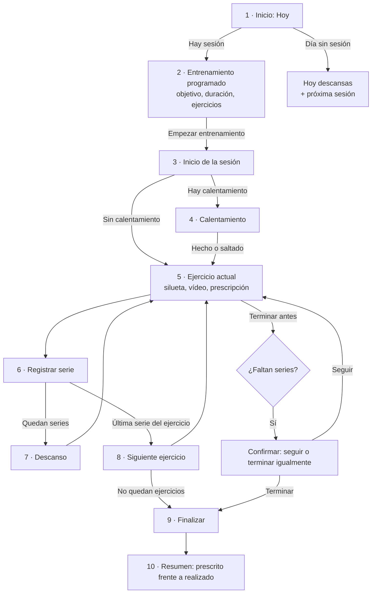

# Experiencia de entrenamiento guiada: análisis y diseño

> **Estado: análisis y diseño pendientes de aprobación. No hay código nuevo.** Este documento responde a los requisitos 1 a 9 de la experiencia de entrenamiento profesional y guiada. Se apoya en dos documentos de detalle: `EFFORT_AND_LOAD.md` (carga, esfuerzo, volumen y 1RM) y `MEDIA.md` (silueta y vídeos). Los cambios en el modelo de datos están en `DATA_MODEL.md` y las decisiones pendientes, en `DECISIONS.md`.

**Objetivo:** que el entrenador diseñe sesiones con toda la información necesaria y que el cliente, desde el móvil, vea qué le toca hoy y lo ejecute **sin interpretar la planificación ni tomar decisiones innecesarias**. En el portal del cliente, el entrenamiento es el protagonista; las estadísticas y el progreso tienen su propio apartado (ya es así en la Fase 1).

## Índice de entregables (R9)

| #   | Entregable                            | Dónde                               |
| --- | ------------------------------------- | ----------------------------------- |
| 1   | Análisis de los requisitos            | §1                                  |
| 2   | Modelo de datos                       | §7 y `DATA_MODEL.md` (§4, §5 y §12) |
| 3   | Interfaz del entrenador y del cliente | §2, §5 y §6                         |
| 4   | Flujo completo de entrenamiento       | §3 y §4                             |
| 5   | Gestión audiovisual                   | `MEDIA.md`                          |
| 6   | Lógica de carga y esfuerzo            | `EFFORT_AND_LOAD.md` (§1–§9)        |
| 7   | Integración con volumen y tonelaje    | `EFFORT_AND_LOAD.md` (§10)          |
| 8   | Riesgos técnicos                      | §8                                  |
| 9   | Riesgos científicos y limitaciones    | §9 y `EFFORT_AND_LOAD.md` (§11)     |
| 10  | Estimación de costes                  | §10 y `MEDIA.md` (§8)               |
| 11  | Priorización por fases                | §11                                 |
| 12  | Criterios de aceptación verificables  | §12                                 |

## 1. Análisis de los requisitos

| Req. | Qué pide                                                                                             | Qué existe ya (Fase 1)                                                                                                                                                                                                                                              | Qué falta                                                                                                                                                                                                                                      |
| ---- | ---------------------------------------------------------------------------------------------------- | ------------------------------------------------------------------------------------------------------------------------------------------------------------------------------------------------------------------------------------------------------------------- | ---------------------------------------------------------------------------------------------------------------------------------------------------------------------------------------------------------------------------------------------- |
| R1   | Ficha completa por ejercicio y variante: identificación, material visual e información técnica       | Nombre, variante, objetivo, clasificación en 4 dimensiones, patrón principal y secundarios, región, material, complejidad, ejecución, instrucciones, puntos clave, errores, consideraciones, variantes, progresiones y regresiones, notas personales del entrenador | Silueta **de cada variante** (hoy es un pictograma por tipo), vídeo breve y ampliado **gestionados por separado** y reproducidos dentro de TrainPro, alternativa si fallan, e **indicaciones individualizadas por cliente** visibles para él   |
| R2   | Carga y esfuerzo prescritos con varios sistemas, por serie; registro real separado; rigor científico | Carga en kg, peso corporal, %1RM, autorregulada o texto; esfuerzo RIR, RPE, carácter o ninguno, igual en todas las series; RIR/RPE real por ejercicio                                                                                                               | Rango de carga, lastre, asistencia, bandas y dispositivos, base de la carga, variación por serie, rangos de esfuerzo, escalas de RPE, criterios de finalización, kg calculados del %1RM, RIR/RPE real por serie, textos claros para el cliente |
| R3   | Experiencia guiada en 11 pasos                                                                       | Pantalla «Hoy» con la sesión protagonista y «Empezar» visible sin desplazarse; reproductor con series, descanso, RIR/RPE, observaciones, confirmación y resumen                                                                                                     | Calentamiento, navegación **ejercicio a ejercicio** (hoy es una única página larga), vídeo dentro de la app, vista de completado/pendiente, prescripción completa en la ficha del ejercicio                                                    |
| R4   | Flujo completo con casos límite                                                                      | Estados pendiente, en curso, completada, parcial y no realizada; series sin duplicados; confirmación al terminar incompleta                                                                                                                                         | Reanudar, dos sesiones en un día (hoy solo se muestra la primera), cambios del entrenador con versiones, días sin entrenamiento, **registro sin conexión**, conservación del historial, restricciones individuales                             |
| R5   | Planificación del entrenador por serie, con duplicados y plantillas                                  | Planificación de solo lectura                                                                                                                                                                                                                                       | Editor completo, variación por serie, duplicar sesiones y ejercicios, plantillas que conservan la individualización, publicación                                                                                                               |
| R6   | Volumen y tonelaje prescritos frente a ejecutados, por modalidad                                     | Series, repeticiones y tonelaje ejecutados (solo kg externos), sin duplicados, con fórmulas versionadas                                                                                                                                                             | Volumen y tonelaje **prescritos**, base de la carga, lastre, asistencia, intensidad relativa, carga respecto al peso corporal, estimación del 1RM                                                                                              |
| R7   | Cambios en datos, biblioteca, multimedia, permisos, portal y RGPD                                    | Modelo conceptual, permisos en casos de uso, procedencia, derechos del cliente diseñados                                                                                                                                                                            | Ver §7                                                                                                                                                                                                                                         |
| R8   | Diseño visual de 6 pantallas con la identidad aprobada                                               | Identidad, tokens, componentes, accesibilidad                                                                                                                                                                                                                       | Bocetos en §5 y §6                                                                                                                                                                                                                             |
| R9   | Documentación y criterios de aceptación                                                              | —                                                                                                                                                                                                                                                                   | Este documento                                                                                                                                                                                                                                 |

**Funcionalidades que se conservan sin cambios:** estados de sesión deducidos de lo realizado, confirmación al terminar con series pendientes, resumen fiel, series sin duplicados, biblioteca multidimensional con búsqueda Y/O, niveles global, personalizado y privado, permisos en los casos de uso y procedencia de los datos. El nuevo diseño las **amplía**; no las sustituye.

## 2. Ficha del ejercicio (R1)

### 2.1 Contenido

| Bloque                             | Campos                                                                                                                                                                        | Origen                                                         |
| ---------------------------------- | ----------------------------------------------------------------------------------------------------------------------------------------------------------------------------- | -------------------------------------------------------------- |
| **A. Identificación**              | Nombre del ejercicio principal y de la variante; objetivo y aplicaciones; etiquetas (4 dimensiones); patrón principal y secundarios; región; material; complejidad; ejecución | Ya existe en `ExerciseVariant`                                 |
| **B. Material visual**             | Silueta de la variante, vídeo breve (< 15 s), vídeo ampliado opcional (≤ 45 s)                                                                                                | Nuevo: `variant_media` (ver `MEDIA.md`)                        |
| **C. Información técnica**         | Instrucciones, puntos clave, errores frecuentes, consideraciones, variantes, progresiones y regresiones                                                                       | Ya existe                                                      |
| **C. Indicaciones del entrenador** | **Para un cliente concreto** («Mantén el pecho alto», «Sin pasar de 90° de rodilla»), visibles para él en todas sus sesiones con esa variante, y **para una sesión concreta** | Nuevo: `client_exercise_guidance` y `notes` de la prescripción |
| Notas privadas                     | Observaciones personales del entrenador sobre la variante                                                                                                                     | Ya existe (`TrainerExerciseNote`); **nunca** las ve el cliente |

### 2.2 Reglas

- Las indicaciones individualizadas tienen dos alcances: **del cliente** (persisten) y **de la sesión** (solo ese día). El cliente ve ambas, marcadas como «Indicación de Alex».
- Las restricciones que proceden de la salud (por ejemplo, de un caso de readaptación) se muestran al cliente como **instrucción**, sin el diagnóstico, y se rigen por los permisos de los datos de salud.
- Cada variante tiene su propia ficha. Una copia adaptada hereda las instrucciones y los recursos visuales del original hasta que se sustituyen (ADR-19).

## 3. Flujo de entrenamiento del cliente (R3 y R4)

### 3.1 Pasos



| Paso del requisito                                  | Pantalla                                                                                                               |
| --------------------------------------------------- | ---------------------------------------------------------------------------------------------------------------------- |
| 1. Ver qué entrenamiento tiene hoy                  | **Hoy** (§6, C)                                                                                                        |
| 2. Objetivo, duración aproximada, n.º de ejercicios | Tarjeta protagonista de **Hoy** y vista previa del **entrenamiento programado**                                        |
| 3. «Empezar entrenamiento»                          | Botón principal, visible sin desplazarse (ya comprobado en E2E)                                                        |
| 4. Calentamiento, si está programado                | Lista de ejercicios del calentamiento, con casilla y temporizador; se puede **saltar** (queda registrado como saltado) |
| 5. Primer ejercicio                                 | **Ejercicio actual** (§6, B)                                                                                           |
| 6. Silueta, vídeo, instrucciones y prescripción     | Todo en la misma pantalla; instrucciones desplegables                                                                  |
| 7. Registrar cada serie                             | **Registro de series** en la misma pantalla (§6, D): valores previstos rellenados, confirmar con un toque              |
| 8. Descanso y temporizador                          | **Descanso** (§6, E), automático al registrar la serie                                                                 |
| 9. Siguiente ejercicio                              | Botón «Siguiente ejercicio» y deslizamiento lateral                                                                    |
| 10. Completado y pendiente                          | Barra de progreso + panel «Tu sesión» con todos los ejercicios y su estado, accesible desde cualquier ejercicio        |
| 11. Finalizar y resumen                             | **Resumen final** (§6, F)                                                                                              |

Durante cada ejercicio se ve, **sin cambiar de pantalla**: nombre, silueta, vídeo breve, acceso al ampliado (si existe), series y repeticiones, **carga prescrita**, **esfuerzo objetivo**, descanso, tempo (si procede) e indicaciones del entrenador.

**Ampliación propuesta (6 de noviembre de 2026, pendiente de aprobación):**

- **Valoración previa** entre «Empezar entrenamiento» y el calentamiento: energía y recuperación de 1 a 10 (sin la pregunta de dolor, según la recomendación revisada de P-58). Se responde en menos de 10 segundos y se puede saltar.
- **Molestias:** al saltar un ejercicio o terminar una serie antes de tiempo, el motivo neutro «molestias», sin escala ni zona, y las observaciones libres. El registro estructurado del dolor, solo en E4 y si se aprueba (P-58).
- **RPE de la sesión** al terminar, en todas las sesiones, con «Responder más tarde».
- En la 1C, si el entrenador tiene reglas preautorizadas, la sesión puede cambiar tras la valoración previa, y el cliente ve el cambio explicado. Una valoración aislada, como mucho, impide el incremento previsto (`PROGRESSION_AND_AUTOREGULATION.md` §5.14).

Detalle en `PROGRESSION_AND_AUTOREGULATION.md` §4 a §6 (P-45, P-47, P-48).

### 3.2 Bloques, superseries y circuitos

El modelo ya agrupa los ejercicios por bloques (A, B, C). En un bloque con varios ejercicios (superserie o circuito), el orden de registro alterna los ejercicios del bloque y el descanso se aplica al terminar la ronda, según lo indique el entrenador (`blockMode`: `sequential` | `superset` | `circuit`). El panel «Tu sesión» muestra la ronda actual.

## 4. Casos límite (R4)

| Caso                                  | Comportamiento propuesto                                                                                                                                                                                                                                                                                                                                                                                                                                                              |
| ------------------------------------- | ------------------------------------------------------------------------------------------------------------------------------------------------------------------------------------------------------------------------------------------------------------------------------------------------------------------------------------------------------------------------------------------------------------------------------------------------------------------------------------- |
| **Sesión parcial**                    | Se conserva el estado actual: «Parcial o interrumpida» si se terminó o pasó el día con parte de las series. El resumen muestra lo que falta.                                                                                                                                                                                                                                                                                                                                          |
| **Interrumpida y retomada**           | Si la app se cierra, el registro queda abierto. Al volver, «Hoy» muestra **«Continuar entrenamiento»** y abre la primera serie pendiente. Se puede retomar **cualquier día** (P-17 revisada): si es de otro día, aparece como «Interrumpida» y se puede continuar o terminar.                                                                                                                                                                                                         |
| **No realizada**                      | Pasa el día sin empezarla → «Sin hacer» (en las pantallas actuales, «No realizada»); se puede hacer otro día (P-83 revisada). El cliente puede indicar «No he podido entrenar» con un motivo opcional (autodeclarado). **No hay reprogramación automática**: lo decide el entrenador.                                                                                                                                                                                                 |
| **Cambios del entrenador**            | Las sesiones tienen **versiones**. Si aún no ha empezado, el cliente ve la versión nueva con la marca «Actualizada por tu entrenador». Si está en curso, las series **pendientes** adoptan la versión nueva con el aviso «Tu entrenador ha actualizado la sesión» y «Ver qué ha cambiado», sin que el cliente tenga que decidir nada (P-18 revisada, `V1_SPEC.md` §5.4). Las series ya hechas siguen ligadas a la versión con la que se hicieron. Lo ya realizado nunca se reescribe. |
| **Días sin entrenamiento**            | «Hoy descansas» con ilustración, la próxima sesión y su fecha. Sin mensajes de culpa ni recuentos negativos.                                                                                                                                                                                                                                                                                                                                                                          |
| **Dos sesiones el mismo día**         | Cada una con su orden (y una etiqueta opcional, como «Mañana» o «Tarde»), su registro y su estado. «Hoy» muestra las dos, con la primera pendiente destacada. Empezar la segunda con la primera en curso pide confirmación (P-21). Hoy el portal solo muestra la primera sesión del día: V1 lo corrige (`V1_SPEC.md` §3, B1).                                                                                                                                                         |
| **Pérdida de conexión**               | La sesión del día y sus fichas se guardan en el móvil al abrir «Hoy». Cada serie se guarda **primero en el dispositivo** (IndexedDB) con su identificador y se envía cuando hay conexión. La interfaz distingue «Guardado en el móvil» de «Enviado». iOS no admite la sincronización en segundo plano, así que se envía al abrir la app, al recuperar la conexión o al volver a ella.                                                                                                 |
| **Conservación de los registros**     | Registro solo de adición: una corrección crea una versión nueva y conserva la anterior. El cliente no borra series enviadas (las corrige). El entrenador **no edita lo realizado** por el cliente: puede anotarlo. El borrado solo se hace por el procedimiento de derechos (`DATA_RIGHTS.md`). Al cerrar sesión se borran los datos guardados en el dispositivo.                                                                                                                     |
| **Indicaciones o restricciones**      | Aparecen en la ficha del ejercicio afectado como aviso destacado y en la vista previa de la sesión. Si una restricción afecta a un ejercicio prescrito, el entrenador ve el aviso al planificar.                                                                                                                                                                                                                                                                                      |
| **Serie registrada dos veces**        | Tres barreras: identificador generado en el dispositivo (un reenvío no crea otra serie), «última versión válida por ejercicio y número de serie» (ya implementado en `effectiveSetRecords`) y restricción única en la base de datos.                                                                                                                                                                                                                                                  |
| **Ejercicio que no se puede hacer**   | «No puedo hacer este ejercicio» con motivo (sin material, molestias, otro). Queda registrado y el ejercicio no cuenta como hecho. No se proponen sustitutos automáticos; si el entrenador definió una alternativa, se ofrece.                                                                                                                                                                                                                                                         |
| **Pantalla bloqueada en el descanso** | El temporizador se basa en la hora de fin, no en un contador: al desbloquear, el tiempo es correcto. Se pedirá mantener la pantalla encendida (API Wake Lock) donde el navegador lo permita; su compatibilidad en iOS está por verificar.                                                                                                                                                                                                                                             |

## 5. Planificación del entrenador (R5)

### 5.1 Editor del ejercicio en la sesión

| Campo                          | Detalle                                                                                                       |
| ------------------------------ | ------------------------------------------------------------------------------------------------------------- |
| Variante                       | Buscador de la biblioteca (el mismo, con filtros Y/O)                                                         |
| Bloque y orden                 | A, B, C… y modo del bloque (secuencial, superserie, circuito)                                                 |
| Series                         | Número de series de trabajo y, opcionalmente, series de aproximación (P-20)                                   |
| Repeticiones                   | Fijas, rango, tiempo o distancia; **por lado** si es unilateral                                               |
| Sistema de carga y carga       | Una de las 10 modalidades de `EFFORT_AND_LOAD.md` §3; los campos cambian con la modalidad                     |
| Sistema de esfuerzo y objetivo | RIR, RPE (con escala), ambos con justificación, carácter, criterio de calidad o sin escala. **Empieza vacío** |
| Criterios de finalización      | Opcionales (`EFFORT_AND_LOAD.md` §5)                                                                          |
| Descanso                       | Segundos; por serie si cambia                                                                                 |
| Tempo                          | Tres o cuatro fases (P-22)                                                                                    |
| Observaciones                  | **Visibles para el cliente** y **privadas** (separadas)                                                       |
| Recursos visibles              | Mostrar u ocultar el vídeo breve y el ampliado en esta sesión; instrucciones del catálogo o propias           |
| Indicaciones                   | Para esta sesión, o para el cliente con esta variante                                                         |

**Variación por serie:** el ejercicio tiene valores comunes y una tabla de series en la que se cambia cualquier valor de una serie concreta (repeticiones, carga, esfuerzo, descanso o criterio). Así se programan pirámides, series descendentes, contrastes o esfuerzos progresivos sin estructuras rígidas.

**Validaciones al publicar** (bloquean la publicación):

- %1RM sin referencia de 1RM del cliente para ese ejercicio.
- RIR y RPE juntos sin justificación, o con la escala basada en RIR (redundante).
- RPE sin escala.
- RIR en series por tiempo o distancia.
- Valores fuera de rango (§7.3 de `EFFORT_AND_LOAD.md`).

**Avisos** (no bloquean): restricción del cliente que afecta al ejercicio, RIR en ejercicios marcados como potencia o técnica, RIR de 5 o más, o series de más de 12 repeticiones con RIR.

### 5.2 Duplicar y plantillas sin perder la individualización

| Acción                                    | Qué se copia                                                                   | Qué **no** se copia                                                                                                               |
| ----------------------------------------- | ------------------------------------------------------------------------------ | --------------------------------------------------------------------------------------------------------------------------------- |
| Duplicar un ejercicio dentro de la sesión | Toda su prescripción                                                           | —                                                                                                                                 |
| Duplicar una sesión al mismo cliente      | Toda la sesión, en otra fecha                                                  | Registros de ejecución                                                                                                            |
| Duplicar una sesión a otro cliente        | Estructura, ejercicios, series, repeticiones, esfuerzo, descansos, tempo, %1RM | **Indicaciones y restricciones del cliente de origen**, notas privadas; **kg concretos**, salvo que el entrenador lo elija (P-19) |
| Guardar como plantilla                    | Igual que «a otro cliente»; la plantilla pertenece al entrenador               | Todo lo individual                                                                                                                |
| Aplicar una plantilla a un cliente        | La prescripción, **copiada** (no enlazada)                                     | —                                                                                                                                 |

Al aplicar una plantilla o duplicar a otro cliente:

- El %1RM se resuelve con **la referencia de ese cliente**. Si no la tiene, se marca para revisar y no se puede publicar.
- Se añaden automáticamente **sus** indicaciones y restricciones.
- La sesión guarda de qué plantilla procede (`derived_from_template_id`) para trazabilidad. Cambiar la plantilla **no modifica** las sesiones ya creadas, salvo que el entrenador lo propague de forma explícita a las sesiones futuras que no han empezado.

### 5.3 Publicación

Las sesiones están en **borrador** hasta que el entrenador las publica. El cliente solo ve las publicadas. Al publicar se congelan los kg calculados a partir del %1RM (`EFFORT_AND_LOAD.md` §3).

## 6. Diseño visual (R8)

Se mantiene la identidad aprobada: amarillo cálido (`sun-400`) para la acción principal, fondo crema (`cream-100`), tarjetas blancas muy redondeadas (`rounded-3xl`, y `rounded-[2rem]` en las protagonistas), titulares en Bricolage Grotesque, pictogramas propios, estados con icono y texto. Nada de tablas densas ni de aspecto de SaaS genérico.

**Patrón nuevo, «la tarjeta de prescripción»:** carga y esfuerzo son los dos datos más grandes de la pantalla del ejercicio, en tipografía de titulares, sobre fondo `sun-100` con texto `ink-900` (contraste suficiente; el amarillo de marca nunca se usa como color de texto). Los valores estimados usan `plum` y los calculados, `sky`, como ya ocurre con la procedencia. Las cifras realizadas que difieren de lo prescrito se marcan con icono y texto, no solo con color.

Los bocetos son conceptuales (anchura de móvil, 360–412 px, salvo el A).

### A. Ficha completa del ejercicio (entrenador, escritorio)

```
┌──────────────────────────────────────────────────────────────────────────────┐
│ ← Biblioteca     Sentadilla › SENTADILLA FRONTAL            [★] [Adaptar]    │
│ Global · Intermedia · Bilateral · Barra · Tren inferior (rodilla, cadera)    │
├───────────────────────────────┬──────────────────────────────────────────────┤
│  ┌─────────────────────────┐  │  Objetivo y aplicaciones                     │
│  │      ▶  vídeo breve     │  │  Fuerza de tren inferior con tronco erguido… │
│  │        (12 s)           │  │                                              │
│  └─────────────────────────┘  │  Clasificación                               │
│  RECURSOS VISUALES            │  Cualidades  [Fuerza máxima] [Fuerza general]│
│  ┌───────┐ ┌───────┐ ┌──────┐ │  Métodos     —                               │
│  │Silueta│ │Breve  │ │Ampli-│ │  Acciones    [Concéntrico]                   │
│  │ ✓ pub.│ │✓ 12 s │ │ado   │ │  Aplicación  [Trabajo con % 1RM]             │
│  │       │ │       │ │+ Añad│ │  Patrón      ● Dominante de rodilla (princ.) │
│  │[Camb.]│ │[Camb.]│ │      │ │              ○ Anti-flexión (secundario)     │
│  └───────┘ └───────┘ └──────┘ │                                              │
│  Cada recurso se gestiona     │  Instrucciones · Puntos clave · Errores ·    │
│  por separado                 │  Consideraciones           (pestañas)        │
├───────────────────────────────┴──────────────────────────────────────────────┤
│ Variantes (4)   Progresiones →  Sentadilla frontal con pausa                 │
│                 ← Regresiones   Sentadilla goblet                            │
├──────────────────────────────────────────────────────────────────────────────┤
│ INDICACIONES PARA CLIENTES                         NOTAS PRIVADAS (solo tú)  │
│ Marta · «Codos altos, baja controlando»  [Editar]  «Revisar movilidad de…»   │
│ + Añadir indicación para un cliente                                          │
└──────────────────────────────────────────────────────────────────────────────┘
```

### B. Ejercicio durante el entrenamiento (cliente)

```
┌────────────────────────────────────┐
│ ✕  Fuerza tren inferior   2 / 6  ☰ │  ☰ = Tu sesión (hecho / pendiente)
│ ▓▓▓▓▓▓▓░░░░░░░░░░░░░ 7 de 18 series │
├────────────────────────────────────┤
│ ┌────────────────────────────────┐ │
│ │   [silueta]   ▶ vídeo breve    │ │  Si el vídeo no carga: silueta
│ │                    ❚❚ Pausa    │ │  + «No se ha podido cargar»
│ └────────────────────────────────┘ │
│  ▷ Ver explicación (40 s)          │  Vídeo ampliado en hoja deslizante
│                                    │
│  SENTADILLA TRASERA                │
│  4 series × 6 repeticiones         │
│ ╭────────────────────────────────╮ │
│ │ CARGA            ESFUERZO      │ │  Tarjeta de prescripción:
│ │ 80 kg            RIR 2  ⓘ      │ │  lo más grande de la pantalla
│ │                  ~2 repeticiones│ │
│ │                  de margen     │ │
│ ╰────────────────────────────────╯ │
│  Descanso 2 min · Tempo 2-0-1 ⓘ    │
│                                    │
│ ┃ Indicación de Alex               │  Aviso con borde sol
│ ┃ «Mantén el pecho alto»           │
│                                    │
│  ▸ Cómo se hace (instrucciones)    │  Desplegable, en la misma pantalla
│  [Serie actual: ver D ↓]           │
└────────────────────────────────────┘
```

### C. Pantalla principal del cliente (Hoy)

```
┌────────────────────────────────────┐
│  Hola, Marta              jue 6 nov│
│ ╭────────────────────────────────╮ │
│ │ HOY · Pendiente                │ │  Tarjeta protagonista (rounded-[2rem])
│ │ Fuerza tren inferior           │ │
│ │ ◷ 55 min · 6 ejercicios        │ │
│ │ Objetivo: fuerza y técnica     │ │
│ │ «Hoy prioriza la técnica» Alex │ │
│ │ ┌────────────────────────────┐ │ │
│ │ │   EMPEZAR ENTRENAMIENTO    │ │ │  Botón sol, visible sin desplazarse
│ │ └────────────────────────────┘ │ │
│ ╰────────────────────────────────╯ │
│  Tarde · Movilidad · 20 min    ›   │  Segunda sesión del día, si la hay
│                                    │
│  Esta semana  L ✓  M ·  X ✓  J ●  V│
│  Próxima: sábado · Potencia        │
├────────────────────────────────────┤
│   Hoy       Semana       Progreso  │  Navegación inferior (ya existe)
└────────────────────────────────────┘
Variantes: «Continuar entrenamiento» (en curso) · «Hoy descansas» + próxima sesión.
```

### D. Registro de series

```
┌────────────────────────────────────┐
│  SERIE 3 DE 4                      │
│ ┌──────────────┐ ┌───────────────┐ │
│ │ CARGA        │ │ REPETICIONES  │ │  Rellenas con lo prescrito
│ │ [−] 80 kg [+]│ │ [−]   6   [+] │ │  ± según el incremento del material
│ └──────────────┘ └───────────────┘ │
│  ¿Cuántas te quedaban? (opcional)  │  Solo si se prescribió RIR
│  (0) (1) [2] (3) (4+)              │
│  ▸ Añadir observación              │
│ ┌────────────────────────────────┐ │
│ │        ✓  SERIE HECHA          │ │  Un toque si todo coincide
│ └────────────────────────────────┘ │
│  ✓ S1  80 kg × 6 · RIR 2           │
│  ✓ S2  80 kg × 6 · RIR 2           │
│  ✎ S3  77,5 kg × 6 · RIR 1  ≠ plan │  Diferencia marcada con icono y texto
│  ○ S4  80 kg × 6 · RIR 2           │
│  Guardado en el móvil · enviando…  │  Estado de sincronización
└────────────────────────────────────┘
```

### E. Descanso

```
┌────────────────────────────────────┐
│            DESCANSO                │
│           ╭────────╮               │
│           │  1:24  │               │  Anillo de progreso; cifras grandes
│           ╰────────╯               │
│    [ −15 s ]  [ +15 s ]  [Saltar]  │
│                                    │
│  A continuación                    │
│  Serie 4 de 4 · 80 kg × 6 · RIR 2  │  O el siguiente ejercicio, con su
│                                    │  silueta y su carga
│  Respira y bebe agua               │  Ilustración de descanso (ya existe)
└────────────────────────────────────┘
```

### F. Resumen final

```
┌────────────────────────────────────┐
│  Sesión terminada parcialmente     │  O «¡Sesión completada!»
│  16 de 18 series · 52 min          │
│ ┌────────────────────────────────┐ │
│ │ Sentadilla trasera     ✓ 4/4   │ │
│ │ Plan  4 × 6 · 80 kg · RIR 2    │ │
│ │ Hecho 6,6,6,6 · 80/80/77,5/80  │ │
│ │       RIR 2,2,1,2              │ │
│ ├────────────────────────────────┤ │
│ │ Peso muerto rumano     ◐ 2/3   │ │
│ │ Plan  3 × 8 · 70–75 kg · RIR 3 │ │
│ │ Hecho 8,8 · 70/72,5            │ │
│ └────────────────────────────────┘ │
│  ¿Cómo de dura ha sido la sesión?  │  En todas las sesiones, salvo desactivación con motivo (P-48)
│  (0)…(10)                          │
│  Mensaje para Alex  [__________]   │
│ ┌────────────────────────────────┐ │
│ │      ENVIAR A MI ENTRENADOR    │ │
│ └────────────────────────────────┘ │
└────────────────────────────────────┘
```

El tonelaje no aparece en el resumen del cliente salvo que el entrenador comparta el volumen. En la ficha del entrenador sí se muestran el volumen y el tonelaje prescritos frente a los ejecutados.

## 7. Cambios de modelo de datos y arquitectura (R7)

| Área                         | Cambio                                                                                                                                                                                                                                                                                                                                        |
| ---------------------------- | --------------------------------------------------------------------------------------------------------------------------------------------------------------------------------------------------------------------------------------------------------------------------------------------------------------------------------------------- |
| **Modelo de datos**          | Prescripción v2 (modalidades de carga, esfuerzo por serie, escalas, criterios), registro de series v2, versiones de sesión, calentamiento, plantillas, recursos visuales. Detalle en `DATA_MODEL.md` §4, §5 y §12                                                                                                                             |
| **Biblioteca**               | Huecos `silhouette`, `demo_short` y `demo_extended` por variante; la silueta por tipo pasa a ser la alternativa                                                                                                                                                                                                                               |
| **Variantes personalizadas** | Las copias adaptadas reutilizan los recursos del original hasta sustituirlos; las indicaciones por cliente no pertenecen a la variante sino a la relación cliente–variante                                                                                                                                                                    |
| **Multimedia**               | Archivos fuera de la base de datos, con metadatos y derechos; puerto `MediaStorage` en `src/server` (ver `MEDIA.md`)                                                                                                                                                                                                                          |
| **Prescripción**             | `LoadSpec`, `EffortTarget` v2, `StopCriterion`, `SetPrescription` (excepciones por serie), tempo de 3 o 4 fases                                                                                                                                                                                                                               |
| **Registro de series**       | `SetLog` v2 con identificador del dispositivo, carga realizada por modalidad, RIR/RPE por serie, motivo de parada, `supersedes` y versión de la prescripción                                                                                                                                                                                  |
| **Planificación**            | Borrador y publicado, versiones, plantillas, duplicados con reglas de individualización                                                                                                                                                                                                                                                       |
| **Carga y volumen**          | Métricas nuevas y `training.volume-load` 2.0.0 (`EFFORT_AND_LOAD.md` §10)                                                                                                                                                                                                                                                                     |
| **Roles y permisos**         | Políticas nuevas en `src/domain/access.ts`: `canViewMedia`, `canManageMedia` (administración: global; entrenador: lo suyo), `canEditPrescription` (solo el entrenador responsable), `canLogExecution` (solo el propio cliente, en sesiones publicadas suyas), `canAnnotateExecution` (entrenador). Cada una con tests de acceso no autorizado |
| **Portal del cliente**       | Reproductor por pasos, calentamiento, dos sesiones al día, cola de envío sin conexión, aviso de cambios                                                                                                                                                                                                                                       |
| **Seguridad y RGPD**         | Datos en el dispositivo cifrados por el sistema y borrados al cerrar sesión; URLs firmadas para medios privados; cesiones de imagen; restricciones de salud sin diagnóstico; ver `SECURITY_PRIVACY.md` y `DATA_RIGHTS.md`                                                                                                                     |

**Arquitectura:** se mantienen las capas. La lógica nueva (modalidades, validaciones, kg del %1RM, métricas, series efectivas con versiones) va al **dominio puro** y se comparte entre el servidor y el portal, como ya ocurre con el estado de la sesión. La cola sin conexión vive en `src/features/client` y envía a un caso de uso idempotente del servidor. No se añaden dependencias: IndexedDB, `<video>`, Wake Lock y el _service worker_ son APIs del navegador (detalle en `ARCHITECTURE.md`).

## 8. Riesgos técnicos

| Riesgo                                                                                                      | Impacto | Mitigación                                                                                                        |
| ----------------------------------------------------------------------------------------------------------- | ------- | ----------------------------------------------------------------------------------------------------------------- |
| Sincronización sin conexión (duplicados, orden, conflictos)                                                 | Alto    | Identificadores del dispositivo, envío idempotente, «última versión válida», restricción única y tests de reenvío |
| Limitaciones de las PWA en iOS (sin sincronización en segundo plano, borrado del almacenamiento, Wake Lock) | Medio   | Envío al abrir o recuperar la conexión; avisar si hay datos sin enviar; probar en iPhone real                     |
| Versiones de sesión y series ligadas a versiones antiguas                                                   | Medio   | Modelo explícito de versiones; las series referencian la versión; tests de cambios en sesiones en curso           |
| Complejidad del editor por serie en pantallas pequeñas                                                      | Medio   | Valores comunes + excepciones; el editor completo, en escritorio y tableta                                        |
| Migración del modelo actual (`kg` → `external`, `autoregulated` → `self_selected`) y de los datos demo      | Bajo    | Correspondencia documentada en `DATA_MODEL.md`; tests que comparan resultados antes y después                     |
| Reproducción de vídeo (Safari, CSP, peso)                                                                   | Medio   | Ver `MEDIA.md` §11                                                                                                |
| Temporizador con la pantalla bloqueada                                                                      | Bajo    | Cálculo por hora de fin; ya se usa un reloj monótono                                                              |
| Rendimiento del reproductor en móviles modestos                                                             | Bajo    | Un ejercicio por pantalla y vídeos ligeros; medir en la Fase 10                                                   |
| Crecimiento del alcance                                                                                     | Alto    | Priorización por etapas (§11) con aprobación en cada una                                                          |

## 9. Riesgos científicos y limitaciones

Resumen (el detalle y las referencias están en `EFFORT_AND_LOAD.md` §11 y §12):

- El RIR y el RPE son **estimaciones subjetivas**, con error mayor lejos del fallo y en series largas.
- RPE y RIR **no son intercambiables** fuera de la escala basada en RIR; TrainPro no convierte entre escalas.
- La estimación del 1RM con RIR **no tiene validación publicada encontrada**: si se aprueba, se mostrará como aproximación con margen, con condiciones estrictas y nunca de forma automática.
- La evidencia se concentra en adultos jóvenes entrenados y en pocos ejercicios con barra.
- Los textos para el cliente simplifican conceptos y deben revisarse (P-26).
- Ninguna regla automática sustituye el criterio del profesional, sobre todo en salud y readaptación.

## 10. Estimación de costes

| Concepto                                                       | Coste                                                                                                                      |
| -------------------------------------------------------------- | -------------------------------------------------------------------------------------------------------------------------- |
| Desarrollo sobre datos demo (etapa A del §11)                  | **0 €**: sin servicios ni dependencias nuevas                                                                              |
| Base de datos y autenticación                                  | Según `INFRASTRUCTURE.md` (0 € en local; ~25–30 $/mes en producción mínima con datos reales)                               |
| Almacenamiento y entrega de vídeos                             | **+0 $** dentro de Supabase Pro o en Cloudflare R2 con el volumen previsto; mínimo 1 $/mes en Bunny Stream (`MEDIA.md` §8) |
| Producción de contenido (siluetas, vídeos, cesiones de imagen) | **Sin estimar**: coste humano o de encargo; es la partida principal (P-33)                                                 |
| Medidores de velocidad u otros dispositivos                    | No se integran (P-25)                                                                                                      |

## 11. Priorización por fases

> La priorización vigente de la 1B es la de `IMPLEMENTATION_READINESS.md` (clases A–D y entregas verticales V1–V6). Esta tabla se conserva como referencia de cómo se repartía el trabajo entre las fases.

**Propuesta (P-16): una etapa A antes de la Fase 2**, sin infraestructura ni costes, para fijar el modelo de prescripción antes de diseñar el esquema de la base de datos. Así se evita migrarlo después. La alternativa es repartir todo en las fases 4 a 8 del plan original.

| Etapa o fase                            | Contenido                                                                                                                                                                                                                                                                                                                                                                                                                   | Depende de                |
| --------------------------------------- | --------------------------------------------------------------------------------------------------------------------------------------------------------------------------------------------------------------------------------------------------------------------------------------------------------------------------------------------------------------------------------------------------------------------------- | ------------------------- |
| **A · Fase 1B** (propuesta, datos demo) | Prescripción v2 y registro de series v2 en el dominio, con tests; datos demo con todas las modalidades; reproductor por pasos (calentamiento, ejercicio actual, registro, descanso, siguiente, «Tu sesión», resumen); tarjeta de prescripción; textos para el cliente; dos sesiones al día; ficha del entrenador con los tres huecos visuales (con la silueta genérica como alternativa y los vídeos como `PendingFeature`) | Aprobación de este diseño |
| **Fase 2** · Autenticación y usuarios   | Esquema de base de datos que ya incluye el modelo v2                                                                                                                                                                                                                                                                                                                                                                        | P-01, P-02                |
| **Fase 4** · Biblioteca                 | Recursos visuales con almacenamiento real, siluetas por variante, gestión de la administración, indicaciones por cliente                                                                                                                                                                                                                                                                                                    | P-32, P-33                |
| **Fase 5** · Evaluaciones               | 1RM directo como referencia del %1RM, con fecha y procedencia; 1RM estimado introducido a mano                                                                                                                                                                                                                                                                                                                              | —                         |
| **Fase 6** · Planificación              | Editor completo por serie, validaciones, plantillas, duplicados, versiones y publicación                                                                                                                                                                                                                                                                                                                                    | Fase 2                    |
| **Fase 7** · Portal del cliente         | Persistencia, cola sin conexión, reanudación, aviso de cambios, vídeos dentro de la app                                                                                                                                                                                                                                                                                                                                     | Fases 2, 4 y 6            |
| **Fase 8** · Carga y volumen            | Volumen y tonelaje prescritos frente a ejecutados, `training.volume-load` 2.0.0, intensidad relativa, carga respecto al peso corporal, RPE de la sesión; estimación del 1RM tras verificar su fuente (P-23)                                                                                                                                                                                                                 | Fases 5 y 7               |
| **Fase 10** · Validación                | Pruebas en dispositivos iOS y Android reales, rendimiento, accesibilidad y uso sin conexión                                                                                                                                                                                                                                                                                                                                 | —                         |

## 12. Criterios de aceptación verificables

Tipo de prueba: **U** = test unitario o de integración (Vitest), **E** = E2E (Playwright, escritorio y móvil), **M** = revisión manual documentada.

### Ficha del ejercicio (R1)

| Id    | Criterio                                                                                                                         | Prueba |
| ----- | -------------------------------------------------------------------------------------------------------------------------------- | ------ |
| CA-01 | La ficha del entrenador muestra todos los campos de identificación del §2.1 para cualquier variante del catálogo demo            | E      |
| CA-02 | Silueta, vídeo breve y vídeo ampliado se pueden publicar, sustituir y retirar por separado; cambiar uno no altera los otros dos  | U, E   |
| CA-03 | El sistema rechaza un vídeo breve de 15 s o más y un ampliado de más de 45 s                                                     | U      |
| CA-04 | El ampliado nunca aparece en el lugar del breve (y, si se aprueba P-28, no se publica sin el breve)                              | U, E   |
| CA-05 | Si el vídeo falla al cargar, la silueta y las instrucciones siguen visibles y aparece el aviso con «Reintentar»                  | E      |
| CA-06 | Sin silueta propia, se muestra la genérica con la etiqueta «Silueta genérica»                                                    | E      |
| CA-07 | Las indicaciones de un cliente para una variante aparecen en todas sus sesiones con esa variante y en las de ningún otro cliente | U, E   |
| CA-08 | Las notas privadas del entrenador no llegan nunca al cliente (ni en los datos que recibe el navegador)                           | U      |

### Carga y esfuerzo (R2)

| Id    | Criterio                                                                                                                                                                                    | Prueba |
| ----- | ------------------------------------------------------------------------------------------------------------------------------------------------------------------------------------------- | ------ |
| CA-09 | Se pueden prescribir los seis ejemplos del requisito (80 kg; 75 % 1RM; 70–75 kg; peso corporal + 10 kg; asistencia de 20 kg; peso corporal sin carga) y el cliente ve cada uno con su texto | U, E   |
| CA-10 | El formulario muestra solo los campos de la modalidad elegida                                                                                                                               | E      |
| CA-11 | Con %1RM, los kg se calculan con la referencia y el redondeo indicados, con la fórmula y su versión, y no cambian si la referencia cambia después de publicar                               | U      |
| CA-12 | No se puede publicar %1RM sin referencia                                                                                                                                                    | U      |
| CA-13 | Al añadir un ejercicio, el esfuerzo empieza vacío: no hay RIR ni RPE por defecto                                                                                                            | U, E   |
| CA-14 | Se pueden prescribir un esfuerzo común, uno distinto por serie y un rango, y el cliente ve el de la serie actual                                                                            | U, E   |
| CA-15 | RIR y RPE juntos exigen justificación y se rechazan con la escala basada en RIR                                                                                                             | U      |
| CA-16 | Todo RPE prescrito o registrado lleva su escala, y no se comparan datos de escalas distintas                                                                                                | U      |
| CA-17 | Un ejercicio técnico o de potencia se puede prescribir sin escala, con un criterio de calidad o velocidad visible para el cliente                                                           | E      |
| CA-18 | La ayuda de RIR y RPE se abre en la misma pantalla con el texto aprobado (P-26)                                                                                                             | E      |
| CA-19 | Registrar una carga distinta de la prescrita guarda la realizada y deja intacta la prescripción                                                                                             | U      |
| CA-20 | Lo realizado (`self_reported`), lo prescrito y lo calculado o estimado se muestran diferenciados, con su procedencia                                                                        | E      |
| CA-21 | No existe ninguna regla que cambie cargas o esfuerzos sin la acción del entrenador                                                                                                          | U, M   |

### Experiencia y flujo del cliente (R3 y R4)

| Id    | Criterio                                                                                                                            | Prueba |
| ----- | ----------------------------------------------------------------------------------------------------------------------------------- | ------ |
| CA-22 | En «Hoy» se ven objetivo, duración aproximada, número de ejercicios y «Empezar entrenamiento» sin desplazarse (Pixel 7 y 360 × 640) | E      |
| CA-23 | Si hay calentamiento, se muestra antes del primer ejercicio y se puede saltar; si no, se pasa directamente al primer ejercicio      | E      |
| CA-24 | En la pantalla del ejercicio están, sin navegar a otra, todos los datos del §3.1                                                    | E      |
| CA-25 | Registrar una serie con los valores previstos requiere un solo toque                                                                | E      |
| CA-26 | El descanso empieza al registrar la serie, admite ±15 s y saltar, muestra lo siguiente y es correcto tras bloquear la pantalla      | U, E   |
| CA-27 | «Tu sesión» muestra lo hecho y lo pendiente desde cualquier ejercicio                                                               | E      |
| CA-28 | El resumen muestra, por ejercicio, lo prescrito frente a lo realizado serie a serie                                                 | E      |
| CA-29 | Una sesión interrumpida se retoma en la primera serie pendiente sin perder lo registrado                                            | E      |
| CA-30 | Con dos sesiones el mismo día, se ven ambas con su estado y cada una se registra por separado                                       | U, E   |
| CA-31 | Un día sin sesión muestra «Hoy descansas» y la próxima sesión                                                                       | E      |
| CA-32 | Sin conexión se pueden registrar todas las series; al recuperarla se envían y el estado pasa de «Guardado en el móvil» a «Enviado»  | E      |
| CA-33 | Reenviar la misma serie (mismo identificador) o corregirla no aumenta las series, las repeticiones ni el tonelaje                   | U      |
| CA-34 | Un cambio del entrenador durante una sesión en curso no altera lo ya registrado y avisa al cliente                                  | U, E   |
| CA-35 | Las restricciones del cliente aparecen en los ejercicios afectados, sin datos de diagnóstico                                        | U, E   |
| CA-36 | Al cerrar sesión se borran los datos del dispositivo                                                                                | E      |

### Planificación (R5)

| Id    | Criterio                                                                                                                       | Prueba |
| ----- | ------------------------------------------------------------------------------------------------------------------------------ | ------ |
| CA-37 | Cualquier valor (repeticiones, carga, esfuerzo, descanso, criterio) se puede cambiar en una serie concreta                     | U, E   |
| CA-38 | Duplicar una sesión a otro cliente no copia indicaciones, restricciones ni notas privadas del cliente de origen                | U      |
| CA-39 | Aplicar una plantilla resuelve el %1RM con la referencia del cliente de destino o lo marca para revisar                        | U      |
| CA-40 | Cambiar una plantilla no modifica las sesiones creadas con ella                                                                | U      |
| CA-41 | El cliente solo ve sesiones publicadas                                                                                         | U      |
| CA-42 | Un entrenador no puede crear, editar ni ver la planificación de clientes que no son suyos (intento no autorizado en los tests) | U      |

### Volumen y tonelaje (R6)

| Id    | Criterio                                                                                                                               | Prueba |
| ----- | -------------------------------------------------------------------------------------------------------------------------------------- | ------ |
| CA-43 | Volumen y tonelaje prescritos y ejecutados se muestran por separado, con su fórmula y versión                                          | U, E   |
| CA-44 | Peso corporal, asistencia, bandas y dispositivos sin kg no suman tonelaje; el lastre se muestra como «carga externa añadida»           | U      |
| CA-45 | Mancuernas por implemento y ejercicios por lado calculan el tonelaje con la base de la carga y las repeticiones por lado               | U      |
| CA-46 | Las series de aproximación no suman al volumen de trabajo (si se aprueba P-20)                                                         | U      |
| CA-47 | Un 1RM estimado se guarda como `estimated` con su fórmula, no sustituye a uno directo y no se calcula si no se cumplen las condiciones | U      |

### Diseño, accesibilidad y seguridad (R7 y R8)

| Id    | Criterio                                                                                                           | Prueba |
| ----- | ------------------------------------------------------------------------------------------------------------------ | ------ |
| CA-48 | Carga y esfuerzo son los textos de mayor tamaño de la pantalla del ejercicio, con contraste AA                     | E, M   |
| CA-49 | Sin incidencias graves de axe y sin desplazamiento horizontal en las seis pantallas, en escritorio y móvil         | E      |
| CA-50 | El vídeo breve tiene botón de pausa y no se reproduce solo con `prefers-reduced-motion`                            | E      |
| CA-51 | Los recursos de ejercicios privados o personalizados solo se sirven con URL firmada a quien puede ver el ejercicio | U      |
| CA-52 | `pnpm check` y `pnpm test:e2e` pasan; las funciones que sigan simuladas se marcan con `PendingFeature` o `Notice`  | U, E   |
