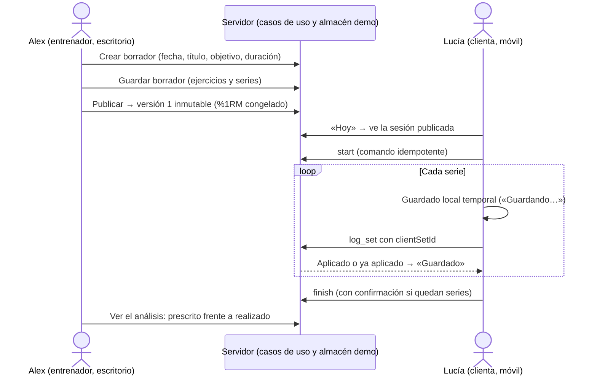
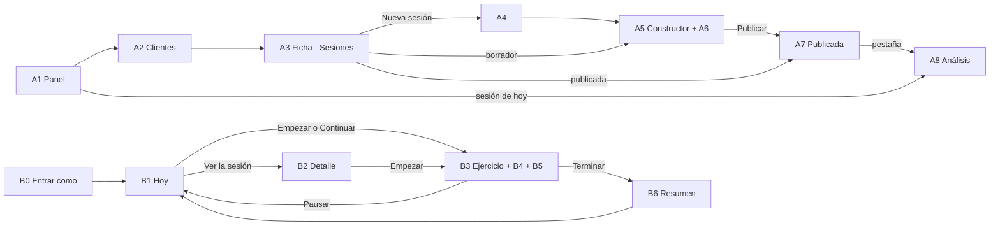
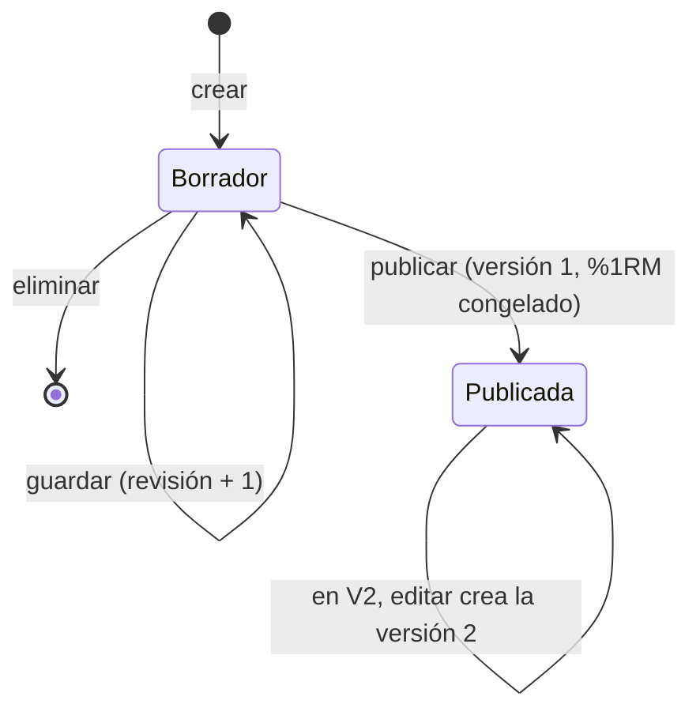
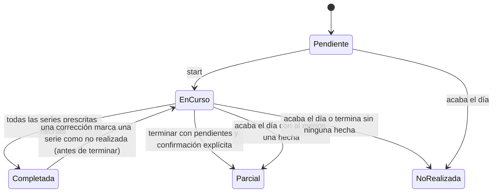

# V1 · Especificación técnica y funcional

> **Estado: diseño pendiente de aprobación (7 de noviembre de 2026). No autoriza a programar.** Concreta la primera entrega vertical de `IMPLEMENTATION_READINESS.md` §8: una sesión prescrita por serie, ejecutada en el móvil y analizada. Para no duplicar, remite a los documentos donde ya está el detalle:
>
> - bocetos del cliente: `TRAINING_EXPERIENCE.md` §6;
> - modalidades de carga y esfuerzo: `EFFORT_AND_LOAD.md`;
> - tipos v2 de referencia: `DATA_MODEL.md` §12;
> - decisiones: `DECISIONS.md` (las nuevas son P-76 a P-84).

## 1. Especificación funcional

### 1.1 Qué hace V1

Un entrenador ficticio (Alex) prescribe una sesión de fuerza serie a serie para una clienta ficticia y la publica. La clienta la ejecuta en el móvil, paso a paso, y registra lo que hace en cada serie. Después, el entrenador ve lo prescrito frente a lo realizado. Todo funciona con datos ficticios en la memoria del servidor: sin base de datos, cuentas ni servicios externos.

| Entorno     | Incluye                                                                                                                                                                                                                                                                                                                                                               |
| ----------- | --------------------------------------------------------------------------------------------------------------------------------------------------------------------------------------------------------------------------------------------------------------------------------------------------------------------------------------------------------------------- |
| Entrenador  | Panel; lista de clientes; ficha; crear una sesión (fecha, título, objetivo, duración y nota); añadir ejercicios de la biblioteca; ordenarlos y quitarlos; prescripción común y por serie (repeticiones o rango, carga, esfuerzo, descanso, tempo y observaciones); guardar el borrador; publicar; ver la sesión publicada y su análisis                               |
| Cliente     | «Hoy» con la sesión del día; detalle de la sesión; empezar; un ejercicio por pantalla con su tarjeta de prescripción; registrar cada serie con un toque; marcar una serie como no realizada; corregir una serie; descanso con temporizador; navegar entre ejercicios; progreso; pausar y continuar; terminar, también como sesión parcial con confirmación; y resumen |
| Modalidades | Kilogramos, %1RM con referencia, peso corporal, peso corporal + lastre, asistida y sin carga externa. El modelo admite también rango de kg, bandas, dispositivos, carga autoseleccionada y «otra», que se ofrecen en la interfaz en V5                                                                                                                                |
| Esfuerzo    | RIR, RPE con la escala basada en RIR o ninguno, por serie. Empieza sin objetivo: nunca se impone                                                                                                                                                                                                                                                                      |

**Cambios respecto al plan de V1 de `IMPLEMENTATION_READINESS.md`**, por lo que pide este encargo:

- **Se adelantan desde V2:** las correcciones, la reanudación tras recargar y un guardado local mínimo (§5.5).
- **Se adelanta desde V3, si apruebas P-76:** «Entrar como…» (F-02).
- **V2 conserva:**
  - el registro completo sin conexión (IndexedDB);
  - dos sesiones el mismo día;
  - editar una sesión publicada;
  - la lista de versiones;
  - el registro desde dos dispositivos.

### 1.2 Qué no hace V1

| Fuera de V1                                                                                       | Cuándo             |
| ------------------------------------------------------------------------------------------------- | ------------------ |
| Crear clientes y registrar evaluaciones                                                           | V3                 |
| Editar o retirar una sesión publicada; dos sesiones el mismo día; registro sin conexión completo  | V2                 |
| Planificar la semana, duplicar sesiones, evolución por ejercicio                                  | V4                 |
| Bandas, dispositivos, potencia, series por tiempo o distancia, calentamiento, saltar un ejercicio | V5                 |
| Valoración previa y RPE de la sesión                                                              | V5, si apruebas Q2 |
| Registro de dolor o molestias (ni campos ni motivos específicos)                                  | Q3: no en V1       |
| Vídeos, plantillas, superseries, series de aproximación, anotaciones del entrenador               | Clase B            |
| Carga interna, motor de progresión                                                                | 1C                 |

### 1.3 Flujo completo entre entrenador y cliente



## 2. Mapa de pantallas y navegación

| Id  | Pantalla                     | Ruta                                                            | Novedad en V1                         |
| --- | ---------------------------- | --------------------------------------------------------------- | ------------------------------------- |
| A1  | Panel                        | `/entrenador`                                                   | Borradores y enlace al análisis       |
| A2  | Clientes                     | `/entrenador/clientes`                                          | Sin cambios (aparece Lucía, P-76)     |
| A3  | Ficha · Sesiones             | `/entrenador/clientes/[clientId]/sesiones`                      | Centro de sesiones con «Nueva sesión» |
| A4  | Nueva sesión                 | `/entrenador/clientes/[clientId]/sesiones/nueva`                | Nueva                                 |
| A5  | Constructor de sesión        | `/entrenador/clientes/[clientId]/sesiones/[sessionId]/editar`   | Nueva                                 |
| A6  | Editor de ejercicio y series | Dentro de A5                                                    | Nueva                                 |
| A7  | Sesión publicada             | `/entrenador/clientes/[clientId]/sesiones/[sessionId]`          | Nueva                                 |
| A8  | Análisis de la sesión        | `/entrenador/clientes/[clientId]/sesiones/[sessionId]/analisis` | Nueva                                 |
| B0  | Entrar como…                 | `/` y aviso de demostración                                     | Nueva si apruebas P-76                |
| B1  | Hoy                          | `/cliente`                                                      | Estados de la sesión del día          |
| B2  | Detalle y resumen            | `/cliente/sesion/[sessionId]`                                   | Pasa a vista previa y resumen         |
| B3  | Ejercicio actual             | `/cliente/sesion/[sessionId]/entrenar`                          | Nueva: reproductor por pasos          |
| B4  | Registro de una serie        | Dentro de B3                                                    | Nueva                                 |
| B5  | Descanso                     | Capa a pantalla completa en B3                                  | Nueva                                 |
| B6  | Resumen                      | Final de B3 y en B2 tras terminar                               | Rehecho sobre datos guardados         |



La navegación existente no cambia: barra lateral del entrenador, pestañas de la ficha y navegación inferior del cliente (Hoy, Semana, Progreso). El reproductor ocupa la pantalla completa, sin navegación inferior, como hoy.

## 3. Pantallas

Línea visual de `DESIGN_SYSTEM.md`, sin cambios de identidad:

- **Colores:**
  - fondo `cream-100`, superficies blancas;
  - `sun-400` para la acción principal y `sun-100` en la tarjeta de prescripción;
  - estados en `leaf` y `coral`, cálculos en `sky`.
- **Tipografía:** cifras grandes en Bricolage Grotesque.
- **Controles:** de 48 px o más en el móvil.
- **Diferencias con lo prescrito:** siempre con icono y texto («≠ −1 rep.»), nunca solo con color.

En todas las pantallas:

- **Carga:** `loading.tsx` con esqueletos de la misma forma que el contenido.
- **Error inesperado:** `error.tsx` con «No se ha podido cargar» y «Reintentar».
- **Recurso que no existe o no es del actor:** 404, sin revelar si existe.

### A1 · Panel (`/entrenador`)

- **Objetivo:** saber qué toca hoy y qué hay que revisar o publicar.
- **Jerarquía:**
  1. Sesiones de hoy (cliente, título, estado de ejecución, series X de Y).
  2. Borradores de los próximos 7 días.
  3. Lo que ya existe: semana, evaluaciones y avisos.
- **Componentes:** existentes (`Card`, `Avatar`, `SessionStatusBadge`, `Stat`) y una insignia «Borrador».
- **Acciones:** abrir el análisis (sesión de hoy), abrir un borrador e ir a Clientes.
- **Vacío:** «Hoy no hay sesiones publicadas», con «Planificar una sesión» (lleva a Clientes).
- **Escritorio y móvil:** rejilla de 2–3 columnas, o una columna con las sesiones de hoy primero.

### A2 · Clientes (`/entrenador/clientes`)

- Sin cambios: búsqueda sin tildes y tarjetas con la próxima sesión y la adherencia.
- **Vacío:** «Ningún cliente coincide con «…»».
- Lucía aparece si apruebas P-76.

### A3 · Ficha · Sesiones (`…/sesiones`)

- **Objetivo:** el centro de las sesiones de un cliente.
- **Jerarquía:**
  1. Botón «Nueva sesión» (`sun-400`).
  2. Borradores.
  3. Próximas publicadas.
  4. Anteriores.
- **Cada fila muestra:**
  - fecha, título y número de ejercicios;
  - insignia de publicación (Borrador o Publicada · v1);
  - estado de ejecución y series X de Y;
  - acción según el estado: Editar, Ver, Análisis o Eliminar (solo borradores, con confirmación).
- **Vacío:** «Todavía no hay sesiones para Lucía», con «Nueva sesión».
- **Escritorio y móvil:** dos columnas (próximas y anteriores), o una lista con secciones plegables.
- La cabecera amarilla y las pestañas de la ficha se mantienen.

### A4 · Nueva sesión (`…/sesiones/nueva`)

- **Objetivo:** crear el borrador con lo mínimo.
- **Formulario (acción de servidor con mejora progresiva):**

  | Campo          | Regla                                                               |
  | -------------- | ------------------------------------------------------------------- |
  | Fecha          | Obligatoria; desde hoy hasta dentro de 60 días; un día libre (P-77) |
  | Título         | Obligatorio; 1–80 caracteres                                        |
  | Objetivo       | Opcional aquí, obligatorio para publicar; hasta 120                 |
  | Duración (min) | Opcional aquí, obligatoria para publicar; entero de 5 a 300         |

- **Acciones:** «Crear borrador», que redirige a A5, y «Cancelar».
- **Error:**
  - mensajes junto al campo, con `aria-invalid` y el foco en el primer error;
  - fecha ocupada: «Lucía ya tiene una sesión el jueves 12. En V1 solo puede haber una por día».

### A5 · Constructor de sesión (`…/[sessionId]/editar`)

Solo para borradores. Si la sesión ya está publicada, redirige a A7.

```
┌─ ← Sesiones · Borrador · Guardado a las 10:32 ─────────────────────────────────┐
│ Fecha [07/11/2026]  Título [Fuerza · pierna]  Objetivo [Sentadilla]  45 min   │
│ Nota para Lucía [Calienta 10 minutos antes…]                                   │
├──────────────────────────────────────────────────────┬─────────────────────────┤
│ ┌ A · Sentadilla trasera con barra ────── ↑ ↓ ✕ ┐   │ RESUMEN                 │
│ │ 3 × 10 · 60 kg · RIR 2 · 2 min       [Editar] │   │ 1 ejercicio · 3 series  │
│ └───────────────────────────────────────────────┘   │ Repeticiones  30        │
│ [ + Añadir ejercicio ]                               │ Tonelaje previsto       │
│                                                      │ 1.800 kg ⓒ cálculo      │
│                                                      │ ANTES DE PUBLICAR       │
│                                                      │ ✓ Datos de la sesión    │
│                                                      │ ✓ 1 ejercicio completo  │
│                                                      │ [ Guardar borrador ]    │
│                                                      │ [ Publicar para Lucía ] │
└──────────────────────────────────────────────────────┴─────────────────────────┘
```

- **Objetivo:** prescribir la sesión completa sin salir de la pantalla.
- **Jerarquía:**
  1. Datos de la sesión.
  2. Lista ordenada de ejercicios (tarjetas plegadas con su resumen).
  3. Panel fijo «Resumen y publicación».
- **Componentes nuevos:**
  - `SessionBuilder` (estado del borrador en el cliente);
  - `ExerciseCard`;
  - `LibraryPicker` (hoja con búsqueda por palabras, reutiliza `searchLibrary`);
  - `PublishChecklist`;
  - `ConfirmDialog`.
- **Información del panel:**
  - número de ejercicios y de series;
  - repeticiones y tonelaje previstos por tipo, como «cálculo» con su fórmula;
  - errores que bloquean y avisos que no bloquean (§5.2).
- **Acciones:**
  - añadir ejercicio, subir o bajar (botones accesibles con teclado; sin arrastrar en V1) y quitar, con «Deshacer» durante 5 s;
  - «Guardar borrador»;
  - «Publicar para Lucía», con confirmación: «Lucía la verá en su app. En V1 no podrás editarla después» (P-78).
- **Guardado:**
  - explícito, con indicador «Cambios sin guardar», «Guardando…» o «Guardado a las 10:32»;
  - aviso al salir con cambios sin guardar;
  - si el borrador cambió en otra pestaña (revisión distinta): «Hay una versión más reciente. Recarga para no perder cambios».
- **Vacío:** «Añade el primer ejercicio desde la biblioteca», con el botón.
- **Error:** el guardado fallido conserva los cambios en la pantalla y ofrece «Reintentar».
- **Escritorio y móvil:**
  - escritorio: dos columnas (2/3 y 1/3, el panel fijo);
  - móvil: una columna y una barra inferior fija con «Guardar» y «Publicar», con la lista de comprobación desplegable.

### A6 · Editor de ejercicio y series (dentro de A5)

Al pulsar «Editar», la tarjeta se despliega en el sitio en el escritorio, o como hoja a pantalla completa en el móvil.

- **Prescripción común**, que se aplica a todas las series salvo que se cambie una:

  | Campo                       | Control                                                         | Aparece                             |
  | --------------------------- | --------------------------------------------------------------- | ----------------------------------- |
  | Series                      | Paso a paso de 1 a 50                                           | Siempre                             |
  | Repeticiones                | «Fijas» o «Rango» y sus valores                                 | Siempre (tiempo y distancia, en V5) |
  | Carga                       | Selector de modalidad y solo los campos de esa modalidad (§5.1) | Siempre                             |
  | Esfuerzo                    | «Sin objetivo», «RIR» o «RPE (escala basada en RIR)» y su valor | Siempre; empieza en «Sin objetivo»  |
  | Descanso                    | m:ss con ±15 s; de 0 a 30 min                                   | Siempre                             |
  | Tempo                       | Texto de 3 o 4 fases con su explicación                         | En «Más opciones»                   |
  | Observación para el cliente | Texto, hasta 300                                                | En «Más opciones»                   |
  | Nota privada                | Texto, hasta 500; nunca llega al cliente                        | En «Más opciones»                   |

- **Tabla de series:**
  - columnas: Serie, Repeticiones, Carga, Esfuerzo, Descanso, Tempo (si hay alguno) y Observación;
  - un valor heredado se ve atenuado («= 60 kg»); uno cambiado, en `ink-900` sobre `sun-100`, con «↺ Volver al común»;
  - en el móvil, cada serie es una tarjeta con «Personalizar esta serie».
- **%1RM:**
  - se elige una referencia de la lista de 1RM del cliente para esa variante, con su fecha y procedencia;
  - se muestra la previsualización «75 % de 100 kg → 75 kg», marcada como cálculo;
  - sin referencia, la opción aparece desactivada con «Lucía no tiene un 1RM registrado de este ejercicio (llega en V3)» (P-81).
- **Validación:** inmediata en cada campo (§5.2); los errores de un ejercicio se resumen en su tarjeta plegada.
- **Accesibilidad:**
  - cada celda editable es un campo con etiqueta («Repeticiones, serie 2»);
  - la tabla tiene cabeceras;
  - el foco no se pierde al plegar.

### A7 · Sesión publicada (`…/[sessionId]`)

- **Objetivo:** ver exactamente lo que se publicó.
- **Jerarquía:**
  1. Cabecera: título, fecha, «Publicada · versión 1 · Alex · 7 nov, 10:32», estado de ejecución.
  2. Pestañas «Prescripción» y «Análisis».
  3. Ejercicios con su tabla de series, de solo lectura, incluida la nota privada (solo la ve el entrenador).
- **Acciones:** ir al análisis. «Editar» aparece como `PendingFeature` («Editar una sesión publicada llega en V2»).
- **Vacío:** no ocurre (no se publica sin ejercicios).
- **Escritorio y móvil:** tabla completa, o tarjetas por serie.

### A8 · Análisis de la sesión (`…/[sessionId]/analisis`)

```
Fuerza · pierna · hoy · versión 1     [Completada]  3 de 3 series · 38 min (incluye pausas)
Volumen, sin mezclar magnitudes
  Repeticiones           30 → 29    −1          ⓒ training.total-reps 2.0.0
  Tonelaje externo  1.800 → 1.740 kg  −60 kg    ⓒ training.volume-load 2.0.0
A · Sentadilla trasera con barra
  Serie │ Prescrito           │ Realizado            │ Diferencia
    1   │ 10 × 60 kg · RIR 2  │ 10 × 60 kg · RIR 2   │ —
    2   │ 10 × 60 kg · RIR 2  │ 10 × 60 kg           │ —
    3   │ 10 × 60 kg · RIR 2  │  9 × 60 kg · RIR 1   │ ≠ −1 rep. · RIR 1 (previsto 2)
Comentario de Lucía: «…»
```

- **Objetivo:** comparar lo prescrito con lo realizado y saber cómo terminó la sesión.
- **Jerarquía:**
  1. Estado y cómo terminó: completada; parcial, terminada antes de tiempo con N series pendientes confirmadas; o parcial, sin terminar al acabar el día.
  2. Totales por tipo de volumen (§6).
  3. Una tabla por ejercicio.
  4. Comentario de la clienta.
- **Componentes:**
  - `Stat`, `OriginBadge` («Cálculo» con la fórmula) y `SessionStatusBadge`;
  - nuevos: `PrescribedVsPerformedTable` y `DeviationMark`;
  - `PendingFeature` para la evolución por ejercicio (V4).
- **Información por serie:**
  - estado: hecha, no realizada o pendiente;
  - lo prescrito y lo realizado en la misma modalidad;
  - la diferencia;
  - «✎ corregida», con los valores originales y la hora.
- **Vacío:** «Lucía aún no ha empezado esta sesión», con lo prescrito.
- **En curso:** los datos llegan al recargar, con el aviso «Sesión en curso: los datos pueden cambiar». Sin actualización automática en V1.
- **Escritorio y móvil:** tablas, o tarjetas por serie con prescrito y realizado una encima de otra.

### B0 · Entrar como… (si apruebas P-76)

- **Dónde:** la portada `/` ofrece «Entrar como Alex, entrenador», «Entrar como Marta, clienta» y «Entrar como Lucía, clienta».
- **Aviso permanente:** el portal muestra siempre «Modo demostración · Estás viendo la app como Lucía · Cambiar».
- **Qué hace:** una acción de servidor guarda una cookie con el cliente elegido, solo entre los clientes ficticios de Alex.
- **Salir:** se borra la cookie y la lista local de pendientes. Si quedan series sin enviar, avisa antes.

### B1 · Hoy (`/cliente`)

- **Objetivo:** saber en un vistazo qué toca y empezar con un toque.
- **Jerarquía:** la tarjeta protagonista (`sun-400`, `rounded-[2rem]`, boceto C) con:
  - título, objetivo, duración, ejercicios y series;
  - nota del entrenador;
  - botón principal visible sin desplazarse.
- **Botón por estado:**

  | Estado (§5.6)        | Etiqueta                                | Destino                 |
  | -------------------- | --------------------------------------- | ----------------------- |
  | Pendiente            | Empezar entrenamiento                   | B3 (envía `start`)      |
  | En curso             | Continuar entrenamiento · 4 de 9 series | B3, en el punto de P-42 |
  | Completada o parcial | Ver resumen                             | B2                      |

- **Otras acciones:** «Ver la sesión» (B2) y la navegación inferior.
- **Vacío:** «Hoy toca descansar», con la ilustración y la próxima sesión (ya existe).
- **Cuándo se puede empezar:** solo el día programado (P-83).
- **Escritorio y móvil:** la misma columna centrada; está pensada para el móvil.

### B2 · Detalle y resumen (`/cliente/sesion/[sessionId]`)

- **Objetivo:** ver la sesión antes de empezar y, al terminar, su resumen.
- **Contenido según el estado:**
  - **Hoy, sin empezar:** cabecera, nota y lista (posición, silueta, nombre y «3 × 10 · 60 kg · RIR 2»), con «Empezar entrenamiento» fijo abajo.
  - **Otro día futuro:** la misma lista y el aviso «Podrás empezarla el jueves 12 de noviembre», sin botón.
  - **En curso:** progreso y «Continuar».
  - **Terminada, o día pasado:** el resumen B6. Si no se registró nada, «No realizada».
- **Error:** 404 si no es suya o no está publicada (también los borradores).

### B3 · Ejercicio actual (`/cliente/sesion/[sessionId]/entrenar`)

Boceto B de `TRAINING_EXPERIENCE.md`, con un ejercicio por pantalla.

- **Jerarquía:**
  1. Cabecera fija: ✕ «Pausar», título, «2 / 6» y ☰ «Tu sesión».
  2. Barra de progreso: «7 de 18 series».
  3. Silueta y nombre.
  4. «4 series × 6 repeticiones».
  5. Tarjeta de prescripción de la **serie actual**: CARGA y ESFUERZO como las cifras más grandes, con ⓘ de ayuda en borrador (Q6).
  6. Descanso y tempo.
  7. Observación del entrenador (borde `sun`).
  8. «Cómo se hace» (desplegable).
  9. El registro de la serie actual (B4) y la lista de series del ejercicio.
- **Acciones:**
  - «Anterior» y «Siguiente ejercicio» abajo;
  - «Tu sesión», una hoja con todos los ejercicios y su estado (✓, ◐, ○) para saltar a cualquiera;
  - «Pausar», que vuelve a B1 con la sesión en curso;
  - «Terminar sesión», en «Tu sesión» y en la pantalla final.
- **Al cambiar de ejercicio:** el foco pasa al título.
- **Pantalla final:** al acabar el último ejercicio aparece «Has terminado todos los ejercicios», con un comentario opcional para el entrenador (hasta 500) y «Terminar sesión».
- **Cuando no se puede registrar** (el día ha pasado o ya está terminada): modo de solo lectura con un `Notice` que explica por qué.
- **Error de envío:** la serie queda «Sin enviar» y se reintenta (§5.5). Nunca se bloquea la pantalla.

### B4 · Registro de una serie (dentro de B3)

Boceto D de `TRAINING_EXPERIENCE.md`.

- **«Serie 3 de 4»**, con estos campos rellenados con lo prescrito:
  - **carga en la misma modalidad:** kg, lastre o asistencia; con peso corporal o sin carga no hay campo de carga;
  - **repeticiones:** el valor fijo, o el mínimo del rango;
  - controles −/+ de 48 px que también admiten escribir: −/+ cambia 1 repetición o 2,5 kg; con %1RM, el paso es el redondeo prescrito.
- **Esfuerzo real:** «¿Cuántas te quedaban?» (RIR) o la escala RPE, **solo si se prescribió**. Es opcional.
- **«Añadir observación»:** plegado, hasta 300 caracteres.
- **Acciones:**
  - «Serie hecha», el botón grande: un toque si todo coincide;
  - «No la he hecho», secundario: la serie queda como no realizada, sin pedir motivo (Q3);
  - tocar una serie ya guardada abre «Corregir serie 2».
- **Estado de cada serie en la lista:**

  | Estado                    | Cuándo                            |
  | ------------------------- | --------------------------------- |
  | ○ Pendiente               | Aún no se ha registrado           |
  | ⏳ Guardando…             | Enviada, sin respuesta todavía    |
  | ✓ Guardada                | El servidor la ha confirmado      |
  | ⚠ Sin enviar · Reintentar | Falló el envío; se reintenta sola |
  | ✎ Corregida               | Tiene una corrección confirmada   |

  Mientras una serie no está confirmada no se puede corregir.

- **Validación:**
  - repeticiones: entero de 1 a 100 si está hecha;
  - kg: de 0,5 a 500;
  - lastre y asistencia: de 0 a 200;
  - RIR: entero de 0 a 10;
  - RPE: de 1 a 10 en pasos de 0,5.
  - El error se muestra junto al campo, con `role="alert"`, y la serie no se marca.

### B5 · Descanso

Boceto E de `TRAINING_EXPERIENCE.md`.

- **Cuándo:** se abre al confirmar una serie con descanso mayor que 0, salvo en la última serie de la sesión.
- **Contenido:**
  - cuenta atrás grande con anillo de progreso;
  - −15 s, +15 s y «Saltar»;
  - «A continuación: Serie 3 de 3 · 60 kg × 10», o el siguiente ejercicio con su silueta.
- **Reloj:** el tiempo se calcula con la hora de fin, guardada en el dispositivo. Al recargar continúa donde estaba; si ya pasó, muestra «Descanso terminado».
- **Al terminar:** vibra si el dispositivo lo permite y lo anuncia una sola vez a los lectores de pantalla (`role="timer"`, sin anunciar cada segundo).
- **Con `prefers-reduced-motion`:** no hay animación del anillo.

### B6 · Resumen

- **Título:** «¡Sesión completada!» o «Sesión terminada parcialmente».
- **Contenido:**
  - series X de Y y ejercicios completos;
  - por ejercicio, lo prescrito y lo realizado;
  - repeticiones realizadas frente a prescritas;
  - el comentario enviado.
- **Tonelaje:** solo si el entrenador comparte el volumen (regla actual de `canReadResource`).
- **Acción:** «Volver a Hoy».
- **De dónde salen los datos:** del servidor, no de la pantalla. Así lo que ve Lucía es lo que ve Alex.

## 4. Modelo de datos de V1

Concreta `DATA_MODEL.md` §4, §5 y §12 para el almacén en memoria. Los tipos van en `src/domain/training` y los nombres de campo llevan la unidad (`kg`, `Seconds`).

### 4.1 Entidades

| Entidad (tabla futura)                          | Identificador                               | Campos y tipos                                                                                                                                                                                                                                                                                                                                                 | Relaciones y restricciones                                                                                                                                                                                                                                                                          |
| ----------------------------------------------- | ------------------------------------------- | -------------------------------------------------------------------------------------------------------------------------------------------------------------------------------------------------------------------------------------------------------------------------------------------------------------------------------------------------------------- | --------------------------------------------------------------------------------------------------------------------------------------------------------------------------------------------------------------------------------------------------------------------------------------------------- |
| `Client` (`client`)                             | `c-…` (existente)                           | Sin cambios                                                                                                                                                                                                                                                                                                                                                    | Pertenece a un entrenador. Datos ficticios. Lucía, con P-76                                                                                                                                                                                                                                         |
| `ExerciseVariant`                               | `ex-…` (existente)                          | Sin cambios; solo lectura en V1                                                                                                                                                                                                                                                                                                                                | Se prescribe la variante, nunca un nombre libre. Solo variantes visibles para el entrenador (`canViewExercise`)                                                                                                                                                                                     |
| `AssessmentResult`                              | `a-…` (existente)                           | + `variantId?: string`                                                                                                                                                                                                                                                                                                                                         | Obligatorio en los resultados `1rm-direct` (P-81)                                                                                                                                                                                                                                                   |
| `TrainingSession` (`session`)                   | `ses_<uuid>`; las sembradas conservan `s-…` | `clientId`, `trainerId`, `date: IsoDate`, `status: 'draft' \| 'published'`, `revision: int ≥ 0`, `draft: SessionContent \| null`, `publishedVersionId: string \| null`, `createdAt`, `updatedAt`                                                                                                                                                               | Única por (`clientId`, `date`) en V1 (P-77). `draft` existe solo si `status = 'draft'`; `publishedVersionId`, solo si es `'published'`. Solo se borra si es borrador                                                                                                                                |
| `SessionVersion` (`session_version`)            | `ver_<uuid>`                                | `sessionId`, `number: int ≥ 1` (en V1, siempre 1), `publishedAt`, `publishedBy` (entrenador), `content: SessionContent` congelado                                                                                                                                                                                                                              | Inmutable: nunca se modifica ni se borra. Única por (`sessionId`, `number`)                                                                                                                                                                                                                         |
| `SessionContent` (valor)                        | —                                           | `title` (1–80), `focus` (≤ 120), `estimatedMinutes` (5–300 o nulo), `coachNote` (≤ 500 o nulo, la ve el cliente), `items: SessionItem[]` (0–30)                                                                                                                                                                                                                | Para publicar: título, objetivo, duración y de 1 a 30 ejercicios completos                                                                                                                                                                                                                          |
| `SessionItem` (`ExercisePrescriptionV2` de §12) | `itm_<uuid>`, estable dentro de la sesión   | `variantId`, `variantName` (copia al publicar), `order: int` (1…n, sin huecos), `block` (letra derivada del orden), `blockMode: 'sequential'`, `sets: int` (1–50), `defaults: SetTarget`, `perSet: (Partial<SetTarget> & { setNumber })[]`, `clientNote` (≤ 300), `privateNote` (≤ 500)                                                                        | `perSet` sin números repetidos y dentro de 1…`sets`. Al reducir las series, se borran sus excepciones con aviso. `privateNote` nunca sale en los contratos del cliente                                                                                                                              |
| `SetTarget` (valor)                             | —                                           | `reps: RepTarget` (V1: `fixed` o `range`), `load: LoadSpec`, `effort: EffortTarget`, `restSeconds: int` (0–1800), `tempo?: Tempo` (3 o 4 fases), `note?: string` (≤ 300, visible)                                                                                                                                                                              | Validación del §5.2. `resolveSets(item)` combina `defaults` y `perSet` en una serie resuelta por número                                                                                                                                                                                             |
| `LoadSpec` (valor)                              | —                                           | Unión de `DATA_MODEL.md` §12. En `percent_1rm` se añaden `referenceResultId` y, al publicar, `resolution: { referenceKg, referenceDate, kg, formula, resolvedAt }`                                                                                                                                                                                             | La resolución solo existe en la versión publicada                                                                                                                                                                                                                                                   |
| `EffortTarget` (valor)                          | —                                           | V1 usa `none`, `rir` (entero 0–10) y `rpe` (1–10 en pasos de 0,5, `scale: 'rir_based'`). El tipo admite rangos (`Amount`)                                                                                                                                                                                                                                      | `rir_and_rpe`, `quality` y `character` no se ofrecen en V1                                                                                                                                                                                                                                          |
| `SessionLogV2` (`session_log`)                  | `exe_<uuid>`                                | `sessionId`, `clientId` (del actor), `versionId`, `startedAt` (servidor), `deviceStartedAt`, `lastActivityAt`, `finishedAt \| null`, `finish: { reason: 'all_done' \| 'ended_early'; pendingSetsConfirmed: int } \| null`, `comment` (≤ 500), `commandIds`                                                                                                     | Una por sesión en V1. Solo la crea el comando `start` del propio cliente, con la sesión publicada y en su día                                                                                                                                                                                       |
| `SetLogV2` (`set_log`)                          | `clientSetId` (UUID v4 del dispositivo)     | `sessionLogId`, `clientId`, `versionId`, `prescriptionId` (= `SessionItem.id`), `setNumber`, `role: 'working'`, `completed: boolean`, `reps` (1–100 si está hecha; nulo si no), `load: PerformedLoad \| null`, `rir`, `rpe`, `rpeScale`, `note` (≤ 300), `supersedes: clientSetId \| null`, `recordedAt` (dispositivo), `receivedAt` (servidor), `payloadHash` | Solo se añade: nunca se modifica ni se borra. `clientSetId` único por registro de sesión. (`versionId`, `prescriptionId`, `setNumber`) debe existir en la versión. Como mucho un registro efectivo por serie: uno nuevo para una serie ya registrada tiene que sustituir (`supersedes`) al efectivo |
| `PerformedLoad` (valor)                         | —                                           | `external { kg }`, `bodyweight`, `bodyweight_plus { addedKg }`, `assisted { assistanceKg? }`, `none`                                                                                                                                                                                                                                                           | Misma modalidad que la prescrita; con %1RM, `external`                                                                                                                                                                                                                                              |

**No se crean:**

- organizaciones, equipos asistenciales e integraciones (no hay ninguna dependencia en V1);
- instrumentos genéricos y `decision_record` (P-63 y P-64 revisadas);
- `stopReason`, campos de dolor o de molestias (Q3).

El `stopReason` de `DATA_MODEL.md` §12 queda para V5 y, sin el valor `pain`, depende de Q3.

### 4.2 Comprobaciones de integridad

| Requisito                                     | Cómo se garantiza                                                                                                                                                                                                                                                                |
| --------------------------------------------- | -------------------------------------------------------------------------------------------------------------------------------------------------------------------------------------------------------------------------------------------------------------------------------- |
| La serie ejecutada se vincula a la prescrita  | Cada `SetLogV2` guarda `versionId`, `prescriptionId` y `setNumber`, y el servidor comprueba que existen en esa versión inmutable                                                                                                                                                 |
| No se duplican registros al guardar dos veces | El mismo `clientSetId` con el mismo contenido devuelve el registro guardado («ya aplicado»); con otro contenido, `409`. Un segundo registro de la misma serie sin `supersedes`, `409`. El repositorio aplica las dos reglas de forma atómica, como lo hará una restricción única |
| Se conserva la prescripción original          | El borrador y la versión publicada son objetos distintos; la versión no cambia. En V1 una sesión publicada es de solo lectura (P-78)                                                                                                                                             |
| Los cambios no destruyen lo realizado         | Los registros solo se añaden; las correcciones encadenan `supersedes`; no se borran sesiones publicadas ni registros. En V2, editar creará la versión 2 y lo hecho seguirá ligado a la 1                                                                                         |
| Prescrito y ejecutado se distinguen           | Entidades y contratos separados. El cliente no tiene ninguna vía para escribir prescripciones, y el entrenador ninguna para escribir registros                                                                                                                                   |
| Cargas y unidades coherentes                  | kg, segundos y metros canónicos; la carga realizada, en la modalidad prescrita (si no coincide, `422`); los decimales se muestran con coma                                                                                                                                       |
| No hay tonelaje con magnitudes no comparables | Solo suman los kg externos (externa y %1RM). El lastre y la asistencia tienen métricas propias. El peso corporal, sin carga y las series no realizadas no entran (§6)                                                                                                            |

### 4.3 Datos demo de V1

La semilla actual se convierte al modelo v2 al crear el almacén:

- sesiones publicadas como versión 1 de Alex;
- registros como `SetLogV2` con `clientSetId` sembrados.

Además:

- Marta tiene un 1RM directo ficticio de sentadilla trasera (100 kg) para probar el %1RM (P-81);
- la semilla genera RIR **por serie** en lugar de por ejercicio (P-84).

**Si apruebas P-76:** Lucía Gil es una clienta ficticia de Alex, activa, de salud y condición física, sin sesiones ni evaluaciones.

## 5. Reglas de prescripción y registro

### 5.1 Carga y esfuerzo

| Modalidad (V1)          | Campos del entrenador                                                     | Lo que ve el cliente            | Lo que registra el cliente                    | Tonelaje                            |
| ----------------------- | ------------------------------------------------------------------------- | ------------------------------- | --------------------------------------------- | ----------------------------------- |
| Kilogramos (`external`) | kg (0,5–500)                                                              | «60 kg»                         | kg realizados                                 | Sí                                  |
| %1RM (`percent_1rm`)    | % (1–100, pasos de 0,5), referencia y redondeo (0,5, 1, 1,25, 2,5 o 5 kg) | Los kg congelados («75 kg»)     | kg realizados                                 | Sí, con los kg realizados           |
| Peso corporal           | —                                                                         | «Tu peso corporal»              | Nada                                          | No                                  |
| Peso corporal + lastre  | kg añadidos (0,5–200)                                                     | «Tu peso + 5 kg»                | kg añadidos realizados                        | No: «carga externa añadida», aparte |
| Asistida                | kg de asistencia (opcional) y medio (máquina, banda, compañero u otro)    | «La máquina te ayuda con 20 kg» | kg de asistencia realizados (si se indicaron) | No: «asistencia», aparte            |
| Sin carga externa       | —                                                                         | «Sin carga»                     | Nada                                          | No                                  |

**%1RM:**

- La fórmula es `training.percent-1rm-load` 1.0.0: el porcentaje por la referencia, redondeado al múltiplo elegido, y un empate se resuelve hacia abajo (P-41). Por ejemplo, 75 % de 107 kg = 80,25 kg → 80 kg.
- Los kg se calculan en la previsualización y **se congelan al publicar**.
- El cliente ve los kg, y el porcentaje solo si se comparten las evaluaciones.
- No hay ninguna ecuación de estimación del 1RM (P-23, P-50).

**Esfuerzo:**

- Empieza en «Sin objetivo», y RIR y RPE no se pueden prescribir a la vez (con la escala basada en RIR serían el mismo dato).
- La escala RPE de V1 es la basada en RIR, con sus descriptores verificados (P-34).
- Los avisos siguen la evidencia de `EFFORT_AND_LOAD.md` §4.2; no son reglas automáticas.
- El cliente solo ve el campo de esfuerzo real si se prescribió esfuerzo.

**Valores que se distinguen siempre:**

| Tipo de valor       | Ejemplos                                           | Procedencia                         |
| ------------------- | -------------------------------------------------- | ----------------------------------- |
| Objetivo prescrito  | Repeticiones, carga y esfuerzo de cada serie       | Lo prescribe el entrenador          |
| Resultado realizado | La serie registrada                                | `self_reported`                     |
| Valor del cliente   | Repeticiones, kg, RIR o RPE reales y observaciones | `self_reported`                     |
| Valor calculado     | kg del %1RM, totales, diferencias y duración       | `calculated`, con fórmula y versión |
| Valor estimado      | Ninguno en V1                                      | —                                   |

### 5.2 Validaciones del constructor

| Nivel                                     | Reglas                                                                                                                                                                                                                                                                                                                                                                    |
| ----------------------------------------- | ------------------------------------------------------------------------------------------------------------------------------------------------------------------------------------------------------------------------------------------------------------------------------------------------------------------------------------------------------------------------- |
| **Al guardar** (si falla, no se guarda)   | Tipos y rangos, iguales a los del registro para que todo lo prescrito se pueda registrar (`EFFORT_AND_LOAD.md` §7.3): series de 1 a 50, repeticiones de 1 a 100, kg de 0,5 a 500, descanso de 0 a 1800 s; rango con mínimo < máximo, tempo con el formato correcto, RIR entero de 0 a 10, RPE en pasos de 0,5, `perSet` coherente, variante visible, fecha válida y libre |
| **Al publicar** (si falla, no se publica) | Título, objetivo y duración; de 1 a 30 ejercicios; todos los campos de la modalidad; %1RM con referencia del cliente para esa variante; RPE con escala; fecha de hoy en adelante                                                                                                                                                                                          |
| **Avisos** (no bloquean)                  | RIR de 5 o más; RIR en series de más de 12 repeticiones; serie con un esfuerzo distinto a todas las demás (para comprobar que es intencionado)                                                                                                                                                                                                                            |

### 5.3 Estados de una sesión (publicación)



### 5.4 Registro por serie

- **Serie hecha:** `completed: true`, repeticiones de 1 a 100 y la carga en su modalidad. Una serie con menos repeticiones de las previstas **es una serie hecha con diferencia**, no una serie pendiente.
- **Serie no realizada:** `completed: false`, sin repeticiones ni carga; la observación es opcional. Cuenta como no hecha.
- **Corrección:** un registro nuevo con `supersedes` igual al `clientSetId` del efectivo. Se permite hasta terminar la sesión o hasta el final del día (P-82). El historial conserva los dos registros.
- **Registro efectivo:** el que no ha sido sustituido. Lo calcula la función de dominio que amplía `effectiveSetRecords` y que usan el servidor y el reproductor.
- **Cuándo se puede registrar:** solo en una sesión publicada, del propio cliente, el día programado (en la zona horaria de la aplicación) y no terminada.

**Límite conocido de V1:** una serie que se intenta enviar después de medianoche se rechaza («el día de la sesión ha terminado») y queda guardada en el móvil. V2 decidirá cómo aceptarla con su hora del dispositivo.

### 5.5 Guardado local temporal, persistencia confirmada y sincronización (Q4)

| Capa                        | Qué es                                                                                                                                      | Implementación en V1                                                                                                                                                                                                 |
| --------------------------- | ------------------------------------------------------------------------------------------------------------------------------------------- | -------------------------------------------------------------------------------------------------------------------------------------------------------------------------------------------------------------------- |
| **Guardado local temporal** | Una lista de comandos pendientes en el dispositivo, con su identificador, para no perder una serie si falla el envío o se recarga la página | `localStorage`, con una clave por espacio, cliente y sesión; menos de 100 comandos; borrado al confirmarse o al salir del modo demostración (con aviso)                                                              |
| **Persistencia confirmada** | El servidor ha aplicado el comando (o ya lo tenía) y lo devuelve en el estado de la sesión                                                  | Respuesta `200` del comando. Es lo único que la interfaz llama «Guardada»                                                                                                                                            |
| **Sincronización**          | Reenviar los pendientes hasta confirmarlos                                                                                                  | En orden. Al cargar el reproductor, en el evento `online`, al volver a la pestaña y con reintentos cada 2, 4, 8, 16 y 30 s; además, «Reintentar» a mano. Aviso al salir de la página con pendientes (`beforeunload`) |

**En V2 (no en V1):** IndexedDB, empezar o hacer toda la sesión sin conexión y el conflicto entre dos dispositivos.

### 5.6 Estados de ejecución

Se **deducen** de los registros efectivos y de las marcas de inicio y fin, igual que hoy (ADR-16, `deriveSessionStatus`). No se guardan.



**Reglas:**

- Una sesión **solo es «Completada» si todas sus series prescritas están hechas.**
- Terminar con series pendientes o no realizadas exige `confirmEndEarly: true`. El servidor guarda `finish.reason = 'ended_early'` y el número de series pendientes que se confirmaron. Sin esa confirmación responde `409 confirmation_required`.
- El motivo lo calcula el servidor, no el cliente.

**Estados de una serie:** pendiente, hecha y no realizada. Una corrección crea un registro nuevo y el estado de la serie pasa a ser el del registro efectivo.

## 6. Análisis de V1

| Métrica                        | Definición                                                                                             | Fórmula del registro (nueva salvo indicación)                                           | Se muestra                           |
| ------------------------------ | ------------------------------------------------------------------------------------------------------ | --------------------------------------------------------------------------------------- | ------------------------------------ |
| Series prescritas y realizadas | Series de la versión frente a series efectivas hechas                                                  | `training.completed-sets` 1.0.0 (existe)                                                | Entrenador y cliente                 |
| Repeticiones                   | Σ de las series hechas, solo en ejercicios por repeticiones; rangos como mínimo–máximo en lo prescrito | `training.prescribed-volume` 1.0.0 y `training.total-reps` 2.0.0                        | Entrenador y cliente                 |
| Tonelaje externo               | Σ repeticiones × kg externos de las series hechas                                                      | `training.prescribed-volume-load` 1.0.0 y `training.volume-load` 2.0.0                  | Entrenador (cliente, si se comparte) |
| Carga externa añadida (lastre) | Σ repeticiones × kg de lastre                                                                          | `training.added-load-volume` 1.0.0                                                      | Entrenador                           |
| Asistencia                     | Media ponderada por repeticiones de los kg de asistencia y número de series                            | `training.assistance-summary` 1.0.0                                                     | Entrenador                           |
| Series sin carga externa       | Recuento                                                                                               | Ya existe (`setsWithoutExternalLoad`)                                                   | Entrenador                           |
| Volumen por ejercicio          | Las mismas métricas por ejercicio                                                                      | Las anteriores                                                                          | Entrenador                           |
| Diferencias por serie          | Repeticiones (0 dentro del rango), kg (solo si los dos están en kg) y RIR o RPE (en la misma escala)   | `training.rep-deviation`, `training.load-deviation` y `training.effort-deviation` 1.0.0 | Entrenador                           |
| Duración                       | Fin − inicio, con las horas del servidor; **incluye las pausas**                                       | `training.session-elapsed` 1.0.0                                                        | Entrenador                           |
| Evolución por ejercicio        | Mismas variante y modalidad de carga, por fecha                                                        | —                                                                                       | V4 (`PendingFeature`)                |

**Reglas:**

- Todos los valores calculados llevan la insignia «Cálculo» y su fórmula. Ninguno se presenta como medición.
- Las fórmulas son definiciones operativas con sus limitaciones en `formulas.ts`. Ninguna es científica, así que no requieren referencias.
- **Volumen, tonelaje y carga interna son magnitudes distintas:**
  - el volumen es el recuento de series y repeticiones por tipo;
  - el tonelaje, la suma de repeticiones × kg externos;
  - la carga interna (RPE de la sesión × minutos) no se calcula en V1. Necesita Q2 y llega en la 1C (P-49).
- **Nunca se suman:**
  - repeticiones de tipos distintos;
  - tonelaje con lastre o asistencia;
  - peso corporal × repeticiones.

**Ejemplo de comprobación** (el de la prueba E2E, §10.1):

- prescrito: 3 × 10 × 60 kg = 30 repeticiones y 1.800 kg;
- realizado: 10, 10 y 9 con 60 kg = 29 repeticiones y 1.740 kg;
- diferencias: −1 repetición y −60 kg; la serie 3, «−1 rep.»;
- estado: «Completada», porque las tres series están hechas.

## 7. Seguridad y permisos

| Política nueva (`src/domain/access.ts`)               | Permite                                                                                                                            |
| ----------------------------------------------------- | ---------------------------------------------------------------------------------------------------------------------------------- |
| `canPlanForClient(actor, client)`                     | Al entrenador de ese cliente                                                                                                       |
| `canEditSession(actor, client, session)`              | Lo anterior y que la sesión sea un borrador (también para guardar, publicar y borrar)                                              |
| `canViewSession(actor, client, session)`              | Al entrenador del cliente (todo, nota privada incluida), o al propio cliente si la sesión está publicada (sin la nota privada)     |
| `canLogExecution(actor, client, session, log, today)` | Solo al propio cliente, con la sesión publicada, en su día y no terminada. Devuelve el motivo: `not_found`, `not_today` o `closed` |
| `canReadExecution(actor, client)`                     | Al entrenador del cliente y al propio cliente                                                                                      |

**Reglas que se comprueban** (cada una con un test del caso permitido y otro del no autorizado):

- **El cliente solo accede a lo suyo.** Una sesión de otro cliente o un borrador responden `404`, tanto en las páginas como en la API.
- **No puede consultar ni modificar sesiones de otros**, ni cambiar la prescripción: no existe ninguna vía de escritura del cliente sobre las sesiones.
- **Los registros no se pueden atribuir a otro cliente:**
  - el `clientId` sale siempre del actor, nunca del cuerpo de la petición;
  - el servidor vuelve a leer la sesión y comprueba que es de ese cliente.
- **Errores de autorización:**
  - las páginas responden con `notFound()`;
  - las acciones de servidor devuelven `{ ok: false, code }`;
  - la API, JSON con su código (§8.4).
- **Defensas de la API:**
  - origen distinto: `403`;
  - cuerpo de más de 16 KB: `413`.
- **Las acciones de servidor comprueban los permisos dentro de cada acción**, porque cualquiera puede invocarlas con un POST (guía de Next.js 16).

**Límite de V1, igual que hoy:** no hay autenticación. Cualquiera que abra `/entrenador` actúa como Alex. Las políticas se prueban con actores en los tests unitarios y de servicio. La autenticación llega en la Fase 2.

**Datos:** solo ficticios, con el aviso en todos los formularios (1B-03). La lista local de pendientes no contiene más que datos de entrenamiento ficticios.

## 8. Arquitectura técnica

### 8.1 Lo que se reutiliza

| Capa           | Reutilizable                                                                                                                                                                                                                                                                                         |
| -------------- | ---------------------------------------------------------------------------------------------------------------------------------------------------------------------------------------------------------------------------------------------------------------------------------------------------- |
| `src/domain`   | `RepTarget`, `Tempo` y `parseTempo`/`describeTempo` (a ampliar a 3 fases), `prescriptionIssues`, `effectiveSetRecords`, `summarizeExecution`, `deriveSessionStatus`, `summarizeVolume`, `weeklyVolume`, registro de fórmulas, `measurement`, `access`, `time`, `format`, `searchLibrary`             |
| `src/server`   | `context` (se amplía), puertos y adaptador demo (se amplían), servicios actuales (sin reescribir: siguen leyendo `PlannedSession` y `SessionLog` a través de la capa de compatibilidad, §8.3), `mappers`                                                                                             |
| `src/ui`       | `Button`/`ButtonLink`, `Card`, `Badge`, `Avatar`, `Stat`, `Meter`, `Notice`, `PageHeader`, `EmptyState`                                                                                                                                                                                              |
| `src/features` | `SessionStatusBadge`, `OriginBadge`, `PendingFeature`, `DemoBanner`, `PrescriptionChips` (se amplía), `ExercisePictogram`, `RestIllustration`, `Shell`, `Nav`, `ClientTabs`, `BottomNav`, y del reproductor actual el descanso, la fila de serie y el resumen, que se trasladan a componentes nuevos |
| Pruebas        | Ayudas de E2E (`collectErrors`, `expectNoSeriousA11yIssues`), proyectos de Playwright de escritorio y Pixel 7                                                                                                                                                                                        |

### 8.2 Lo que se crea

| Ubicación                                                        | Contenido                                                                                                                                                                                   |
| ---------------------------------------------------------------- | ------------------------------------------------------------------------------------------------------------------------------------------------------------------------------------------- |
| `src/domain/training/load.ts`, `effort.ts`                       | `LoadSpec`, `PerformedLoad`, `EffortTarget` v2, validación, textos de formato y clasificación para el volumen                                                                               |
| `src/domain/training/session-v2.ts`                              | `TrainingSession`, `SessionVersion`, `SessionItem`, `SetTarget`, `resolveSets`, validación al guardar y al publicar, avisos y resolución del %1RM                                           |
| `src/domain/training/execution.ts`                               | `SessionLogV2`, `SetLogV2`, registros efectivos con `supersedes`, estados, validación de comandos y motivo de fin                                                                           |
| `src/domain/training/analysis.ts`                                | Totales por tipo, diferencias y duración (fórmulas nuevas en `formulas.ts`)                                                                                                                 |
| `src/domain/training/compat.ts`                                  | Proyección de v2 a `PlannedSession` y `SessionLog` para las pantallas existentes (temporal, hasta V4)                                                                                       |
| `src/server/repositories/ports.ts`                               | `TrainingRepository`: sesiones, versiones, registro de sesión y series, con resultados explícitos (`'ok' \| 'conflict' \| 'date_taken' \| 'duplicate_same' \| 'duplicate_different'`)       |
| `src/server/repositories/demo/store.ts`                          | Almacén en memoria en `globalThis`, espacios, restablecer y semilla convertida a v2                                                                                                         |
| `src/server/services/trainer-sessions.ts`, `client-execution.ts` | Casos de uso con políticas: crear, guardar, borrar y publicar; constructor, vista publicada y análisis; reproductor y aplicar un comando                                                    |
| `src/contracts/sessions.ts`                                      | `SessionBuilderVM`, `SessionReviewVM`, `PlayerVM`, `ExecutionStateVM` y los tipos de comandos (solo tipos)                                                                                  |
| `src/app/entrenador/clientes/[clientId]/sesiones/…`              | Rutas A4, A5, A7 y A8, `actions.ts` (acciones de servidor), `loading.tsx` y `error.tsx`                                                                                                     |
| `src/app/cliente/sesion/[sessionId]/entrenar/page.tsx`           | Reproductor                                                                                                                                                                                 |
| `src/app/api/cliente/sesiones/[sessionId]/comandos/route.ts`     | Manejador de rutas de los comandos del cliente                                                                                                                                              |
| `src/features/trainer/session-builder/…`                         | `SessionBuilder`, `ExerciseCard`, `ExerciseEditor`, `SetTable`, `LoadFields`, `EffortFields`, `LibraryPicker`, `PublishChecklist`, `PrescribedVsPerformedTable`, `DeviationMark`            |
| `src/features/client/player/…`                                   | `GuidedPlayer`, `PlayerHeader`, `PrescriptionCard`, `SetLogger`, `SetList`, `RestScreen`, `SessionOutline`, `FinishDialog`, `SessionSummary`, `command-queue.ts` (lista local y reintentos) |
| `src/ui`                                                         | `Stepper` (−/+ accesible), `Dialog` y `ConfirmDialog` (`<dialog>` nativo), `Sheet`, `SegmentedControl`, `Field` con su error, `Skeleton`                                                    |

**Capas:** se respetan las reglas de ESLint. Los componentes de `features` no importan `server`: las rutas les pasan las acciones de servidor como propiedades, y el reproductor llama a la API con `fetch`. No hay dependencias nuevas (P-11).

### 8.3 Estado y persistencia

- **Almacén demo (P-80):**
  - un objeto en `globalThis`, para que la recarga en caliente de `next dev` no lo borre;
  - un espacio compartido por defecto;
  - con `TRAINPRO_DEMO_SPACES=on` (solo en E2E), un espacio aislado por cookie `trainpro-demo-espacio`, como máximo 32 y descartando primero el menos usado;
  - «Restablecer datos demo» en Configuración;
  - se pierde al reiniciar el servidor (F-01).
- **Una sola fuente de datos (v2):** las pantallas existentes leen a través de `compat.ts`, que solo proyecta sesiones publicadas. Así el panel, la semana, Resultados y Carga incluyen las sesiones nuevas sin reescribirse.
  - Una prueba compara, con la semilla, los modelos de vista antes y después del cambio de almacén.
  - Cambios previstos:
    - el RIR por serie (P-84);
    - el texto «Variable por serie» cuando la carga varía entre series;
    - las pestañas de la ficha que muestran la prescripción completa (Planificación) o los registros (Registro) enlazan a A7 y A8 hasta su rediseño en V4.
- **En el navegador:**
  - el borrador del constructor, en el estado de React;
  - la lista de comandos pendientes y la hora de fin del descanso, en `localStorage`;
  - el ejercicio visitado, como pista para continuar;
  - nada más: la verdad está en el servidor.
- **Actualización de las páginas:** las acciones del entrenador usan `redirect` o `refresh()` (solo en acciones de servidor). El reproductor mantiene su estado con las respuestas de la API.

### 8.4 API de comandos del cliente (P-79)

`POST /api/cliente/sesiones/{sessionId}/comandos`, con `Content-Type: application/json`, del mismo origen y un comando por petición:

```json
{ "commandId": "uuid", "type": "start", "recordedAt": "2026-11-07T17:59:58Z" }
{ "commandId": "uuid", "type": "log_set", "recordedAt": "…", "versionId": "ver_…", "prescriptionId": "itm_…",
  "setNumber": 3, "completed": true, "reps": 9, "load": { "kind": "external", "kg": 60 },
  "rir": 1, "rpe": null, "note": null, "supersedes": null }
{ "commandId": "uuid", "type": "finish", "recordedAt": "…", "confirmEndEarly": false, "comment": "…" }
```

En `log_set`, `commandId` es el `clientSetId`.

| Respuesta                                               | Cuándo                                                                                                                                                                  |
| ------------------------------------------------------- | ----------------------------------------------------------------------------------------------------------------------------------------------------------------------- |
| `200 { result: 'applied' \| 'already_applied', state }` | Aplicado, o el mismo comando ya estaba aplicado. `state` es `ExecutionStateVM`                                                                                          |
| `400 bad_request`                                       | JSON no válido, tipo desconocido o faltan campos                                                                                                                        |
| `403 forbidden_origin`                                  | Origen distinto del de la aplicación                                                                                                                                    |
| `404 not_found`                                         | La sesión no existe, no es del cliente o no está publicada                                                                                                              |
| `409`                                                   | `not_today`, `closed`, `set_already_logged` (con el registro efectivo), `command_id_reused` (mismo id con otro contenido), `version_mismatch` o `confirmation_required` |
| `413 payload_too_large`                                 | Más de 16 KB                                                                                                                                                            |
| `422 invalid { issues }`                                | Valores fuera de rango, modalidad que no coincide o esfuerzo no prescrito                                                                                               |

**Por qué un manejador de rutas y no acciones de servidor para el cliente:** según la guía de Next.js 16 incluida en el proyecto:

- los identificadores de las acciones cambian entre despliegues, y un comando en cola fallaría con «Failed to find Server Action»;
- el navegador las envía de una en una y vuelve a pintar la ruta.

Una URL estable con comandos idempotentes es más fiable para reintentar. Las del entrenador sí son acciones de servidor: formularios con mejora progresiva, comprobación de permisos dentro y `redirect` o `refresh()`.

### 8.5 Validación y errores

- **Sin bibliotecas nuevas (P-11):**
  - analizadores escritos a mano convierten `unknown` en tipos (`parseSessionContent`, `parseCommand`) y devuelven una lista de problemas;
  - la validación de dominio devuelve problemas con campo y mensaje en español.
- **Los casos de uso devuelven resultados explícitos:** `{ ok: true, value }` o `{ ok: false, code, issues? }`. No lanzan excepciones para los errores esperados.
- **Cada capa traduce el resultado:**
  - la ruta, a `notFound()`;
  - la acción, a estado de formulario;
  - la API, a código HTTP.
- **Los errores inesperados** se registran en el servidor con `console.error`, sin datos personales, y se muestran con `error.tsx`.

### 8.6 Next.js 16 (guía leída en `node_modules/next/dist/docs`)

| Aspecto               | Cómo se usa en V1                                                                                 |
| --------------------- | ------------------------------------------------------------------------------------------------- |
| `params` asíncronos   | Con `PageProps<'/ruta'>` y `RouteContext<'/api/…'>`                                               |
| `cookies()` asíncrono | Solo se escriben en acciones de servidor o manejadores de rutas                                   |
| `refresh()`           | Solo dentro de acciones de servidor                                                               |
| Acciones de servidor  | Se invocan de una en una por cliente, son alcanzables con un POST y Next.js comprueba el `Origin` |
| `typedRoutes`         | Ya está activo; las rutas nuevas también son tipadas                                              |
| `useOffline`          | Experimental: no se activa en V1                                                                  |

## 9. Plan de implementación por bloques

Cada bloque termina con funcionalidad que se puede probar de extremo a extremo, `pnpm check`, `pnpm test:e2e` y un commit. Las tareas dentro de un bloque son pequeñas y verificables por separado.

### Bloque 1 · El entrenador publica una sesión y el cliente la ve

| Tarea                                          | Archivos                                                                                                                                        | Resultado                                                                                                | Pruebas y criterio de aceptación                                                                                                                                          | Riesgos                                  |
| ---------------------------------------------- | ----------------------------------------------------------------------------------------------------------------------------------------------- | -------------------------------------------------------------------------------------------------------- | ------------------------------------------------------------------------------------------------------------------------------------------------------------------------- | ---------------------------------------- |
| **1.1** Dominio de prescripción v2             | `domain/training/load.ts`, `effort.ts`, `session-v2.ts`, `formulas.ts`                                                                          | Tipos, `resolveSets`, validaciones, %1RM y textos                                                        | Unitarias: rangos, `perSet`, publicar sin ejercicios, %1RM 80,25 → 80, RIR con RPE rechazado, tempo de 3 y 4 fases                                                        | Diseño de tipos difícil de cambiar luego |
| **1.2** Almacén escribible y compatibilidad    | `repositories/ports.ts`, `demo/store.ts`, `demo/index.ts`, `demo/dataset.ts`, `domain/training/compat.ts`, `server/env.ts`, `server/context.ts` | Los datos actuales pasan a v2 sin que cambie ninguna pantalla; espacios para E2E; «Restablecer»          | Prueba de equivalencia de los modelos de vista; aislamiento de espacios; restricciones atómicas; **toda la suite actual en verde** (con los cambios de P-84 justificados) | Diferencias sutiles en la proyección     |
| **1.3** Casos de uso del entrenador            | `services/trainer-sessions.ts`, `domain/access.ts`, `contracts/sessions.ts`                                                                     | Crear, guardar (con revisión), borrar y publicar la versión 1                                            | Unitarias y de servicio: cada política permitida y no autorizada; conflicto de revisión; fecha ocupada; publicar dos veces                                                | —                                        |
| **1.4** Constructor con prescripción común     | Rutas A4, A5 y A7, `actions.ts`, `features/trainer/session-builder/*`, `ui/*`                                                                   | El entrenador crea, prescribe (kg, peso corporal o sin carga; RIR, RPE o nada), ordena, guarda y publica | E2E en escritorio: crear, añadir desde la biblioteca, guardar, recargar (persiste), publicar y ver A7; validación al publicar; axe                                        | Densidad del formulario                  |
| **1.5** Cliente: Hoy, detalle y «Entrar como…» | `app/page.tsx`, `app/cliente/*`, `features/client/*`, `server/context.ts`                                                                       | La clienta ve la sesión publicada en Hoy y en B2; los borradores no se ven                               | E2E con dos contextos (escritorio y Pixel 7) en el mismo espacio: publicar → aparece en Hoy, con el botón sin desplazarse; borrador → `404`                               | Que parezca un inicio de sesión          |

### Bloque 2 · El cliente ejecuta y registra con persistencia confirmada

| Tarea                                                                       | Archivos                                                                                 | Resultado                                                                                                     | Pruebas y criterio de aceptación                                                                                                                           | Riesgos                                             |
| --------------------------------------------------------------------------- | ---------------------------------------------------------------------------------------- | ------------------------------------------------------------------------------------------------------------- | ---------------------------------------------------------------------------------------------------------------------------------------------------------- | --------------------------------------------------- |
| **2.1** Dominio de ejecución                                                | `domain/training/execution.ts`                                                           | Registros efectivos con `supersedes`, estados y validación de comandos                                        | Unitarias: S-06, completada solo con todas, serie con menos repeticiones hecha, no realizada, motivo de fin                                                | —                                                   |
| **2.2** API de comandos y caso de uso                                       | `services/client-execution.ts`, `app/api/cliente/sesiones/[sessionId]/comandos/route.ts` | `start`, `log_set` y `finish` idempotentes                                                                    | De servicio: `already_applied`, `command_id_reused`, `set_already_logged`, `not_today`, `closed`, otro cliente → `not_found`; E2E de la API: `403` y `413` | Atomicidad en memoria                               |
| **2.3** Reproductor por pasos                                               | `app/cliente/sesion/[sessionId]/entrenar`, `features/client/player/*`                    | Ejercicio actual, registro con un toque, descanso por hora de fin, navegación, «Tu sesión», progreso y pausar | E2E en Pixel 7: registrar, descansar, saltar, navegar y pausar → «Continuar»; axe; sin desplazamiento horizontal a 360 px                                  | Usabilidad en pantallas pequeñas                    |
| **2.4** Guardado local, sincronización, correcciones y series no realizadas | `features/client/player/command-queue.ts`                                                | Estados «Guardando…», «Guardada» y «Sin enviar»; reintentos; aviso al salir; corregir; «No la he hecho»       | E2E: doble toque → un registro; sin conexión (`setOffline`) → «Sin enviar» y después «Guardada»; recarga → no se pierde nada; corrección                   | Temporizadores en las pruebas (reloj de Playwright) |
| **2.5** Terminar y resumen                                                  | `FinishDialog`, `SessionSummary`, B2                                                     | Completada o parcial con confirmación trazable; resumen desde el servidor                                     | E2E del escenario de Lucía (§10.1) en la parte del cliente; terminar antes → parcial y «confirmación» guardada                                             | —                                                   |

### Bloque 3 · El entrenador analiza

| Tarea                                        | Archivos                                                         | Resultado                                         | Pruebas y criterio de aceptación                                                      | Riesgos            |
| -------------------------------------------- | ---------------------------------------------------------------- | ------------------------------------------------- | ------------------------------------------------------------------------------------- | ------------------ |
| **3.1** Fórmulas y análisis                  | `domain/training/analysis.ts`, `formulas.ts`                     | Totales por tipo, diferencias y duración          | Unitarias: 1.800 → 1.740 kg; S-01; la parte de fuerza de S-09; nada mezcla magnitudes | Etiquetas confusas |
| **3.2** Análisis, centro de sesiones y panel | Rutas A3 y A8, A1, `PrescribedVsPerformedTable`, `DeviationMark` | El entrenador consulta el resultado serie a serie | E2E completo del §10.1 con las dos personas; axe                                      | —                  |

### Bloque 4 · Prescripción completa de V1

| Tarea                           | Archivos                                      | Resultado                                                                        | Pruebas y criterio de aceptación                                                                   | Riesgos                           |
| ------------------------------- | --------------------------------------------- | -------------------------------------------------------------------------------- | -------------------------------------------------------------------------------------------------- | --------------------------------- |
| **4.1** Tabla por serie         | `SetTable`, `PrescriptionCard`                | Valores comunes con excepciones; el cliente ve el objetivo de la serie actual    | E2E de S-01 de principio a fin; unitarias de las excepciones al reducir las series                 | Complejidad del editor            |
| **4.2** Lastre, asistida y %1RM | `LoadFields`, `domain/assessment.ts`, semilla | Modalidades restantes de V1, previsualización del %1RM y congelación al publicar | Unitarias de 1B-18 y 1B-19; E2E: %1RM de Marta → kg congelados; Lucía sin referencia → desactivado | La referencia por variante (P-81) |
| **4.3** Tempo y textos de ayuda | `describeTempo` (3 fases), ayudas ⓘ           | Tempo explicado; ayudas de RIR, RPE, lastre y asistencia en borrador (Q6)        | Unitarias de `parseTempo`; E2E: la ayuda se abre en el sitio                                       | Textos sin aprobar (marcados)     |

### Bloque 5 · Cierre y revisión

| Tarea                                 | Resultado                                                                                                                                                                                         | Criterio                                                                                           |
| ------------------------------------- | ------------------------------------------------------------------------------------------------------------------------------------------------------------------------------------------------- | -------------------------------------------------------------------------------------------------- |
| **5.1** Calidad                       | Estados de carga, vacío y error en todas las pantallas; teclado; `prefers-reduced-motion`; actualizar las pruebas existentes que cambian (reproductor, columna «Valoración») con su justificación | `pnpm check` y `pnpm test:e2e` en verde; axe sin incidencias graves; sin desplazamiento horizontal |
| **5.2** Documentación y revisión (Q5) | `SCREEN_INVENTORY.md`, informe de V1 con lo que funciona y lo que no, tiempos medidos de B1 y B3 en el móvil emulado, y recorrido manual                                                          | Revisión contigo antes de V2                                                                       |

## 10. Pruebas y criterios de aceptación

### 10.1 Prueba integral (E2E-1)

Entrenador en escritorio y clienta en un Pixel 7, en dos contextos del navegador que comparten un espacio aislado:

1. Alex abre Clientes → Lucía Gil → Sesiones → «Nueva sesión»: hoy, «Fuerza · pierna», objetivo «Sentadilla», 40 min → «Crear borrador».
2. Añade «Sentadilla trasera con barra»: 3 series, 10 repeticiones fijas, 60 kg, RIR 2 y 2 min de descanso. El resumen muestra **30 repeticiones** y **1.800 kg** previstos, como cálculo.
3. «Guardar borrador», recarga (sigue igual) y «Publicar para Lucía» → A7 muestra «Publicada · versión 1».
4. Lucía entra en el móvil: «Hoy» muestra «Fuerza · pierna» y «Empezar entrenamiento» sin desplazarse.
5. Empieza: «Serie 1 de 3», carga **60 kg**, esfuerzo **RIR 2**. Pulsa «Serie hecha» → «Guardada» y el descanso; «Saltar».
6. Registra la serie 2 (10 × 60) y **recarga la página**: el reproductor vuelve a la serie 3, con «2 de 3 series» guardadas. Sale a «Hoy», que ofrece «Continuar entrenamiento · 2 de 3 series», y vuelve.
7. Cambia las repeticiones a **9** → «Serie hecha» → «Has terminado todos los ejercicios» → «Terminar sesión», sin confirmación porque no falta nada.
8. El resumen dice «¡Sesión completada!», **3 de 3 series** y **29 repeticiones** (de 30).
9. Alex abre el análisis: «Completada», 3 de 3 series, **30 → 29 repeticiones**, **1.800 → 1.740 kg**, y la serie 3 con «≠ −1 rep.». Al recargar, los datos siguen ahí.

### 10.2 Pruebas adicionales

| Id     | Qué comprueba                                                                                                                                                                                               | Tipo |
| ------ | ----------------------------------------------------------------------------------------------------------------------------------------------------------------------------------------------------------- | ---- |
| E2E-2  | **Doble envío:** dos toques rápidos en «Serie hecha» → un registro. Reenviar el mismo comando por la API → `already_applied` y el análisis no cambia                                                        | E    |
| E2E-3  | **Sin conexión durante la sesión:** la serie queda «Sin enviar»; al volver la conexión pasa a «Guardada» sin duplicarse                                                                                     | E    |
| E2E-4  | **Recarga durante el descanso:** el tiempo continúa (±1 s) y el punto de reanudación es correcto                                                                                                            | E    |
| E2E-5  | **Navegación:** «Tu sesión» → otro ejercicio y vuelta; «Pausar» → Hoy muestra «Continuar entrenamiento · 1 de 6 series»                                                                                     | E    |
| E2E-6  | **Terminar antes:** con series pendientes pide confirmación; «Seguir entrenando» no cambia nada; «Terminar como parcial» → Parcial, y el análisis muestra «terminada antes de tiempo · 4 series pendientes» | E    |
| E2E-7  | **Permisos:** Lucía abre la sesión de Marta → `404`; la API con la sesión de Marta → `404`; un borrador → `404`; una sesión futura → sin botón y `409 not_today`; origen ajeno → `403`                      | E    |
| E2E-8  | **Validación del constructor:** publicar sin ejercicios, rango 8–6, repeticiones vacías o %1RM sin referencia → bloqueado, con mensajes                                                                     | E    |
| E2E-9  | **Corrección:** la serie 2 pasa de 10 a 8 → resumen y análisis con 8; el historial conserva el 10                                                                                                           | E    |
| E2E-10 | **Serie no realizada:** «No la he hecho» en la serie 3 y terminar → Parcial (2 de 3), nunca «Completada»                                                                                                    | E    |
| E2E-11 | **Accesibilidad y adaptación:** axe en A4, A5, A7, A8 y B1–B6; sin desplazamiento horizontal a 360 px; constructor usable con teclado                                                                       | E    |
| U-1…   | **Dominio y servicios:**                                                                                                                                                                                    | U    |
|        | - prescripción, ejecución, análisis y compatibilidad;                                                                                                                                                       |      |
|        | - cada política, con su caso no autorizado (otro cliente, cliente sobre un borrador, cliente que intenta guardar una prescripción, entrenador que intenta registrar, administración);                       |      |
|        | - datos incoherentes (S-12): 0 repeticiones en una serie hecha, 0 kg, RIR con RPE, modalidad distinta                                                                                                       |      |

### 10.3 Criterios de la 1B que cumple V1

1B-01, 1B-02, 1B-04, 1B-05 (si apruebas P-76), 1B-12, 1B-17 a 1B-20, 1B-22, 1B-27 (sin calentamiento), 1B-30, 1B-31, 1B-34, 1B-35 (fuerza), 1B-38, 1B-40, 1B-41, 1B-52 (RPE) y los nuevos 1B-60 a 1B-63 de `ROADMAP.md`, además de S-01, S-06 y la parte de fuerza de S-09.

## 11. Decisiones pendientes

**Bloquean empezar V1:**

| Id   | Pregunta                                                                                                                  | Recomendación                                                                                                                   |
| ---- | ------------------------------------------------------------------------------------------------------------------------- | ------------------------------------------------------------------------------------------------------------------------------- |
| Q1   | ¿Apruebas el alcance de la primera versión, con los ajustes de V1 del §1.1?                                               | Sí                                                                                                                              |
| Q4   | ¿Apruebas el nivel de persistencia del §5.5 (guardado local temporal y confirmación, sin registro completo sin conexión)? | Sí                                                                                                                              |
| P-76 | ¿Con qué clienta se hace el flujo de V1?                                                                                  | Lucía, clienta ficticia nueva, y «Entrar como…» en V1. Alternativa: Marta sin su sesión sembrada de hoy, y «Entrar como…» en V3 |

**No bloquean V1:**

- **Q5:** la revisión al terminar V1.
- **Q2, Q3 y Q6:** afectan a V5.

**Lo que depende de cada aprobación:**

| Aprobación | Partes del diseño                                                                                                                                             |
| ---------- | ------------------------------------------------------------------------------------------------------------------------------------------------------------- |
| Q1         | Todo el §1. Si no se aprueba, el alcance se ajusta antes de empezar                                                                                           |
| Q2         | Nada en V1. Punto de inserción en V5: dos comandos más (`answer_readiness` y `rate_session`) en la misma API, un paso antes del primer ejercicio y otro en B6 |
| Q3         | Nada en V1: ni campos ni motivos de dolor o molestias. Solo las observaciones libres que ya existen                                                           |
| Q4         | §5.5, tarea 2.4 y los estados de B4                                                                                                                           |
| Q5         | Tarea 5.2                                                                                                                                                     |
| Q6         | Las ayudas ⓘ y los textos del reproductor se usan como borrador y se revisan en V5                                                                            |
| P-76       | B0, tarea 1.5, la semilla de Lucía y la prueba integral. Con la alternativa, la prueba se hace con Marta y los mismos valores                                 |

**Técnicas, salvo objeción:**

- **P-77:** una sesión por día.
- **P-78:** las sesiones publicadas son de solo lectura en V1.
- **P-79:** vías de escritura.
- **P-80:** almacén y espacios.
- **P-81:** referencia del %1RM; también se puede aplazar el %1RM a V3.
- **P-82:** plazo de las correcciones.
- **P-83:** empezar solo el día programado. Lo verá el usuario, pero es fácil de cambiar.
- **P-84:** RIR por serie en la semilla.

## 12. Primer bloque de código recomendado

Recomiendo empezar por la **tarea 1.2 (almacén escribible y capa de compatibilidad)**, precedida de la **1.1 (dominio de prescripción v2)**:

- es la base de todo lo demás y la parte con más riesgo de romper lo que ya funciona;
- se verifica de forma objetiva: la suite actual sigue en verde sobre el nuevo almacén y una prueba de equivalencia lo demuestra;
- no compromete ninguna pantalla nueva.

Inmediatamente después, las tareas 1.3 a 1.5 cierran el **bloque 1**: la primera funcionalidad visible, en la que el entrenador publica y la clienta la ve en el móvil.
