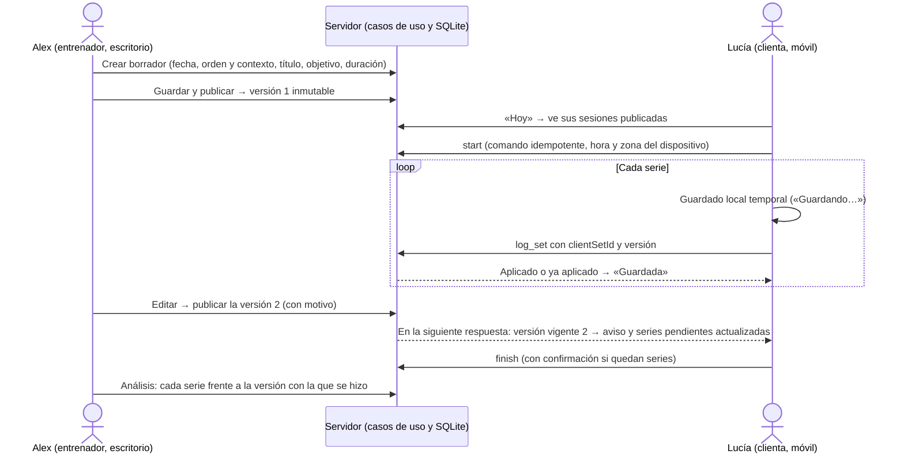
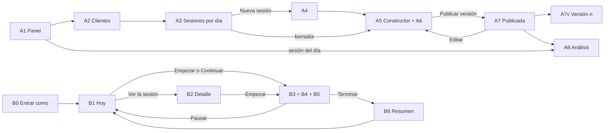
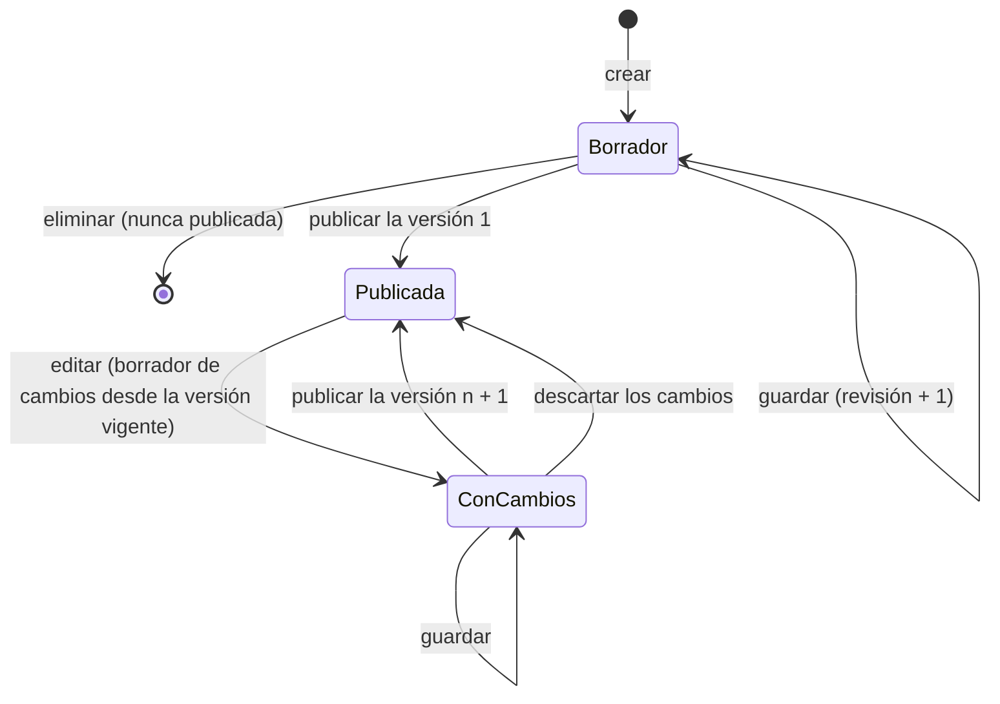

# V1 · Especificación técnica y funcional

> **Estado: versión 2.1, aprobada para V1 el 9 de noviembre de 2026 (Q1, P-76, P-85 y Q4; `DECISIONS.md` ADR-23).** Solo está autorizado el **bloque 1**, que está **implementado y pendiente de tu revisión** (§9.2). El bloque 2 no se empieza sin tu aprobación expresa.
>
> - Sustituye a la versión 1 (commit `57bf859`) y revisa la 2 (commit `2dd77fa`); las dos siguen en el historial de Git.
> - El §0 resume qué ha cambiado y por qué.
> - La versión 2.1 revisa la persistencia (§8.3), la versión de Node (§8.7), el bloque 1 (§9.1), las garantías ante fallos de conexión (§5.7) y la propuesta de decisiones (§11.1 y §12).
>
> V1 es la primera entrega vertical de `IMPLEMENTATION_READINESS.md` §8: una sesión prescrita por serie, ejecutada en el móvil y analizada. Para no duplicar, este documento remite a:
>
> - bocetos del cliente: `TRAINING_EXPERIENCE.md` §6;
> - modalidades de carga y esfuerzo: `EFFORT_AND_LOAD.md`;
> - tipos v2 de referencia: `DATA_MODEL.md` §12;
> - decisiones: `DECISIONS.md` (P-76 a P-89).

## 0. Correcciones respecto a la versión anterior

| Tema                                    | Antes                                                         | Ahora                                                                                                                                        | Motivo                                      |
| --------------------------------------- | ------------------------------------------------------------- | -------------------------------------------------------------------------------------------------------------------------------------------- | ------------------------------------------- |
| Sesiones el mismo día                   | Una por cliente y fecha (P-77)                                | Varias, cada una con su orden y su contexto («Mañana», «Club»…), su registro y su historial; análisis por sesión y total del día             | Tu indicación                               |
| Sesiones publicadas                     | De solo lectura en V1 (P-78)                                  | Se editan publicando una versión nueva. Lo ya registrado queda bloqueado y ligado a su versión (§5.4)                                        | Tu indicación                               |
| Cambios con la sesión en curso          | El cliente decidía cuándo actualizar (P-18)                   | Las series pendientes adoptan la versión nueva, con un aviso. El cliente no tiene que decidir nada                                           | No obligar al cliente a interpretar cambios |
| Fecha de ejecución                      | Solo el día programado (P-83); cierre al acabar el día (P-17) | Cualquier día. Se distinguen la fecha prevista y las fechas reales. Una sesión sin terminar queda «Interrumpida» y se puede continuar (§5.5) | Tu indicación                               |
| Persistencia                            | En memoria: los datos se perdían al reiniciar (P-80)          | SQLite local en un archivo, con migraciones, transacciones y restricciones (§8.3, P-85)                                                      | Tu indicación, tras comparar alternativas   |
| Series después de medianoche            | Se rechazaban                                                 | Se aceptan siempre. Cuenta la hora real de la ejecución, con su zona horaria (§5.5)                                                          | Tu indicación                               |
| Identidad                               | «Cualquiera que abra `/entrenador` actúa como Alex»           | Identidad, rol y permiso separados; protección mínima del prototipo local y requisitos de cada etapa (§7)                                    | Tu indicación                               |
| Correcciones del cliente                | Hasta terminar la sesión o hasta el final del día             | Hasta terminar la sesión                                                                                                                     | Coherencia con las fechas libres            |
| Controlador SQLite (revisión del 7 nov) | `node:sqlite` en Node 24.15                                   | `better-sqlite3` 13.x, por la estabilidad de su API. `node:sqlite` es _release candidate_ (1.2), no estable (§8.3)                           | Tu revisión crítica                         |
| Versión de Node                         | 24.15 o posterior                                             | Node 26 LTS (hoy 26.13.0), con una política de actualización (§8.7)                                                                          | La 24 ya está en mantenimiento              |
| Bloque 1                                | Una fila del plan                                             | Desglose A–E, qué se podrá hacer y qué no, y 12 pruebas propias (§9.1)                                                                       | Tu petición                                 |
| Fallos de conexión                      | Estados y reintentos                                          | Además: escritura previa al envío, rechazos visibles que no se descartan y aviso si el navegador no puede guardar (§5.7)                     | Que ningún registro se pierda en silencio   |
| Fecha al crear una sesión               | Entre hoy y dentro de 60 días                                 | Cualquier fecha, con aviso si ya ha pasado                                                                                                   | Era una limitación artificial               |

## 1. Especificación funcional

### 1.1 Qué hace V1

Un entrenador ficticio (Alex) prescribe sesiones serie a serie para una clienta ficticia, las publica y las corrige cuando hace falta. La clienta las ejecuta en el móvil, paso a paso, el día que las hace, y registra cada serie. El entrenador ve lo prescrito frente a lo realizado, por sesión y por día.

Los datos persisten en un archivo SQLite local. No hay cuentas, servicios externos ni costes.

| Entorno     | Incluye                                                                                                                                                                                                                                                                                                                                                                                                                                                                                                                      |
| ----------- | ---------------------------------------------------------------------------------------------------------------------------------------------------------------------------------------------------------------------------------------------------------------------------------------------------------------------------------------------------------------------------------------------------------------------------------------------------------------------------------------------------------------------------- |
| Entrenador  | Panel; clientes; ficha; crear sesiones (fecha, orden y contexto en el día, título, objetivo, duración y nota); varias sesiones el mismo día; añadir ejercicios de la biblioteca, ordenarlos y quitarlos; prescripción común y por serie (repeticiones o rango, carga, esfuerzo, descanso, tempo y observaciones); guardar el borrador; publicar; **editar una sesión publicada y publicar una versión nueva con motivo**; historial de versiones; vista publicada; análisis por sesión y por día                             |
| Cliente     | «Hoy», con el entrenamiento del día como protagonista y las demás sesiones del día debajo; detalle de la sesión; empezar cualquier sesión publicada (también de otro día); un ejercicio por pantalla con su tarjeta de prescripción; registrar cada serie con un toque; marcarla como no realizada; corregirla; descanso con temporizador; navegar entre ejercicios; progreso; pausar y continuar, también otro día; aviso cuando el entrenador cambia la sesión; terminar, también como parcial con confirmación; y resumen |
| Modalidades | Kilogramos, %1RM con referencia, peso corporal, peso corporal + lastre, asistida y sin carga externa. El modelo admite también rango de kg, bandas, dispositivos, carga autoseleccionada y «otra», que la interfaz ofrecerá en V5                                                                                                                                                                                                                                                                                            |
| Esfuerzo    | RIR, RPE con la escala basada en RIR o ninguno, por serie. Empieza sin objetivo: nunca se impone                                                                                                                                                                                                                                                                                                                                                                                                                             |

### 1.2 Preparación mínima, funcionalidad y aplazado

| Tipo                                               | Contenido                                                                                                                                                                                                                                                                                                                                                                                                                                                                                                                                                                                |
| -------------------------------------------------- | ---------------------------------------------------------------------------------------------------------------------------------------------------------------------------------------------------------------------------------------------------------------------------------------------------------------------------------------------------------------------------------------------------------------------------------------------------------------------------------------------------------------------------------------------------------------------------------------- |
| **Preparación mínima** (sin funcionalidad visible) | <ul><li>Base SQLite con una migración inicial y un adaptador de un solo archivo.</li><li>Repositorios de las entidades de V1.</li><li>Modelo de tiempo: instante en UTC más la zona horaria.</li><li>Tabla de comandos idempotentes.</li><li>Capa de compatibilidad para las pantallas existentes.</li><li>Protección del modo local.</li><li>Un archivo de datos por prueba E2E.</li></ul>Nada más: ni buses de eventos, ni colas genéricas, ni módulos vacíos                                                                                                                          |
| **Funcionalidad de V1**                            | La de §1.1 y las pantallas de §3                                                                                                                                                                                                                                                                                                                                                                                                                                                                                                                                                         |
| **Aplazado**                                       | <ul><li>Crear clientes y registrar evaluaciones (V3).</li><li>Semana, duplicar y evolución por ejercicio (V4).</li><li>Bandas, potencia, series por tiempo o distancia, calentamiento, saltar un ejercicio, y valoración previa y RPE de la sesión si apruebas Q2 (V5).</li><li>Registro completo sin conexión (IndexedDB) y conflicto entre dos dispositivos (V2).</li><li>Restricciones de fecha configurables por el entrenador, cancelar sesiones y actualización en tiempo real (más adelante).</li><li>Dolor (Q3: no en V1, ni campos ni motivos).</li><li>Clase B y 1C.</li></ul> |

**Respecto al plan de `IMPLEMENTATION_READINESS.md`:**

- V1 adelanta desde V2: las correcciones, la reanudación, dos sesiones el mismo día, editar una sesión publicada y el historial de versiones.
- Desde V3 adelanta «Entrar como…», si apruebas P-76.
- V2 queda con el registro completo sin conexión y el conflicto entre dos dispositivos.

### 1.3 Flujo completo entre entrenador y cliente



## 2. Mapa de pantallas y navegación

| Id  | Pantalla                                             | Ruta                                                                   |
| --- | ---------------------------------------------------- | ---------------------------------------------------------------------- |
| A1  | Panel                                                | `/entrenador`                                                          |
| A2  | Clientes                                             | `/entrenador/clientes`                                                 |
| A3  | Ficha · Sesiones                                     | `/entrenador/clientes/[clientId]/sesiones`                             |
| A4  | Nueva sesión                                         | `…/sesiones/nueva`                                                     |
| A5  | Constructor (borrador inicial o borrador de cambios) | `…/sesiones/[sessionId]/editar`                                        |
| A6  | Editor de ejercicio y series                         | Dentro de A5                                                           |
| A7  | Sesión publicada y versiones                         | `…/sesiones/[sessionId]` (pestañas Prescripción, Versiones y Análisis) |
| A7v | Una versión concreta                                 | `…/sesiones/[sessionId]/versiones/[number]`                            |
| A8  | Análisis                                             | `…/sesiones/[sessionId]/analisis`                                      |
| B0  | Entrar como… (P-76)                                  | `/` y aviso de demostración                                            |
| B1  | Hoy                                                  | `/cliente`                                                             |
| B2  | Detalle y resumen                                    | `/cliente/sesion/[sessionId]`                                          |
| B3  | Ejercicio actual (con B4 y B5)                       | `/cliente/sesion/[sessionId]/entrenar`                                 |
| B6  | Resumen                                              | Final de B3 y en B2 tras terminar                                      |



## 3. Pantallas

Se mantiene la línea visual de `DESIGN_SYSTEM.md`, sin cambios de identidad:

- **Fondos:** `cream-100` de fondo y superficies blancas.
- **Colores de acción:** `sun-400` en la acción principal y `sun-100` en la tarjeta de prescripción.
- **Estados:** `leaf` y `coral`; los cálculos, en `sky`.
- **Tipografía:** cifras grandes en Bricolage Grotesque.
- **Controles:** de 48 px o más en el móvil.
- **Diferencias:** siempre con icono y texto («≠ −1 rep.»).

En todas las pantallas:

- **Carga:** `loading.tsx` con esqueletos.
- **Error:** `error.tsx` con «Reintentar».
- **Recurso que no existe o no es del actor:** `404`, sin revelar si existe.

### A1 · Panel

- **Objetivo:** saber qué toca hoy y qué revisar.
- **Jerarquía:**
  1. Sesiones previstas para hoy de todos los clientes, varias por cliente si las hay, ordenadas por cliente y por orden en el día, con su estado.
  2. Sesiones interrumpidas.
  3. Borradores y borradores de cambios sin publicar.
  4. Lo que ya existe.
- **Acciones:** abrir el análisis, abrir un borrador, ir a Clientes.
- **Vacío:** «Hoy no hay sesiones previstas», con «Planificar una sesión».

### A2 · Clientes

Sin cambios: búsqueda sin tildes y tarjetas con la próxima sesión. Aparece Lucía si apruebas P-76.

### A3 · Ficha · Sesiones

- **Objetivo:** las sesiones del cliente, **agrupadas por fecha prevista**.
- **Cabecera de cada día:**
  - fecha;
  - «2 sesiones»;
  - el total realizado del día (series, repeticiones y tonelaje por tipo, §6).
  - _Nota del 13 nov 2026 (P-93, ADR-33):_ A3 agrupa por fecha prevista, así que su cabecera muestra el estado de lo previsto y lo hecho con su fecha real. Los totales ejecutados van por fecha de ejecución (`BLOCK3_SPEC.md` §9.4).
- **Cada sesión del día**, en su orden:
  - contexto («Mañana»), título y objetivo;
  - insignias: Borrador · Publicada v2 · Cambios sin publicar;
  - estado de ejecución, series X de Y y, si se hizo otro día, «Hecha el viernes (1 día después)».
- **Acciones:**
  - «Nueva sesión» (general o «+ Añadir sesión a este día»);
  - subir y bajar el orden dentro del día;
  - según el estado: Editar, Ver, Análisis o Eliminar (solo los borradores que nunca se han publicado).
- **Vacío:** «Todavía no hay sesiones para Lucía».
- **Escritorio y móvil:** próximas y anteriores en dos columnas, o una sola lista por días.

### A4 · Nueva sesión

| Campo               | Regla                                                                                                                          |
| ------------------- | ------------------------------------------------------------------------------------------------------------------------------ |
| Fecha prevista      | Obligatoria; cualquier fecha. Si ya ha pasado: «La fecha ya ha pasado: Lucía la verá como pendiente de otro día»               |
| Contexto (opcional) | Hasta 40 caracteres, con sugerencias («Mañana», «Tarde», «Club», «Recuperación»). Sirve para distinguir sesiones del mismo día |
| Orden en el día     | Automático (al final del día); se cambia en A3                                                                                 |
| Título              | Obligatorio (1–80)                                                                                                             |
| Objetivo y duración | Opcionales aquí; obligatorios para publicar                                                                                    |

- **Acciones:** «Crear borrador», que lleva a A5.
- **Errores:** junto al campo, con el foco en el primero.

### A5 · Constructor de sesión

```
┌─ ← Sesiones · Lucía · Borrador de cambios (versión 2) · Guardado 10:32 ───────┐
│ ⓘ Lucía ha registrado 2 series con la versión 1. No cambian: los cambios       │
│   afectan solo a lo pendiente.                                                 │
│ Fecha [07/11]  Contexto [Mañana]  Título [Fuerza · pierna]  Objetivo […] 45 min│
├────────────────────────────────────────────────────────┬───────────────────────┤
│ ┌ A · Sentadilla trasera con barra ─────────── ↑ ↓ ┐   │ RESUMEN               │
│ │ Serie │ Repeticiones │ Carga   │ Esfuerzo │ Desc. │   │ 3 series · 18 rep.    │
│ │  1 🔒 │ Hecha 6      │ 80 kg   │ RIR 2    │ v1    │   │ Tonelaje 1.410 kg ⓒ   │
│ │  2 🔒 │ Hecha 6      │ 80 kg   │ RIR 2    │ v1    │   │ CAMBIOS FRENTE A v1   │
│ │  3    │ = 6          │ [75] kg │ = RIR 2  │ = 2:00│   │ · Serie 4 eliminada   │
│ │ [ − Quitar serie 4 ]  [ Personalizar series ]   │   │ · Serie 3: 80 → 75 kg │
│ └─────────────────────────────────────────────────┘   │ Motivo (opcional) […] │
│ [ + Añadir ejercicio ]                                  │ [Descartar cambios]   │
│                                                         │ [Publicar versión 2]  │
└────────────────────────────────────────────────────────┴───────────────────────┘
```

- **Dos modos:**
  - **Borrador inicial:** hasta la primera publicación.
  - **Borrador de cambios:** se abre con «Editar» desde A7 y parte de la versión vigente. La clienta sigue viendo esa versión hasta que publicas.
- **Aviso fijo según el caso (§5.4):**
  - A: «Lucía no ha empezado: verá la versión nueva».
  - B: «Lucía ha empezado pero no ha registrado ninguna serie».
  - C: «Lucía ha registrado N series. No cambian: los cambios afectan solo a lo pendiente».
  - D: «La sesión está terminada: la versión nueva queda como corrección posterior. El motivo es obligatorio».
- **Bloqueos visibles:** las series registradas aparecen con 🔒, lo que se hizo y la versión. No se editan. Un ejercicio con series registradas no se puede quitar ni cambiar de variante.
- **Panel derecho:**
  - totales previstos por tipo;
  - lista de comprobación;
  - en modo cambios, el resumen de cambios frente a la versión vigente y el motivo;
  - botones: «Guardar», «Descartar cambios» y «Publicar versión N».
- **Confirmación al publicar:** resume el efecto. Por ejemplo: «2 series registradas no cambian; 1 serie pendiente pasa de 80 a 75 kg; Lucía verá un aviso».
- **Guardado:**
  - indicador de estado;
  - aviso al salir con cambios sin guardar;
  - si otra pestaña cambió el borrador (revisión distinta): «Hay una versión más reciente».
- **Escritorio y móvil:** dos columnas, o una con una barra inferior fija con «Guardar» y «Publicar» y la lista desplegable.

### A6 · Editor de ejercicio y series (en A5)

La prescripción común va primero. La tabla por serie aparece al pulsar «Personalizar series», o si ya hay excepciones, así un caso sencillo no muestra una tabla.

| Campo                                             | Control                                                          | Aparece                             |
| ------------------------------------------------- | ---------------------------------------------------------------- | ----------------------------------- |
| Series                                            | Paso a paso de 1 a 50 (nunca por debajo de la última registrada) | Siempre                             |
| Repeticiones                                      | «Fijas» o «Rango», con sus valores                               | Siempre (tiempo y distancia, en V5) |
| Carga                                             | Modalidad y solo sus campos (§5.1)                               | Siempre                             |
| Esfuerzo                                          | «Sin objetivo», «RIR» o «RPE (escala basada en RIR)»             | Siempre; empieza sin objetivo       |
| Descanso                                          | m:ss con ±15 s, de 0 a 30 min                                    | Siempre                             |
| Tempo, observación para el cliente y nota privada | Texto con validación y explicación del tempo                     | En «Más opciones»                   |

- **En la tabla por serie:**
  - lo heredado se ve atenuado («= 60 kg»);
  - lo cambiado, sobre `sun-100`, con «↺ Volver al común»;
  - en el móvil, una tarjeta por serie.
- **%1RM:** referencia del cliente para esa variante, con su fecha y procedencia, y la previsualización «75 % de 100 kg → 75 kg (cálculo)». Sin referencia, la opción aparece desactivada y explica por qué (P-81).
- **Accesibilidad:** cada celda tiene su etiqueta («Repeticiones, serie 2») y la tabla tiene cabeceras.

### A7 · Sesión publicada y versiones

- **Cabecera:**
  - título, contexto, fecha prevista;
  - «Versión vigente 2 · Alex · 7 nov, 10:32»;
  - estado de ejecución;
  - fechas reales si las hay: «Empezada el 8 nov, 18:02 · terminada 18:51».
- **Pestaña Prescripción:** la versión vigente, de solo lectura y con la nota privada; botón «Editar», que abre A5 en modo cambios.
- **Pestaña Versiones** (lista):
  - número, autor, fecha y hora, motivo;
  - estado de la ejecución al publicarla: «sin empezar», «con 2 series registradas», «terminada»;
  - resumen de cambios;
  - cuántas series se hicieron con ella.
  - Cada versión se abre en A7v, una vista de solo lectura exacta.
- **Vacío de versiones:** solo la versión 1.

### A8 · Análisis de la sesión

```
Fuerza · pierna · Mañana · prevista el 7 nov · hecha el 7 nov (en su día)   [Completada]
Versiones usadas: v1 (series 1–2), v2 (serie 3) · 3 de 3 series · 49 min (incluye pausas)
Volumen, sin mezclar magnitudes
  Repeticiones          18 → 18           ⓒ training.total-reps 2.0.0
  Tonelaje externo  1.410 → 1.410 kg      ⓒ training.volume-load 2.0.0
A · Sentadilla trasera con barra
  Serie │ Versión │ Prescrito          │ Realizado          │ Diferencia
    1   │ v1      │ 6 × 80 kg · RIR 2  │ 6 × 80 kg · RIR 2  │ —
    2   │ v1      │ 6 × 80 kg · RIR 2  │ 6 × 80 kg          │ —
    3   │ v2      │ 6 × 75 kg · RIR 2  │ 6 × 75 kg · RIR 1  │ RIR 1 (previsto 2)
Total del día 7 nov: 2 sesiones · … (enlace a A3)
```

- **Jerarquía:**
  1. Estado y fechas: prevista frente a real, con el adelanto o retraso.
  2. Versiones usadas.
  3. Totales por tipo (§6).
  4. Tabla por ejercicio con la versión de cada serie.
  5. Series «fuera de la versión vigente» si las hay (§5.4).
  6. Comentario de la clienta.
- **Información por serie:** «✎ corregida», con los valores anteriores y la hora; la hora de ejecución, y «hora ajustada» si el reloj del dispositivo iba adelantado.
- **Vacío:** «Lucía aún no ha empezado esta sesión».
- **Sesión en curso:** aviso «En curso: los datos llegan al recargar». No hay tiempo real en V1.
- **Pendiente:** la evolución por ejercicio aparece como `PendingFeature` (V4).

### B0 · Entrar como… (si apruebas P-76)

- La portada ofrece «Entrar como Alex, entrenador», «Entrar como Marta, clienta» y «Entrar como Lucía, clienta».
- Solo existe con `TRAINPRO_MODE=local-demo` (§7).
- El aviso «Modo demostración · Estás viendo la app como Lucía · Cambiar» está siempre visible.
- **No es autenticación.**

### B1 · Hoy

- **Objetivo:** que el entrenamiento del día sea lo primero y se empiece con un toque.
- **Tarjeta protagonista**, una sola, elegida en este orden:
  1. La sesión en curso o interrumpida que se tocó por última vez (botón «Continuar entrenamiento · 4 de 9 series»).
  2. Si no hay ninguna, la primera sesión de hoy sin empezar, por orden en el día («Empezar entrenamiento»).
  3. Si no hay ninguna, la primera de hoy terminada («Ver resumen»).
- **Debajo:**
  - **«También hoy»:** las demás sesiones del día, con su contexto, título y estado (una línea cada una).
  - **«De días anteriores»:** sesiones sin terminar o sin hacer de los últimos 7 días, plegado y como mucho tres, con «Continuar» o «Hacerla ahora». Sin mensajes de culpa.
  - La próxima sesión, si hoy no hay ninguna.
- **Empezar una segunda sesión con otra en curso:** una confirmación: «Tienes "Mañana · Fuerza" a medias. Podrás continuarla después». La primera sigue en curso.
- **Vacío:** «Hoy toca descansar», con la próxima sesión.

### B2 · Detalle y resumen

- **Sin empezar:**
  - lista de ejercicios («3 × 10 · 60 kg · RIR 2») y «Empezar entrenamiento».
  - Si es de otro día: «Prevista para el jueves 12. ¿Empezar ahora?», con un solo toque de confirmación. Sin bloqueos (P-83).
- **Actualizada por el entrenador:** si cambió antes de empezar, insignia discreta «Actualizada por Alex».
- **En curso o interrumpida:** progreso, «Continuar» y «Terminar».
- **Terminada:** el resumen (B6).
- **Error:** `404` si no es suya o no está publicada; los borradores de cambios tampoco se ven.

### B3 · Ejercicio actual (boceto B de `TRAINING_EXPERIENCE.md`)

- **Contenido** (una pantalla por ejercicio):
  - cabecera con ✕ «Pausar», el título y el contexto, «2 / 6» y ☰ «Tu sesión»;
  - progreso «7 de 18 series»;
  - silueta y nombre;
  - tarjeta de prescripción de la serie actual, con CARGA y ESFUERZO en grande y ⓘ en borrador (Q6);
  - descanso, tempo y observación;
  - el registro de la serie (B4) y la lista de series.
- **Al volver:** se abre en el punto de reanudación (P-42) y un aviso breve dice «Seguimos en Sentadilla, serie 3».
- **Si el entrenador publica una versión nueva** (se detecta en la siguiente respuesta, al volver a la pestaña o al recargar):
  - aparece un aviso no bloqueante con borde `sun`: «Alex ha actualizado la sesión», con «Ver qué ha cambiado», una hoja en lenguaje claro que solo habla de lo pendiente;
  - las series pendientes muestran ya lo nuevo, y lo que la clienta había escrito sin enviar se conserva;
  - no hay que confirmar nada.
- **Acciones:** «Anterior» y «Siguiente ejercicio»; «Tu sesión», una hoja con todos los ejercicios y su estado para saltar a cualquiera; «Pausar», que vuelve a B1; y «Terminar sesión».

### B4 · Registro de una serie (boceto D)

- **«Serie 3 de 4»**, con lo prescrito ya rellenado:
  - la carga, en su modalidad (no hay campo de carga con peso corporal ni sin carga);
  - las repeticiones (el valor fijo o el mínimo del rango);
  - controles −/+ de 48 px que también admiten escribir.
- **Esfuerzo real:** solo si se prescribió, y opcional.
- **Observación:** plegada.
- **Acciones:** «Serie hecha», con un toque; «No la he hecho», secundario y sin motivo (Q3); y, tocando una serie guardada, «Corregir serie 2».
- **Estado de cada serie:** ○ Pendiente · ⏳ Guardando… · ✓ Guardada · ⚠ Sin enviar (se reintenta sola, y hay «Reintentar») · ✎ Corregida. Una serie que aún no está confirmada no se puede corregir.
- **Validación:**
  - repeticiones: de 1 a 100;
  - kg: de 0,5 a 500;
  - lastre y asistencia: de 0 a 200;
  - RIR: de 0 a 10;
  - RPE: de 1 a 10 en pasos de 0,5.
  - El error aparece junto al campo y la serie no se marca.

### B5 · Descanso (boceto E)

- **Cuándo aparece:** tras cada serie que tiene descanso, salvo la última de la sesión.
- **Contenido:**
  - cuenta atrás calculada con la hora de fin, que se guarda en el dispositivo y sobrevive a una recarga;
  - −15 s, +15 s y «Saltar»;
  - «A continuación…», con la siguiente serie o el siguiente ejercicio.
- **Al terminar:** vibra si se puede y lo anuncia una sola vez (`role="timer"`).
- **Movimiento reducido:** no hay animación si el usuario lo ha pedido.

### B6 · Resumen

- **Título:** «¡Sesión completada!» o «Sesión terminada parcialmente».
- **Contenido:**
  - series X de Y;
  - por ejercicio, lo prescrito frente a lo realizado;
  - repeticiones;
  - el comentario enviado.
- **Tonelaje:** solo si el entrenador comparte el volumen.
- **Corrección posterior** (caso D): si el entrenador corrigió la sesión después de que terminara, una nota: «Alex corrigió esta sesión después de que la terminaras. Lo que hiciste no cambia».
- **Origen de los datos:** los da el servidor.

## 4. Modelo de datos de V1

Esquema SQLite de la migración `001_v1.sql`. Concreta `DATA_MODEL.md` §4, §5 y §12, y se escribe en un subconjunto de SQL portable a PostgreSQL (§8.3).

**Convenciones:**

- **Identificadores:** `TEXT` con UUID; los datos sembrados conservan los suyos.
- **Fechas:** `TEXT` `AAAA-MM-DD`.
- **Instantes:** `TEXT` ISO 8601 en UTC (`…Z`).
- **Documentos JSON:** `TEXT`, validados al escribir y al leer, con un campo `schema`.
- **Booleanos:** `INTEGER` 0/1.

### 4.1 Tablas

| Tabla               | Columnas y tipos                                                                                                                                                                                                                                                                                                                                                                                                                                                                                                                                                                                                                                                                                                                                                               | Restricciones e integridad                                                                                                                                                                                                                                                                                                                                                                                                                                                        |
| ------------------- | ------------------------------------------------------------------------------------------------------------------------------------------------------------------------------------------------------------------------------------------------------------------------------------------------------------------------------------------------------------------------------------------------------------------------------------------------------------------------------------------------------------------------------------------------------------------------------------------------------------------------------------------------------------------------------------------------------------------------------------------------------------------------------ | --------------------------------------------------------------------------------------------------------------------------------------------------------------------------------------------------------------------------------------------------------------------------------------------------------------------------------------------------------------------------------------------------------------------------------------------------------------------------------- |
| `schema_migrations` | `version INTEGER PK`, `name`, `applied_at`                                                                                                                                                                                                                                                                                                                                                                                                                                                                                                                                                                                                                                                                                                                                     | Solo hacia delante                                                                                                                                                                                                                                                                                                                                                                                                                                                                |
| `meta`              | `key TEXT PK`, `value`                                                                                                                                                                                                                                                                                                                                                                                                                                                                                                                                                                                                                                                                                                                                                         | `seed_date` y `seed_version`: los datos de referencia que siguen en el código (§4.3) se generan con esa fecha y no con la de hoy                                                                                                                                                                                                                                                                                                                                                  |
| `trainer`           | `id PK`, `display_name` (1–80)                                                                                                                                                                                                                                                                                                                                                                                                                                                                                                                                                                                                                                                                                                                                                 | —                                                                                                                                                                                                                                                                                                                                                                                                                                                                                 |
| `client`            | `id PK`, `trainer_id → trainer`, `display_name` (1–80), `status` (`active`, `paused`), `population` (4 valores), `goal`, `sport`, `started_on`, `created_at` (orden de alta, sin `rowid`; §9.2)                                                                                                                                                                                                                                                                                                                                                                                                                                                                                                                                                                                | `CHECK` en los enumerados. Datos ficticios                                                                                                                                                                                                                                                                                                                                                                                                                                        |
| `session`           | `id PK`, `client_id → client`, `trainer_id → trainer`, `planned_date`, `day_order INTEGER ≥ 1`, `label` (≤ 40, contexto), `status` (`draft`, `published`), `current_version INTEGER`, `draft_content` (JSON), `draft_base_version INTEGER`, `draft_revision INTEGER`, `created_at`, `updated_at`                                                                                                                                                                                                                                                                                                                                                                                                                                                                               | `CHECK ((status = 'draft') = (current_version IS NULL))`. **Varias por cliente y día**: índice (`client_id`, `planned_date`, `day_order`), sin unicidad. `planned_date`, `day_order` y `label` reflejan la versión vigente (o el borrador si nunca se ha publicado). Solo se borra si nunca se ha publicado                                                                                                                                                                       |
| `session_version`   | `id PK`, `session_id → session`, `number INTEGER ≥ 1`, `content` (JSON `SessionContent`), `published_at`, `published_by → trainer`, `reason` (≤ 300), `changes` (JSON, frente a la anterior), `execution_state` (`not_started`, `started_no_sets`, `in_progress`, `finished`)                                                                                                                                                                                                                                                                                                                                                                                                                                                                                                  | `UNIQUE (session_id, number)`. **Inmutable**: disparadores que impiden `UPDATE` y `DELETE`. `reason` obligatorio si `execution_state = 'finished'`                                                                                                                                                                                                                                                                                                                                |
| `session_log`       | `id PK`, `session_id → session` **UNIQUE**, `client_id → client`, `started_at` (instante de ejecución), `start_device_at`, `start_time_zone`, `start_utc_offset_min`, `start_received_at`, `last_activity_at`, `finished_at`, `finish_device_at`, `finish_received_at`, `finish_reason` (`all_done`, `ended_early`), `pending_sets_confirmed INTEGER ≥ 0`, `perceived_effort INTEGER` (0–10, el dato de la Fase 1; su formalización depende de Q2; §9.2), `comment` (≤ 500)                                                                                                                                                                                                                                                                                                    | Una ejecución por sesión. Los campos de fin se rellenan todos a la vez o ninguno, y solo una vez                                                                                                                                                                                                                                                                                                                                                                                  |
| `set_log`           | `client_set_id TEXT PK`, `session_log_id → session_log`, `session_id`, `client_id`, `version_number`, `prescription_id`, `variant_id`, `set_number INTEGER ≥ 1`, `role` (`working`), `completed` 0/1, `reps INTEGER` (1–100), `duration_s` y `distance_m` (series por tiempo o distancia de la semilla), `load_kind` (`external`, `bodyweight`, `bodyweight_plus`, `assisted`, `none`, `elastic`, `device`, `self_selected`, `other`), `load_kg REAL` (0–500), `load_descriptor` (carga descrita con texto; §9.2), `rir INTEGER` (0–10), `rpe REAL` (1–10, pasos de 0,5), `rpe_scale` (`rir_based`), `note` (≤ 300), `supersedes → set_log` **UNIQUE**, `performed_at`, `device_recorded_at`, `device_time_zone`, `device_utc_offset_min`, `received_at`, `clock_adjusted` 0/1 | `FOREIGN KEY (session_id, version_number) → session_version (session_id, number)`. Una serie hecha tiene repeticiones y modalidad; una no realizada no tiene ninguna de las dos (`CHECK`). **Índice único parcial** (`session_log_id`, `prescription_id`, `set_number`) `WHERE supersedes IS NULL`: un único registro original por serie. Con `supersedes` único, cada serie forma una cadena lineal de correcciones. Solo se añade: disparadores que impiden `UPDATE` y `DELETE` |
| `client_command`    | `command_id TEXT PK`, `session_id`, `client_id`, `type` (`start`, `log_set`, `finish`), `payload_hash`, `received_at`                                                                                                                                                                                                                                                                                                                                                                                                                                                                                                                                                                                                                                                          | Idempotencia de todos los comandos. En `log_set`, `command_id` = `client_set_id`. Inmutable                                                                                                                                                                                                                                                                                                                                                                                       |

**Documento `SessionContent`** (en `draft_content` y `session_version.content`):

- `schema: 1`, `plannedDate`, `dayOrder`, `label`, `title`, `focus`, `estimatedMinutes` y `coachNote`;
- `items[]`: `ExercisePrescriptionV2` de `DATA_MODEL.md` §12, más `variantName` (copia al publicar), `note` por serie y, en `percent_1rm`, `referenceResultId` y la resolución congelada (`referenceKg`, `referenceDate`, `kg`, fórmula y `resolvedAt`).

**Reglas del documento:**

- Los identificadores de los ejercicios (`items[].id`) son estables entre versiones. Una serie se identifica por (`prescription_id`, `set_number`) en todas las versiones.
- `privateNote` nunca sale en los contratos del cliente.

**No se crean en V1:**

- organizaciones, equipos asistenciales e integraciones;
- instrumentos genéricos y `decision_record`;
- `stopReason`, y campos de dolor o de molestias (Q3).

### 4.2 Comprobaciones de integridad

| Requisito                                     | Cómo se garantiza                                                                                                                                                                           |
| --------------------------------------------- | ------------------------------------------------------------------------------------------------------------------------------------------------------------------------------------------- |
| La serie ejecutada se vincula a la prescrita  | `set_log` guarda la versión, el ejercicio y el número de serie. La clave ajena exige que la versión exista, y el servidor comprueba que la serie existe en esa versión                      |
| Nada se duplica al guardar dos veces          | Mismo `client_set_id` y mismo contenido → «ya aplicado». Mismo identificador con otro contenido → `409`. Un segundo original de la misma serie → violación del índice único parcial → `409` |
| Se conserva la prescripción original          | Las versiones son inmutables (disparadores). El borrador de cambios es aparte y la versión vigente solo cambia al publicar                                                                  |
| Los cambios no destruyen lo realizado         | Los registros solo se añaden y se corrigen con `supersedes`. Las series registradas quedan bloqueadas en los borradores de cambios (§5.4). Las sesiones publicadas no se borran             |
| Prescrito y ejecutado se distinguen           | Tablas y contratos separados. El cliente no escribe prescripciones; el entrenador no escribe registros                                                                                      |
| Cargas y unidades coherentes                  | kg, segundos y metros. La carga realizada va en la modalidad prescrita (si no coincide, `422`). `CHECK` de rangos en la base y validación en el dominio                                     |
| No hay tonelaje con magnitudes no comparables | Solo suman los kg externos (externa y %1RM). El lastre y la asistencia tienen métricas propias (§6)                                                                                         |
| Las fechas no falsean el análisis             | Cada serie tiene su instante de ejecución y su zona horaria. La fecha de ejecución de la sesión es la local de su inicio (§5.5)                                                             |

### 4.3 Datos sembrados

- **Al crear la base** (primer arranque o «Restablecer datos demo»), se aplican las migraciones y se siembran:
  - Alex y sus clientes;
  - las sesiones actuales, como versión 1 publicada;
  - los registros, como `set_log`, con RIR por serie (P-84).
- **Si apruebas P-76:** Lucía Gil, sin historial.
- **Datos de solo lectura que siguen en el código hasta su fase**, generados con `meta.seed_date` para que sean coherentes con lo guardado:
  - la biblioteca;
  - los objetivos;
  - la readaptación;
  - lo compartido;
  - las evaluaciones, más el 1RM ficticio de Marta (P-81).

## 5. Reglas de prescripción, versiones, fechas y registro

### 5.1 Carga y esfuerzo

| Modalidad (V1)         | Campos del entrenador                                                     | Lo que ve el cliente            | Lo que registra                    | Tonelaje                    |
| ---------------------- | ------------------------------------------------------------------------- | ------------------------------- | ---------------------------------- | --------------------------- |
| Kilogramos             | kg (0,5–500)                                                              | «60 kg»                         | kg realizados                      | Sí                          |
| %1RM                   | % (1–100, pasos de 0,5), referencia y redondeo (0,5; 1; 1,25; 2,5 o 5 kg) | Los kg congelados               | kg realizados                      | Sí                          |
| Peso corporal          | —                                                                         | «Tu peso corporal»              | Nada                               | No                          |
| Peso corporal + lastre | kg añadidos (0,5–200)                                                     | «Tu peso + 5 kg»                | kg añadidos realizados             | No: «carga externa añadida» |
| Asistida               | kg de asistencia (opcional) y medio                                       | «La máquina te ayuda con 20 kg» | kg de asistencia (si se indicaron) | No: «asistencia»            |
| Sin carga externa      | —                                                                         | «Sin carga»                     | Nada                               | No                          |

**%1RM:**

- La fórmula es `training.percent-1rm-load` 1.0.0: un empate se redondea hacia abajo (P-41). Por ejemplo, 75 % de 107 kg = 80,25 → 80 kg.
- Los kg se congelan **en cada versión publicada**: una versión nueva vuelve a resolverlos con la referencia vigente y lo muestra.
- No hay ecuaciones de estimación del 1RM (P-23, P-50).

**Esfuerzo:**

- Empieza en «Sin objetivo». RIR y RPE no se combinan (con la escala basada en RIR serían el mismo dato).
- Los avisos siguen `EFFORT_AND_LOAD.md` §4.2.
- El cliente solo ve el campo de esfuerzo real si se prescribió esfuerzo.

**Valores que se distinguen siempre:**

| Tipo de valor                                                               | Procedencia                         |
| --------------------------------------------------------------------------- | ----------------------------------- |
| Objetivo prescrito                                                          | El entrenador, en una versión       |
| Lo realizado y lo que escribe el cliente                                    | `self_reported`                     |
| Calculado (kg del %1RM, totales, diferencias, duración, adelanto o retraso) | `calculated`, con fórmula y versión |
| Estimado                                                                    | Ninguno en V1                       |

### 5.2 Validaciones del constructor

| Nivel                    | Reglas                                                                                                                                                                                                                                                                                                                |
| ------------------------ | --------------------------------------------------------------------------------------------------------------------------------------------------------------------------------------------------------------------------------------------------------------------------------------------------------------------- |
| **Al guardar**           | Tipos y rangos iguales a los del registro (`EFFORT_AND_LOAD.md` §7.3): series de 1 a 50, repeticiones de 1 a 100, kg de 0,5 a 500 y descanso de 0 a 1800 s. Además: rango con mínimo < máximo, tempo de 3 o 4 fases, `perSet` coherente, variante visible para el entrenador y **ninguna serie bloqueada modificada** |
| **Al publicar**          | Título, objetivo y duración; de 1 a 30 ejercicios completos; %1RM con referencia; RPE con su escala; en el caso D, el motivo                                                                                                                                                                                          |
| **Avisos** (no bloquean) | RIR de 5 o más; RIR con más de 12 repeticiones; fecha prevista ya pasada; una serie con un esfuerzo distinto a las demás                                                                                                                                                                                              |

### 5.3 Estados de publicación



### 5.4 Versiones de una sesión publicada

**Principio:** nunca se modifica ni se reinterpreta lo que el cliente ya ha ejecutado.

- Cada versión publicada es inmutable.
- Cada serie registrada queda ligada a la versión con la que se hizo y se compara siempre con ella.
- El borrador de cambios no lo ve el cliente.

| Caso al publicar                        | Qué puede cambiar el entrenador                                                                                                                                                                            | Qué pasa                                                                                                  | Qué ve el cliente                                                                                                            |
| --------------------------------------- | ---------------------------------------------------------------------------------------------------------------------------------------------------------------------------------------------------------- | --------------------------------------------------------------------------------------------------------- | ---------------------------------------------------------------------------------------------------------------------------- |
| **A. Sin empezar**                      | Todo, también la fecha prevista, el orden y el contexto                                                                                                                                                    | La versión nueva sustituye a la anterior en todo                                                          | La versión nueva, con la insignia «Actualizada por Alex»                                                                     |
| **B. Empezada, sin series registradas** | Todo                                                                                                                                                                                                       | Igual que A; la ejecución sigue abierta                                                                   | En el reproductor, en la siguiente respuesta o al volver a la pestaña: aviso y prescripción nueva. No hay nada que confirmar |
| **C. Con series registradas**           | Las series pendientes y los ejercicios sin registros: todo. Las series registradas: nada (🔒). Un ejercicio con registros no se quita ni cambia de variante, y sus series no bajan de la última registrada | Lo registrado sigue ligado a su versión; lo pendiente adopta la nueva                                     | Aviso no bloqueante y «Ver qué ha cambiado», solo sobre lo pendiente. Lo hecho no cambia                                     |
| **D. Terminada**                        | Lo mismo que en C. En la práctica, los datos de la sesión, las notas y lo que quedó sin registrar. **El motivo es obligatorio**                                                                            | Queda como **corrección posterior a la ejecución**. El análisis sigue comparando con las versiones usadas | En el resumen: «Alex corrigió esta sesión después de que la terminaras. Lo que hiciste no cambia»                            |

**Cada versión guarda:**

- el número;
- la prescripción completa;
- el autor;
- la fecha y hora;
- el motivo (opcional, salvo en D);
- el resumen de cambios frente a la anterior;
- el estado de la ejecución al publicarla.

El análisis muestra las series ejecutadas con cada versión.

**Comandos con una versión anterior:**

- Si el cliente envía una serie con la versión que estaba viendo (por ejemplo, la tenía en la cola antes de enterarse del cambio), se acepta ligada a esa versión, siempre que esa serie exista en ella (S-07).
- Si en la versión vigente esa serie ya no existe, cuenta como realizada y aparece «fuera de la versión vigente». Es el único caso posible: el entrenador no puede quitar series registradas.

**Prescripción efectiva para el análisis:**

- Cada serie registrada se compara con su versión.
- Cada serie pendiente, con la vigente.
- **Completada** = todas las series de la versión vigente tienen un registro efectivo hecho, con cualquier versión.

Ejemplo (S-05): la versión 1 prescribe 4 × 6 × 80 kg; se registran las series 1 y 2; la versión 2 pasa a 3 × 6 × 75 kg y se registra la serie 3. Prescrito: 480 + 480 + 450 = **1.410 kg**. Realizado: 1.410 kg. Estado: completada (3 de 3).

**Lo que no hay en V1:** colaboración en tiempo real, avisos push ni la opción de comparar con una versión distinta de la usada.

### 5.5 Fechas y ejecución

**Modelo de tiempo (P-86):**

| Dato                            | Cómo se guarda                                                                                                                                                                                                                                                                                                                                                                                                     |
| ------------------------------- | ------------------------------------------------------------------------------------------------------------------------------------------------------------------------------------------------------------------------------------------------------------------------------------------------------------------------------------------------------------------------------------------------------------------ |
| Fecha prevista                  | `planned_date`, fecha local sin hora, en la zona horaria de la aplicación (P-66)                                                                                                                                                                                                                                                                                                                                   |
| Instantes                       | ISO 8601 en UTC para todo lo que ocurre: inicio, serie, fin, recepción y publicación                                                                                                                                                                                                                                                                                                                               |
| Referencia local inequívoca     | Con cada instante del cliente, su zona horaria IANA (`Europe/Madrid`) y el desfase en minutos de ese momento                                                                                                                                                                                                                                                                                                       |
| Hora de ejecución de una serie  | La del dispositivo (`device_recorded_at`). Si es **posterior** a la recepción (el reloj iba adelantado), se usa la de recepción y se marca `clock_adjusted`. No hay más umbrales inventados. **Sustituida el 13 nov 2026 por las reglas T1–T4 (A-10, ADR-28, `EXECUTION.md` §7.1):** además, una hora imposible se rechaza y una anterior a la publicación o al inicio usa la de recepción, con el motivo guardado |
| Fecha de ejecución de la sesión | La fecha local del inicio, en la zona del dispositivo. Una serie a las 00:02 pertenece a la sesión que empezó a las 23:50, y conserva su propia hora                                                                                                                                                                                                                                                               |
| Adelanto o retraso              | Fecha de ejecución − fecha prevista, en días (`training.schedule-offset` 1.0.0). El entrenador lo ve («1 día después»); el cliente solo ve la fecha prevista, sin valoraciones                                                                                                                                                                                                                                     |

**Reglas:**

- **Cualquier sesión publicada se puede empezar cualquier día.**
  - La de hoy, con un toque.
  - La de otro día, con una confirmación ligera.
  - Las restricciones que configure el entrenador quedan para más adelante.
- **No hay cierre por fecha:**
  - una sesión sin terminar de otro día queda «Interrumpida» y se puede continuar o terminar;
  - una sesión sin empezar cuya fecha ya pasó queda «Sin hacer» y se puede hacer.
- **Medianoche:** ninguna serie se rechaza por la hora de llegada.
  - Cada comando lleva su identificador, la sesión, la hora del dispositivo, la zona y el desfase, y el servidor añade la recepción.
  - Los reintentos son idempotentes.
- **Historial y análisis:**
  - las listas ordenan por fecha prevista y muestran la fecha real;
  - los totales del día y de la semana se agrupan por **fecha de ejecución**, porque es cuando ocurrió la carga;
  - el cumplimiento de lo planificado («programadas frente a realizadas») se cuenta por **fecha prevista**.

### 5.6 Registro por serie

| Registro         | Datos                                                                                                                                                |
| ---------------- | ---------------------------------------------------------------------------------------------------------------------------------------------------- |
| **Serie hecha**  | `completed = 1`, repeticiones y la carga en su modalidad. Una serie con menos repeticiones de las previstas es una serie **hecha con diferencia**    |
| **No realizada** | `completed = 0`, sin repeticiones ni carga, con una observación opcional                                                                             |
| **Corrección**   | Un registro nuevo con `supersedes` igual al `client_set_id` del efectivo. Se permite hasta terminar la sesión (P-82) y el historial conserva los dos |
| **Efectivo**     | El que no ha sido sustituido. La misma función de dominio en el servidor y en el reproductor                                                         |

**Cuándo se puede registrar:** en una sesión publicada, del propio cliente y no terminada, cualquier día.

### 5.7 Guardado local temporal, persistencia confirmada y sincronización (Q4)

| Capa                        | V1                                                                                                                                                                                                                                                                                                     |
| --------------------------- | ------------------------------------------------------------------------------------------------------------------------------------------------------------------------------------------------------------------------------------------------------------------------------------------------------ |
| **Guardado local temporal** | En el móvil (**IndexedDB**, base `trainpro-ejecucion`; bloque 2, §9.3): los comandos pendientes con su identificador, la hora de fin del descanso y la posición en el reproductor. **Se escriben antes de enviar.** Se conservan si se cierra la app o se pierde la conexión. Se borran al confirmarse |
| **Persistencia confirmada** | El servidor guarda el comando en una transacción SQLite y responde `200`. Es lo único que la interfaz llama «Confirmada» o «Todo guardado en el servidor». Sobrevive a cerrar la app y a reiniciar el servidor                                                                                         |
| **Sincronización**          | En orden y de uno en uno. Reintentos cada 2, 4, 8, 16 y 30 s; al abrir, con el evento `online`, al volver a la pestaña y con «Reintentar», sin esperar. También desde Hoy, Semana, Progreso y el detalle. Aviso al salir de la página con pendientes                                                   |

**Garantías para el cliente:**

| Situación                                    | Comportamiento                                                                                                                                                                                           |
| -------------------------------------------- | -------------------------------------------------------------------------------------------------------------------------------------------------------------------------------------------------------- |
| Registro pendiente                           | Se muestra como «Pendiente de envío» o «Enviando…», **nunca** como «Confirmada»                                                                                                                          |
| Operación confirmada (`200`)                 | Está en la base y no se pierde. El estado de la sesión que devuelve el servidor manda sobre lo local                                                                                                     |
| Falla el envío (red, `5xx` o tiempo agotado) | El comando sigue en el móvil y se reintenta con el **mismo** identificador. El servidor responde «ya aplicado» si ya lo tenía, así que el reintento nunca duplica la serie                               |
| El servidor lo rechaza (`422` o `409`)       | No se descarta en silencio: queda visible como «Error de envío», con el motivo y «Descartar y volver a registrar». `set_already_logged` se reconcilia con el registro del servidor                       |
| El navegador no permite guardar en local     | Por ejemplo, sin IndexedDB en navegación privada. Aviso permanente: «Este navegador no puede guardar temporalmente: no cierres la página hasta ver "Todo guardado"». Lo pendiente se mantiene en memoria |

**Límites que hay que aceptar en V1** (el bloque 2 ya usa IndexedDB; el almacenamiento persistente queda para después):

- lo **pendiente** se pierde si se borran los datos del navegador o se cambia de dispositivo antes de enviarlo;
- Safari puede borrar ese almacenamiento si la web pasa días sin usarse;
- no se puede **abrir** la app sin conexión. Con el reproductor ya abierto, sí se puede empezar, registrar, pausar y terminar: todo queda en la cola y se envía al volver.

Lo confirmado nunca se pierde.

### 5.8 Estados de ejecución

Se deducen de los registros efectivos y de las marcas de inicio y fin (ADR-16); no se guardan.

| Estado       | Condición                                                                                               | Etiqueta en las pantallas existentes (compatibilidad) |
| ------------ | ------------------------------------------------------------------------------------------------------- | ----------------------------------------------------- |
| Programada   | Sin ejecución y la fecha prevista es hoy o futura                                                       | Pendiente                                             |
| Sin hacer    | Sin ejecución y la fecha prevista ya pasó (se puede hacer)                                              | No realizada                                          |
| En curso     | Empezada, sin terminar, con actividad hoy                                                               | En curso                                              |
| Pausada      | Empezada, sin terminar, con una pausa abierta («Pausar»; bloque 2, §9.3)                                | Pausada                                               |
| Interrumpida | Empezada, sin terminar y sin actividad hoy (se puede continuar)                                         | Parcial o interrumpida                                |
| Completada   | Todas las series de la versión vigente hechas                                                           | Completada                                            |
| Parcial      | Terminada con series pendientes o no realizadas, tras la confirmación (`finish_reason = 'ended_early'`) | Parcial o interrumpida                                |

**Reglas:**

- **«Completada» solo si están todas las series.** Terminar con series pendientes exige `confirmEndEarly: true`. El servidor calcula el motivo y guarda cuántas series quedaban; sin la confirmación responde `409 confirmation_required`.
- **Volver atrás:** una versión nueva que añade series a una sesión completada sin terminar la devuelve a «En curso». Una corrección a «no realizada» también.

## 6. Análisis de V1

> **Refinado el 13 nov 2026 (PROMPT 15):** `BLOCK3_SPEC.md` desarrolla este apartado y lo amplía, pendiente de aprobación. Cambios principales:
>
> - **Cumplimiento** multidimensional, sin índice global (P-90, **aprobada**). Diferencia, condición e interpretación separadas (P-91, **aprobada**).
> - **Duración** transcurrida, pausas registradas y duración calculada, con advertencias (P-95, **aprobada** el 13 nov 2026 en ADR-33; sustituye a «con las pausas»).
> - **Prescripción original** (la que recibió la clienta) y **vigente** (P-92, **aprobada**). Fecha prevista para la planificación y fecha de ejecución para la carga ejecutada (P-93, **aprobada**); semana ISO (P-94, **aprobada**).
> - **Tonelaje** 2.0.0 con la base de la carga.
> - **Pantallas nuevas:** semana y periodo (A9) y evolución por ejercicio (A10).
> - **Carga interna:** opcional (B3.3), sujeta a Q2 y a verificar la fuente original (P-112).

| Métrica                                 | Definición                                                                                                                       | Fórmula (nueva salvo indicación)                                                        |
| --------------------------------------- | -------------------------------------------------------------------------------------------------------------------------------- | --------------------------------------------------------------------------------------- |
| Series prescritas y realizadas          | Series de la prescripción efectiva frente a series efectivas hechas                                                              | `training.completed-sets` 1.0.0 (existe)                                                |
| Repeticiones                            | Σ de las series hechas, en ejercicios por repeticiones; los rangos, como mínimo y máximo                                         | `training.prescribed-volume` 1.0.0 y `training.total-reps` 2.0.0                        |
| Tonelaje externo                        | Σ repeticiones × kg externos                                                                                                     | `training.prescribed-volume-load` 1.0.0 y `training.volume-load` 2.0.0                  |
| Carga externa añadida (lastre)          | Σ repeticiones × kg de lastre                                                                                                    | `training.added-load-volume` 1.0.0                                                      |
| Asistencia                              | Media ponderada por repeticiones y número de series                                                                              | `training.assistance-summary` 1.0.0                                                     |
| Series sin carga externa                | Recuento                                                                                                                         | Existe (`setsWithoutExternalLoad`)                                                      |
| Por ejercicio, por sesión y **por día** | Las mismas métricas; el día suma las sesiones con esa **fecha de ejecución**, por tipo                                           | Las anteriores                                                                          |
| Programadas frente a realizadas         | Por fecha prevista: sesiones previstas, empezadas, completadas y parciales                                                       | `training.session-adherence` 1.0.0                                                      |
| Diferencias por serie                   | Repeticiones (0 dentro del rango), kg (si los dos están en kg) y esfuerzo (en la misma escala), frente a la versión de esa serie | `training.rep-deviation`, `training.load-deviation` y `training.effort-deviation` 1.0.0 |
| Fechas                                  | Adelanto o retraso; duración desde el inicio hasta el fin, **con las pausas**                                                    | `training.schedule-offset` y `training.session-elapsed` 1.0.0                           |
| Evolución por ejercicio                 | —                                                                                                                                | V4 (`PendingFeature`)                                                                   |

**Reglas de contabilización** (pruebas unitarias):

- Solo cuentan los registros efectivos: los reenvíos y las correcciones cuentan una vez.
- Las series no realizadas no suman ni repeticiones ni carga.
- Las series de cualquier versión cuentan como realizadas.
- Nunca se suman repeticiones de tipos distintos, ni tonelaje con lastre o asistencia, ni peso corporal × repeticiones.

**Magnitudes que no se confunden:**

- el volumen es el recuento de series y repeticiones por tipo;
- el tonelaje, la suma de repeticiones × kg externos;
- la carga interna (RPE de la sesión × minutos) no se calcula en V1: necesita Q2 y llega en la 1C.

Todo lo calculado lleva la insignia «Cálculo» con su fórmula, y nada se presenta como una medición.

## 7. Identidad, rol y permisos

| Concepto      | Qué es                                  | En V1                                                                                         | Después                                                    |
| ------------- | --------------------------------------- | --------------------------------------------------------------------------------------------- | ---------------------------------------------------------- |
| **Identidad** | Quién es la persona                     | Una persona ficticia elegida con «Entrar como…» (cookie). **No es autenticación**             | Una sesión verificada por el proveedor que se elija (P-02) |
| **Rol**       | Qué relación tiene con los datos        | Entrenador de unos clientes, o cliente vinculado a su ficha, según la semilla                 | Membresías en la base de datos                             |
| **Permiso**   | Qué puede hacer con un recurso concreto | Políticas de `access.ts` en cada caso de uso, con tests de lo permitido y de lo no autorizado | Las mismas, más RLS en PostgreSQL                          |

**En el código:**

1. `resolveIdentity()` (cookie demo ahora, sesión verificada después).
2. `resolveActor()` (roles desde la base).
3. Las políticas.

En la Fase 2 solo cambia el primer paso.

**Políticas de V1:**

| Política           | Permite                                                                                                                                             |
| ------------------ | --------------------------------------------------------------------------------------------------------------------------------------------------- |
| `canPlanForClient` | Al entrenador del cliente                                                                                                                           |
| `canEditSession`   | Lo anterior. En los borradores de cambios, nunca sobre series bloqueadas (`locked`)                                                                 |
| `canViewSession`   | Al entrenador (todo, también la nota privada y las versiones); al cliente, solo la versión vigente publicada, sin la nota privada ni los borradores |
| `canLogExecution`  | Al propio cliente, con la sesión publicada y no terminada, cualquier día                                                                            |
| `canReadExecution` | Al entrenador del cliente y al propio cliente                                                                                                       |

**Más reglas:**

- El `clientId` del registro sale siempre del actor, nunca del cuerpo de la petición.
- Un recurso que no es del actor responde `404`, sin revelar si existe.
- Las acciones de servidor comprueban los permisos dentro de cada acción.

**Etapas y protección mínima (P-87):**

| Etapa                                  | Quién accede                               | Datos                    | Protección imprescindible                                                                                                                                                                                                                                                                                                                                                                                                                                                                                                                                 |
| -------------------------------------- | ------------------------------------------ | ------------------------ | --------------------------------------------------------------------------------------------------------------------------------------------------------------------------------------------------------------------------------------------------------------------------------------------------------------------------------------------------------------------------------------------------------------------------------------------------------------------------------------------------------------------------------------------------------- |
| **1. Prototipo local** (V1 a 1C)       | Tú, en tu ordenador o en este entorno      | Solo ficticios           | <ul><li>Servidor escuchando solo en `127.0.0.1`. **Hoy `next start` escucha por defecto en `0.0.0.0`**, es decir, en toda la red local.</li><li>`TRAINPRO_MODE=local-demo`, obligatorio para que exista «Entrar como…».</li><li>El servidor rechaza un `Host` que no esté en `TRAINPRO_ALLOWED_HOSTS` (por defecto, `localhost` y `127.0.0.1`), también contra el DNS rebinding.</li><li>Comprobación de origen en las escrituras.</li><li>Aviso de demostración.</li><li>Archivo de datos solo legible por tu usuario.</li><li>Sin despliegue.</li></ul> |
| **2. Prueba con usuarios controlados** | Personas invitadas, con acceso desde fuera | Ficticios o de prueba    | <ul><li>Lo anterior **no basta**.</li><li>Autenticación real (P-02), con cookies `HttpOnly`, `Secure` y `SameSite`.</li><li>Cuentas por invitación y roles en la base de datos.</li><li>Políticas y RLS.</li><li>HTTPS y HSTS.</li><li>Límites de peticiones y CSRF.</li><li>«Entrar como…» eliminado de la compilación.</li><li>Registro de accesos, copias de seguridad y secretos fuera del repositorio.</li></ul>                                                                                                                                     |
| **3. Producto con clientes reales**    | Entrenadores y clientes reales             | Reales, también de salud | <ul><li>Lo anterior.</li><li>Revisión jurídica (P-13 a P-15).</li><li>Evaluación de impacto y contratos de encargo.</li><li>Región UE y cifrado en reposo.</li><li>Conservación y borrado.</li><li>2FA para entrenadores.</li><li>Revisión de seguridad (Fase 10a).</li></ul>                                                                                                                                                                                                                                                                             |

**Lo que no es autenticación:** una ruta poco conocida, un identificador difícil de adivinar (UUID) o una cookie de espacio. Tampoco la identidad demo de V1.

## 8. Arquitectura técnica

### 8.1 Lo que se reutiliza

| Capa           | Reutilizable                                                                                                                                                                                                                                                                    |
| -------------- | ------------------------------------------------------------------------------------------------------------------------------------------------------------------------------------------------------------------------------------------------------------------------------- |
| `src/domain`   | `RepTarget` y `Tempo` (ampliado a 3 fases), `prescriptionIssues`, `effectiveSetRecords`, `summarizeExecution`, `deriveSessionStatus` (ampliado a los estados del §5.8), `summarizeVolume`, `weeklyVolume`, fórmulas, `measurement`, `access`, `time`, `format`, `searchLibrary` |
| `src/server`   | `context` (se amplía), puertos (se amplían), servicios actuales (sin reescribir: leen a través de la compatibilidad), `mappers`                                                                                                                                                 |
| `src/ui`       | `Button`, `Card`, `Badge`, `Avatar`, `Stat`, `Meter`, `Notice`, `PageHeader`, `EmptyState`                                                                                                                                                                                      |
| `src/features` | `SessionStatusBadge`, `OriginBadge`, `PendingFeature`, `DemoBanner`, `PrescriptionChips`, `ExercisePictogram`, `RestIllustration`, `Shell`, `Nav`, `ClientTabs` y `BottomNav`. Del reproductor actual se reaprovechan el descanso, la fila de serie y el resumen                |
| Pruebas        | Ayudas de E2E y proyectos de escritorio y Pixel 7                                                                                                                                                                                                                               |

### 8.2 Lo que se crea

| Ubicación                                                                            | Contenido                                                                                                                                                                          |
| ------------------------------------------------------------------------------------ | ---------------------------------------------------------------------------------------------------------------------------------------------------------------------------------- |
| `src/domain/training/load.ts`, `effort.ts`, `session-v2.ts`                          | Prescripción v2, `resolveSets`, validaciones, %1RM, bloqueos y resumen de cambios entre versiones                                                                                  |
| `src/domain/training/execution.ts`, `analysis.ts`, `compat.ts`                       | Registros efectivos, estados, prescripción efectiva, totales por sesión y por día, y proyección para las pantallas existentes (temporal, hasta V4)                                 |
| `src/domain/time.ts` (ampliado)                                                      | Instantes con zona, hora de ejecución con el ajuste y fecha local de ejecución                                                                                                     |
| `src/server/db/sqlite.ts`                                                            | **El único archivo que importa el controlador SQLite**: abrir con las opciones (§8.3), `prepare`, `run`, `get`, `all` y `transaction`                                              |
| `src/server/db/migrations/001_v1.sql`, `migrate.ts`, `seed.ts`                       | Esquema del §4, aplicación ordenada y semilla                                                                                                                                      |
| `src/server/repositories/sqlite/*`                                                   | Repositorios de V1 que implementan los puertos; los resultados son explícitos (`ok`, `conflict`, `locked`, `duplicate_same`, `duplicate_different`)                                |
| `src/server/services/trainer-sessions.ts`, `client-execution.ts`                     | Casos de uso con políticas                                                                                                                                                         |
| `src/proxy.ts`                                                                       | Comprobación de `Host` del modo local (§7)                                                                                                                                         |
| `src/contracts/sessions.ts`                                                          | Modelos de vista y tipos de comandos (solo tipos)                                                                                                                                  |
| Rutas y API                                                                          | A3–A8 y `actions.ts`; `/cliente/sesion/[sessionId]/entrenar`; `/api/cliente/sesiones/[sessionId]/comandos` (POST) y `/estado` (GET)                                                |
| `src/features/trainer/session-builder/*`, `src/features/client/player/*`, `src/ui/*` | Los componentes de la primera versión, más `VersionList`, `ChangeSummary`, `LockedSetRow` y `VersionNotice`; `Stepper`, `Dialog`, `Sheet`, `SegmentedControl`, `Field`, `Skeleton` |

Se respetan las capas: los componentes de `features` reciben las acciones como propiedades y el reproductor usa `fetch`.

### 8.3 Persistencia (P-85)

**Requisitos:**

- nada se pierde al recargar, al cerrar y abrir el navegador ni al reiniciar el servidor;
- integridad de las relaciones y transacciones en lo que deba ser atómico;
- identificadores únicos y protección frente a duplicados;
- migraciones versionadas;
- copias de seguridad y recuperación en el entorno de prueba;
- varios clientes ficticios y E2E reproducibles;
- sin servicios externos ni costes, y con una vía de migración a PostgreSQL.

#### 8.3.1 Entornos

| Entorno                  | Persistencia                                                                                                                                                                                                                                 | Notas                                                                                              |
| ------------------------ | -------------------------------------------------------------------------------------------------------------------------------------------------------------------------------------------------------------------------------------------- | -------------------------------------------------------------------------------------------------- |
| **A. Desarrollo local**  | `.data/trainpro.sqlite`, con un solo proceso (`next dev`)                                                                                                                                                                                    | La conexión se reutiliza en `globalThis` para que la recarga en caliente no abra conexiones de más |
| **B. Pruebas**           | <ul><li>Unitarias: `:memory:` o un archivo temporal por prueba.</li><li>E2E: `next start` en `127.0.0.1`, con un archivo `.data/e2e/<espacio>.sqlite` por prueba.</li><li>Reinicio: un servidor propio con un directorio temporal.</li></ul> | Los datos de E2E se borran al empezar cada ejecución                                               |
| **C. Usuarios externos** | **PostgreSQL**, en la Fase 2 (P-01)                                                                                                                                                                                                          | SQLite no se usará con usuarios externos (§8.3.5)                                                  |

#### 8.3.2 Comparativa del controlador SQLite

Todas las opciones usan el mismo motor SQLite y el mismo esquema (§4). Lo que cambia es el controlador.

| Criterio                   | **A. `node:sqlite`** (integrado en Node 26 LTS)                                                                                          | **B. `better-sqlite3`** 13.x                                                                                                                                                                                                                                 | **C. libSQL** (`@libsql/client`)                                            |
| -------------------------- | ---------------------------------------------------------------------------------------------------------------------------------------- | ------------------------------------------------------------------------------------------------------------------------------------------------------------------------------------------------------------------------------------------------------------ | --------------------------------------------------------------------------- |
| Madurez y estabilidad      | «1.2 · Release candidate» desde Node 24.15.0 (25.7.0 en la rama 25) y también en Node 26. **No es estable.** Existe desde la 22.5 (2024) | Estable y muy usada desde 2016. Versión 13.0.3 (5 de agosto de 2026). Los cambios incompatibles llegan con las versiones mayores: la 13 salió en julio de 2026                                                                                               | Versión 0.18.0: todavía 0.x. Orientada al servicio Turso                    |
| Mantenimiento              | El equipo de Node; SQLite se actualiza con Node                                                                                          | WiseLibs; publicaciones frecuentes (seis entre junio y agosto de 2026); pocos mantenedores                                                                                                                                                                   | La empresa Turso                                                            |
| Next.js 16                 | **Comprobado aquí, con Node 22.23.4** (Turbopack: componente de servidor y manejador de rutas). No he podido probarlo con Node 26        | Next.js 16.4.5 no la empaqueta y la carga desde `node_modules` (está en su lista `server-external-packages.jsonc`). No comprobado aquí: no puedo instalarla                                                                                                  | También en esa lista                                                        |
| TypeScript                 | Tipos en `@types/node`, cuya versión mayor hay que alinear con la de Node                                                                | `@types/better-sqlite3` 9.6.0 (DefinitelyTyped), aparte; pueden ir por detrás                                                                                                                                                                                | Tipos incluidos                                                             |
| Windows y entorno actual   | Incluido en Node para Windows, macOS y Linux. Aquí (Node 22.23.4) funciona, con el aviso «ExperimentalWarning»                           | **Binarios precompilados dentro del paquete** para Windows x64 y arm64, macOS, Linux y Linux musl, sin script de instalación (comprobado en el paquete publicado). Si una plataforma no está, se compila con `node-gyp` (en Windows, Visual Studio y Python) | Binarios por plataforma como paquetes opcionales (en Windows, solo x64)     |
| Dependencias nativas       | Ninguna                                                                                                                                  | Un módulo nativo de 27 MB descomprimido. Usa N-API, así que sirve para versiones futuras de Node sin recompilar. Es un binario más en la cadena de suministro                                                                                                | Módulo nativo y cuatro dependencias                                         |
| Rendimiento y concurrencia | Síncrono y en el mismo proceso. SQLite admite un escritor y lectores en paralelo (WAL); de sobra para el prototipo                       | Igual; además, ayuda para hilos de trabajo                                                                                                                                                                                                                   | Asíncrono; parecido                                                         |
| Transacciones e integridad | SQL completo (`BEGIN IMMEDIATE` … `COMMIT`). No trae una ayuda `transaction()`: la escribimos en el adaptador                            | `db.transaction()`, con puntos de guardado anidados                                                                                                                                                                                                          | Transacciones interactivas asíncronas                                       |
| Migraciones                | Ninguna trae migraciones: archivos SQL numerados y un ejecutor propio                                                                    | Igual                                                                                                                                                                                                                                                        | Igual                                                                       |
| Copias de seguridad        | `sqlite.backup()` en línea (presente en Node 22.23) y `VACUUM INTO`                                                                      | `db.backup()` y `VACUUM INTO`                                                                                                                                                                                                                                | `VACUUM INTO`                                                               |
| Pruebas automatizadas      | **Comprobado en Vitest 5 con Node 22.23.4**: índice único parcial, disparadores y `ROLLBACK`                                             | Uso habitual en Vitest; no comprobado aquí                                                                                                                                                                                                                   | Posible                                                                     |
| Mantenimiento del proyecto | Nada que actualizar aparte de Node, pero hay que seguir los cambios de una API candidata                                                 | Una dependencia y sus tipos que actualizar; API conocida y bien documentada                                                                                                                                                                                  | Más piezas                                                                  |
| Migración a PostgreSQL     | La misma en las tres: SQL portable y un adaptador nuevo                                                                                  | La misma                                                                                                                                                                                                                                                     | La misma. Añade una salida hacia Turso, un servicio externo que no buscamos |
| Límites de despliegue      | Los de SQLite en un disco local (§8.3.5)                                                                                                 | Los mismos                                                                                                                                                                                                                                                   | Los mismos en modo local                                                    |
| **Veredicto**              | Alternativa válida                                                                                                                       | **Recomendada**                                                                                                                                                                                                                                              | No                                                                          |

**Otras opciones descartadas:**

- `sql.js` (WebAssembly): trabaja en memoria y tiene que reescribir el archivo entero para guardarlo.
- `sqlite3` (node-sqlite3): API de retrollamadas, más antigua y con compilación.
- Drizzle, Kysely y otros ORM o constructores de consultas: no son controladores; añadirían una abstracción que el adaptador del §8.3.4 no necesita.

#### 8.3.3 Recomendación

**`better-sqlite3` 13.x**: la última versión 13 al empezar, con la versión exacta fijada en `pnpm-lock.yaml`. Sobre **Node 26 LTS** (§8.7).

**Motivos:**

1. **Su API es estable** y tiene años de uso. La de `node:sqlite` sigue siendo una candidata (1.2), también en Node 26.
2. **Se instala sin compilar** en las plataformas habituales, Windows incluido: el paquete trae los binarios.
3. **Next.js 16 la deja fuera del empaquetado de serie.**
4. **Trae ayuda para transacciones y copias en línea.**

**El coste:**

- una dependencia nueva, que es una excepción a P-11 y requiere tu aprobación;
- sus tipos, que van aparte;
- un binario nativo más.

**Rectificación:** en la versión 2 recomendé `node:sqlite`. Tu precisión es correcta: es _release candidate_, no estable. Con la estabilidad pesando más que evitar una dependencia, la recomendación pasa a `better-sqlite3`.

**Si prefieres no añadir dependencias, A sigue siendo viable:** lo he comprobado con Next.js 16 y Vitest 5, en Node 22. Cambiar entre A y B afecta a un solo archivo (`src/server/db/sqlite.ts`).

#### 8.3.4 Arquitectura para empezar con SQLite sin quedar atrapados

```
dominio (puro) → casos de uso (políticas) → puertos → adaptador SQLite → src/server/db/sqlite.ts → controlador
```

- **Puertos por agregado, con operaciones atómicas a la medida de los casos de uso.**
  - Sin repositorio genérico, sin unidad de trabajo y sin ORM.
  - Los puertos de V1:
    - `clients`;
    - `sessions` (`createDraft`, `saveDraft(revisión esperada)`, `publishVersion`, `deleteDraft`, `get` y `listByClient`);
    - `versions` (`get` y `list`);
    - `executions` (`start`, `appendSetLog`, `finish` y `get`).
  - Cada método es **una transacción** y devuelve un resultado explícito: `ok`, `conflict`, `locked`, `duplicate_same` o `duplicate_different`.
- **El SQL solo vive en el adaptador** (`src/server/repositories/sqlite/*`).
  - Una regla de ESLint impide importar el controlador fuera de `src/server/db/sqlite.ts`.
  - Otra regla impide importar el adaptador fuera de la composición del contexto.
- **SQL portable:**
  - UUID generados por la aplicación;
  - instantes ISO en UTC;
  - `ON CONFLICT DO NOTHING` y `RETURNING`, que existen en los dos motores;
  - nada de `rowid`, de `INSERT OR REPLACE` ni de funciones de fecha de SQLite en la lógica.
- **Pruebas de contrato por puerto** (`*.contract.test.ts`): comprueban restricciones, idempotencia, inmutabilidad y conflictos contra el adaptador SQLite. El de PostgreSQL tendrá que pasar las mismas.
- **Migración a PostgreSQL**, sin tocar el dominio, los casos de uso, los contratos ni la interfaz:
  1. Traducir las migraciones con la tabla de tipos (más abajo).
  2. Escribir el adaptador de PostgreSQL de los mismos puertos.
  3. Pasar las pruebas de contrato.
  4. Copiar los datos ficticios con un script, si interesa conservarlos.
  5. Cambiar `TRAINPRO_DATA_SOURCE`.

| SQLite           | PostgreSQL    |
| ---------------- | ------------- |
| `TEXT` con UUID  | `uuid`        |
| Fechas `TEXT`    | `date`        |
| Instantes `TEXT` | `timestamptz` |
| JSON en `TEXT`   | `jsonb`       |
| `INTEGER` 0/1    | `boolean`     |
| `REAL`           | `numeric`     |

Se conservan las mismas `CHECK`, claves ajenas e índices parciales. Los disparadores de inmutabilidad pasan a permisos y RLS.

#### 8.3.5 Límites de SQLite según el despliegue

| Escenario                                  | ¿Sirve un archivo SQLite?                                                    | Por qué                                                                                                                                                                          |
| ------------------------------------------ | ---------------------------------------------------------------------------- | -------------------------------------------------------------------------------------------------------------------------------------------------------------------------------- |
| Un servidor con almacenamiento persistente | Técnicamente sí, con copias; **no lo propongo con usuarios externos**        | Un solo escritor; las copias, el cifrado y la recuperación quedarían a nuestro cargo; no hay RLS                                                                                 |
| Varios procesos en la misma máquina        | Con cautela. **Desde el 13 nov 2026, no:** un solo proceso por base (ADR-25) | SQLite bloquea el archivo entre procesos (un escritor a la vez, con espera por `busy_timeout`). Las cachés de cada proceso no se comparten. Ahora un segundo servidor no arranca |
| Serverless                                 | **No**                                                                       | No hay disco persistente ni compartido: cada instancia tendría su archivo, o ninguno                                                                                             |
| Varias instancias simultáneas              | **No**                                                                       | Cada máquina tendría su copia. SQLite sobre un sistema de archivos en red no es fiable con los bloqueos                                                                          |
| Cualquier proveedor de alojamiento         | No suponer nada                                                              | Muchos usan discos efímeros: sin un volumen persistente, el archivo se pierde al volver a desplegar                                                                              |

**Conclusión:** SQLite para los entornos A y B. Con usuarios externos (C), PostgreSQL.

#### 8.3.6 Cómo se cumplen los requisitos

| Requisito                                 | Cómo                                                                                                                                                                                                                                                                                                                                                                                                                                                                 |
| ----------------------------------------- | -------------------------------------------------------------------------------------------------------------------------------------------------------------------------------------------------------------------------------------------------------------------------------------------------------------------------------------------------------------------------------------------------------------------------------------------------------------------- |
| Recargar y cerrar el navegador            | Los datos están en el servidor. El navegador solo guarda lo pendiente (§5.7)                                                                                                                                                                                                                                                                                                                                                                                         |
| Reiniciar el servidor                     | Archivo en disco con `synchronous=FULL`. Se prueba con `SIGTERM` y con `SIGKILL`                                                                                                                                                                                                                                                                                                                                                                                     |
| Integridad de las relaciones              | `foreign_keys=ON` en cada conexión y las claves ajenas del §4                                                                                                                                                                                                                                                                                                                                                                                                        |
| Transacciones                             | Crear y publicar (versión y sesión); cada comando del cliente (comando, serie y registro de sesión); restablecer los datos. Siempre `BEGIN IMMEDIATE`                                                                                                                                                                                                                                                                                                                |
| Identificación                            | UUID. En el navegador, `crypto.randomUUID()`, que necesita un contexto seguro (`localhost` lo es), con una alternativa basada en `crypto.getRandomValues()`                                                                                                                                                                                                                                                                                                          |
| Duplicados                                | <ul><li>Claves primarias, índice único parcial y tabla de comandos.</li><li>**Entrenador:** el identificador del borrador se emite al mostrar el formulario, así que un reenvío no crea otro; publicar dos veces no crea dos versiones; guardar dos veces el mismo contenido no da conflicto.</li></ul>                                                                                                                                                              |
| Migraciones versionadas                   | <ul><li>`schema_migrations` guarda número, nombre, suma de comprobación y fecha.</li><li>Solo hacia delante.</li><li>Si una migración ya aplicada cambia, el arranque falla.</li><li>Antes de migrar se hace una copia automática.</li></ul>                                                                                                                                                                                                                         |
| Copias y recuperación (entorno de prueba) | <ul><li>`pnpm db:backup`: copia en línea a `.data/backups/AAAAMMDD-HHMMSS.sqlite`.</li><li>`pnpm db:restore <archivo>`: con el servidor parado, comprueba `PRAGMA integrity_check` antes de sustituir. **Desde el 13 nov 2026:** exige la base en exclusiva y es recuperable si se interrumpe (diario, copia previa con el WAL, temporal validado, `rename` atómico; `pnpm db:recover`; ADR-25).</li><li>Una prueba automática copia, modifica y restaura.</li></ul> |

#### 8.3.7 Configuración

- `journal_mode=WAL`, `synchronous=FULL`, `foreign_keys=ON` y `busy_timeout=5000` (**1000 desde el 13 nov 2026**, con errores `storage_busy`, `storage_unavailable` y `storage_error`; ADR-29).
- El archivo, en `.data/`, fuera de Git. En Linux y macOS, con permisos `600`; en Windows, los permisos de la carpeta del usuario.
- En las E2E (`TRAINPRO_DEMO_SPACES=on`), un archivo por espacio, creado y sembrado al primer uso.
- «Restablecer datos demo» hace una copia y vuelve a crear la base con la semilla de hoy.

#### 8.3.8 Limitaciones

- **Un solo proceso de servidor.** Ni serverless ni varias instancias (§8.3.5). Desde el 13 nov 2026 se impone con un bloqueo del sistema operativo (ADR-25), y en `local-demo` el servidor no arranca fuera de la propia máquina (ADR-30).
- **Sin cifrado en reposo ni copias automáticas programadas.** Por eso, solo datos ficticios.
- **Este entorno en la nube es efímero:** el archivo sobrevive a reiniciar el servidor y a cerrar y abrir el navegador, pero **no a que se vuelva a crear el entorno**. En tu ordenador persiste de verdad.
- **Los datos de referencia de la demo siguen en el código** hasta su fase (§4.3).
- **Con B, una dependencia nativa.** Si fallara en alguna plataforma, la alternativa A cambia un solo archivo.

### 8.4 API de comandos del cliente (P-79)

**`POST /api/cliente/sesiones/{sessionId}/comandos`:** JSON, del mismo origen, un comando por petición. Cada comando lleva `device: { recordedAt, timeZone, utcOffsetMinutes }`.

```json
{ "commandId": "uuid", "type": "start", "device": { "recordedAt": "2026-11-07T22:50:01Z", "timeZone": "Europe/Madrid", "utcOffsetMinutes": 60 } }
{ "commandId": "uuid", "type": "log_set", "device": { "…": "…" }, "versionNumber": 1, "prescriptionId": "itm_…",
  "setNumber": 3, "completed": true, "reps": 9, "load": { "kind": "external", "kg": 60 },
  "rir": 1, "rpe": null, "note": null, "supersedes": null }
{ "commandId": "uuid", "type": "pause", "device": { "…": "…" } }
{ "commandId": "uuid", "type": "resume", "device": { "…": "…" } }
{ "commandId": "uuid", "type": "finish", "device": { "…": "…" }, "confirmEndEarly": false, "comment": "…" }
```

`start` lleva además `versionNumber` (la versión que la clienta tiene en pantalla). `pause` y `resume` llegan con el bloque 2 (§9.3); el detalle de cada respuesta está en `docs/EXECUTION.md` §5.

**`GET /api/cliente/sesiones/{sessionId}/estado`:** devuelve el estado de la ejecución y la versión vigente. Se usa al volver a la pestaña y al recuperar la conexión. El resumen de cambios entre versiones (`?desde=`) llega con el bloque 5; en el bloque 2, el reproductor avisa de que hay una versión nueva y la carga solo si la clienta lo pide (§9.3).

| Respuesta                                               | Cuándo                                                                                                                                                                                                                                     |
| ------------------------------------------------------- | ------------------------------------------------------------------------------------------------------------------------------------------------------------------------------------------------------------------------------------------ |
| `200 { result: 'applied' \| 'already_applied', state }` | Aplicado, o ya lo estaba. `state` incluye `currentVersion`                                                                                                                                                                                 |
| `400 bad_request`                                       | JSON no válido, tipo desconocido o faltan campos                                                                                                                                                                                           |
| `403 forbidden_origin` · `403 forbidden_host`           | Origen o `Host` no permitidos                                                                                                                                                                                                              |
| `404 not_found`                                         | La sesión no existe, no es del cliente o no está publicada                                                                                                                                                                                 |
| `409`                                                   | `not_started`, `closed` (terminada), `set_already_logged` y `not_effective` (con el registro efectivo), `command_id_reused` (mismo identificador con otro contenido), `unknown_version`, `unknown_set_in_version`, `confirmation_required` |
| `413 payload_too_large`                                 | Más de 16 KB                                                                                                                                                                                                                               |
| `422 invalid { issues }`                                | Rangos, modalidad o esfuerzo que no corresponden                                                                                                                                                                                           |

**Por qué un manejador de rutas para el cliente:** según la guía de Next.js 16, los identificadores de las acciones de servidor cambian al desplegar y se envían de una en una. Una cola de reintentos necesita una URL estable.

**Las del entrenador son acciones de servidor**, que responden con estos códigos:

- `conflict` (revisión distinta);
- `locked` (serie o ejercicio bloqueado);
- `reason_required` (caso D);
- `not_found` e `invalid`.

### 8.5 Validación y errores

- **Sin bibliotecas nuevas (P-11):**
  - analizadores escritos a mano de `unknown` a tipos, que devuelven una lista de problemas;
  - validación de dominio con mensajes en español;
  - `CHECK` en la base como segunda barrera.
- **Resultados explícitos** en los casos de uso: `{ ok: true, value }` o `{ ok: false, code, issues? }`.
- **Cada capa los traduce:**
  - la ruta, a `notFound()`;
  - la acción, a estado de formulario;
  - la API, a código HTTP.
- **Errores inesperados:** `console.error`, sin datos personales, y `error.tsx`.

### 8.6 Next.js 16 (guía en `node_modules/next/dist/docs`)

- `params` asíncronos (`PageProps`, `RouteContext`).
- `cookies()` asíncrono; solo se escriben en acciones y manejadores de rutas.
- `refresh()` solo dentro de acciones.
- Las acciones de servidor se envían de una en una, son alcanzables con un POST y Next.js comprueba el `Origin`.
- `proxy.ts` sustituye al antiguo `middleware`.
- `next start -H` fija la interfaz de red; por defecto escucha en `0.0.0.0`.
- `useOffline` es experimental y no se activa.

### 8.7 Versión de Node (P-85)

**Estado actual** (comprobado el 7 de noviembre de 2026):

| Elemento                      | Valor                                                                   |
| ----------------------------- | ----------------------------------------------------------------------- |
| Este entorno                  | Node 22.23.4 (la última de la 22) y pnpm 10.28.0                        |
| `.nvmrc`                      | `22`: solo la versión mayor                                             |
| `package.json`                | `engines` `>=22.13`; `packageManager` `pnpm@10.28.0` (Corepack)         |
| `.npmrc`                      | `engine-strict=true`: no se instala con un Node que no cumpla `engines` |
| CI y contenedor de desarrollo | No existen (no hay `.github`; la CI depende de P-04)                    |
| Compilación                   | Next.js 16.4.5 con Turbopack                                            |

**Calendario oficial** (repositorio `nodejs/Release`):

| Rama | Estado                                                                | Fin de soporte | Última versión publicada |
| ---- | --------------------------------------------------------------------- | -------------- | ------------------------ |
| 22   | Mantenimiento                                                         | 30-04-2027     | 22.23.4                  |
| 24   | Mantenimiento desde el 20-10-2026                                     | 30-04-2028     | 24.22.2                  |
| 26   | **LTS activa** desde el 28-10-2026; mantenimiento desde el 20-10-2027 | **30-04-2029** | 26.13.0                  |

**Compatibilidad declarada de las dependencias:**

| Dependencia                  | Versiones de Node              |
| ---------------------------- | ------------------------------ |
| Next.js                      | `>=20.9`                       |
| Vitest 5                     | `^22.12 \|\| ^24 \|\| >=26`    |
| ESLint 10                    | `^20.19 \|\| ^22.13 \|\| >=24` |
| Playwright                   | `>=20`                         |
| TypeScript, Prettier y React | Sin restricción relevante      |

- Las dependencias con binarios (esbuild, sharp, unrs-resolver y Tailwind) usan N-API o ejecutables propios, que no dependen de la versión de Node.
- **No lo he podido comprobar en Node 26**, porque este entorno solo tiene Node 22. La primera tarea del bloque 1 lo comprueba.

**Recomendación:** Node 26 LTS, en la última versión de la 26 cuando se haga el cambio (hoy, 26.13.0).

**Por qué no 24.15:**

- la rama 24 ya está en mantenimiento;
- si se eligiera la 24, habría que usar su última versión (24.22.2), no la 24.15.

**Política de versiones:**

1. **Una sola fuente de verdad:** `.nvmrc` con la versión exacta (`26.13.0`).
2. **`engines`:** `>=26.13 <27`. Con `engine-strict=true`, nadie instala con otra versión mayor.
3. **`@types/node`:** en la 26.x, alineado con el entorno.
4. **Actualizaciones de la 26:** en cada versión de seguridad, y como mucho una vez al mes. Cada una en un commit propio que cambia `.nvmrc` (y el mínimo de `engines` si hace falta), solo tras pasar `pnpm check` y `pnpm test:e2e`.
5. **Cambio de versión mayor:** se evalúa la siguiente LTS (28) cuando pase a LTS activa (octubre de 2028) y se migra antes del fin de la 26 (abril de 2029).
6. **Coherencia entre equipos:**
   - en desarrollo, `nvm`, `fnm` o Volta leen `.nvmrc`;
   - en la CI (cuando se apruebe P-04), `actions/setup-node` con `node-version-file: .nvmrc`;
   - en el futuro entorno de ejecución, una imagen de Node con la misma versión exacta, fijada por su resumen.
7. **Este entorno en la nube:** instalar Node 26 es un cambio de su configuración. Te lo propondré cuando lo apruebes; no he cambiado nada.

**Orden:** el cambio de Node es la primera tarea del bloque 1 y va separado de cualquier cambio funcional. Si fallara, se sigue con Node 22 (con soporte hasta abril de 2027) mientras se resuelve. Con la opción B, SQLite no depende de la versión de Node.

## 9. Plan de implementación por bloques

Cada bloque termina con funcionalidad comprobable de extremo a extremo, `pnpm check`, `pnpm test:e2e` y un commit.

| Bloque                                                                 | Tareas                                                                                                                                                                                                                                                                                                                                                                                                                                                                                                                                                           | Al terminar se comprueba                                                                                                                                                                                                                                |
| ---------------------------------------------------------------------- | ---------------------------------------------------------------------------------------------------------------------------------------------------------------------------------------------------------------------------------------------------------------------------------------------------------------------------------------------------------------------------------------------------------------------------------------------------------------------------------------------------------------------------------------------------------------- | ------------------------------------------------------------------------------------------------------------------------------------------------------------------------------------------------------------------------------------------------------- |
| **1 · Base persistente: Alex publica y Lucía lo ve (detalle en §9.1)** | <ul><li>**1.1** Dominio de prescripción v2 y de versiones (tipos, `resolveSets`, validaciones, bloqueos, resumen de cambios).</li><li>**1.2** SQLite: adaptador, migración `001`, semilla, repositorios, compatibilidad, espacios E2E y protección local (`-H 127.0.0.1`, `proxy.ts`, `TRAINPRO_MODE`).</li><li>**1.3** Casos de uso del entrenador (crear, guardar, publicar v1) con sus políticas.</li><li>**1.4** Constructor con prescripción común y vista publicada.</li><li>**1.5** Cliente: Hoy con varias sesiones, detalle y «Entrar como…».</li></ul> | <ul><li>Toda la batería actual en verde sobre SQLite.</li><li>Prueba de equivalencia de la compatibilidad.</li><li>Reinicio del servidor (E2E-20).</li><li>Publicar → aparece en Hoy, en Pixel 7.</li><li>Dos sesiones el mismo día visibles.</li></ul> |
| **2 · Ejecutar y registrar**                                           | <ul><li>**2.1** Dominio de ejecución y modelo de tiempo.</li><li>**2.2** API de comandos y de estado.</li><li>**2.3** Reproductor por pasos.</li><li>**2.4** Cola local, sincronización, correcciones y series no realizadas.</li><li>**2.5** Terminar y resumen.</li></ul>                                                                                                                                                                                                                                                                                      | E2E-1 (lado del cliente), E2E-2 a E2E-6, E2E-9, E2E-10, E2E-18, E2E-19, E2E-21 a E2E-23                                                                                                                                                                 |
| **3 · Analizar** (detalle propuesto en `BLOCK3_SPEC.md`, 13 nov 2026)  | <ul><li>**3.1** Fórmulas y análisis por sesión y por día.</li><li>**3.2** A3 por días, A8 y panel.</li></ul>                                                                                                                                                                                                                                                                                                                                                                                                                                                     | E2E-1 completo y E2E-12                                                                                                                                                                                                                                 |
| **4 · Prescripción completa**                                          | <ul><li>**4.1** Tabla por serie.</li><li>**4.2** Lastre, asistida y %1RM.</li><li>**4.3** Tempo y ayudas (borradores, Q6).</li></ul>                                                                                                                                                                                                                                                                                                                                                                                                                             | S-01 de principio a fin; 1B-18 y 1B-19                                                                                                                                                                                                                  |
| **5 · Editar sesiones publicadas**                                     | <ul><li>**5.1** Borrador de cambios, bloqueos y publicación de la versión n + 1.</li><li>**5.2** Historial de versiones (A7 y A7v).</li><li>**5.3** Aviso al cliente y adopción de lo pendiente.</li></ul>                                                                                                                                                                                                                                                                                                                                                       | E2E-13 a E2E-17 (casos A–D y S-05 con 1.410 kg)                                                                                                                                                                                                         |
| **6 · Cierre y revisión (Q5)**                                         | <ul><li>**6.1** Estados de carga y error, teclado, movimiento reducido, pruebas existentes adaptadas.</li><li>**6.2** `SCREEN_INVENTORY.md`, informe de V1 y revisión contigo.</li></ul>                                                                                                                                                                                                                                                                                                                                                                         | Calidad del §10.4                                                                                                                                                                                                                                       |

**Riesgos principales y su mitigación:**

| Riesgo                                            | Mitigación                                                                                     |
| ------------------------------------------------- | ---------------------------------------------------------------------------------------------- |
| Diferencias sutiles en la capa de compatibilidad  | Prueba de equivalencia de los modelos de vista con la semilla                                  |
| Complejidad del constructor con series bloqueadas | Bloqueos en el dominio, probados por separado; la interfaz solo los refleja                    |
| Temporizadores y relojes en las pruebas           | El reloj de Playwright (`page.clock`) y un reloj inyectado en las unitarias                    |
| Dependencia nativa del controlador SQLite         | Binarios incluidos en el paquete; si fallara, `node:sqlite` cambiando un solo archivo (§8.3.3) |
| Cambio a Node 26 sin probar en este entorno       | Primera tarea del bloque 1, en un commit aparte; si falla, se sigue con Node 22 (§8.7)         |

### 9.1 Bloque 1 en detalle

**Qué es el bloque 1:** la primera infraestructura funcional y el primer corte vertical (publicar y ver).

- **No es V1:** V1 son los bloques 1 a 6.
- Tampoco es la primera entrega vertical completa del plan (V1 de `IMPLEMENTATION_READINESS.md`), que necesita también el registro y el análisis.

| Parte                                 | Se construye                                                                                                                                                                                                                                                                                                                                                                                                                                                                                                                                                                                                                                                                     | Queda para después                                                                                 |
| ------------------------------------- | -------------------------------------------------------------------------------------------------------------------------------------------------------------------------------------------------------------------------------------------------------------------------------------------------------------------------------------------------------------------------------------------------------------------------------------------------------------------------------------------------------------------------------------------------------------------------------------------------------------------------------------------------------------------------------- | -------------------------------------------------------------------------------------------------- |
| **A. Infraestructura y persistencia** | <ul><li>**A0.** Node 26 (si apruebas P-85): `.nvmrc`, `engines` y `@types/node`, con la batería completa en verde. Va en un commit aparte.</li><li>**A1.** Adaptador del controlador y ejecutor de migraciones con suma de comprobación.</li><li>**A2.** Migración `001` con **todas** las tablas de V1 (§4), también las de ejecución, porque la semilla incluye registros.</li><li>**A3.** Semilla, copia y restauración (`db:backup` y `db:restore`).</li><li>**A4.** Espacios E2E.</li><li>**A5.** Capa de compatibilidad para las pantallas existentes.</li><li>**A6.** Protección local: `-H 127.0.0.1`, `proxy.ts`, `TRAINPRO_MODE` y `TRAINPRO_ALLOWED_HOSTS`.</li></ul> | IndexedDB (V2), CI (P-04), adaptador de PostgreSQL (Fase 2)                                        |
| **B. Modelo de prescripción**         | <ul><li>Tipos v2 completos: todas las modalidades de carga y de esfuerzo en el modelo.</li><li>`SessionContent` y `resolveSets`.</li><li>Validaciones al guardar y al publicar.</li><li>Versiones: publicar la v1 y, a nivel de dominio y de servicio, la v2 y siguientes, con los bloqueos y el resumen de cambios.</li></ul>                                                                                                                                                                                                                                                                                                                                                   | La tabla por serie, las otras modalidades y la edición de versiones en la interfaz (bloques 4 y 5) |
| **C. Clientes de prueba**             | <ul><li>Semilla: Alex, sus clientes y, si apruebas P-76, Lucía.</li><li>«Entrar como…», validado en el servidor y solo en modo local.</li></ul>                                                                                                                                                                                                                                                                                                                                                                                                                                                                                                                                  | Crear y editar clientes (V3)                                                                       |
| **D. Crear y publicar sesiones**      | <ul><li>Borrador con fecha, orden y contexto.</li><li>Varias sesiones el mismo día.</li><li>Ejercicios de la biblioteca, ordenar y quitar.</li><li>Prescripción común: kg, peso corporal o sin carga; RIR, RPE o nada; descanso; notas.</li><li>Guardar con revisión, publicar la versión 1 y borrar un borrador que nunca se publicó.</li><li>A3 agrupado por días y A7, la pestaña Prescripción.</li></ul>                                                                                                                                                                                                                                                                     | Por serie, %1RM, lastre y asistida; versiones y análisis en la interfaz                            |
| **E. El cliente ve sus sesiones**     | <ul><li>«Hoy», con la sesión protagonista, «También hoy» y «De días anteriores».</li><li>Detalle (B2) de cada sesión publicada.</li><li>El reproductor actual se mantiene, con un aviso de que aún no guarda.</li></ul>                                                                                                                                                                                                                                                                                                                                                                                                                                                          | El reproductor nuevo y el registro guardado (bloque 2)                                             |

**Lo que podrás hacer al terminar:**

- Elegir en la portada si entras como Alex, como Marta o como Lucía.
- Como Alex: crear para Lucía dos sesiones el mismo día («Mañana» y «Tarde») y otra para otro día, prescribirlas con valores comunes, guardar, recargar, publicar y borrar un borrador.
- Como Lucía: ver en el móvil sus sesiones del día y su detalle. No ve las de Marta, y Marta no ve las suyas.
- Reiniciar el servidor sin perder nada, y hacer y restaurar una copia de seguridad.
- Ver las sesiones nuevas en las pantallas existentes: panel, semana, planificación y carga.

**Lo que aún no podrás hacer:**

- registrar series que se guarden;
- el análisis;
- la tabla por serie y las otras modalidades;
- editar una sesión publicada y su historial desde la interfaz;
- la cola local.

**Pruebas del bloque 1:**

| Id    | Qué comprueba                                                                                                                                                                                                            | Tipo |
| ----- | ------------------------------------------------------------------------------------------------------------------------------------------------------------------------------------------------------------------------ | ---- |
| B1-01 | **Reinicio del servidor** con `SIGTERM` y con `SIGKILL`: sesiones, versiones y registros sembrados intactos (servidor propio con un directorio temporal)                                                                 | E    |
| B1-02 | **Persistencia** al recargar y al cerrar y abrir el navegador (un contexto nuevo)                                                                                                                                        | E    |
| B1-03 | **Dos sesiones el mismo día:** «Mañana» y «Tarde», con su orden, en A3 y en «Hoy» («También hoy»)                                                                                                                        | E    |
| B1-04 | **Clientes independientes:** Lucía no ve las sesiones de Marta (página y datos); un segundo entrenador ficticio, solo en la base de pruebas, no puede leer ni editar las de Alex                                         | U, E |
| B1-05 | **Versiones en el modelo:** se publica la v1; se crea y publica la v2 desde el servicio; la v1 no cambia; los disparadores impiden `UPDATE` y `DELETE`; los bloqueos funcionan con registros sembrados                   | U    |
| B1-06 | **Integridad:** una sesión sin cliente o una serie sin versión se rechazan; también los `CHECK` de rangos y el índice único parcial                                                                                      | U    |
| B1-07 | **Reintentos y duplicados del entrenador:** reenviar «Crear borrador» deja un solo borrador; publicar dos veces deja una versión; guardar dos veces lo mismo no da conflicto; una revisión antigua con otro contenido sí | U, E |
| B1-08 | **Duplicados en las tablas de ejecución** (preparan el bloque 2): un `client_set_id` repetido, un segundo original de la misma serie o un `supersedes` doble se rechazan                                                 | U    |
| B1-09 | **Compatibilidad:** prueba de equivalencia de los modelos de vista con la semilla; la batería actual en verde, con los cambios justificados (P-84)                                                                       | U, E |
| B1-10 | **Migraciones y copias:** una base vacía aplica la `001`; al volver a arrancar no la reaplica; una migración alterada hace fallar el arranque; copia y restauración con `integrity_check`                                | U    |
| B1-11 | **Protección local:** el servidor solo escucha en `127.0.0.1`; un `Host` ajeno recibe `403`; sin `TRAINPRO_MODE=local-demo` no hay «Entrar como…»                                                                        | U, E |
| B1-12 | **Accesibilidad y adaptación** de A3, A4, A5, A7, B1 y B2 (axe, 360 px)                                                                                                                                                  | E    |

**Criterio de aceptación:**

- todas las pruebas en verde, con `pnpm check` y `pnpm test:e2e`;
- un recorrido manual documentado;
- un informe breve.

Después, **tu revisión antes del bloque 2**.

### 9.2 Bloque 1: lo implementado y sus desviaciones

**Estado (9 de noviembre de 2026):** implementado, con `pnpm check` y `pnpm test:e2e` en verde. Revisado y aceptado; el bloque 2 está en el §9.3.

**Lo que hay:**

| Parte | Implementado                                                                                                                                                                                                                                                                                                                                                                                                                                                                    |
| ----- | ------------------------------------------------------------------------------------------------------------------------------------------------------------------------------------------------------------------------------------------------------------------------------------------------------------------------------------------------------------------------------------------------------------------------------------------------------------------------------- |
| A     | Node 26.13.0; `better-sqlite3` 13.0.3 en `src/server/db/sqlite.ts` (único importador, regla de ESLint); migración `001` con todas las tablas del §4 y suma de comprobación; almacén por archivo en `src/server/db/store.ts` (único que compone el adaptador, otra regla de ESLint); semilla v2; `pnpm db:status`, `db:backup` y `db:restore`; espacios E2E; compatibilidad con equivalencia probada; `-H 127.0.0.1`, `src/proxy.ts`, `TRAINPRO_MODE` y `TRAINPRO_ALLOWED_HOSTS` |
| B     | Tipos v2 completos, `resolveSets`, validaciones al guardar y al publicar, avisos, bloqueos, resumen de cambios; versión n + 1 desde el servicio (`publishSessionChange`), sin interfaz                                                                                                                                                                                                                                                                                          |
| C     | Lucía Gil en la semilla; «Entrar como…» validado en el servidor, solo en `local-demo`; aviso «Modo demostración · Estás viendo la app como … · Cambiar»                                                                                                                                                                                                                                                                                                                         |
| D     | A3 por días (orden, contexto, insignias, estado, añadir al día, subir y bajar borradores, eliminar borradores), A4, A5 con la prescripción común y A7 (pestaña Prescripción); Configuración con copias y «Restablecer datos demo»                                                                                                                                                                                                                                               |
| E     | Hoy (protagonista, «También hoy», «De días anteriores», próxima y semana), B2 y el reproductor de la Fase 1 en `/cliente/sesion/<id>/entrenar`, con el aviso de que aún no guarda                                                                                                                                                                                                                                                                                               |

**Desviaciones y aclaraciones** (ninguna cambia una decisión aprobada):

| Tema                           | Especificación                                                 | Implementado y motivo                                                                                                                                                                                                                                                                                                                                                    |
| ------------------------------ | -------------------------------------------------------------- | ------------------------------------------------------------------------------------------------------------------------------------------------------------------------------------------------------------------------------------------------------------------------------------------------------------------------------------------------------------------------ |
| Archivo de la migración        | `001_v1.sql`                                                   | `src/server/db/migrations/001-v1.ts`, que exporta el SQL como texto: así lo cargan igual Next.js, Vitest y la herramienta de copias (Node sin compilador). La suma de comprobación es la del texto SQL                                                                                                                                                                   |
| Columnas añadidas              | §4.1                                                           | `client.created_at` (ordenar sin `rowid`); `session_log.perceived_effort` (la valoración de la Fase 1, para no perder la columna «Valoración» de Registro; su formalización depende de Q2); `set_log.duration_s`, `distance_m` y `load_descriptor`, y más modalidades en `load_kind`, porque la semilla tiene series por tiempo y distancia y cargas descritas con texto |
| Puertos                        | `sessions`, `versions` y `executions`, con `ok`, `conflict`…   | Un puerto `TrainingRepository` con resultados explícitos (`created`/`exists`, `saved`/`unchanged`/`conflict`, `published`/`already_published`/`conflict`…). Las escrituras de la ejecución (`start`, `appendSetLog`, `finish`) llegan con el bloque 2                                                                                                                    |
| Bloques de ejercicios          | —                                                              | `normalizeContent` conserva la agrupación (A1, A2 de la semilla) y renombra los bloques por orden de aparición; un bloque debe ir seguido. El constructor del bloque 1 crea un bloque por ejercicio                                                                                                                                                                      |
| Hoy · protagonista (§3 B1)     | «La sesión en curso o interrumpida que se tocó por última vez» | La que está **en curso** (actividad hoy) o la **de hoy** interrumpida. Una interrumpida de otro día va a «De días anteriores» con «Continuar»: si no, una sesión a medias de hace días desplazaría siempre a la de hoy                                                                                                                                                   |
| A3 · orden en el día           | Subir y bajar                                                  | Entre borradores que nunca se han publicado. En una publicada, el orden forma parte de la versión: cambiarlo exige publicar otra (bloque 5)                                                                                                                                                                                                                              |
| A3 · totales del día           | Series, repeticiones y tonelaje del día                        | No se muestran: son el análisis del bloque 3. A3 muestra cuántas sesiones hay cada día y, en cada una, «X de Y series»                                                                                                                                                                                                                                                   |
| A5 · guardado                  | Indicador, aviso al salir y conflicto de revisión              | Así, con guardado manual («Guardar» y al publicar). No hay guardado automático                                                                                                                                                                                                                                                                                           |
| Copias                         | `.data/backups/AAAAMMDD-HHMMSS.sqlite`                         | `<carpeta de la base>/backups/trainpro-AAAAMMDD-HHMMSS-<etiqueta>.sqlite` (`manual`, `antes-de-migrar`, `antes-de-restablecer`, `antes-de-restaurar`). Restaurar solo con `pnpm db:restore`, que se niega si el servidor tiene la base abierta (marca `.pid`; desde el 13 nov 2026, bloqueo del sistema operativo y restauración recuperable, ADR-25)                    |
| Espacios E2E                   | `.data/e2e/<espacio>.sqlite`                                   | `<datos>/espacios/<espacio>.sqlite`; las E2E usan `TRAINPRO_DATA_DIR=.data/e2e`, que se borra al empezar cada ejecución                                                                                                                                                                                                                                                  |
| Sin `TRAINPRO_MODE=local-demo` | No hay «Entrar como…»                                          | La aplicación arranca, la portada lo explica y las áreas privadas vuelven a la portada: no hay ninguna identidad hasta la Fase 2                                                                                                                                                                                                                                         |
| `TRAINPRO_DATA_SOURCE=demo`    | —                                                              | Ya no existe: el arranque falla con un mensaje que indica usar `sqlite`. El almacén en memoria queda solo como referencia de la prueba de equivalencia                                                                                                                                                                                                                   |
| Series no realizadas (P-84)    | —                                                              | En la Fase 1 guardaban repeticiones y carga; en V1 no tienen (`CHECK`). Registro solo muestra «no» para ellas, así que la pantalla no cambia; la prueba de equivalencia lo tiene en cuenta                                                                                                                                                                               |

**Pruebas B1-01 a B1-12:** todas implementadas y en verde. Unitarias e integración en `src/**/*.test.ts` (también contra archivos SQLite reales) y E2E en `e2e/sessions.spec.ts`, `e2e/client-sessions.spec.ts` y `e2e/restart.spec.ts`. El reinicio arranca un servidor propio y lo para con `SIGTERM` y con `SIGKILL`.

**Recorrido manual (9 nov):**

1. En la portada, «Entrar como Alex, entrenador».
2. En Clientes › Lucía Gil › Sesiones, «Planificar una sesión»: hoy, «Mañana», «Fuerza · pierna», con sentadilla goblet (16 kg, RIR 2) y peso muerto rumano (30 kg, RIR 2). Guardar y «Publicar versión 1».
3. Otra para hoy, «Tarde», y un borrador para dentro de dos días («Club»). A3 los muestra por días y en su orden.
4. En Configuración, «Hacer una copia ahora».
5. «Cambiar» → «Entrar como Lucía, clienta» en un Pixel 7: «Fuerza · pierna» de protagonista y «Tarde · Movilidad y core» en «También hoy». El borrador no aparece. El detalle muestra la prescripción.
6. «Entrar como Marta, clienta»: su sesión de hoy, sin nada de Lucía.

**Limitaciones conocidas:**

- **Windows:** el paquete incluye los binarios `win32-x64` y `win32-arm64` (comprobados como DLL válidas), pero **no se ha ejecutado en Windows**: este entorno es Linux x64.
- **Datos pendientes del navegador (Q4):** cuando llegue el registro (bloque 2), lo que esté «Pendiente de envío» vive en el navegador; borrar los datos del sitio antes de que se confirme lo pierde. En el bloque 1 el cliente no escribe nada.
- **Entorno en la nube efímero:** la base sobrevive a los reinicios, pero no a que se vuelva a crear el entorno. En tu ordenador persiste en `.data/`.
- **Un solo proceso de servidor;** sin cifrado en reposo ni copias programadas (§8.3.8).

### 9.3 Bloque 2: lo implementado y sus desviaciones

**Estado (12 de noviembre de 2026):** implementado, con `pnpm check` y `pnpm test:e2e` en verde. **Pendiente de tu revisión;** el bloque 3 no ha empezado. El funcionamiento detallado está en `docs/EXECUTION.md`.

**Lo que hay:**

| Tarea | Implementado                                                                                                                                                                                                                                                                                                                                                                                    |
| ----- | ----------------------------------------------------------------------------------------------------------------------------------------------------------------------------------------------------------------------------------------------------------------------------------------------------------------------------------------------------------------------------------------------- |
| 2.1   | **Dominio de ejecución y de tiempo:**<ul><li>estados con «Pausada»;</li><li>qué se registra según el ejercicio, validación y diferencias (`performance.ts`);</li><li>prescrito frente a realizado serie a serie, con la versión de cada serie (`review.ts`);</li><li>hora del dispositivo con el límite de P-86;</li><li>políticas `canLogExecution` y `canReadExecution`.</li></ul>            |
| 2.2   | **Migración `002`:** versión de inicio, pausas y comandos `pause`/`resume`.<br>**Repositorio transaccional e idempotente:**<ul><li>`POST …/comandos` (mismo origen, 16 KB, errores tipados);</li><li>`GET …/estado`.</li></ul>                                                                                                                                                                  |
| 2.3   | **Reproductor por pasos** en `/cliente/sesion/<id>/entrenar`:<ul><li>inicio (con aviso de otra sesión a medias, P-21);</li><li>ejercicio con la prescripción completa (carga y esfuerzo destacados), lista de series y formulario relleno con lo prescrito;</li><li>descanso con hora de fin;</li><li>«Tu sesión», «Anterior» y «Siguiente ejercicio»;</li><li>«Pausar» y «Reanudar».</li></ul> |
| 2.4   | **Cola en IndexedDB:**<ul><li>motor de envío con cerrojo y espera creciente;</li><li>estado por serie y barra de sincronización;</li><li>envío también desde Hoy, Semana, Progreso y el detalle;</li><li>correcciones con historial;</li><li>«No la he hecho»;</li><li>protección frente al doble toque.</li></ul>                                                                              |
| 2.5   | **Terminar:** confirmación del cierre parcial.<br>**Resumen:** «¡Sesión completada!» o «Sesión terminada parcialmente», por ejercicio y serie, con la duración.<br>**Entrenador:** en A7, prescrito frente a realizado, versiones, duración, cierre y mensaje; en A3, estados y «(1 día después)».                                                                                              |

**Desviaciones y aclaraciones** (ninguna cambia una decisión aprobada sin decírtelo):

| Tema                         | Especificación                                                        | Implementado y motivo                                                                                                                                                                                                                        |
| ---------------------------- | --------------------------------------------------------------------- | -------------------------------------------------------------------------------------------------------------------------------------------------------------------------------------------------------------------------------------------- |
| Guardado local               | `localStorage` (§5.7)                                                 | **IndexedDB.** Lo pide tu indicación del bloque 2 y admite más datos sin bloquear la página. Sin IndexedDB, memoria con aviso permanente                                                                                                     |
| Pausa                        | Sin pausa explícita                                                   | Estado **«Pausada»** y comandos `pause` y `resume`, que pedías («interrumpida/pausada»). Columnas `paused_at` y `paused_seconds` (solo crece). La duración se da con y sin pausas                                                            |
| Versión de inicio            | La ejecución se liga a la sesión                                      | **`session_log.started_version`**, clave foránea a la versión exacta. Las ejecuciones antiguas se rellenan con la última versión publicada antes del inicio                                                                                  |
| Migración                    | Añadir columnas                                                       | La `002` **reconstruye** `session_log` y `client_command`: SQLite no añade una clave foránea ni cambia un `CHECK` con `ALTER TABLE`. Nuevo procedimiento `rebuildsTables` (`docs/EXECUTION.md` §2), con copia previa                         |
| Empezar sin conexión         | «No se puede» (§5.7)                                                  | Si el reproductor ya está abierto, sí: el inicio se encola como cualquier comando y se confirma al volver la conexión. Abrir la app sin conexión sigue sin ser posible                                                                       |
| Versión nueva a media sesión | Aviso con el resumen de cambios (E2E-14, bloque 5)                    | Aviso «… ha actualizado la sesión» y «Ver la versión nueva». Hasta pulsarlo, se registra con la versión que tiene en pantalla (el servidor lo acepta, S-07). Nunca cambia sola. El resumen de cambios llega con el bloque 5                  |
| Textos de estado             | «Guardada», «Sin enviar», «Guardando…»                                | «Confirmada», «Pendiente de envío», «Enviando…», «Error de envío» y «Todo guardado en el servidor»: separan mejor lo que solo está en el móvil de lo confirmado                                                                              |
| Empezar dos veces            | —                                                                     | Empezar una sesión ya empezada (por ejemplo, desde otro móvil) responde `200 already_applied`, no un error                                                                                                                                   |
| `GET …/estado`               | `?desde={versión}` con resumen de cambios                             | Sin parámetro: estado y versión vigente (el resumen es del bloque 5)                                                                                                                                                                         |
| E2E-1                        | Sentadilla trasera 3 × 10 × 60 kg; el paso 8 compara 1.800 → 1.740 kg | Con la **sentadilla goblet 3 × 10 · 16 kg · RIR 2** de tu indicación y una plancha. Los pasos 1 a 7 y la comparación serie a serie del 8 están probados. Los totales (repeticiones y tonelaje) son el análisis del bloque 3 y no se calculan |
| Doble toque                  | «Un registro»                                                         | El formulario y el descanso ignoran toques en sus primeros 400 ms. Así, el segundo toque no registra la serie siguiente ni salta el descanso                                                                                                 |

**Escenarios del §10.2 asignados al bloque 2 y dónde se prueban** (todos en verde):

| Escenario                  | Prueba                                                                                                                                                          |
| -------------------------- | --------------------------------------------------------------------------------------------------------------------------------------------------------------- |
| E2E-1 (lado del cliente)   | `client-execution` «recorrido completo» y «cerrar y volver a abrir el navegador»                                                                                |
| E2E-2                      | `client-execution` «E2E-2 · doble toque» y «respuesta perdida…»; `execution-api` (mismo comando dos veces)                                                      |
| E2E-3                      | `client-execution` «sin conexión»                                                                                                                               |
| E2E-4                      | `client-execution` «E2E-4 · recargar durante el descanso»                                                                                                       |
| E2E-5                      | `client-execution` «E2E-5 · navegación» y «pausar vuelve a Hoy»                                                                                                 |
| E2E-6 y E2E-10             | `client-execution` «cierre parcial» («No la he hecho», «Seguir entrenando», Parcial); `client-app` «solo se da por completada si están hechas todas las series» |
| E2E-9                      | `client-execution` «corregir una serie confirmada…» (A7: «corregida» y «Antes: 10 × 16 kg»)                                                                     |
| E2E-18                     | `client-execution` «E2E-18» («(1 día después)» y «(2 días antes)» en A3)                                                                                        |
| E2E-19                     | `client-execution` «E2E-19» (23:58 y 00:03 con el reloj del navegador); `v2.test.ts` (reloj adelantado)                                                         |
| E2E-20 (ampliado)          | `restart` «B2 · reiniciar el servidor a media sesión» (`SIGKILL`)                                                                                               |
| E2E-21                     | `client-execution` «E2E-21» y «recargar con series pendientes»                                                                                                  |
| E2E-22                     | `client-execution` «E2E-22» (dos `503` y reintentos automáticos)                                                                                                |
| E2E-23                     | `client-execution` «respuesta perdida…» (`set_already_logged`); `execution.test.ts`; `execution-api` (`command_id_reused`)                                      |
| E2E-7 (la parte de la API) | `execution-api` (Lucía → `404`, origen ajeno → `403`); `execution.test.ts` (permisos)                                                                           |

**Windows:** **no se ha ejecutado en Windows** (este entorno es Linux x64, sin Windows ni Wine). Que el paquete traiga los binarios `win32-x64` y `win32-arm64` no lo prueba. Para comprobarlo en tu equipo:

1. `pnpm verify:env`: Node, carga de `better-sqlite3`, migraciones, integridad, claves foráneas, copia y restauración, y persistencia tras reabrir.
2. Después, `pnpm test` y `pnpm test:e2e`.

Un ejecutor de Windows en CI necesitaría tu aprobación (P-04).

**Limitaciones conocidas:** `docs/EXECUTION.md` §11.

### 9.4 Auditoría del 13 de noviembre de 2026

`AUDIT_BLOCK1.md` audita el bloque 1 y el código del bloque 2 con pruebas reales. **No hay pérdidas en el uso normal:** cero escrituras confirmadas perdidas tras cortes con `SIGKILL` bajo carga, sin duplicados y sin operaciones a medias. Sí hay problemas de gravedad alta en situaciones plausibles:

- restaurar una copia tras un corte o interrumpir la restauración (A-01, A-02);
- dos servidores sobre la misma base (A-03, A-04);
- un error al guardar en el constructor (A-05);
- la cola local en un navegador compartido (A-08).

Las correcciones propuestas (R1–R13) y las decisiones pendientes están en sus §10 y §14; **ninguna se ha aplicado**. La versión de Node citada como «hoy» en el §0 y el §8.7 (26.13.0) es ahora la 26.13.1 (bloque 2).

### 9.5 Correcciones de la auditoría (PROMPT 14, 13 de noviembre de 2026)

Autorizadas por ti: se conserva el bloque 2 y se corrigen los defectos antes del bloque 3, **que no está autorizado**. Aplicadas y probadas R1–R11, sin dependencias nuevas ni cambios de versión. Detalle de cada problema (causa raíz, solución, archivos, pruebas y limitaciones): `AUDIT_BLOCK1.md` §15.

**Cambios que afectan a esta especificación:**

- **Restauración** (§8.3.6): segura y recuperable (ADR-25).
- **Un solo proceso por base** (§8.3.5 y §8.3.8): impuesto con un bloqueo del sistema operativo (ADR-25).
- **Constructor** (§3 y §5): guardado automático a los 2 s, copia local recuperable y aviso al salir (ADR-26).
- **API de comandos** (§8.4):
  - `clientId` obligatorio;
  - `409 identity_mismatch`;
  - errores `storage_busy` y `storage_unavailable` (`503`) y `storage_error` (`500`);
  - `422` para una hora imposible (ADR-27, ADR-28, ADR-29).
- **Cola del móvil:** por persona; «Reintentar» también reintenta los errores recuperables (ADR-27).
- **Hora de ejecución** (§5): reglas T1–T4 (ADR-28).
- **Modelo** (§4): migración `003-procedencia` (ADR-31).
- **Arranque:** `local-demo` no arranca fuera de la propia máquina (ADR-30). `pnpm db:recover` es nuevo.
- **Semilla:** relativa a su fecha (`SEED_VERSION` 3, ADR-32).

**Sin cambios:** los requisitos funcionales de los bloques 1 y 2; pantallas, recorridos y permisos siguen igual.

## 10. Pruebas y criterios de aceptación

### 10.1 Prueba integral (E2E-1)

Escritorio y Pixel 7, en un espacio de datos propio:

1. Alex crea para Lucía, hoy y en el contexto «Mañana», «Fuerza · pierna» (objetivo «Sentadilla», 40 min). Añade «Sentadilla trasera con barra»: 3 × 10 a 60 kg, RIR 2 y 2 min. El resumen dice **30 repeticiones** y **1.800 kg** previstos, como cálculo.
2. Guarda, recarga (sigue igual) y publica: «Publicada · versión 1».
3. Lucía entra en el móvil. «Hoy» muestra la sesión y «Empezar entrenamiento» sin desplazarse.
4. Serie 1: 10 × 60, «Serie hecha» → «Guardada» y descanso → «Saltar». Serie 2: 10 × 60.
5. **Cierra la página y la vuelve a abrir.** Hoy ofrece «Continuar entrenamiento · 2 de 3 series» y el reproductor abre la serie 3.
6. Serie 3: **9** repeticiones → «Terminar sesión», sin confirmación porque no falta nada.
7. El resumen dice «¡Sesión completada!», **3 de 3 series** y **29 repeticiones** (de 30).
8. Alex abre el análisis: «Completada», «hecha en su día», **30 → 29 repeticiones**, **1.800 → 1.740 kg**, y la serie 3 con «≠ −1 rep.».

### 10.2 Escenarios adicionales

| Id     | Escenario                                                                                                                                                                                                                                                                                                                                                                                 | Tipo |
| ------ | ----------------------------------------------------------------------------------------------------------------------------------------------------------------------------------------------------------------------------------------------------------------------------------------------------------------------------------------------------------------------------------------- | ---- |
| E2E-2  | **Doble toque** en «Serie hecha» → un registro. **Reenviar el mismo comando** por la API → `already_applied`; el análisis no cambia                                                                                                                                                                                                                                                       | E    |
| E2E-3  | **Sin conexión durante la sesión** → «Sin enviar»; al volver la conexión → «Guardada», sin duplicados                                                                                                                                                                                                                                                                                     | E    |
| E2E-4  | **Recarga durante el descanso** → el tiempo sigue (±1 s) y el punto de reanudación es correcto                                                                                                                                                                                                                                                                                            | E    |
| E2E-5  | **Navegación:** «Tu sesión» → otro ejercicio y vuelta; «Pausar» → Hoy con «Continuar»                                                                                                                                                                                                                                                                                                     | E    |
| E2E-6  | **Terminar antes** → confirmación; «Seguir entrenando» no cambia nada; «Terminar como parcial» → Parcial, con las series pendientes confirmadas                                                                                                                                                                                                                                           | E    |
| E2E-7  | **Permisos del cliente:** la sesión o la API de Marta, con la identidad de Lucía → `404`; un borrador o un borrador de cambios → no se ven; origen ajeno → `403`                                                                                                                                                                                                                          | E    |
| E2E-8  | **Validación del constructor:** sin ejercicios, rango 8–6, repeticiones vacías o %1RM sin referencia → bloqueado, con su mensaje                                                                                                                                                                                                                                                          | E    |
| E2E-9  | **Corrección:** la serie 2 pasa de 10 a 8 → el resumen y el análisis usan 8; el historial conserva el 10                                                                                                                                                                                                                                                                                  | E    |
| E2E-10 | **Serie no realizada** y terminar → Parcial (2 de 3), nunca «Completada»                                                                                                                                                                                                                                                                                                                  | E    |
| E2E-11 | **Accesibilidad y adaptación:** axe en A3–A8 y B1–B6; nada desborda a 360 px; el constructor se usa con teclado                                                                                                                                                                                                                                                                           | E    |
| E2E-12 | **Dos sesiones el mismo día:** «Mañana · Fuerza» (sentadilla 3 × 5 × 80 kg) y «Tarde · Press» (press de banca 2 × 8 × 40 kg).<br>- Lucía hace 2 series de la primera, empieza la segunda (confirmación) y la completa; luego termina la primera.<br>- Análisis: mañana **15 rep. y 1.200 kg**; tarde **16 rep. y 640 kg**; día **31 rep. y 1.840 kg**.<br>- Cada sesión, con su historial | E    |
| E2E-13 | **Versión antes de empezar (A):** la versión 2 cambia las repeticiones de 10 a 8 → Lucía ve 8 y la insignia «Actualizada»                                                                                                                                                                                                                                                                 | E    |
| E2E-14 | **Versión con la sesión empezada y sin series (B)** → aviso en el reproductor y la prescripción nueva, sin confirmar nada                                                                                                                                                                                                                                                                 | E    |
| E2E-15 | **Versión con series registradas (C, S-05):**<br>- La versión 1 prescribe 4 × 6 × 80; Lucía registra 2 series; la versión 2 pasa a 3 × 6 × 75.<br>- En el constructor, las series 1 y 2 están bloqueadas.<br>- Lucía ve el aviso y registra la serie 3 con 75 kg.<br>- Prescrito y realizado: **1.410 kg**; series 1–2 con v1 y 3 con v2; completada                                      | E    |
| E2E-16 | **Versión con la sesión terminada (D):** sin motivo → `reason_required`; con motivo → versión 3 «posterior a la ejecución»; el análisis no cambia y el resumen del cliente muestra la nota                                                                                                                                                                                                | E    |
| E2E-17 | **El historial de versiones se conserva:** A7v de la versión 1 es idéntica a la original tras publicar la 2 y la 3; la serie que se envió en cola con la versión 1 queda ligada a ella (S-07)                                                                                                                                                                                             | U, E |
| E2E-18 | **Inicio antes y después del día previsto:** una sesión de pasado mañana empezada hoy → «2 días antes»; una de ayer empezada hoy → «1 día después»; ningún bloqueo                                                                                                                                                                                                                        | E    |
| E2E-19 | **Después de medianoche:**<br>- Con el reloj del navegador, la sesión de ayer empieza a las 23:50 y registra series a las 23:58 y a las 00:03.<br>- Las dos se aceptan.<br>- La fecha de ejecución de la sesión es ayer, y la serie de las 00:03 conserva su hora.<br>- Unitaria: hora del dispositivo posterior a la recepción → se usa la de recepción, marcada                         | U, E |
| E2E-20 | **Reinicio del servidor:**<br>- Un servidor propio con un directorio de datos temporal: publicar y registrar dos series.<br>- Se detiene (`SIGTERM` y, en otra prueba, `SIGKILL`) y se arranca de nuevo.<br>- La sesión, las versiones y las dos series siguen ahí, y Hoy ofrece «Continuar».<br>- Unitaria: cerrar y abrir el archivo SQLite                                             | U, E |
| E2E-21 | **Cierre y reapertura con pendientes:** sin conexión, registrar una serie; cerrar la página; abrir otra con conexión → la cola se envía sola → «Guardada»; Alex la ve                                                                                                                                                                                                                     | E    |
| E2E-22 | **Reintentos:** las dos primeras peticiones fallan (`503`) → «Sin enviar», reintento → «Guardada»; un único registro                                                                                                                                                                                                                                                                      | E    |
| E2E-23 | **Duplicados:** la misma serie con otro identificador y sin `supersedes` → `409 set_already_logged`; el mismo identificador con otro contenido → `409 command_id_reused`                                                                                                                                                                                                                  | U, E |
| E2E-24 | **Permisos del entrenador y del modo local:** modificar una serie bloqueada con una acción → `locked`; el cliente no ve versiones ni notas privadas; `Host` ajeno → `403`                                                                                                                                                                                                                 | U, E |
| U-…    | **Dominio y servicios:**<br>- prescripción, versiones (bloqueos y prescripción efectiva), ejecución, los seis estados, tiempo (también el cambio de hora del 25 de octubre de 2026 en Madrid), análisis y compatibilidad;<br>- cada política con su caso no autorizado;<br>- S-12 (datos incoherentes);<br>- restricciones de SQLite (índice parcial, disparadores, `CHECK`)              | U    |

### 10.3 Comprobaciones aritméticas

| Caso                 | Cálculo                                                              | Resultado                         |
| -------------------- | -------------------------------------------------------------------- | --------------------------------- |
| Lucía, prescrito     | 3 × 10 = 30 rep.; 30 × 60                                            | **30 rep. · 1.800 kg**            |
| Lucía, realizado     | 10 + 10 + 9 = 29; (10 + 10 + 9) × 60                                 | **29 rep. · 1.740 kg** (−1 · −60) |
| S-05 (versiones)     | 6 × 80 + 6 × 80 + 6 × 75 = 480 + 480 + 450                           | **18 rep. · 1.410 kg**            |
| Dos sesiones, mañana | 3 × 5 = 15; 15 × 80                                                  | **15 rep. · 1.200 kg**            |
| Dos sesiones, tarde  | 2 × 8 = 16; 16 × 40                                                  | **16 rep. · 640 kg**              |
| Día                  | 15 + 16; 1.200 + 640 (mismo tipo de repeticiones y tonelaje externo) | **31 rep. · 1.840 kg**            |

### 10.4 Calidad y criterios

- **Criterios de `ROADMAP.md` que cumple V1:**
  - 1B-01, 1B-02, 1B-04, 1B-05 (P-76), 1B-12, 1B-13, 1B-16 y 1B-17 a 1B-20;
  - 1B-22, 1B-27 (sin calentamiento), 1B-30, 1B-31, 1B-34, 1B-35 (fuerza), 1B-38, 1B-40, 1B-41, 1B-48 y 1B-52 (RPE);
  - 1B-60 a 1B-68;
  - los escenarios S-01, S-03 a S-07 y la parte de fuerza de S-09.
- **Calidad:**
  - `pnpm check` y `pnpm test:e2e` en verde;
  - axe sin incidencias graves;
  - nada desborda a 360 px;
  - ninguna dependencia nueva, salvo `better-sqlite3` y sus tipos si apruebas P-85;
  - lo simulado, marcado con `PendingFeature`.

## 11. Decisiones

### 11.1 Requieren tu aprobación expresa

**Q1 · Alcance de V1**

- **Recomendación:** aprobar el alcance del §1 (V1 = bloques 1 a 6) y autorizar ahora **solo el bloque 1**, con tu revisión antes de cada bloque siguiente.
- **Motivos:** cubre tu flujo completo, y el modelo de datos ya soporta todo el alcance, así que no habrá que rehacerlo.
- **Alternativas:**
  - aprobar solo el bloque 1 y decidir el resto después de verlo;
  - recortar V1, por ejemplo, llevando la edición de versiones a V2.
- **Consecuencias:** queda fijado el orden de los bloques; cualquier cambio de alcance posterior pasa por una decisión.
- **Si se aplaza:** no se puede empezar.

**Q4 · Persistencia y fallos de conexión**

- **Recomendación:** el servidor (SQLite) es la única fuente de verdad. En el móvil, el guardado local temporal de §5.7: escrito antes de enviar, con estados visibles, reintentos idempotentes y rechazos que nunca se descartan en silencio. El registro completo sin conexión, en V2.
- **Motivos:** cumple tus cuatro garantías con un coste bajo.
- **Alternativas:**
  - IndexedDB ya en V1: más robusto ante límites de espacio, pero más código;
  - envío directo sin guardado local: descartado, porque podría perder series.
- **Consecuencias:** lo pendiente solo se pierde si se borran los datos del navegador o se cambia de dispositivo antes de enviarlo. No se puede empezar una sesión sin conexión.
- **Si se aplaza:** no afecta al bloque 1, que no registra series, pero bloquea el bloque 2.

**P-76 · Lucía y el selector de cliente**

- **Recomendación:** Lucía Gil, clienta ficticia sin historial, y «Entrar como…» limitado a los clientes ficticios de Alex y solo en modo local (§7).
- **Motivos:**
  - las pruebas tienen valores exactos;
  - Marta conserva su demostración;
  - permite probar en la interfaz que los clientes están separados.
- **Alternativas:**
  - Marta: tiene historial, y habría que quitarle la sesión sembrada de hoy;
  - una identidad fija sin selector: no permite probar la separación desde la interfaz.
- **Consecuencias:** un selector que hay que eliminar antes de cualquier acceso externo.
- **Si se aplaza:** el bloque 1 se puede hacer con Marta, pero B1-03 y B1-04 solo se prueban a nivel de servicio.

**P-85 · Tecnología SQLite y versión de Node**

- **Recomendación:**
  - **(a)** `better-sqlite3` 13.x como controlador (§8.3.3);
  - **(b)** Node 26 LTS, hoy 26.13.0, con la política del §8.7.
- **Motivos:**
  - (a) API estable, binarios incluidos también para Windows, Next.js 16 la excluye del empaquetado de serie, y trae transacciones y copias;
  - (b) es la LTS activa, con soporte hasta abril de 2029. La 22 termina en abril de 2027 y la 24 ya está en mantenimiento.
- **Alternativas:**
  - para (a): `node:sqlite` en Node 26: sin dependencias y comprobado en Next.js y Vitest (con Node 22), pero con la API como candidata a estable;
  - para (b): Node 24.22, con soporte hasta abril de 2028, o seguir de momento en Node 22.
- **Consecuencias:**
  - (a) una dependencia nueva con sus tipos, que es una excepción a P-11;
  - (b) cambiar `.nvmrc`, `engines` y `@types/node`, e instalar Node 26 en este entorno, un cambio de configuración que te propondré.
  - Las dos partes son independientes.
- **Si se aplaza:** sin persistencia no hay bloque 1. La parte (b) sí se puede aplazar, porque con la opción (a) SQLite no depende de la versión de Node.

### 11.2 Resueltas por tus indicaciones

| Decisión                           | Resolución                                                                      |
| ---------------------------------- | ------------------------------------------------------------------------------- |
| **P-77 (revisada)**                | Varias sesiones por cliente y día, con orden y contexto. Sin límite             |
| **P-78 (revisada)**                | Las sesiones publicadas se editan con versiones nuevas, con las reglas del §5.4 |
| **P-83 (revisada)**                | Se empiezan cualquier día; la de otro día, con una confirmación ligera          |
| **P-17 (revisada)**                | Sin cierre por fecha: «Interrumpida» y se puede continuar                       |
| **Medianoche y persistencia real** | Aceptar siempre la serie; guardar los datos en disco (el motor, en P-85)        |

### 11.3 Técnicas, que aplicaré salvo que te opongas

| Decisión                       | Resolución                                                                           |
| ------------------------------ | ------------------------------------------------------------------------------------ |
| **P-18 (revisada)**            | Lo pendiente adopta la versión nueva automáticamente, con un aviso                   |
| **P-79**                       | Acciones de servidor para el entrenador; API de comandos y de estado para el cliente |
| **P-80 (sustituida por P-85)** | Espacios E2E como archivos separados                                                 |
| **P-81**                       | Referencia del %1RM por variante, con el 1RM ficticio de Marta                       |
| **P-82 (revisada)**            | Correcciones hasta terminar la sesión                                                |
| **P-84**                       | RIR por serie en la semilla                                                          |
| **P-86**                       | Modelo de tiempo (§5.5)                                                              |
| **P-87**                       | Protección del prototipo local (§7)                                                  |
| **P-88**                       | Bloqueos por series registradas y motivo obligatorio en el caso D                    |
| **P-89**                       | Totales del día por fecha de ejecución; cumplimiento por fecha prevista              |

### 11.4 Aplazables

- Registro completo sin conexión y conflicto entre dos dispositivos (V2).
- Restricciones de fecha configurables por el entrenador.
- Zona horaria por cliente (P-66).
- Cancelar o eliminar sesiones publicadas.
- Actualización en tiempo real.
- Registrar sesiones no planificadas.
- Comparar con una versión distinta de la usada.
- Normalizar en tablas los ejercicios de las versiones (hoy van en JSON).

**Sin cambios:** Q2, Q3, Q5 y Q6. No hay registro estructurado de dolor en V1.

## 12. ¿Podemos empezar a programar?

**Sí, en cuanto apruebes Q1 (al menos el bloque 1), P-85 y P-76.**

- **Q4** solo hace falta antes del bloque 2.
- **No hace falta más documentación:** el siguiente paso es código.

**Primer bloque de código:** el bloque 1 del §9.1, en este orden.

1. **A0, el cambio a Node 26.** Va en un commit aparte y no cambia ninguna funcionalidad.
2. **A1 a A6, la base SQLite**, junto con **B, el modelo de prescripción v2.** Se da por buena cuando:
   - la batería actual pasa sobre SQLite;
   - la prueba de equivalencia confirma que las pantallas existentes no cambian;
   - B1-01 (reinicio) y B1-10 (migraciones y copias) están en verde.
3. **C, D y E:** el primer flujo visible. Alex publica una o varias sesiones el mismo día y Lucía las ve en el móvil, con los datos guardados de verdad.

**Al terminar:**

- me detendré con el informe y el recorrido manual para tu revisión;
- el registro, el análisis y la edición de versiones en la interfaz llegarán en los bloques siguientes.
