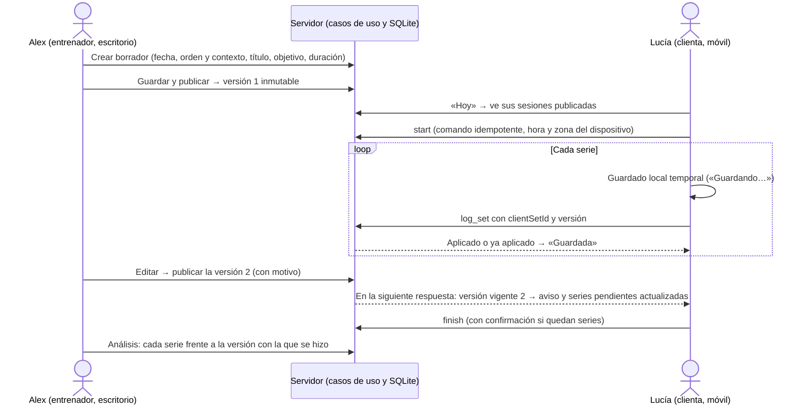
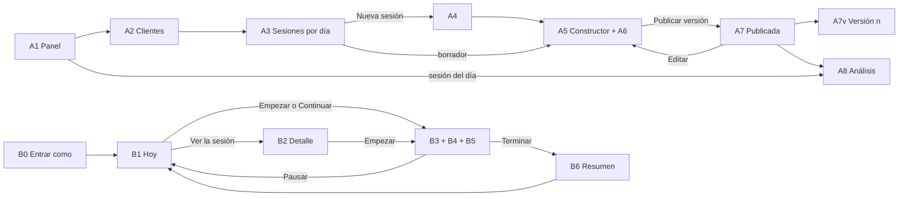
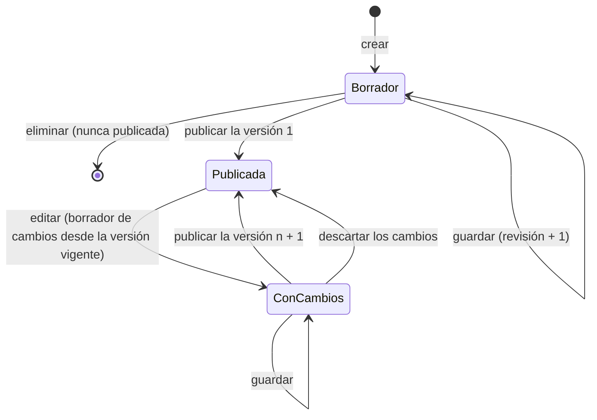

# V1 · Especificación técnica y funcional

> **Estado: versión 2 de la especificación, pendiente de aprobación (7 de noviembre de 2026). No autoriza a programar.** Sustituye a la primera versión (commit `57bf859`, que sigue en el historial de Git). El §0 resume qué ha cambiado y por qué.
>
> V1 es la primera entrega vertical de `IMPLEMENTATION_READINESS.md` §8: una sesión prescrita por serie, ejecutada en el móvil y analizada. Para no duplicar, este documento remite a:
>
> - bocetos del cliente: `TRAINING_EXPERIENCE.md` §6;
> - modalidades de carga y esfuerzo: `EFFORT_AND_LOAD.md`;
> - tipos v2 de referencia: `DATA_MODEL.md` §12;
> - decisiones: `DECISIONS.md` (P-76 a P-89).

## 0. Correcciones respecto a la versión anterior

| Tema                           | Antes                                                         | Ahora                                                                                                                                        | Motivo                                      |
| ------------------------------ | ------------------------------------------------------------- | -------------------------------------------------------------------------------------------------------------------------------------------- | ------------------------------------------- |
| Sesiones el mismo día          | Una por cliente y fecha (P-77)                                | Varias, cada una con su orden y su contexto («Mañana», «Club»…), su registro y su historial; análisis por sesión y total del día             | Tu indicación                               |
| Sesiones publicadas            | De solo lectura en V1 (P-78)                                  | Se editan publicando una versión nueva. Lo ya registrado queda bloqueado y ligado a su versión (§5.4)                                        | Tu indicación                               |
| Cambios con la sesión en curso | El cliente decidía cuándo actualizar (P-18)                   | Las series pendientes adoptan la versión nueva, con un aviso. El cliente no tiene que decidir nada                                           | No obligar al cliente a interpretar cambios |
| Fecha de ejecución             | Solo el día programado (P-83); cierre al acabar el día (P-17) | Cualquier día. Se distinguen la fecha prevista y las fechas reales. Una sesión sin terminar queda «Interrumpida» y se puede continuar (§5.5) | Tu indicación                               |
| Persistencia                   | En memoria: los datos se perdían al reiniciar (P-80)          | SQLite local en un archivo, con migraciones, transacciones y restricciones (§8.3, P-85)                                                      | Tu indicación, tras comparar alternativas   |
| Series después de medianoche   | Se rechazaban                                                 | Se aceptan siempre. Cuenta la hora real de la ejecución, con su zona horaria (§5.5)                                                          | Tu indicación                               |
| Identidad                      | «Cualquiera que abra `/entrenador` actúa como Alex»           | Identidad, rol y permiso separados; protección mínima del prototipo local y requisitos de cada etapa (§7)                                    | Tu indicación                               |
| Correcciones del cliente       | Hasta terminar la sesión o hasta el final del día             | Hasta terminar la sesión                                                                                                                     | Coherencia con las fechas libres            |
| Fecha al crear una sesión      | Entre hoy y dentro de 60 días                                 | Cualquier fecha, con aviso si ya ha pasado                                                                                                   | Era una limitación artificial               |

## 1. Especificación funcional

### 1.1 Qué hace V1

Un entrenador ficticio (Alex) prescribe sesiones serie a serie para una clienta ficticia, las publica y las corrige cuando hace falta. La clienta las ejecuta en el móvil, paso a paso, el día que las hace, y registra cada serie. El entrenador ve lo prescrito frente a lo realizado, por sesión y por día.

Los datos persisten en un archivo SQLite local. No hay cuentas, servicios externos ni costes.

| Entorno     | Incluye                                                                                                                                                                                                                                                                                                                                                                                                                                                                                                                      |
| ----------- | ---------------------------------------------------------------------------------------------------------------------------------------------------------------------------------------------------------------------------------------------------------------------------------------------------------------------------------------------------------------------------------------------------------------------------------------------------------------------------------------------------------------------------- |
| Entrenador  | Panel; clientes; ficha; crear sesiones (fecha, orden y contexto en el día, título, objetivo, duración y nota); varias sesiones el mismo día; añadir ejercicios de la biblioteca, ordenarlos y quitarlos; prescripción común y por serie (repeticiones o rango, carga, esfuerzo, descanso, tempo y observaciones); guardar el borrador; publicar; **editar una sesión publicada y publicar una versión nueva con motivo**; historial de versiones; vista publicada; análisis por sesión y por día                             |
| Cliente     | «Hoy», con el entrenamiento del día como protagonista y las demás sesiones del día debajo; detalle de la sesión; empezar cualquier sesión publicada (también de otro día); un ejercicio por pantalla con su tarjeta de prescripción; registrar cada serie con un toque; marcarla como no realizada; corregirla; descanso con temporizador; navegar entre ejercicios; progreso; pausar y continuar, también otro día; aviso cuando el entrenador cambia la sesión; terminar, también como parcial con confirmación; y resumen |
| Modalidades | Kilogramos, %1RM con referencia, peso corporal, peso corporal + lastre, asistida y sin carga externa. El modelo admite también rango de kg, bandas, dispositivos, carga autoseleccionada y «otra», que la interfaz ofrecerá en V5                                                                                                                                                                                                                                                                                            |
| Esfuerzo    | RIR, RPE con la escala basada en RIR o ninguno, por serie. Empieza sin objetivo: nunca se impone                                                                                                                                                                                                                                                                                                                                                                                                                             |

### 1.2 Preparación mínima, funcionalidad y aplazado

| Tipo                                               | Contenido                                                                                                                                                                                                                                                                                                                                                                                                                                                                                                                                                                                |
| -------------------------------------------------- | ---------------------------------------------------------------------------------------------------------------------------------------------------------------------------------------------------------------------------------------------------------------------------------------------------------------------------------------------------------------------------------------------------------------------------------------------------------------------------------------------------------------------------------------------------------------------------------------- |
| **Preparación mínima** (sin funcionalidad visible) | <ul><li>Base SQLite con una migración inicial y un adaptador de un solo archivo.</li><li>Repositorios de las entidades de V1.</li><li>Modelo de tiempo: instante en UTC más la zona horaria.</li><li>Tabla de comandos idempotentes.</li><li>Capa de compatibilidad para las pantallas existentes.</li><li>Protección del modo local.</li><li>Un archivo de datos por prueba E2E.</li></ul>Nada más: ni buses de eventos, ni colas genéricas, ni módulos vacíos                                                                                                                          |
| **Funcionalidad de V1**                            | La de §1.1 y las pantallas de §3                                                                                                                                                                                                                                                                                                                                                                                                                                                                                                                                                         |
| **Aplazado**                                       | <ul><li>Crear clientes y registrar evaluaciones (V3).</li><li>Semana, duplicar y evolución por ejercicio (V4).</li><li>Bandas, potencia, series por tiempo o distancia, calentamiento, saltar un ejercicio, y valoración previa y RPE de la sesión si apruebas Q2 (V5).</li><li>Registro completo sin conexión (IndexedDB) y conflicto entre dos dispositivos (V2).</li><li>Restricciones de fecha configurables por el entrenador, cancelar sesiones y actualización en tiempo real (más adelante).</li><li>Dolor (Q3: no en V1, ni campos ni motivos).</li><li>Clase B y 1C.</li></ul> |

**Respecto al plan de `IMPLEMENTATION_READINESS.md`:**

- V1 adelanta desde V2: las correcciones, la reanudación, dos sesiones el mismo día, editar una sesión publicada y el historial de versiones.
- Desde V3 adelanta «Entrar como…», si apruebas P-76.
- V2 queda con el registro completo sin conexión y el conflicto entre dos dispositivos.

### 1.3 Flujo completo entre entrenador y cliente



## 2. Mapa de pantallas y navegación

| Id  | Pantalla                                             | Ruta                                                                   |
| --- | ---------------------------------------------------- | ---------------------------------------------------------------------- |
| A1  | Panel                                                | `/entrenador`                                                          |
| A2  | Clientes                                             | `/entrenador/clientes`                                                 |
| A3  | Ficha · Sesiones                                     | `/entrenador/clientes/[clientId]/sesiones`                             |
| A4  | Nueva sesión                                         | `…/sesiones/nueva`                                                     |
| A5  | Constructor (borrador inicial o borrador de cambios) | `…/sesiones/[sessionId]/editar`                                        |
| A6  | Editor de ejercicio y series                         | Dentro de A5                                                           |
| A7  | Sesión publicada y versiones                         | `…/sesiones/[sessionId]` (pestañas Prescripción, Versiones y Análisis) |
| A7v | Una versión concreta                                 | `…/sesiones/[sessionId]/versiones/[number]`                            |
| A8  | Análisis                                             | `…/sesiones/[sessionId]/analisis`                                      |
| B0  | Entrar como… (P-76)                                  | `/` y aviso de demostración                                            |
| B1  | Hoy                                                  | `/cliente`                                                             |
| B2  | Detalle y resumen                                    | `/cliente/sesion/[sessionId]`                                          |
| B3  | Ejercicio actual (con B4 y B5)                       | `/cliente/sesion/[sessionId]/entrenar`                                 |
| B6  | Resumen                                              | Final de B3 y en B2 tras terminar                                      |



## 3. Pantallas

Se mantiene la línea visual de `DESIGN_SYSTEM.md`, sin cambios de identidad:

- **Fondos:** `cream-100` de fondo y superficies blancas.
- **Colores de acción:** `sun-400` en la acción principal y `sun-100` en la tarjeta de prescripción.
- **Estados:** `leaf` y `coral`; los cálculos, en `sky`.
- **Tipografía:** cifras grandes en Bricolage Grotesque.
- **Controles:** de 48 px o más en el móvil.
- **Diferencias:** siempre con icono y texto («≠ −1 rep.»).

En todas las pantallas:

- **Carga:** `loading.tsx` con esqueletos.
- **Error:** `error.tsx` con «Reintentar».
- **Recurso que no existe o no es del actor:** `404`, sin revelar si existe.

### A1 · Panel

- **Objetivo:** saber qué toca hoy y qué revisar.
- **Jerarquía:**
  1. Sesiones previstas para hoy de todos los clientes, varias por cliente si las hay, ordenadas por cliente y por orden en el día, con su estado.
  2. Sesiones interrumpidas.
  3. Borradores y borradores de cambios sin publicar.
  4. Lo que ya existe.
- **Acciones:** abrir el análisis, abrir un borrador, ir a Clientes.
- **Vacío:** «Hoy no hay sesiones previstas», con «Planificar una sesión».

### A2 · Clientes

Sin cambios: búsqueda sin tildes y tarjetas con la próxima sesión. Aparece Lucía si apruebas P-76.

### A3 · Ficha · Sesiones

- **Objetivo:** las sesiones del cliente, **agrupadas por fecha prevista**.
- **Cabecera de cada día:**
  - fecha;
  - «2 sesiones»;
  - el total realizado del día (series, repeticiones y tonelaje por tipo, §6).
- **Cada sesión del día**, en su orden:
  - contexto («Mañana»), título y objetivo;
  - insignias: Borrador · Publicada v2 · Cambios sin publicar;
  - estado de ejecución, series X de Y y, si se hizo otro día, «Hecha el viernes (1 día después)».
- **Acciones:**
  - «Nueva sesión» (general o «+ Añadir sesión a este día»);
  - subir y bajar el orden dentro del día;
  - según el estado: Editar, Ver, Análisis o Eliminar (solo los borradores que nunca se han publicado).
- **Vacío:** «Todavía no hay sesiones para Lucía».
- **Escritorio y móvil:** próximas y anteriores en dos columnas, o una sola lista por días.

### A4 · Nueva sesión

| Campo               | Regla                                                                                                                          |
| ------------------- | ------------------------------------------------------------------------------------------------------------------------------ |
| Fecha prevista      | Obligatoria; cualquier fecha. Si ya ha pasado: «La fecha ya ha pasado: Lucía la verá como pendiente de otro día»               |
| Contexto (opcional) | Hasta 40 caracteres, con sugerencias («Mañana», «Tarde», «Club», «Recuperación»). Sirve para distinguir sesiones del mismo día |
| Orden en el día     | Automático (al final del día); se cambia en A3                                                                                 |
| Título              | Obligatorio (1–80)                                                                                                             |
| Objetivo y duración | Opcionales aquí; obligatorios para publicar                                                                                    |

- **Acciones:** «Crear borrador», que lleva a A5.
- **Errores:** junto al campo, con el foco en el primero.

### A5 · Constructor de sesión

```
┌─ ← Sesiones · Lucía · Borrador de cambios (versión 2) · Guardado 10:32 ───────┐
│ ⓘ Lucía ha registrado 2 series con la versión 1. No cambian: los cambios       │
│   afectan solo a lo pendiente.                                                 │
│ Fecha [07/11]  Contexto [Mañana]  Título [Fuerza · pierna]  Objetivo […] 45 min│
├────────────────────────────────────────────────────────┬───────────────────────┤
│ ┌ A · Sentadilla trasera con barra ─────────── ↑ ↓ ┐   │ RESUMEN               │
│ │ Serie │ Repeticiones │ Carga   │ Esfuerzo │ Desc. │   │ 3 series · 18 rep.    │
│ │  1 🔒 │ Hecha 6      │ 80 kg   │ RIR 2    │ v1    │   │ Tonelaje 1.410 kg ⓒ   │
│ │  2 🔒 │ Hecha 6      │ 80 kg   │ RIR 2    │ v1    │   │ CAMBIOS FRENTE A v1   │
│ │  3    │ = 6          │ [75] kg │ = RIR 2  │ = 2:00│   │ · Serie 4 eliminada   │
│ │ [ − Quitar serie 4 ]  [ Personalizar series ]   │   │ · Serie 3: 80 → 75 kg │
│ └─────────────────────────────────────────────────┘   │ Motivo (opcional) […] │
│ [ + Añadir ejercicio ]                                  │ [Descartar cambios]   │
│                                                         │ [Publicar versión 2]  │
└────────────────────────────────────────────────────────┴───────────────────────┘
```

- **Dos modos:**
  - **Borrador inicial:** hasta la primera publicación.
  - **Borrador de cambios:** se abre con «Editar» desde A7 y parte de la versión vigente. La clienta sigue viendo esa versión hasta que publicas.
- **Aviso fijo según el caso (§5.4):**
  - A: «Lucía no ha empezado: verá la versión nueva».
  - B: «Lucía ha empezado pero no ha registrado ninguna serie».
  - C: «Lucía ha registrado N series. No cambian: los cambios afectan solo a lo pendiente».
  - D: «La sesión está terminada: la versión nueva queda como corrección posterior. El motivo es obligatorio».
- **Bloqueos visibles:** las series registradas aparecen con 🔒, lo que se hizo y la versión. No se editan. Un ejercicio con series registradas no se puede quitar ni cambiar de variante.
- **Panel derecho:**
  - totales previstos por tipo;
  - lista de comprobación;
  - en modo cambios, el resumen de cambios frente a la versión vigente y el motivo;
  - botones: «Guardar», «Descartar cambios» y «Publicar versión N».
- **Confirmación al publicar:** resume el efecto. Por ejemplo: «2 series registradas no cambian; 1 serie pendiente pasa de 80 a 75 kg; Lucía verá un aviso».
- **Guardado:**
  - indicador de estado;
  - aviso al salir con cambios sin guardar;
  - si otra pestaña cambió el borrador (revisión distinta): «Hay una versión más reciente».
- **Escritorio y móvil:** dos columnas, o una con una barra inferior fija con «Guardar» y «Publicar» y la lista desplegable.

### A6 · Editor de ejercicio y series (en A5)

La prescripción común va primero. La tabla por serie aparece al pulsar «Personalizar series», o si ya hay excepciones, así un caso sencillo no muestra una tabla.

| Campo                                             | Control                                                          | Aparece                             |
| ------------------------------------------------- | ---------------------------------------------------------------- | ----------------------------------- |
| Series                                            | Paso a paso de 1 a 50 (nunca por debajo de la última registrada) | Siempre                             |
| Repeticiones                                      | «Fijas» o «Rango», con sus valores                               | Siempre (tiempo y distancia, en V5) |
| Carga                                             | Modalidad y solo sus campos (§5.1)                               | Siempre                             |
| Esfuerzo                                          | «Sin objetivo», «RIR» o «RPE (escala basada en RIR)»             | Siempre; empieza sin objetivo       |
| Descanso                                          | m:ss con ±15 s, de 0 a 30 min                                    | Siempre                             |
| Tempo, observación para el cliente y nota privada | Texto con validación y explicación del tempo                     | En «Más opciones»                   |

- **En la tabla por serie:**
  - lo heredado se ve atenuado («= 60 kg»);
  - lo cambiado, sobre `sun-100`, con «↺ Volver al común»;
  - en el móvil, una tarjeta por serie.
- **%1RM:** referencia del cliente para esa variante, con su fecha y procedencia, y la previsualización «75 % de 100 kg → 75 kg (cálculo)». Sin referencia, la opción aparece desactivada y explica por qué (P-81).
- **Accesibilidad:** cada celda tiene su etiqueta («Repeticiones, serie 2») y la tabla tiene cabeceras.

### A7 · Sesión publicada y versiones

- **Cabecera:**
  - título, contexto, fecha prevista;
  - «Versión vigente 2 · Alex · 7 nov, 10:32»;
  - estado de ejecución;
  - fechas reales si las hay: «Empezada el 8 nov, 18:02 · terminada 18:51».
- **Pestaña Prescripción:** la versión vigente, de solo lectura y con la nota privada; botón «Editar», que abre A5 en modo cambios.
- **Pestaña Versiones** (lista):
  - número, autor, fecha y hora, motivo;
  - estado de la ejecución al publicarla: «sin empezar», «con 2 series registradas», «terminada»;
  - resumen de cambios;
  - cuántas series se hicieron con ella.
  - Cada versión se abre en A7v, una vista de solo lectura exacta.
- **Vacío de versiones:** solo la versión 1.

### A8 · Análisis de la sesión

```
Fuerza · pierna · Mañana · prevista el 7 nov · hecha el 7 nov (en su día)   [Completada]
Versiones usadas: v1 (series 1–2), v2 (serie 3) · 3 de 3 series · 49 min (incluye pausas)
Volumen, sin mezclar magnitudes
  Repeticiones          18 → 18           ⓒ training.total-reps 2.0.0
  Tonelaje externo  1.410 → 1.410 kg      ⓒ training.volume-load 2.0.0
A · Sentadilla trasera con barra
  Serie │ Versión │ Prescrito          │ Realizado          │ Diferencia
    1   │ v1      │ 6 × 80 kg · RIR 2  │ 6 × 80 kg · RIR 2  │ —
    2   │ v1      │ 6 × 80 kg · RIR 2  │ 6 × 80 kg          │ —
    3   │ v2      │ 6 × 75 kg · RIR 2  │ 6 × 75 kg · RIR 1  │ RIR 1 (previsto 2)
Total del día 7 nov: 2 sesiones · … (enlace a A3)
```

- **Jerarquía:**
  1. Estado y fechas: prevista frente a real, con el adelanto o retraso.
  2. Versiones usadas.
  3. Totales por tipo (§6).
  4. Tabla por ejercicio con la versión de cada serie.
  5. Series «fuera de la versión vigente» si las hay (§5.4).
  6. Comentario de la clienta.
- **Información por serie:** «✎ corregida», con los valores anteriores y la hora; la hora de ejecución, y «hora ajustada» si el reloj del dispositivo iba adelantado.
- **Vacío:** «Lucía aún no ha empezado esta sesión».
- **Sesión en curso:** aviso «En curso: los datos llegan al recargar». No hay tiempo real en V1.
- **Pendiente:** la evolución por ejercicio aparece como `PendingFeature` (V4).

### B0 · Entrar como… (si apruebas P-76)

- La portada ofrece «Entrar como Alex, entrenador», «Entrar como Marta, clienta» y «Entrar como Lucía, clienta».
- Solo existe con `TRAINPRO_MODE=local-demo` (§7).
- El aviso «Modo demostración · Estás viendo la app como Lucía · Cambiar» está siempre visible.
- **No es autenticación.**

### B1 · Hoy

- **Objetivo:** que el entrenamiento del día sea lo primero y se empiece con un toque.
- **Tarjeta protagonista**, una sola, elegida en este orden:
  1. La sesión en curso o interrumpida que se tocó por última vez (botón «Continuar entrenamiento · 4 de 9 series»).
  2. Si no hay ninguna, la primera sesión de hoy sin empezar, por orden en el día («Empezar entrenamiento»).
  3. Si no hay ninguna, la primera de hoy terminada («Ver resumen»).
- **Debajo:**
  - **«También hoy»:** las demás sesiones del día, con su contexto, título y estado (una línea cada una).
  - **«De días anteriores»:** sesiones sin terminar o sin hacer de los últimos 7 días, plegado y como mucho tres, con «Continuar» o «Hacerla ahora». Sin mensajes de culpa.
  - La próxima sesión, si hoy no hay ninguna.
- **Empezar una segunda sesión con otra en curso:** una confirmación: «Tienes "Mañana · Fuerza" a medias. Podrás continuarla después». La primera sigue en curso.
- **Vacío:** «Hoy toca descansar», con la próxima sesión.

### B2 · Detalle y resumen

- **Sin empezar:**
  - lista de ejercicios («3 × 10 · 60 kg · RIR 2») y «Empezar entrenamiento».
  - Si es de otro día: «Prevista para el jueves 12. ¿Empezar ahora?», con un solo toque de confirmación. Sin bloqueos (P-83).
- **Actualizada por el entrenador:** si cambió antes de empezar, insignia discreta «Actualizada por Alex».
- **En curso o interrumpida:** progreso, «Continuar» y «Terminar».
- **Terminada:** el resumen (B6).
- **Error:** `404` si no es suya o no está publicada; los borradores de cambios tampoco se ven.

### B3 · Ejercicio actual (boceto B de `TRAINING_EXPERIENCE.md`)

- **Contenido** (una pantalla por ejercicio):
  - cabecera con ✕ «Pausar», el título y el contexto, «2 / 6» y ☰ «Tu sesión»;
  - progreso «7 de 18 series»;
  - silueta y nombre;
  - tarjeta de prescripción de la serie actual, con CARGA y ESFUERZO en grande y ⓘ en borrador (Q6);
  - descanso, tempo y observación;
  - el registro de la serie (B4) y la lista de series.
- **Al volver:** se abre en el punto de reanudación (P-42) y un aviso breve dice «Seguimos en Sentadilla, serie 3».
- **Si el entrenador publica una versión nueva** (se detecta en la siguiente respuesta, al volver a la pestaña o al recargar):
  - aparece un aviso no bloqueante con borde `sun`: «Alex ha actualizado la sesión», con «Ver qué ha cambiado», una hoja en lenguaje claro que solo habla de lo pendiente;
  - las series pendientes muestran ya lo nuevo, y lo que la clienta había escrito sin enviar se conserva;
  - no hay que confirmar nada.
- **Acciones:** «Anterior» y «Siguiente ejercicio»; «Tu sesión», una hoja con todos los ejercicios y su estado para saltar a cualquiera; «Pausar», que vuelve a B1; y «Terminar sesión».

### B4 · Registro de una serie (boceto D)

- **«Serie 3 de 4»**, con lo prescrito ya rellenado:
  - la carga, en su modalidad (no hay campo de carga con peso corporal ni sin carga);
  - las repeticiones (el valor fijo o el mínimo del rango);
  - controles −/+ de 48 px que también admiten escribir.
- **Esfuerzo real:** solo si se prescribió, y opcional.
- **Observación:** plegada.
- **Acciones:** «Serie hecha», con un toque; «No la he hecho», secundario y sin motivo (Q3); y, tocando una serie guardada, «Corregir serie 2».
- **Estado de cada serie:** ○ Pendiente · ⏳ Guardando… · ✓ Guardada · ⚠ Sin enviar (se reintenta sola, y hay «Reintentar») · ✎ Corregida. Una serie que aún no está confirmada no se puede corregir.
- **Validación:**
  - repeticiones: de 1 a 100;
  - kg: de 0,5 a 500;
  - lastre y asistencia: de 0 a 200;
  - RIR: de 0 a 10;
  - RPE: de 1 a 10 en pasos de 0,5.
  - El error aparece junto al campo y la serie no se marca.

### B5 · Descanso (boceto E)

- **Cuándo aparece:** tras cada serie que tiene descanso, salvo la última de la sesión.
- **Contenido:**
  - cuenta atrás calculada con la hora de fin, que se guarda en el dispositivo y sobrevive a una recarga;
  - −15 s, +15 s y «Saltar»;
  - «A continuación…», con la siguiente serie o el siguiente ejercicio.
- **Al terminar:** vibra si se puede y lo anuncia una sola vez (`role="timer"`).
- **Movimiento reducido:** no hay animación si el usuario lo ha pedido.

### B6 · Resumen

- **Título:** «¡Sesión completada!» o «Sesión terminada parcialmente».
- **Contenido:**
  - series X de Y;
  - por ejercicio, lo prescrito frente a lo realizado;
  - repeticiones;
  - el comentario enviado.
- **Tonelaje:** solo si el entrenador comparte el volumen.
- **Corrección posterior** (caso D): si el entrenador corrigió la sesión después de que terminara, una nota: «Alex corrigió esta sesión después de que la terminaras. Lo que hiciste no cambia».
- **Origen de los datos:** los da el servidor.

## 4. Modelo de datos de V1

Esquema SQLite de la migración `001_v1.sql`. Concreta `DATA_MODEL.md` §4, §5 y §12, y se escribe en un subconjunto de SQL portable a PostgreSQL (§8.3).

**Convenciones:**

- **Identificadores:** `TEXT` con UUID; los datos sembrados conservan los suyos.
- **Fechas:** `TEXT` `AAAA-MM-DD`.
- **Instantes:** `TEXT` ISO 8601 en UTC (`…Z`).
- **Documentos JSON:** `TEXT`, validados al escribir y al leer, con un campo `schema`.
- **Booleanos:** `INTEGER` 0/1.

### 4.1 Tablas

| Tabla               | Columnas y tipos                                                                                                                                                                                                                                                                                                                                                                                                                                                                                                                                                                                 | Restricciones e integridad                                                                                                                                                                                                                                                                                                                                                                                                                                                        |
| ------------------- | ------------------------------------------------------------------------------------------------------------------------------------------------------------------------------------------------------------------------------------------------------------------------------------------------------------------------------------------------------------------------------------------------------------------------------------------------------------------------------------------------------------------------------------------------------------------------------------------------ | --------------------------------------------------------------------------------------------------------------------------------------------------------------------------------------------------------------------------------------------------------------------------------------------------------------------------------------------------------------------------------------------------------------------------------------------------------------------------------- |
| `schema_migrations` | `version INTEGER PK`, `name`, `applied_at`                                                                                                                                                                                                                                                                                                                                                                                                                                                                                                                                                       | Solo hacia delante                                                                                                                                                                                                                                                                                                                                                                                                                                                                |
| `meta`              | `key TEXT PK`, `value`                                                                                                                                                                                                                                                                                                                                                                                                                                                                                                                                                                           | `seed_date` y `seed_version`: los datos de referencia que siguen en el código (§4.3) se generan con esa fecha y no con la de hoy                                                                                                                                                                                                                                                                                                                                                  |
| `trainer`           | `id PK`, `display_name` (1–80)                                                                                                                                                                                                                                                                                                                                                                                                                                                                                                                                                                   | —                                                                                                                                                                                                                                                                                                                                                                                                                                                                                 |
| `client`            | `id PK`, `trainer_id → trainer`, `display_name` (1–80), `status` (`active`, `paused`), `population` (4 valores), `goal`, `sport`, `started_on`                                                                                                                                                                                                                                                                                                                                                                                                                                                   | `CHECK` en los enumerados. Datos ficticios                                                                                                                                                                                                                                                                                                                                                                                                                                        |
| `session`           | `id PK`, `client_id → client`, `trainer_id → trainer`, `planned_date`, `day_order INTEGER ≥ 1`, `label` (≤ 40, contexto), `status` (`draft`, `published`), `current_version INTEGER`, `draft_content` (JSON), `draft_base_version INTEGER`, `draft_revision INTEGER`, `created_at`, `updated_at`                                                                                                                                                                                                                                                                                                 | `CHECK ((status = 'draft') = (current_version IS NULL))`. **Varias por cliente y día**: índice (`client_id`, `planned_date`, `day_order`), sin unicidad. `planned_date`, `day_order` y `label` reflejan la versión vigente (o el borrador si nunca se ha publicado). Solo se borra si nunca se ha publicado                                                                                                                                                                       |
| `session_version`   | `id PK`, `session_id → session`, `number INTEGER ≥ 1`, `content` (JSON `SessionContent`), `published_at`, `published_by → trainer`, `reason` (≤ 300), `changes` (JSON, frente a la anterior), `execution_state` (`not_started`, `started_no_sets`, `in_progress`, `finished`)                                                                                                                                                                                                                                                                                                                    | `UNIQUE (session_id, number)`. **Inmutable**: disparadores que impiden `UPDATE` y `DELETE`. `reason` obligatorio si `execution_state = 'finished'`                                                                                                                                                                                                                                                                                                                                |
| `session_log`       | `id PK`, `session_id → session` **UNIQUE**, `client_id → client`, `started_at` (instante de ejecución), `start_device_at`, `start_time_zone`, `start_utc_offset_min`, `start_received_at`, `last_activity_at`, `finished_at`, `finish_device_at`, `finish_received_at`, `finish_reason` (`all_done`, `ended_early`), `pending_sets_confirmed INTEGER ≥ 0`, `comment` (≤ 500)                                                                                                                                                                                                                     | Una ejecución por sesión. Los campos de fin se rellenan todos a la vez o ninguno, y solo una vez                                                                                                                                                                                                                                                                                                                                                                                  |
| `set_log`           | `client_set_id TEXT PK`, `session_log_id → session_log`, `session_id`, `client_id`, `version_number`, `prescription_id`, `variant_id`, `set_number INTEGER ≥ 1`, `role` (`working`), `completed` 0/1, `reps INTEGER` (1–100), `load_kind` (`external`, `bodyweight`, `bodyweight_plus`, `assisted`, `none`), `load_kg REAL` (0–500), `rir INTEGER` (0–10), `rpe REAL` (1–10, pasos de 0,5), `rpe_scale` (`rir_based`), `note` (≤ 300), `supersedes → set_log` **UNIQUE**, `performed_at`, `device_recorded_at`, `device_time_zone`, `device_utc_offset_min`, `received_at`, `clock_adjusted` 0/1 | `FOREIGN KEY (session_id, version_number) → session_version (session_id, number)`. Una serie hecha tiene repeticiones y modalidad; una no realizada no tiene ninguna de las dos (`CHECK`). **Índice único parcial** (`session_log_id`, `prescription_id`, `set_number`) `WHERE supersedes IS NULL`: un único registro original por serie. Con `supersedes` único, cada serie forma una cadena lineal de correcciones. Solo se añade: disparadores que impiden `UPDATE` y `DELETE` |
| `client_command`    | `command_id TEXT PK`, `session_id`, `client_id`, `type` (`start`, `log_set`, `finish`), `payload_hash`, `received_at`                                                                                                                                                                                                                                                                                                                                                                                                                                                                            | Idempotencia de todos los comandos. En `log_set`, `command_id` = `client_set_id`. Inmutable                                                                                                                                                                                                                                                                                                                                                                                       |

**Documento `SessionContent`** (en `draft_content` y `session_version.content`):

- `schema: 1`, `plannedDate`, `dayOrder`, `label`, `title`, `focus`, `estimatedMinutes` y `coachNote`;
- `items[]`: `ExercisePrescriptionV2` de `DATA_MODEL.md` §12, más `variantName` (copia al publicar), `note` por serie y, en `percent_1rm`, `referenceResultId` y la resolución congelada (`referenceKg`, `referenceDate`, `kg`, fórmula y `resolvedAt`).

**Reglas del documento:**

- Los identificadores de los ejercicios (`items[].id`) son estables entre versiones. Una serie se identifica por (`prescription_id`, `set_number`) en todas las versiones.
- `privateNote` nunca sale en los contratos del cliente.

**No se crean en V1:**

- organizaciones, equipos asistenciales e integraciones;
- instrumentos genéricos y `decision_record`;
- `stopReason`, y campos de dolor o de molestias (Q3).

### 4.2 Comprobaciones de integridad

| Requisito                                     | Cómo se garantiza                                                                                                                                                                           |
| --------------------------------------------- | ------------------------------------------------------------------------------------------------------------------------------------------------------------------------------------------- |
| La serie ejecutada se vincula a la prescrita  | `set_log` guarda la versión, el ejercicio y el número de serie. La clave ajena exige que la versión exista, y el servidor comprueba que la serie existe en esa versión                      |
| Nada se duplica al guardar dos veces          | Mismo `client_set_id` y mismo contenido → «ya aplicado». Mismo identificador con otro contenido → `409`. Un segundo original de la misma serie → violación del índice único parcial → `409` |
| Se conserva la prescripción original          | Las versiones son inmutables (disparadores). El borrador de cambios es aparte y la versión vigente solo cambia al publicar                                                                  |
| Los cambios no destruyen lo realizado         | Los registros solo se añaden y se corrigen con `supersedes`. Las series registradas quedan bloqueadas en los borradores de cambios (§5.4). Las sesiones publicadas no se borran             |
| Prescrito y ejecutado se distinguen           | Tablas y contratos separados. El cliente no escribe prescripciones; el entrenador no escribe registros                                                                                      |
| Cargas y unidades coherentes                  | kg, segundos y metros. La carga realizada va en la modalidad prescrita (si no coincide, `422`). `CHECK` de rangos en la base y validación en el dominio                                     |
| No hay tonelaje con magnitudes no comparables | Solo suman los kg externos (externa y %1RM). El lastre y la asistencia tienen métricas propias (§6)                                                                                         |
| Las fechas no falsean el análisis             | Cada serie tiene su instante de ejecución y su zona horaria. La fecha de ejecución de la sesión es la local de su inicio (§5.5)                                                             |

### 4.3 Datos sembrados

- **Al crear la base** (primer arranque o «Restablecer datos demo»), se aplican las migraciones y se siembran:
  - Alex y sus clientes;
  - las sesiones actuales, como versión 1 publicada;
  - los registros, como `set_log`, con RIR por serie (P-84).
- **Si apruebas P-76:** Lucía Gil, sin historial.
- **Datos de solo lectura que siguen en el código hasta su fase**, generados con `meta.seed_date` para que sean coherentes con lo guardado:
  - la biblioteca;
  - los objetivos;
  - la readaptación;
  - lo compartido;
  - las evaluaciones, más el 1RM ficticio de Marta (P-81).

## 5. Reglas de prescripción, versiones, fechas y registro

### 5.1 Carga y esfuerzo

| Modalidad (V1)         | Campos del entrenador                                                     | Lo que ve el cliente            | Lo que registra                    | Tonelaje                    |
| ---------------------- | ------------------------------------------------------------------------- | ------------------------------- | ---------------------------------- | --------------------------- |
| Kilogramos             | kg (0,5–500)                                                              | «60 kg»                         | kg realizados                      | Sí                          |
| %1RM                   | % (1–100, pasos de 0,5), referencia y redondeo (0,5; 1; 1,25; 2,5 o 5 kg) | Los kg congelados               | kg realizados                      | Sí                          |
| Peso corporal          | —                                                                         | «Tu peso corporal»              | Nada                               | No                          |
| Peso corporal + lastre | kg añadidos (0,5–200)                                                     | «Tu peso + 5 kg»                | kg añadidos realizados             | No: «carga externa añadida» |
| Asistida               | kg de asistencia (opcional) y medio                                       | «La máquina te ayuda con 20 kg» | kg de asistencia (si se indicaron) | No: «asistencia»            |
| Sin carga externa      | —                                                                         | «Sin carga»                     | Nada                               | No                          |

**%1RM:**

- La fórmula es `training.percent-1rm-load` 1.0.0: un empate se redondea hacia abajo (P-41). Por ejemplo, 75 % de 107 kg = 80,25 → 80 kg.
- Los kg se congelan **en cada versión publicada**: una versión nueva vuelve a resolverlos con la referencia vigente y lo muestra.
- No hay ecuaciones de estimación del 1RM (P-23, P-50).

**Esfuerzo:**

- Empieza en «Sin objetivo». RIR y RPE no se combinan (con la escala basada en RIR serían el mismo dato).
- Los avisos siguen `EFFORT_AND_LOAD.md` §4.2.
- El cliente solo ve el campo de esfuerzo real si se prescribió esfuerzo.

**Valores que se distinguen siempre:**

| Tipo de valor                                                               | Procedencia                         |
| --------------------------------------------------------------------------- | ----------------------------------- |
| Objetivo prescrito                                                          | El entrenador, en una versión       |
| Lo realizado y lo que escribe el cliente                                    | `self_reported`                     |
| Calculado (kg del %1RM, totales, diferencias, duración, adelanto o retraso) | `calculated`, con fórmula y versión |
| Estimado                                                                    | Ninguno en V1                       |

### 5.2 Validaciones del constructor

| Nivel                    | Reglas                                                                                                                                                                                                                                                                                                                |
| ------------------------ | --------------------------------------------------------------------------------------------------------------------------------------------------------------------------------------------------------------------------------------------------------------------------------------------------------------------- |
| **Al guardar**           | Tipos y rangos iguales a los del registro (`EFFORT_AND_LOAD.md` §7.3): series de 1 a 50, repeticiones de 1 a 100, kg de 0,5 a 500 y descanso de 0 a 1800 s. Además: rango con mínimo < máximo, tempo de 3 o 4 fases, `perSet` coherente, variante visible para el entrenador y **ninguna serie bloqueada modificada** |
| **Al publicar**          | Título, objetivo y duración; de 1 a 30 ejercicios completos; %1RM con referencia; RPE con su escala; en el caso D, el motivo                                                                                                                                                                                          |
| **Avisos** (no bloquean) | RIR de 5 o más; RIR con más de 12 repeticiones; fecha prevista ya pasada; una serie con un esfuerzo distinto a las demás                                                                                                                                                                                              |

### 5.3 Estados de publicación



### 5.4 Versiones de una sesión publicada

**Principio:** nunca se modifica ni se reinterpreta lo que el cliente ya ha ejecutado.

- Cada versión publicada es inmutable.
- Cada serie registrada queda ligada a la versión con la que se hizo y se compara siempre con ella.
- El borrador de cambios no lo ve el cliente.

| Caso al publicar                        | Qué puede cambiar el entrenador                                                                                                                                                                            | Qué pasa                                                                                                  | Qué ve el cliente                                                                                                            |
| --------------------------------------- | ---------------------------------------------------------------------------------------------------------------------------------------------------------------------------------------------------------- | --------------------------------------------------------------------------------------------------------- | ---------------------------------------------------------------------------------------------------------------------------- |
| **A. Sin empezar**                      | Todo, también la fecha prevista, el orden y el contexto                                                                                                                                                    | La versión nueva sustituye a la anterior en todo                                                          | La versión nueva, con la insignia «Actualizada por Alex»                                                                     |
| **B. Empezada, sin series registradas** | Todo                                                                                                                                                                                                       | Igual que A; la ejecución sigue abierta                                                                   | En el reproductor, en la siguiente respuesta o al volver a la pestaña: aviso y prescripción nueva. No hay nada que confirmar |
| **C. Con series registradas**           | Las series pendientes y los ejercicios sin registros: todo. Las series registradas: nada (🔒). Un ejercicio con registros no se quita ni cambia de variante, y sus series no bajan de la última registrada | Lo registrado sigue ligado a su versión; lo pendiente adopta la nueva                                     | Aviso no bloqueante y «Ver qué ha cambiado», solo sobre lo pendiente. Lo hecho no cambia                                     |
| **D. Terminada**                        | Lo mismo que en C. En la práctica, los datos de la sesión, las notas y lo que quedó sin registrar. **El motivo es obligatorio**                                                                            | Queda como **corrección posterior a la ejecución**. El análisis sigue comparando con las versiones usadas | En el resumen: «Alex corrigió esta sesión después de que la terminaras. Lo que hiciste no cambia»                            |

**Cada versión guarda:**

- el número;
- la prescripción completa;
- el autor;
- la fecha y hora;
- el motivo (opcional, salvo en D);
- el resumen de cambios frente a la anterior;
- el estado de la ejecución al publicarla.

El análisis muestra las series ejecutadas con cada versión.

**Comandos con una versión anterior:**

- Si el cliente envía una serie con la versión que estaba viendo (por ejemplo, la tenía en la cola antes de enterarse del cambio), se acepta ligada a esa versión, siempre que esa serie exista en ella (S-07).
- Si en la versión vigente esa serie ya no existe, cuenta como realizada y aparece «fuera de la versión vigente». Es el único caso posible: el entrenador no puede quitar series registradas.

**Prescripción efectiva para el análisis:**

- Cada serie registrada se compara con su versión.
- Cada serie pendiente, con la vigente.
- **Completada** = todas las series de la versión vigente tienen un registro efectivo hecho, con cualquier versión.

Ejemplo (S-05): la versión 1 prescribe 4 × 6 × 80 kg; se registran las series 1 y 2; la versión 2 pasa a 3 × 6 × 75 kg y se registra la serie 3. Prescrito: 480 + 480 + 450 = **1.410 kg**. Realizado: 1.410 kg. Estado: completada (3 de 3).

**Lo que no hay en V1:** colaboración en tiempo real, avisos push ni la opción de comparar con una versión distinta de la usada.

### 5.5 Fechas y ejecución

**Modelo de tiempo (P-86):**

| Dato                            | Cómo se guarda                                                                                                                                                                              |
| ------------------------------- | ------------------------------------------------------------------------------------------------------------------------------------------------------------------------------------------- |
| Fecha prevista                  | `planned_date`, fecha local sin hora, en la zona horaria de la aplicación (P-66)                                                                                                            |
| Instantes                       | ISO 8601 en UTC para todo lo que ocurre: inicio, serie, fin, recepción y publicación                                                                                                        |
| Referencia local inequívoca     | Con cada instante del cliente, su zona horaria IANA (`Europe/Madrid`) y el desfase en minutos de ese momento                                                                                |
| Hora de ejecución de una serie  | La del dispositivo (`device_recorded_at`). Si es **posterior** a la recepción (el reloj iba adelantado), se usa la de recepción y se marca `clock_adjusted`. No hay más umbrales inventados |
| Fecha de ejecución de la sesión | La fecha local del inicio, en la zona del dispositivo. Una serie a las 00:02 pertenece a la sesión que empezó a las 23:50, y conserva su propia hora                                        |
| Adelanto o retraso              | Fecha de ejecución − fecha prevista, en días (`training.schedule-offset` 1.0.0). El entrenador lo ve («1 día después»); el cliente solo ve la fecha prevista, sin valoraciones              |

**Reglas:**

- **Cualquier sesión publicada se puede empezar cualquier día.**
  - La de hoy, con un toque.
  - La de otro día, con una confirmación ligera.
  - Las restricciones que configure el entrenador quedan para más adelante.
- **No hay cierre por fecha:**
  - una sesión sin terminar de otro día queda «Interrumpida» y se puede continuar o terminar;
  - una sesión sin empezar cuya fecha ya pasó queda «Sin hacer» y se puede hacer.
- **Medianoche:** ninguna serie se rechaza por la hora de llegada.
  - Cada comando lleva su identificador, la sesión, la hora del dispositivo, la zona y el desfase, y el servidor añade la recepción.
  - Los reintentos son idempotentes.
- **Historial y análisis:**
  - las listas ordenan por fecha prevista y muestran la fecha real;
  - los totales del día y de la semana se agrupan por **fecha de ejecución**, porque es cuando ocurrió la carga;
  - el cumplimiento de lo planificado («programadas frente a realizadas») se cuenta por **fecha prevista**.

### 5.6 Registro por serie

| Registro         | Datos                                                                                                                                                |
| ---------------- | ---------------------------------------------------------------------------------------------------------------------------------------------------- |
| **Serie hecha**  | `completed = 1`, repeticiones y la carga en su modalidad. Una serie con menos repeticiones de las previstas es una serie **hecha con diferencia**    |
| **No realizada** | `completed = 0`, sin repeticiones ni carga, con una observación opcional                                                                             |
| **Corrección**   | Un registro nuevo con `supersedes` igual al `client_set_id` del efectivo. Se permite hasta terminar la sesión (P-82) y el historial conserva los dos |
| **Efectivo**     | El que no ha sido sustituido. La misma función de dominio en el servidor y en el reproductor                                                         |

**Cuándo se puede registrar:** en una sesión publicada, del propio cliente y no terminada, cualquier día.

### 5.7 Guardado local temporal, persistencia confirmada y sincronización (Q4)

| Capa                        | V1                                                                                                                                                                                                                                        |
| --------------------------- | ----------------------------------------------------------------------------------------------------------------------------------------------------------------------------------------------------------------------------------------- |
| **Guardado local temporal** | En el móvil (`localStorage`): los comandos pendientes con su identificador y la hora de fin del descanso. Se conservan si se cierra la app o se pierde la conexión. Se borran al confirmarse o al salir del modo demostración (con aviso) |
| **Persistencia confirmada** | El servidor guarda el comando en una transacción SQLite y responde `200`. Es lo único que la interfaz llama «Guardada». Sobrevive a cerrar la app y a reiniciar el servidor                                                               |
| **Sincronización**          | En orden: al abrir el reproductor, con el evento `online`, al volver a la pestaña y con reintentos cada 2, 4, 8, 16 y 30 s, además de «Reintentar». Aviso al salir de la página con pendientes                                            |

**En V2:** IndexedDB, empezar o hacer toda la sesión sin conexión y el registro desde dos dispositivos.

### 5.8 Estados de ejecución

Se deducen de los registros efectivos y de las marcas de inicio y fin (ADR-16); no se guardan.

| Estado       | Condición                                                                                               | Etiqueta en las pantallas existentes (compatibilidad) |
| ------------ | ------------------------------------------------------------------------------------------------------- | ----------------------------------------------------- |
| Programada   | Sin ejecución y la fecha prevista es hoy o futura                                                       | Pendiente                                             |
| Sin hacer    | Sin ejecución y la fecha prevista ya pasó (se puede hacer)                                              | No realizada                                          |
| En curso     | Empezada, sin terminar, con actividad hoy                                                               | En curso                                              |
| Interrumpida | Empezada, sin terminar y sin actividad hoy (se puede continuar)                                         | Parcial o interrumpida                                |
| Completada   | Todas las series de la versión vigente hechas                                                           | Completada                                            |
| Parcial      | Terminada con series pendientes o no realizadas, tras la confirmación (`finish_reason = 'ended_early'`) | Parcial o interrumpida                                |

**Reglas:**

- **«Completada» solo si están todas las series.** Terminar con series pendientes exige `confirmEndEarly: true`. El servidor calcula el motivo y guarda cuántas series quedaban; sin la confirmación responde `409 confirmation_required`.
- **Volver atrás:** una versión nueva que añade series a una sesión completada sin terminar la devuelve a «En curso». Una corrección a «no realizada» también.

## 6. Análisis de V1

| Métrica                                 | Definición                                                                                                                       | Fórmula (nueva salvo indicación)                                                        |
| --------------------------------------- | -------------------------------------------------------------------------------------------------------------------------------- | --------------------------------------------------------------------------------------- |
| Series prescritas y realizadas          | Series de la prescripción efectiva frente a series efectivas hechas                                                              | `training.completed-sets` 1.0.0 (existe)                                                |
| Repeticiones                            | Σ de las series hechas, en ejercicios por repeticiones; los rangos, como mínimo y máximo                                         | `training.prescribed-volume` 1.0.0 y `training.total-reps` 2.0.0                        |
| Tonelaje externo                        | Σ repeticiones × kg externos                                                                                                     | `training.prescribed-volume-load` 1.0.0 y `training.volume-load` 2.0.0                  |
| Carga externa añadida (lastre)          | Σ repeticiones × kg de lastre                                                                                                    | `training.added-load-volume` 1.0.0                                                      |
| Asistencia                              | Media ponderada por repeticiones y número de series                                                                              | `training.assistance-summary` 1.0.0                                                     |
| Series sin carga externa                | Recuento                                                                                                                         | Existe (`setsWithoutExternalLoad`)                                                      |
| Por ejercicio, por sesión y **por día** | Las mismas métricas; el día suma las sesiones con esa **fecha de ejecución**, por tipo                                           | Las anteriores                                                                          |
| Programadas frente a realizadas         | Por fecha prevista: sesiones previstas, empezadas, completadas y parciales                                                       | `training.session-adherence` 1.0.0                                                      |
| Diferencias por serie                   | Repeticiones (0 dentro del rango), kg (si los dos están en kg) y esfuerzo (en la misma escala), frente a la versión de esa serie | `training.rep-deviation`, `training.load-deviation` y `training.effort-deviation` 1.0.0 |
| Fechas                                  | Adelanto o retraso; duración desde el inicio hasta el fin, **con las pausas**                                                    | `training.schedule-offset` y `training.session-elapsed` 1.0.0                           |
| Evolución por ejercicio                 | —                                                                                                                                | V4 (`PendingFeature`)                                                                   |

**Reglas de contabilización** (pruebas unitarias):

- Solo cuentan los registros efectivos: los reenvíos y las correcciones cuentan una vez.
- Las series no realizadas no suman ni repeticiones ni carga.
- Las series de cualquier versión cuentan como realizadas.
- Nunca se suman repeticiones de tipos distintos, ni tonelaje con lastre o asistencia, ni peso corporal × repeticiones.

**Magnitudes que no se confunden:**

- el volumen es el recuento de series y repeticiones por tipo;
- el tonelaje, la suma de repeticiones × kg externos;
- la carga interna (RPE de la sesión × minutos) no se calcula en V1: necesita Q2 y llega en la 1C.

Todo lo calculado lleva la insignia «Cálculo» con su fórmula, y nada se presenta como una medición.

## 7. Identidad, rol y permisos

| Concepto      | Qué es                                  | En V1                                                                                         | Después                                                    |
| ------------- | --------------------------------------- | --------------------------------------------------------------------------------------------- | ---------------------------------------------------------- |
| **Identidad** | Quién es la persona                     | Una persona ficticia elegida con «Entrar como…» (cookie). **No es autenticación**             | Una sesión verificada por el proveedor que se elija (P-02) |
| **Rol**       | Qué relación tiene con los datos        | Entrenador de unos clientes, o cliente vinculado a su ficha, según la semilla                 | Membresías en la base de datos                             |
| **Permiso**   | Qué puede hacer con un recurso concreto | Políticas de `access.ts` en cada caso de uso, con tests de lo permitido y de lo no autorizado | Las mismas, más RLS en PostgreSQL                          |

**En el código:**

1. `resolveIdentity()` (cookie demo ahora, sesión verificada después).
2. `resolveActor()` (roles desde la base).
3. Las políticas.

En la Fase 2 solo cambia el primer paso.

**Políticas de V1:**

| Política           | Permite                                                                                                                                             |
| ------------------ | --------------------------------------------------------------------------------------------------------------------------------------------------- |
| `canPlanForClient` | Al entrenador del cliente                                                                                                                           |
| `canEditSession`   | Lo anterior. En los borradores de cambios, nunca sobre series bloqueadas (`locked`)                                                                 |
| `canViewSession`   | Al entrenador (todo, también la nota privada y las versiones); al cliente, solo la versión vigente publicada, sin la nota privada ni los borradores |
| `canLogExecution`  | Al propio cliente, con la sesión publicada y no terminada, cualquier día                                                                            |
| `canReadExecution` | Al entrenador del cliente y al propio cliente                                                                                                       |

**Más reglas:**

- El `clientId` del registro sale siempre del actor, nunca del cuerpo de la petición.
- Un recurso que no es del actor responde `404`, sin revelar si existe.
- Las acciones de servidor comprueban los permisos dentro de cada acción.

**Etapas y protección mínima (P-87):**

| Etapa                                  | Quién accede                               | Datos                    | Protección imprescindible                                                                                                                                                                                                                                                                                                                                                                                                                                                                                                                                 |
| -------------------------------------- | ------------------------------------------ | ------------------------ | --------------------------------------------------------------------------------------------------------------------------------------------------------------------------------------------------------------------------------------------------------------------------------------------------------------------------------------------------------------------------------------------------------------------------------------------------------------------------------------------------------------------------------------------------------- |
| **1. Prototipo local** (V1 a 1C)       | Tú, en tu ordenador o en este entorno      | Solo ficticios           | <ul><li>Servidor escuchando solo en `127.0.0.1`. **Hoy `next start` escucha por defecto en `0.0.0.0`**, es decir, en toda la red local.</li><li>`TRAINPRO_MODE=local-demo`, obligatorio para que exista «Entrar como…».</li><li>El servidor rechaza un `Host` que no esté en `TRAINPRO_ALLOWED_HOSTS` (por defecto, `localhost` y `127.0.0.1`), también contra el DNS rebinding.</li><li>Comprobación de origen en las escrituras.</li><li>Aviso de demostración.</li><li>Archivo de datos solo legible por tu usuario.</li><li>Sin despliegue.</li></ul> |
| **2. Prueba con usuarios controlados** | Personas invitadas, con acceso desde fuera | Ficticios o de prueba    | <ul><li>Lo anterior **no basta**.</li><li>Autenticación real (P-02), con cookies `HttpOnly`, `Secure` y `SameSite`.</li><li>Cuentas por invitación y roles en la base de datos.</li><li>Políticas y RLS.</li><li>HTTPS y HSTS.</li><li>Límites de peticiones y CSRF.</li><li>«Entrar como…» eliminado de la compilación.</li><li>Registro de accesos, copias de seguridad y secretos fuera del repositorio.</li></ul>                                                                                                                                     |
| **3. Producto con clientes reales**    | Entrenadores y clientes reales             | Reales, también de salud | <ul><li>Lo anterior.</li><li>Revisión jurídica (P-13 a P-15).</li><li>Evaluación de impacto y contratos de encargo.</li><li>Región UE y cifrado en reposo.</li><li>Conservación y borrado.</li><li>2FA para entrenadores.</li><li>Revisión de seguridad (Fase 10a).</li></ul>                                                                                                                                                                                                                                                                             |

**Lo que no es autenticación:** una ruta poco conocida, un identificador difícil de adivinar (UUID) o una cookie de espacio. Tampoco la identidad demo de V1.

## 8. Arquitectura técnica

### 8.1 Lo que se reutiliza

| Capa           | Reutilizable                                                                                                                                                                                                                                                                    |
| -------------- | ------------------------------------------------------------------------------------------------------------------------------------------------------------------------------------------------------------------------------------------------------------------------------- |
| `src/domain`   | `RepTarget` y `Tempo` (ampliado a 3 fases), `prescriptionIssues`, `effectiveSetRecords`, `summarizeExecution`, `deriveSessionStatus` (ampliado a los estados del §5.8), `summarizeVolume`, `weeklyVolume`, fórmulas, `measurement`, `access`, `time`, `format`, `searchLibrary` |
| `src/server`   | `context` (se amplía), puertos (se amplían), servicios actuales (sin reescribir: leen a través de la compatibilidad), `mappers`                                                                                                                                                 |
| `src/ui`       | `Button`, `Card`, `Badge`, `Avatar`, `Stat`, `Meter`, `Notice`, `PageHeader`, `EmptyState`                                                                                                                                                                                      |
| `src/features` | `SessionStatusBadge`, `OriginBadge`, `PendingFeature`, `DemoBanner`, `PrescriptionChips`, `ExercisePictogram`, `RestIllustration`, `Shell`, `Nav`, `ClientTabs` y `BottomNav`. Del reproductor actual se reaprovechan el descanso, la fila de serie y el resumen                |
| Pruebas        | Ayudas de E2E y proyectos de escritorio y Pixel 7                                                                                                                                                                                                                               |

### 8.2 Lo que se crea

| Ubicación                                                                            | Contenido                                                                                                                                                                          |
| ------------------------------------------------------------------------------------ | ---------------------------------------------------------------------------------------------------------------------------------------------------------------------------------- |
| `src/domain/training/load.ts`, `effort.ts`, `session-v2.ts`                          | Prescripción v2, `resolveSets`, validaciones, %1RM, bloqueos y resumen de cambios entre versiones                                                                                  |
| `src/domain/training/execution.ts`, `analysis.ts`, `compat.ts`                       | Registros efectivos, estados, prescripción efectiva, totales por sesión y por día, y proyección para las pantallas existentes (temporal, hasta V4)                                 |
| `src/domain/time.ts` (ampliado)                                                      | Instantes con zona, hora de ejecución con el ajuste y fecha local de ejecución                                                                                                     |
| `src/server/db/sqlite.ts`                                                            | **El único archivo que importa el controlador SQLite**: abrir con las opciones (§8.3), `prepare`, `run`, `get`, `all` y `transaction`                                              |
| `src/server/db/migrations/001_v1.sql`, `migrate.ts`, `seed.ts`                       | Esquema del §4, aplicación ordenada y semilla                                                                                                                                      |
| `src/server/repositories/sqlite/*`                                                   | Repositorios de V1 que implementan los puertos; los resultados son explícitos (`ok`, `conflict`, `locked`, `duplicate_same`, `duplicate_different`)                                |
| `src/server/services/trainer-sessions.ts`, `client-execution.ts`                     | Casos de uso con políticas                                                                                                                                                         |
| `src/proxy.ts`                                                                       | Comprobación de `Host` del modo local (§7)                                                                                                                                         |
| `src/contracts/sessions.ts`                                                          | Modelos de vista y tipos de comandos (solo tipos)                                                                                                                                  |
| Rutas y API                                                                          | A3–A8 y `actions.ts`; `/cliente/sesion/[sessionId]/entrenar`; `/api/cliente/sesiones/[sessionId]/comandos` (POST) y `/estado` (GET)                                                |
| `src/features/trainer/session-builder/*`, `src/features/client/player/*`, `src/ui/*` | Los componentes de la primera versión, más `VersionList`, `ChangeSummary`, `LockedSetRow` y `VersionNotice`; `Stepper`, `Dialog`, `Sheet`, `SegmentedControl`, `Field`, `Skeleton` |

Se respetan las capas: los componentes de `features` reciben las acciones como propiedades y el reproductor usa `fetch`.

### 8.3 Persistencia (P-85)

**Requisitos:**

- no perder datos al cerrar y abrir la app ni al reiniciar el servidor;
- integridad de las restricciones;
- varios clientes ficticios;
- E2E reproducibles;
- sin servicios externos ni costes;
- poder migrar a PostgreSQL o Supabase.

**Comparativa:**

| Opción                                             | Persiste al reiniciar | Integridad                                                                             | Concurrencia                                                          | Dependencias y costes                              | Seguridad                                                        | Pruebas                                                | Migración a PostgreSQL                     | Mantenimiento                                                                       | Veredicto                                                                           |
| -------------------------------------------------- | --------------------- | -------------------------------------------------------------------------------------- | --------------------------------------------------------------------- | -------------------------------------------------- | ---------------------------------------------------------------- | ------------------------------------------------------ | ------------------------------------------ | ----------------------------------------------------------------------------------- | ----------------------------------------------------------------------------------- |
| Memoria del servidor (diseño anterior)             | No                    | Solo en el código                                                                      | Un proceso                                                            | Ninguna                                            | —                                                                | Fácil                                                  | —                                          | Bajo                                                                                | Descartada                                                                          |
| Archivo JSON en el servidor                        | Sí                    | **Solo en el código**: sin restricciones; escritura atómica por renombrado             | Un proceso, con exclusión mutua propia                                | Ninguna; 0 €                                       | Archivo local                                                    | Fácil                                                  | Script de exportación                      | **Alto**: sería programar una base de datos (unicidad, índices, cambios de formato) | Descartada                                                                          |
| **SQLite con `node:sqlite`** (integrado en Node)   | Sí                    | Transacciones ACID, `UNIQUE`, `CHECK`, claves ajenas, índices parciales y disparadores | Un escritor y lectores en paralelo (WAL): suficiente para un servidor | **Ninguna dependencia**; 0 €                       | Archivo local con permisos de usuario; solo consultas preparadas | `:memory:` en unitarias; un archivo por espacio en E2E | SQL portable; un adaptador nuevo para `pg` | Bajo: SQL estándar y un adaptador de un archivo                                     | **Recomendada**                                                                     |
| SQLite con `better-sqlite3`                        | Sí                    | Igual                                                                                  | Igual                                                                 | Dependencia nueva con módulo nativo; 0 €           | Igual, más la cadena de suministro                               | Igual                                                  | Igual                                      | Bajo; muy madura                                                                    | Alternativa si no se cambia de versión de Node                                      |
| PGlite (PostgreSQL en WebAssembly)                 | Sí                    | PostgreSQL completo                                                                    | Una conexión                                                          | Dependencia nueva y voluminosa; 0 €                | Igual                                                            | Un directorio por espacio                              | **Mínima** (mismo dialecto)                | Medio: proyecto más joven                                                           | No por ahora                                                                        |
| PostgreSQL local (o Supabase local)                | Sí                    | Completa                                                                               | Completa                                                              | Un servicio aparte (Docker) y el cliente `pg`; 0 € | Más superficie (puerto y credenciales)                           | Más lentas: una base por prueba                        | Ninguna                                    | Alto para un prototipo                                                              | En la Fase 2 (`INFRASTRUCTURE.md`)                                                  |
| Almacenamiento del navegador como fuente principal | Por dispositivo       | Débil                                                                                  | —                                                                     | Ninguna                                            | Datos repartidos por dispositivos                                | —                                                      | —                                          | —                                                                                   | Descartada: entrenador y cliente no comparten datos. Solo para la cola local (§5.7) |

**Comprobado en este entorno (7 de noviembre de 2026):**

- **Node 22.23.4 incluye SQLite 3.53.** `UNIQUE` y `CHECK` funcionan, y el módulo muestra el aviso «ExperimentalWarning».
- **Funciona con la compilación de Next.js 16.4.5 del proyecto** (Turbopack), en un componente de servidor y en un manejador de rutas. Lo comprobé con una prueba aislada, fuera del repositorio y ya borrada.
- **Estabilidad del módulo según la documentación oficial de Node.js:**
  - en Node 22: «1.1 · Active development», sin opción de activación desde la 22.13;
  - desde Node **24.15.0**: «1.2 · Release candidate» (en la rama 25, desde la 25.7.0).

**Recomendación:**

- SQLite con `node:sqlite`, **en Node 24 LTS (24.15 o posterior)**. Requiere cambiar `engines` y la versión de Node del entorno (P-85).
- Todo el acceso pasa por `src/server/db/sqlite.ts`. Si el módulo cambiara, pasar a `better-sqlite3` afectaría solo a ese archivo: las dos API son síncronas y muy parecidas.

**Configuración:**

- `journal_mode=WAL`, `synchronous=FULL` (no se pierde una transacción confirmada aunque se corte la luz), `foreign_keys=ON` y `busy_timeout=5000`.
- Archivo en `.data/trainpro.sqlite`, fuera de Git y con permisos `600`.
- En las E2E (`TRAINPRO_DEMO_SPACES=on`): `.data/e2e/<espacio>.sqlite`, creado y sembrado al primer uso y borrado al empezar cada ejecución.
- «Restablecer datos demo» vuelve a crear el archivo con la semilla de hoy.

**Migración a PostgreSQL o Supabase:**

| SQLite           | PostgreSQL    |
| ---------------- | ------------- |
| `TEXT` con UUID  | `uuid`        |
| Fechas `TEXT`    | `date`        |
| Instantes `TEXT` | `timestamptz` |
| JSON en `TEXT`   | `jsonb`       |
| `INTEGER` 0/1    | `boolean`     |
| `REAL`           | `numeric`     |

- Se conservan las mismas `CHECK`, claves ajenas e índices parciales.
- Los disparadores de inmutabilidad pasan a permisos y RLS.
- Los puertos ya son asíncronos: se escribe un adaptador nuevo y un script copia los datos ficticios si interesa conservarlos.

**Limitaciones que hay que aceptar:**

- **Un solo proceso de servidor:** no sirve para varias instancias ni para funciones sin servidor.
- **Sin cifrado en reposo ni copias automáticas:** se copia el archivo con `VACUUM INTO`. Por eso, solo datos ficticios.
- **Este entorno en la nube es efímero:** el archivo sobrevive a reiniciar el servidor y a cerrar y abrir la app, pero **no a que se vuelva a crear el entorno**. En tu ordenador persiste de verdad.
- **En Node 22 el módulo sigue siendo experimental.**
- **Los datos de referencia de la demo siguen en el código** hasta su fase (§4.3).

### 8.4 API de comandos del cliente (P-79)

**`POST /api/cliente/sesiones/{sessionId}/comandos`:** JSON, del mismo origen, un comando por petición. Cada comando lleva `device: { recordedAt, timeZone, utcOffsetMinutes }`.

```json
{ "commandId": "uuid", "type": "start", "device": { "recordedAt": "2026-11-07T22:50:01Z", "timeZone": "Europe/Madrid", "utcOffsetMinutes": 60 } }
{ "commandId": "uuid", "type": "log_set", "device": { "…": "…" }, "versionNumber": 1, "prescriptionId": "itm_…",
  "setNumber": 3, "completed": true, "reps": 9, "load": { "kind": "external", "kg": 60 },
  "rir": 1, "rpe": null, "note": null, "supersedes": null }
{ "commandId": "uuid", "type": "finish", "device": { "…": "…" }, "confirmEndEarly": false, "comment": "…" }
```

**`GET /api/cliente/sesiones/{sessionId}/estado?desde={versión}`:** devuelve el estado de la ejecución y la versión vigente y, si ha cambiado desde la indicada, el resumen de cambios de lo pendiente. Se usa al volver a la pestaña y al recuperar la conexión.

| Respuesta                                               | Cuándo                                                                                                                                                                                 |
| ------------------------------------------------------- | -------------------------------------------------------------------------------------------------------------------------------------------------------------------------------------- |
| `200 { result: 'applied' \| 'already_applied', state }` | Aplicado, o ya lo estaba. `state` incluye `currentVersion`                                                                                                                             |
| `400 bad_request`                                       | JSON no válido, tipo desconocido o faltan campos                                                                                                                                       |
| `403 forbidden_origin` · `403 forbidden_host`           | Origen o `Host` no permitidos                                                                                                                                                          |
| `404 not_found`                                         | La sesión no existe, no es del cliente o no está publicada                                                                                                                             |
| `409`                                                   | `closed` (terminada), `set_already_logged` (con el registro efectivo), `command_id_reused` (mismo identificador con otro contenido), `unknown_set_in_version`, `confirmation_required` |
| `413 payload_too_large`                                 | Más de 16 KB                                                                                                                                                                           |
| `422 invalid { issues }`                                | Rangos, modalidad o esfuerzo que no corresponden                                                                                                                                       |

**Por qué un manejador de rutas para el cliente:** según la guía de Next.js 16, los identificadores de las acciones de servidor cambian al desplegar y se envían de una en una. Una cola de reintentos necesita una URL estable.

**Las del entrenador son acciones de servidor**, que responden con estos códigos:

- `conflict` (revisión distinta);
- `locked` (serie o ejercicio bloqueado);
- `reason_required` (caso D);
- `not_found` e `invalid`.

### 8.5 Validación y errores

- **Sin bibliotecas nuevas (P-11):**
  - analizadores escritos a mano de `unknown` a tipos, que devuelven una lista de problemas;
  - validación de dominio con mensajes en español;
  - `CHECK` en la base como segunda barrera.
- **Resultados explícitos** en los casos de uso: `{ ok: true, value }` o `{ ok: false, code, issues? }`.
- **Cada capa los traduce:**
  - la ruta, a `notFound()`;
  - la acción, a estado de formulario;
  - la API, a código HTTP.
- **Errores inesperados:** `console.error`, sin datos personales, y `error.tsx`.

### 8.6 Next.js 16 (guía en `node_modules/next/dist/docs`)

- `params` asíncronos (`PageProps`, `RouteContext`).
- `cookies()` asíncrono; solo se escriben en acciones y manejadores de rutas.
- `refresh()` solo dentro de acciones.
- Las acciones de servidor se envían de una en una, son alcanzables con un POST y Next.js comprueba el `Origin`.
- `proxy.ts` sustituye al antiguo `middleware`.
- `next start -H` fija la interfaz de red; por defecto escucha en `0.0.0.0`.
- `useOffline` es experimental y no se activa.

## 9. Plan de implementación por bloques

Cada bloque termina con funcionalidad comprobable de extremo a extremo, `pnpm check`, `pnpm test:e2e` y un commit.

| Bloque                                               | Tareas                                                                                                                                                                                                                                                                                                                                                                                                                                                                                                                                                           | Al terminar se comprueba                                                                                                                                                                                                                                |
| ---------------------------------------------------- | ---------------------------------------------------------------------------------------------------------------------------------------------------------------------------------------------------------------------------------------------------------------------------------------------------------------------------------------------------------------------------------------------------------------------------------------------------------------------------------------------------------------------------------------------------------------- | ------------------------------------------------------------------------------------------------------------------------------------------------------------------------------------------------------------------------------------------------------- |
| **1 · Base persistente: Alex publica y Lucía lo ve** | <ul><li>**1.1** Dominio de prescripción v2 y de versiones (tipos, `resolveSets`, validaciones, bloqueos, resumen de cambios).</li><li>**1.2** SQLite: adaptador, migración `001`, semilla, repositorios, compatibilidad, espacios E2E y protección local (`-H 127.0.0.1`, `proxy.ts`, `TRAINPRO_MODE`).</li><li>**1.3** Casos de uso del entrenador (crear, guardar, publicar v1) con sus políticas.</li><li>**1.4** Constructor con prescripción común y vista publicada.</li><li>**1.5** Cliente: Hoy con varias sesiones, detalle y «Entrar como…».</li></ul> | <ul><li>Toda la batería actual en verde sobre SQLite.</li><li>Prueba de equivalencia de la compatibilidad.</li><li>Reinicio del servidor (E2E-20).</li><li>Publicar → aparece en Hoy, en Pixel 7.</li><li>Dos sesiones el mismo día visibles.</li></ul> |
| **2 · Ejecutar y registrar**                         | <ul><li>**2.1** Dominio de ejecución y modelo de tiempo.</li><li>**2.2** API de comandos y de estado.</li><li>**2.3** Reproductor por pasos.</li><li>**2.4** Cola local, sincronización, correcciones y series no realizadas.</li><li>**2.5** Terminar y resumen.</li></ul>                                                                                                                                                                                                                                                                                      | E2E-1 (lado del cliente), E2E-2 a E2E-6, E2E-9, E2E-10, E2E-18, E2E-19, E2E-21 a E2E-23                                                                                                                                                                 |
| **3 · Analizar**                                     | <ul><li>**3.1** Fórmulas y análisis por sesión y por día.</li><li>**3.2** A3 por días, A8 y panel.</li></ul>                                                                                                                                                                                                                                                                                                                                                                                                                                                     | E2E-1 completo y E2E-12                                                                                                                                                                                                                                 |
| **4 · Prescripción completa**                        | <ul><li>**4.1** Tabla por serie.</li><li>**4.2** Lastre, asistida y %1RM.</li><li>**4.3** Tempo y ayudas (borradores, Q6).</li></ul>                                                                                                                                                                                                                                                                                                                                                                                                                             | S-01 de principio a fin; 1B-18 y 1B-19                                                                                                                                                                                                                  |
| **5 · Editar sesiones publicadas**                   | <ul><li>**5.1** Borrador de cambios, bloqueos y publicación de la versión n + 1.</li><li>**5.2** Historial de versiones (A7 y A7v).</li><li>**5.3** Aviso al cliente y adopción de lo pendiente.</li></ul>                                                                                                                                                                                                                                                                                                                                                       | E2E-13 a E2E-17 (casos A–D y S-05 con 1.410 kg)                                                                                                                                                                                                         |
| **6 · Cierre y revisión (Q5)**                       | <ul><li>**6.1** Estados de carga y error, teclado, movimiento reducido, pruebas existentes adaptadas.</li><li>**6.2** `SCREEN_INVENTORY.md`, informe de V1 y revisión contigo.</li></ul>                                                                                                                                                                                                                                                                                                                                                                         | Calidad del §10.4                                                                                                                                                                                                                                       |

**Riesgos principales y su mitigación:**

| Riesgo                                            | Mitigación                                                                  |
| ------------------------------------------------- | --------------------------------------------------------------------------- |
| Diferencias sutiles en la capa de compatibilidad  | Prueba de equivalencia de los modelos de vista con la semilla               |
| Complejidad del constructor con series bloqueadas | Bloqueos en el dominio, probados por separado; la interfaz solo los refleja |
| Temporizadores y relojes en las pruebas           | El reloj de Playwright (`page.clock`) y un reloj inyectado en las unitarias |
| El módulo SQLite de Node 22 es experimental       | Node 24.15 o posterior (P-85) y un único archivo de acceso                  |

## 10. Pruebas y criterios de aceptación

### 10.1 Prueba integral (E2E-1)

Escritorio y Pixel 7, en un espacio de datos propio:

1. Alex crea para Lucía, hoy y en el contexto «Mañana», «Fuerza · pierna» (objetivo «Sentadilla», 40 min). Añade «Sentadilla trasera con barra»: 3 × 10 a 60 kg, RIR 2 y 2 min. El resumen dice **30 repeticiones** y **1.800 kg** previstos, como cálculo.
2. Guarda, recarga (sigue igual) y publica: «Publicada · versión 1».
3. Lucía entra en el móvil. «Hoy» muestra la sesión y «Empezar entrenamiento» sin desplazarse.
4. Serie 1: 10 × 60, «Serie hecha» → «Guardada» y descanso → «Saltar». Serie 2: 10 × 60.
5. **Cierra la página y la vuelve a abrir.** Hoy ofrece «Continuar entrenamiento · 2 de 3 series» y el reproductor abre la serie 3.
6. Serie 3: **9** repeticiones → «Terminar sesión», sin confirmación porque no falta nada.
7. El resumen dice «¡Sesión completada!», **3 de 3 series** y **29 repeticiones** (de 30).
8. Alex abre el análisis: «Completada», «hecha en su día», **30 → 29 repeticiones**, **1.800 → 1.740 kg**, y la serie 3 con «≠ −1 rep.».

### 10.2 Escenarios adicionales

| Id     | Escenario                                                                                                                                                                                                                                                                                                                                                                                 | Tipo |
| ------ | ----------------------------------------------------------------------------------------------------------------------------------------------------------------------------------------------------------------------------------------------------------------------------------------------------------------------------------------------------------------------------------------- | ---- |
| E2E-2  | **Doble toque** en «Serie hecha» → un registro. **Reenviar el mismo comando** por la API → `already_applied`; el análisis no cambia                                                                                                                                                                                                                                                       | E    |
| E2E-3  | **Sin conexión durante la sesión** → «Sin enviar»; al volver la conexión → «Guardada», sin duplicados                                                                                                                                                                                                                                                                                     | E    |
| E2E-4  | **Recarga durante el descanso** → el tiempo sigue (±1 s) y el punto de reanudación es correcto                                                                                                                                                                                                                                                                                            | E    |
| E2E-5  | **Navegación:** «Tu sesión» → otro ejercicio y vuelta; «Pausar» → Hoy con «Continuar»                                                                                                                                                                                                                                                                                                     | E    |
| E2E-6  | **Terminar antes** → confirmación; «Seguir entrenando» no cambia nada; «Terminar como parcial» → Parcial, con las series pendientes confirmadas                                                                                                                                                                                                                                           | E    |
| E2E-7  | **Permisos del cliente:** la sesión o la API de Marta, con la identidad de Lucía → `404`; un borrador o un borrador de cambios → no se ven; origen ajeno → `403`                                                                                                                                                                                                                          | E    |
| E2E-8  | **Validación del constructor:** sin ejercicios, rango 8–6, repeticiones vacías o %1RM sin referencia → bloqueado, con su mensaje                                                                                                                                                                                                                                                          | E    |
| E2E-9  | **Corrección:** la serie 2 pasa de 10 a 8 → el resumen y el análisis usan 8; el historial conserva el 10                                                                                                                                                                                                                                                                                  | E    |
| E2E-10 | **Serie no realizada** y terminar → Parcial (2 de 3), nunca «Completada»                                                                                                                                                                                                                                                                                                                  | E    |
| E2E-11 | **Accesibilidad y adaptación:** axe en A3–A8 y B1–B6; nada desborda a 360 px; el constructor se usa con teclado                                                                                                                                                                                                                                                                           | E    |
| E2E-12 | **Dos sesiones el mismo día:** «Mañana · Fuerza» (sentadilla 3 × 5 × 80 kg) y «Tarde · Press» (press de banca 2 × 8 × 40 kg).<br>- Lucía hace 2 series de la primera, empieza la segunda (confirmación) y la completa; luego termina la primera.<br>- Análisis: mañana **15 rep. y 1.200 kg**; tarde **16 rep. y 640 kg**; día **31 rep. y 1.840 kg**.<br>- Cada sesión, con su historial | E    |
| E2E-13 | **Versión antes de empezar (A):** la versión 2 cambia las repeticiones de 10 a 8 → Lucía ve 8 y la insignia «Actualizada»                                                                                                                                                                                                                                                                 | E    |
| E2E-14 | **Versión con la sesión empezada y sin series (B)** → aviso en el reproductor y la prescripción nueva, sin confirmar nada                                                                                                                                                                                                                                                                 | E    |
| E2E-15 | **Versión con series registradas (C, S-05):**<br>- La versión 1 prescribe 4 × 6 × 80; Lucía registra 2 series; la versión 2 pasa a 3 × 6 × 75.<br>- En el constructor, las series 1 y 2 están bloqueadas.<br>- Lucía ve el aviso y registra la serie 3 con 75 kg.<br>- Prescrito y realizado: **1.410 kg**; series 1–2 con v1 y 3 con v2; completada                                      | E    |
| E2E-16 | **Versión con la sesión terminada (D):** sin motivo → `reason_required`; con motivo → versión 3 «posterior a la ejecución»; el análisis no cambia y el resumen del cliente muestra la nota                                                                                                                                                                                                | E    |
| E2E-17 | **El historial de versiones se conserva:** A7v de la versión 1 es idéntica a la original tras publicar la 2 y la 3; la serie que se envió en cola con la versión 1 queda ligada a ella (S-07)                                                                                                                                                                                             | U, E |
| E2E-18 | **Inicio antes y después del día previsto:** una sesión de pasado mañana empezada hoy → «2 días antes»; una de ayer empezada hoy → «1 día después»; ningún bloqueo                                                                                                                                                                                                                        | E    |
| E2E-19 | **Después de medianoche:**<br>- Con el reloj del navegador, la sesión de ayer empieza a las 23:50 y registra series a las 23:58 y a las 00:03.<br>- Las dos se aceptan.<br>- La fecha de ejecución de la sesión es ayer, y la serie de las 00:03 conserva su hora.<br>- Unitaria: hora del dispositivo posterior a la recepción → se usa la de recepción, marcada                         | U, E |
| E2E-20 | **Reinicio del servidor:**<br>- Un servidor propio con un directorio de datos temporal: publicar y registrar dos series.<br>- Se detiene (`SIGTERM` y, en otra prueba, `SIGKILL`) y se arranca de nuevo.<br>- La sesión, las versiones y las dos series siguen ahí, y Hoy ofrece «Continuar».<br>- Unitaria: cerrar y abrir el archivo SQLite                                             | U, E |
| E2E-21 | **Cierre y reapertura con pendientes:** sin conexión, registrar una serie; cerrar la página; abrir otra con conexión → la cola se envía sola → «Guardada»; Alex la ve                                                                                                                                                                                                                     | E    |
| E2E-22 | **Reintentos:** las dos primeras peticiones fallan (`503`) → «Sin enviar», reintento → «Guardada»; un único registro                                                                                                                                                                                                                                                                      | E    |
| E2E-23 | **Duplicados:** la misma serie con otro identificador y sin `supersedes` → `409 set_already_logged`; el mismo identificador con otro contenido → `409 command_id_reused`                                                                                                                                                                                                                  | U, E |
| E2E-24 | **Permisos del entrenador y del modo local:** modificar una serie bloqueada con una acción → `locked`; el cliente no ve versiones ni notas privadas; `Host` ajeno → `403`                                                                                                                                                                                                                 | U, E |
| U-…    | **Dominio y servicios:**<br>- prescripción, versiones (bloqueos y prescripción efectiva), ejecución, los seis estados, tiempo (también el cambio de hora del 25 de octubre de 2026 en Madrid), análisis y compatibilidad;<br>- cada política con su caso no autorizado;<br>- S-12 (datos incoherentes);<br>- restricciones de SQLite (índice parcial, disparadores, `CHECK`)              | U    |

### 10.3 Comprobaciones aritméticas

| Caso                 | Cálculo                                                              | Resultado                         |
| -------------------- | -------------------------------------------------------------------- | --------------------------------- |
| Lucía, prescrito     | 3 × 10 = 30 rep.; 30 × 60                                            | **30 rep. · 1.800 kg**            |
| Lucía, realizado     | 10 + 10 + 9 = 29; (10 + 10 + 9) × 60                                 | **29 rep. · 1.740 kg** (−1 · −60) |
| S-05 (versiones)     | 6 × 80 + 6 × 80 + 6 × 75 = 480 + 480 + 450                           | **18 rep. · 1.410 kg**            |
| Dos sesiones, mañana | 3 × 5 = 15; 15 × 80                                                  | **15 rep. · 1.200 kg**            |
| Dos sesiones, tarde  | 2 × 8 = 16; 16 × 40                                                  | **16 rep. · 640 kg**              |
| Día                  | 15 + 16; 1.200 + 640 (mismo tipo de repeticiones y tonelaje externo) | **31 rep. · 1.840 kg**            |

### 10.4 Calidad y criterios

- **Criterios de `ROADMAP.md` que cumple V1:**
  - 1B-01, 1B-02, 1B-04, 1B-05 (P-76), 1B-12, 1B-13, 1B-16 y 1B-17 a 1B-20;
  - 1B-22, 1B-27 (sin calentamiento), 1B-30, 1B-31, 1B-34, 1B-35 (fuerza), 1B-38, 1B-40, 1B-41, 1B-48 y 1B-52 (RPE);
  - 1B-60 a 1B-68;
  - los escenarios S-01, S-03 a S-07 y la parte de fuerza de S-09.
- **Calidad:**
  - `pnpm check` y `pnpm test:e2e` en verde;
  - axe sin incidencias graves;
  - nada desborda a 360 px;
  - ninguna dependencia nueva (salvo lo que decidas en P-85);
  - lo simulado, marcado con `PendingFeature`.

## 11. Decisiones

### 11.1 Requieren tu aprobación expresa (lista reducida)

| Id       | Pregunta                                                                                                                              | Recomendación                                                                                                                    | Alternativas                                                                                                          |
| -------- | ------------------------------------------------------------------------------------------------------------------------------------- | -------------------------------------------------------------------------------------------------------------------------------- | --------------------------------------------------------------------------------------------------------------------- |
| **Q1**   | ¿Apruebas el alcance de V1 de este documento (§1), con varias sesiones al día, edición con versiones, fechas libres y persistencia?   | Sí                                                                                                                               | Quitar algo y llevarlo a V2                                                                                           |
| **P-85** | ¿Con qué se guarda: SQLite con `node:sqlite` en Node 24 LTS (24.15 o posterior)?                                                      | Sí: sin dependencias nuevas y con el módulo como candidato a estable. Hay que cambiar `engines` y la versión de Node del entorno | <ul><li>Node 22, aceptando el aviso experimental.</li><li>`better-sqlite3`, una dependencia nueva y madura.</li></ul> |
| **Q4**   | ¿Basta en V1 con el guardado local temporal y la confirmación del servidor (§5.7), dejando el registro completo sin conexión para V2? | Sí                                                                                                                               | Adelantar IndexedDB a V1                                                                                              |
| **P-76** | ¿El flujo de V1 se hace con Lucía, clienta ficticia nueva, con «Entrar como…» en V1?                                                  | Sí                                                                                                                               | Marta, que tiene historial sembrado; «Entrar como…» en V3                                                             |

### 11.2 Resueltas por tus indicaciones

| Decisión                           | Resolución                                                                      |
| ---------------------------------- | ------------------------------------------------------------------------------- |
| **P-77 (revisada)**                | Varias sesiones por cliente y día, con orden y contexto. Sin límite             |
| **P-78 (revisada)**                | Las sesiones publicadas se editan con versiones nuevas, con las reglas del §5.4 |
| **P-83 (revisada)**                | Se empiezan cualquier día; la de otro día, con una confirmación ligera          |
| **P-17 (revisada)**                | Sin cierre por fecha: «Interrumpida» y se puede continuar                       |
| **Medianoche y persistencia real** | Aceptar siempre la serie; guardar los datos en disco (el motor, en P-85)        |

### 11.3 Técnicas, que aplicaré salvo que te opongas

| Decisión                       | Resolución                                                                           |
| ------------------------------ | ------------------------------------------------------------------------------------ |
| **P-18 (revisada)**            | Lo pendiente adopta la versión nueva automáticamente, con un aviso                   |
| **P-79**                       | Acciones de servidor para el entrenador; API de comandos y de estado para el cliente |
| **P-80 (sustituida por P-85)** | Espacios E2E como archivos separados                                                 |
| **P-81**                       | Referencia del %1RM por variante, con el 1RM ficticio de Marta                       |
| **P-82 (revisada)**            | Correcciones hasta terminar la sesión                                                |
| **P-84**                       | RIR por serie en la semilla                                                          |
| **P-86**                       | Modelo de tiempo (§5.5)                                                              |
| **P-87**                       | Protección del prototipo local (§7)                                                  |
| **P-88**                       | Bloqueos por series registradas y motivo obligatorio en el caso D                    |
| **P-89**                       | Totales del día por fecha de ejecución; cumplimiento por fecha prevista              |

### 11.4 Aplazables

- Registro completo sin conexión y conflicto entre dos dispositivos (V2).
- Restricciones de fecha configurables por el entrenador.
- Zona horaria por cliente (P-66).
- Cancelar o eliminar sesiones publicadas.
- Actualización en tiempo real.
- Registrar sesiones no planificadas.
- Comparar con una versión distinta de la usada.
- Normalizar en tablas los ejercicios de las versiones (hoy van en JSON).

**Sin cambios:** Q2, Q3, Q5 y Q6. No hay registro estructurado de dolor en V1.

## 12. Primer bloque de código recomendado

Bloque 1, por este orden:

1. **Tarea 1.1:** el dominio de prescripción v2 y de versiones. Es TypeScript puro con pruebas.
2. **Tarea 1.2:** SQLite con su migración, la semilla, los repositorios, la compatibilidad, los espacios E2E y la protección local.
   - Es la base de todo lo demás y la parte con más riesgo de romper lo que ya funciona.
   - Se da por buena cuando la batería actual pasa sobre SQLite, la prueba de equivalencia confirma que las pantallas existentes no cambian y el reinicio del servidor no pierde nada.
3. **Tareas 1.3 a 1.5:** completan el primer flujo visible. Alex publica una o varias sesiones el mismo día y Lucía las ve en el móvil, con los datos guardados de verdad.

No incluye todavía ni el registro, ni el análisis, ni la edición de versiones. Así no se construye ninguna infraestructura que no use el primer flujo.
